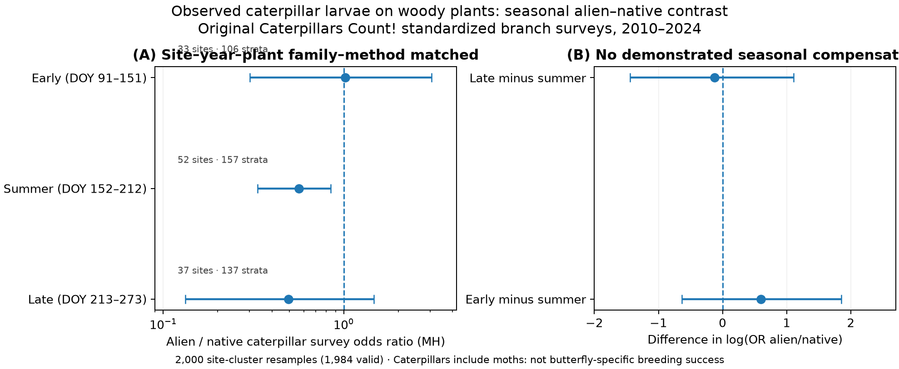

# Realized caterpillar use of native versus alien woody hosts through the season

**2026-10-26 | independent original field data, source-locked exploratory analysis | no claim of actual butterfly population change or competition.**

## What is newly evaluated, versus what belongs to original authors

Whitener et al. (2026), *Ecosphere*, DOI [10.1002/ecs2.70615](https://doi.org/10.1002/ecs2.70615), already demonstrated nearly fourfold greater caterpillar (larval Lepidoptera, not necessarily butterflies) occurrence on native relative to alien woody plants in ~70,000 original June–July branch surveys. This is original authors' evidence of a gap between plant **presence** and actual **Lepidoptera larvae observed on leaves**, not an original chocho result.

Our distinct **exploratory temporal test** asked whether the alien/native larval field-occupancy gap narrows after midsummer, potentially contributing a complementary time niche in the observed larval community. We prespecified early (DOY 91–151), peak (152–212), late (213–273) *before reading raw source outcomes*, matching original survey units at exact **site×year×botanical family×observation method×season** and treating observed caterpillars as binary branch-survey detections, not larval production or survival. The original published June–July source count **68,741** was reproduced exactly. Original raw source and taxon-origin join use immutable [hurlbertlab/caterpillars-on-plants](https://github.com/hurlbertlab/caterpillars-on-plants) commit 2c5690ac7c6dba7eca506da886c49781c37617bd, file Git blob SHA 5e9f8c8c98b7e941c53a3ba32baf9be9f6d0692d. This source has 274,530 arthropod-sighting rows and 107,213 branch survey IDs passing the original study-area / leaf-dry quality filter.

## Exact fixed season sample gate

| Season | Original source eligible branch surveys (all known hosts) | Matched family×site×year×method strata | Distinct matched sites | Native branches | Alien branches | Native branches with caterpillar | Alien branches with caterpillar |
|---|---:|---:|---:|---:|---:|---:|---:|
| Early spring–late spring (DOY 91–151) | 23,010 | 106 | 33 | 1,321 | 544 | 62 | 25 |
| Mid-summer original reference (DOY 152–212) | 68,741 | 157 | 52 | 2,176 | 1,199 | 121 | 24 |
| Late summer (DOY 213–273) | 13,945 | 137 | 37 | 1,127 | 593 | 73 | 14 |

Every predeclared source availability gate was met; observations outside windows were not used to infer missing positives/zeros. Plants are classified native/alien by original authors' taxonomic dictionary. No guessed butterfly species identity, site coordinates or individual original survey rows are uploaded.

## Source-matched caterpillar larval detection result

For each season, Mantel–Haenszel pooled odds ratio alien/native with *local site-year-family-method exact matching*. Uncertainty comes from 2,000 distinct-site resamples with replacement, deterministic seed 20261026. **1,984/2,000** joint season draws yielded a finite MH odds ratio in all three windows, 16 were degenerate; no pseudo-count added.

| Seasonal caterpillar larval detection | Matched alien/native OR | 95% site-cluster bootstrap OR interval |
|---|---:|---:|
| Early spring | +1.019 | 0.302–3.063 |
| **Peak June–July** | **0.563** | **0.333–0.846** |
| Late summer | 0.495 | 0.132–1.469 |

The **main prespecified late-vs-peak log-OR contrast was −0.12854**, with a 95% site-cluster bootstrap interval **−1.44380 to +1.10414**; the corresponding late/peak odds-ratio ratio was **0.879**. This does **NOT** establish seasonal recovery/compensation of larval occurrence on alien hosts. The secondary early-vs-peak log-OR contrast was +0.59391, bootstrap interval **−0.63228 to +1.84914**, equally inconclusive. Wide intervals are expected from only 14–25 alien positive source surveys in each matched season.

The additional *visual-observation-only* sensitivity met per-season raw source counts but only **1,675/2,000** site bootstraps yielded finite matched MH odds ratios in all three seasons. The prespecified uncertainty gate requires ≥1,900 and therefore classifies this sensitivity **NOT IDENTIFIABLE**, rather than using its potentially impressive point estimates to support a cherry-picked temporal niche.

## What survives scientifically

1. **Strong empirical evidence from original published work** establishes that plant introduction status is associated with substantial differences in realized *Lepidoptera caterpillar branch occupancy*, even when more potential host plant geography exists. The new source-matched midsummer comparison gives OR 0.563 (site bootstrap 0.333–0.846), demonstrating that lower alien-plant field use remains after controlling **site×year×plant family×method**. This is a source-conditional, observational *plant-origin proxy*, not a plant-species-causal contrast, and the previously published June–July conclusion already points in the same direction.
2. **No convincing temporal rescue**: the relative alien/native caterpillar detection deficit did **not demonstrably narrow** in the late window; corresponding source uncertainty includes substantial benefit and harm. No special alien-host temporal subsidy or out-of-season "good invasive" conclusion follows.
3. **Butterfly-specific causal interpretation is not identified**: many caterpillars are moths; the field survey's Group label does not provide a reliable accepted butterfly binomial or the identity of individual caterpillar diet transitions. Even a photographed larval presence does not measure arrival of an invasive host, completed egg-to-adult development, the butterfly count at that plant site, or competition among larvae.
4. **Mechanistic inference still requires edible leaf biomass and timing**, independently measured plant age/quality, butterfly-specific larval identification, and observed survival or emergence. Neither the original US adult transects (Illinois source branch) nor the original HOSTS/WCVP potential-resource map has those linked, verified fields.

## Model method and representativeness limits

Original caterpillar sightings were collapsed to survey ID, avoiding sighting-row pseudoreplication. Matching controlled regionally varying site and year, plant botanical family and observation method, but **not exact woody plant species identity** (origin is plant-species-level, and species fixed effects would remove the origin contrast). Seasonal community/plant composition changes, citizen observer detectability, weather, branch age and caterpillar taxonomic composition can yield these ORs. Site-level bootstrap does not remove correlated within-site year and plant-family sampling; uncertainty is conditional on 57 sites represented in all three seasonal matched source panels, not a global biological sampling frame.

The original published Whitener et al. native-versus-alien analysis and this exploratory season contrast should be represented as **independent empirical context** for why butterfly *potential resource geography* need not become realized productive larval niches; NOT merged into the frozen GEB paper as novel butterfly recruitment evidence. Do not test new DOY bins or site filters after observing the late-vs-peak interval.

## Exact original source and results
- [Fixed protocol](../../provenance/reviewer_defenses/protocols/CATERPILLAR_NATIVE_ALIEN_SEASON_MATCHED_SOURCE_20261026.md)
- [Source 77MB / original summer denominator QC](../../provenance/reviewer_defenses/results/caterpillars_count_native_alien_season_source_gate_20261026.json)
- [Full matched seasonal OR / 2,000 bootstrap receipt](../../provenance/reviewer_defenses/results/caterpillars_count_native_alien_seasonal_larval_MH_20261026.json)
- [Source reproduction workflow](https://github.com/zuizui0223/chocho/actions/runs/40310078311)
- [Seasonal original-data model workflow](https://github.com/zuizui0223/chocho/actions/runs/40310452124)

Separate newly published Western monarch Dryad 2026 DOI 10.5061/dryad.4j0zpc8q5 (eggs and L1–L5 on 7 milkweeds across five western states) was audited in branch analysis/monarch-host-stage-realization-20261026; metadata was verified, but the Dryad API zip path returned 401 and the publicly documented file-stream retrieval returned 403 on this runner. **No egg/larva-stage result was computed from that blocked source.** This availability failure is not biological absence and requires authenticated permission or another openly distributable source before individual butterfly-stage inference.

## Photo-expert butterfly-species identity gate: **not adequate for a butterfly-specific inference**

A separate source-blind *taxonomic identifiability* gate was frozen before checking expert photo taxa: [protocol](../../provenance/reviewer_defenses/protocols/CATERPILLARS_COUNT_EXPERT_BUTTERFLY_SPECIES_ID_GATE_20261026.md). It queried the original source's 2025-06-17 expert identifications (Git blob SHA a5d5ff967ddfc79a6e11abb7bab9fae4354e11ca), without guessing or taxonomically broadening the original 239 accepted butterfly names.

[Verified expert source receipt](../../provenance/reviewer_defenses/results/caterpillars_count_expert_exact_butterfly_id_gate_20261026.json) finds **17,341** photo expert identification records, including **2,564** source-group *caterpillar* sightings; **866** of these had a source species-rank identification, spanning **101** taxa. But **only 15 sightings belonging to a single identified butterfly species** match any of the originally fixed **239 chocho butterflies** exactly. This is far below the predeclared gate of 20 individual sightings across at least 10 distinct butterfly species. It is a **source taxonomic-identifiability limitation**, not an absence of those species in nature.

The first attempts failed because the expert source has the field \`StandardGroup\`, not \`Group\`. The source field mapping was corrected in the protocol and script **before the species-overlap counts were inspected**, with the source Git identity and all biological thresholds unchanged. [Corrected expert source CI](https://github.com/zuizui0223/chocho/actions/runs/40311570733) passed.

**Final butterfly-specific claim:** NOT IDENTIFIABLE using this source. Do not treat the significant/suggestive broad larval Lepidoptera plant-origin signal as original-data evidence of any butterfly species’ egg-to-adult recruitment, population expansion or interspecific larval competition.

## Final figure / numerical reproducibility

[Final visually inspected PNG](figures/CaterpillarsCount_seasonal_native_alien_field_use_20261026.png) · [SVG](figures/CaterpillarsCount_seasonal_native_alien_field_use_20261026.svg). The final [figure CI](https://github.com/zuizui0223/chocho/actions/runs/40311455503) passed after correcting axis-title annotation overlap, with the underlying source and bootstrap numbers unchanged.

The source identity/season gate [40310078311](https://github.com/zuizui0223/chocho/actions/runs/40310078311), exact source-matched Mantel–Haenszel site-bootstrap regression [40310452124](https://github.com/zuizui0223/chocho/actions/runs/40310452124), final figure [40311455503](https://github.com/zuizui0223/chocho/actions/runs/40311455503) and expert butterfly-specific availability gate [40311570733](https://github.com/zuizui0223/chocho/actions/runs/40311570733) have all passed.

The independently published, well-suited monarch milkweed/egg/L1–L5 Dryad source DOI 10.5061/dryad.4j0zpc8q5 remains source-metadata identifiable but **not anonymously downloadable** in this test: dataset ZIP REST returned HTTP 401, and current individual published file_stream returned 403. No Dryad juvenile stage rows were inspected or used to make results. Never assume the biological question was tested on that dataset.
