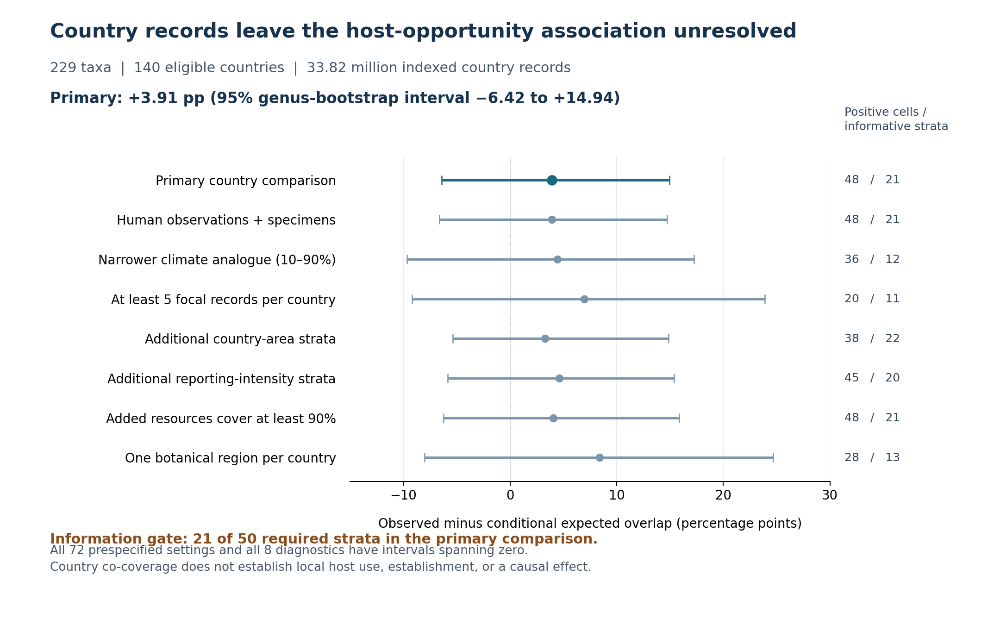

# Full-index country records leave the realized-butterfly association unresolved

**20 October 2026 — completed exploratory analysis.** The independent
country-grain acquisition and all specified comparisons have finished. The
primary estimate is **+3.91 percentage points**, with a genus-bootstrap 95%
interval of **−6.42 to +14.94 pp**. Only **21 informative strata** contribute,
below the prospectively stated minimum of 50. This is evidence of unresolved
precision and restricted scope, not evidence that the biological effect is zero.

## What was advanced

The four apparently successful 96-species recovery jobs had returned only one
completed taxon, zero usable mapped records and 95 incomplete taxa. That lone
taxon, Chlosyne lacinia, used the transcribed key 1914469 instead of the frozen
source key 1914465. The identity-preserving merge correctly rejected it. The
key is corrected and every recovery key is now checked against the original
manifest before requests begin. The original merge protection remains intact.

Ordinary occurrence bodies still truncate at the transport layer, including
75-, 15- and 10-record requests. Repeating the full failed recovery was stopped.
Compact country facets then provided a separate feasible route to the full
matching live index. This does **not** recover the missing WGSRPD3 samples and
changes the spatial estimand. The country protocol, exclusions and analysis
code were frozen before the country association was calculated; see the
[protocol](../../provenance/reviewer_defenses/protocols/GBIF_COUNTRY_FULL_INDEX_MACRO_20261020.md)
and [code freeze c792732](https://github.com/zuizui0223/chocho/commit/c792732b8c18dfbb61bd89bbbddf6b483e42816e).

## New source and analysis population

| Source accounting | Completed quantity |
| --- | ---: |
| Original butterfly names retained in source audit | 239 |
| Resolved names with both windows and both basis scopes complete | 231 |
| Completed country-facet queries | 924 / 924 |
| Original unresolved names | 8 |
| Non-colliding accepted-key taxa in ecological analysis | 229 |
| Country-assigned records, accepted bases, 229 taxa | 33,817,891 |
| Country-assigned records, core bases, 229 taxa | 33,621,039 |
| Country/territory codes represented in the source | 238 |
| Countries meeting the fixed geography/climate-source criteria | 140 |
| Eligible countries with any retained taxon record | 139 |
| Accepted-base records in eligible countries | 25,558,968 |

Oeneis bore and Oeneis polixenes share accepted key 9804158. Both are excluded
before ecological outcomes are examined; neither is chosen arbitrarily as the
representative resource catalogue. All original unresolved taxa and rejected
geographic units remain missing, rather than ecological negatives.

The source comprises 2010–2017 and 2018–2025 country facets with coordinates,
no GBIF geospatial issue and status PRESENT. Core bases are human observations
and preserved specimens; the accepted-bases scope additionally allows
OBSERVATION, MACHINE_OBSERVATION and OCCURRENCE. The scopes overlap and are
never added together. Counts are indexed records, not independent individuals,
verified wild populations or breeding events. The source has no uniform
captive/wild or establishment verification.

The 140-country panel requires at least 95% mapped geographic coverage,
unambiguous country codes, a single material WGSRPD Level-1 region and known
climate data for material and guard units. This excludes major multi-region
countries including the United States, Australia, Russia, Spain and Portugal.
Thus this is a geographically restricted macro comparison, not an unrestricted
worldwide butterfly estimate. All excluded codes and reasons are retained.
Exact disjoint area partitions avoid double-counting overlapping boundaries.

## Primary ecological comparison

The question is whether country-level butterfly records outside documented
**native-host resource geography** are enriched where introduced plants add
potential host resources. Native-host geography is not butterfly-native range.
An entire country is excluded if a guard-linked region contains a native host.
Eligible countries must have at least 90% of their total land area within the
native-host BIO1/BIO12 5–95% analogue and at least three other focal butterfly
taxa recorded. The focal taxon cannot supply its own effort proxy.

Within each butterfly × Level-1 stratum, N is eligible countries, A is
added-host countries, K is positive countries and O is positive added-host
countries. Only 0<A<N strata provide resource contrasts. The geographical
reference expectation is AK/N, preserving K within each stratum.

| Primary quantity | Result |
| --- | ---: |
| Species / genera with resource contrasts | 156 / 99 |
| Species / genera contributing positive countries | 20 / 19 |
| Resource-contrast strata | 255 |
| Candidate species × country cells N | 3,188 |
| Added-host candidate cells A | 1,527 |
| Positive species × country cells K | 48 |
| Observed positives overlapping added-host countries O | 26 |
| Conditional expected overlap | 24.121933 |
| Observed fraction | 54.17% |
| Conditional expected fraction | 50.25% |
| Excess | **+3.912639 pp** |
| Genus-bootstrap 95% interval | **−6.416154 to +14.935744 pp** |
| Strata with 0<A<N and 0<K<N | **21; minimum 50 not reached** |
| Monte Carlo conditional geographical upper tail | 0.2844 |
| Independently calculated exact conditional upper tail | 0.283249575 |

The conditional tail is a geographical benchmark, not a causal or biological
p-value. The bootstrap resamples genera; it does not eliminate shared-country,
shared-host or observer dependence. The original 33.82 million indexed records
do not create 33.82 million independent observations for this hypothesis.

## Prespecified sensitivity results

All **72** settings were executed: two basis scopes × three windows × three
effort gates × two climate bounds × two focal-record thresholds. Every setting
has **6–21 informative strata**, below 50; all 72 genus intervals include zero.
Their positive point estimates are correlated analyses of the same source,
not 72 independent replications. All eight additional diagnostic intervals
also include zero.

| Selected prespecified check | Excess pp | 95% genus interval pp | Positive cells |
| --- | ---: | ---: | ---: |
| Primary | +3.91 | −6.42 to +14.94 | 48 |
| Core observation/specimen bases | +3.91 | −6.63 to +14.75 | 48 |
| Narrower 10–90% climate analogue | +4.43 | −9.64 to +17.26 | 36 |
| At least five focal records | +6.94 | −9.20 to +23.90 | 20 |
| Additional country-area classes | +3.27 | −5.35 to +14.86 | 38 |
| Additional reporting-intensity classes | +4.62 | −5.84 to +15.37 | 45 |
| Added-resource coverage at least 90% | +4.04 | −6.24 to +15.87 | 48 |
| One material botanical region per country | +8.39 | −8.00 to +24.68 | 28 |
| Continuous added-and-analogue area fraction | +3.74 | −6.28 to +13.17 | 48 |

The continuous result uses country land-area fractions rather than a binary
added-host-country label, so its response differs from the binary overlap.
Both retain the unmapped remainder in the full country-area denominator.

Using only the original-complete, non-colliding 133 taxa as both target and
effort panel in the **new country data** gives +8.65 pp (interval −2.78 to
+25.00). Expanding targets to 229 with the same 133-taxon effort reference gives
+7.18 pp (−3.05 to +17.44); expanding the effort panel as well gives the primary
+3.91 pp. The internal reporting background affects the comparison. None of
these country estimates is a reproduction of the older WGSRPD3 estimate.

## Where the information is concentrated

Of the 48 positive cells, **28 contain only one to four indexed records**.
The WGSRPD Level-1 code 8 accounts for 34 positive cells and 19 added-host
positive cells. Its formal name, Southern America, includes Central America
and the Caribbean; it must not be described simply as mainland South America.

| Contribution within Level-1 code 8 | Positive cells | Added-host positive cells |
| --- | ---: | ---: |
| Caribbean: Cuba, Dominican Republic, Haiti | 15 | 12 |
| Central America: Guatemala, Honduras, Nicaragua | 11 | 4 |
| South American mainland side: BO, EC, GF, GY, SR, VE | 8 | 3 |

Thus **26/48 positive cells and 16/26 added-host positive cells are in Central
America or the Caribbean**. The sparse comparison and geographic concentration
limit generalization even though source retrieval is complete.

## Posthoc geographic dependence of the country-level excess

A new **posthoc** leave-area-out diagnostic recomputes the same within-stratum
conditional expectation after excluding each geographic subset. This is
important because merely subtracting positive records would not preserve the
original definition of the comparison (0<A<N within species × Level-1). No
selection is promoted as a confirmatory biological hypothesis test.

| Recomputed geographical subset | K positive cells | O added-host positives | Expected overlap | Excess pp | Informative strata |
| --- | ---: | ---: | ---: | ---: | ---: |
| Frozen primary | 48 | 26 | 24.122 | +3.91 | 21 |
| Excluding Caribbean (CU, DO, HT) | 33 | 14 | 14.495 | **−1.50** | 18 |
| Excluding Central America (GT, HN, NI) | 37 | 22 | 19.404 | +7.02 | 16 |
| Excluding both six-country sets | 22 | 10 | 10.481 | **−2.19** | 13 |
| Southern America Level-1 only | 34 | 19 | 16.017 | +8.77 | 12 |
| Excluding entire Southern America Level-1 | 14 | 7 | 8.105 | **−7.89** | 9 |

The formal WGSRPD Level-1 label *Southern America* includes Central America
and the Caribbean. Removing these locations flips the overall point estimate
negative; retaining only the remaining continents also gives a negative point
estimate. **This is evidence of geographical sensitivity, not a demonstrated
biological geographic interaction.** All estimates use far fewer than the
prospective 50 informative strata, and the regional exclusions were selected
after inspecting the spatial distribution of the primary positives. Record
absence remains an imperfect proxy for biological absence.

A comprehensive influence audit recomputes the expectation after separately
omitting **all 119 candidate countries** and **all 99 candidate genera**.
One-country and one-genus omissions are correlated and can remove whole
resource-contrast strata. Thus they are deletion diagnostics rather than
independent replications or estimates of local causal contributions. The
archived exact conditional geographical upper tails are diagnostic reference
quantities, not biological p-values. They reproduce the primary exact upper
tail of 0.283249575 without simulating additional observations.

The [posthoc results and full leave-one-out arrays](../../provenance/reviewer_defenses/results/gbif_country_20261020/geographic_dependence_posthoc_20261020.json)
and [standalone recomputation script](../../scripts/analyze_gbif_country_geographic_influence_20261020.py)
use only the frozen public primary strata. They do not require access to
author-only HOSTS/WCVP/TDWG/CHELSA inputs and do not modify the frozen GEB
manuscript.

## Paired-window recording turnover (20 October 2026)

A new [outcome-blind protocol](../../provenance/reviewer_defenses/protocols/GBIF_COUNTRY_RECORD_TURNOVER_20261020.md)
was frozen before inspecting 2010–2017 / 2018–2025 transitions. Its 12
source/paired-effort/record-threshold settings are now fully executed with
the 229-taxon country count source and fixed 255 candidate strata. Requiring
>=3 other butterfly taxa recorded in **each** period retains 2,684 candidate
species × country cells: 2,638 not recorded in either window, **16 late-only**,
**7 early-only**, and **23 recorded in both**. These are GBIF record states,
never colonization, demographic recruitment or extinction.

The primary late-only comparison has 9 observed added-host detections against
8.096 conditional expectation: **+5.65 pp** (genus-bootstrap 95% interval
**−15.02 to +22.04 pp**), from only **10 informative strata**. The reverse
early-only comparison is +16.34 pp (interval −21.82 to +57.84) from 6 strata.
All 12 settings are below the source-blind information threshold. Posthoc
Caribbean deletion changes the late-only estimate to **−6.36 pp** (8 strata),
again with a zero-spanning interval. Dated host arrival, local larval use and
establishment are not available in country facets.

See the [complete recording-turnover readout](../../provenance/reviewer_defenses/results/gbif_country_20261020/GBIF_COUNTRY_RECORD_TURNOVER_READOUT_20261020.md),
[archived 12-setting summary](../../provenance/reviewer_defenses/results/gbif_country_20261020/gbif_country_record_turnover_summary_20261020.json),
and [successful 20 October workflow](https://github.com/zuizui0223/chocho/actions/runs/39386941953).

### Two-window record depth diagnostic (20 October 2026)

After preserving the **early period as strictly zero-record**, posthoc
later-record thresholds reduce 16 late-only country/species cells to
**7 cells with >=2 records** (3 added-resource) and only **2 with >=5 records**
(1 added-resource). Nine of 16 late-only cells and six of nine added-resource
late-only cells are singletons. The stricter >=5 comparison has only two
informative strata, not stronger evidence for colonization. The two >=5
cells are `Aguna asander` / Dominican Republic (9 country records) and
`Papilio demoleus` / Israel (86 country records). All labels refer to
indexed GBIF records, *not* verified wild establishment or local host use.
See the [temporal depth audit](../../provenance/reviewer_defenses/results/gbif_country_20261020/GBIF_COUNTRY_RECORD_TURNOVER_READOUT_20261020.md).

### Candidate GBIF recording provenance (20 October 2026)

The six corresponding GBIF dataset identities were also independently
resolved. In Israel, 86 `Papilio demoleus` records come from three
publishers: **43 iNaturalist, 42 INPA Observations and 1 eButterfly**.
That is stronger *provenance variety* than a single dataset, but it
still does not verify nonduplicated individuals or larval establishment.
[Dataset metadata audit](../../provenance/reviewer_defenses/results/gbif_country_20261020/gbif_country_dataset_registry_qc_20261020.json).

The later-only recording subgroup was further checked using
dataset, observation-year and basis-of-record facets for all seven
non-singleton species × country cells. All **7/7 live country counts
reproduced the frozen totals** and all seven were HUMAN_OBSERVATION
records. `Aguna asander` / Dominican Republic has nine iNaturalist
records across six years from **one** dataset; `Papilio demoleus` /
Israel has 86 records over three years from **three** datasets, 61
of them in 2025, but lacks an added-host flag in the country catalogue.
These cannot distinguish wild colonization from recording processes,
or demonstrate larval recruitment. See the
[source-provenance readout](../../provenance/reviewer_defenses/results/gbif_country_20261020/GBIF_COUNTRY_SOURCE_PROVENANCE_READOUT_20261020.md).

## Subnational positive-cell and developmental metadata gate

All **48 positive butterfly×country cells** were verified from the
same original country source and now have GADM1/life-stage facets.
**736/756** indexed records map to first-level administrative units;
**500/756** have a life-stage string, but only **39** carry putative
Egg/Larva/Caterpillar/Pupa labels. These are concentrated in **11
positive cells and three species**. EstablishmentMeans is absent
in **all 756 records**. The raw labels do not prove host use, larval
survival or independent breeding. See the
[complete subcountry+stage analysis](../../provenance/reviewer_defenses/results/gbif_country_20261020/GBIF_POSITIVE48_SUBCOUNTRY_STAGE_READOUT_20261020.md).

## Exact candidate-host plant × juvenile GADM1 co-detection (22 October 2026)

Original source-verified HOSTS/WCVP/BCE reconstruction supplies 8
strictly accepted botanical taxa for 20 butterfly×country×plant
links in 5 preselected juvenile-labelled added-resource cases. Only
**9/20 plant links have any matching indexed GBIF botanical record**
(38 plant records total). Among **24 butterfly records carrying source
immature-stage labels**, **16** fall in a GADM1 subdivision also
reporting a candidate plant; across 5 species×country cases this
occurs in only **3**. A posthoc within-species-country
recording-geography reference predicts **13.870** stage-label
overlaps versus 16 observed (+8.87 pp), but an exact conditional
reference upper-tail is 0.229 and the direction flips when Dominican
Republic *Papilio demoleus* is omitted. This is **not** an inferential
butterfly population test or verified larval host use.
[Full local GADM1 plant audit](../../provenance/reviewer_defenses/results/gbif_country_20261020/GBIF_FIVE_HOST_GADM_LOCAL_READOUT_20261022.md).

## Archived sample replay and the information-gate correction

The original 135-name source replay reproduces its numerical result exactly.
Its written protocol called for 50 informative strata, while the old code
checked ten K>0 strata. The new separate gate counts true nonzero conditional
variance, 0<A<N and 0<K<N, and does not silently relabel the archived result.

| Archived WGSRPD3 comparison | Original 135 names | Both shared-key names removed |
| --- | ---: | ---: |
| Target and effort names | 135 | 133 |
| Positive cells | 119 | 118 |
| Observed added-host overlap | 74 | 74 |
| Expected overlap | 69.618462 | 69.383168 |
| Excess pp | +3.681965 | +3.912569 |
| Genus 95% interval pp | −0.993179 to +9.104424 | −0.501672 to +9.547507 |
| True informative strata | 29 | 28 |

The 133-name result is an explicit posthoc taxonomic-identity diagnostic;
neither the original source nor its exact replay is overwritten. The inference
remains unresolved after the collision exclusion. Similar country and WGSRPD3
point estimates do not make the new country analysis a same-grain replication.

## Ecological implication and useful next evidence

The existing resource-network work supports expansion and homogenization of
**potential larval-resource geography**. Its stronger plant-climate and spatial
nulls already showed that much of apparent climate sorting reflects plant
distribution structure. The completed country record comparison does not
establish that introduced hosts caused butterfly expansion, local host use,
establishment or demographic benefit. It also does not establish a zero effect.

The next useful evidence would preserve finer geographic resolution and verify
wild occurrence/establishment in the relatively small set of informative
outside-native-resource locations. Further variants of the same plant null or
larger totals from repeated records inside already occupied countries would
not resolve the present information bottleneck. This identifies the remaining
empirical requirement; it is not an unreported completed analysis.

## Verification and reproducibility

All 924 raw-body hashes and facet summaries, complete-window receipt identities,
CSV rows and hashes, source totals, and all geographic union-area identities
passed verification. A separate implementation rebuilt every primary cell and
stratum from the frozen CSV and resource fractions. It obtained the exact
expectation 1,919,141/79,560 and independently convolved the conditional null.
The analysis-freeze repository suite passed **251 tests plus five subtests**.
After adding the completed readout, CI exposed a missing repository allowlist
entry and accidental inclusion of independent country-analysis tests in the
original GEB anonymous snapshot. Both packaging boundaries were corrected;
the final local suite passed **252 tests plus five subtests**, and the staged
anonymous snapshot passed **88 tests with one intentional skip**. No ecological
estimate or manuscript text changed in this packaging correction.

The [frozen public aggregate inputs](../../data/exploratory/gbif_country_20261020/README.md)
include replay instructions. [Complete results and all 72 settings](../../provenance/reviewer_defenses/results/gbif_country_20261020/gbif_country_macro_results.json),
[sensitivity CSV](../../provenance/reviewer_defenses/results/gbif_country_20261020/gbif_country_sensitivities.csv),
[primary cells](../../provenance/reviewer_defenses/results/gbif_country_20261020/gbif_country_primary_strata.json),
and [verification receipt](../../provenance/reviewer_defenses/results/gbif_country_20261020/verification_20261020.json)
are retained. Author-only raw source tables and geometry remain outside this
branch. The frozen GEB manuscript is unchanged.
