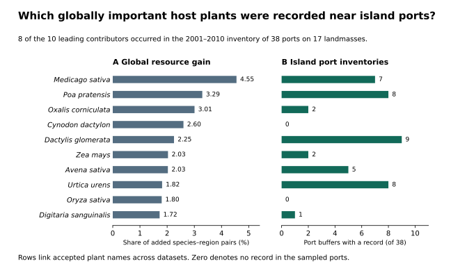
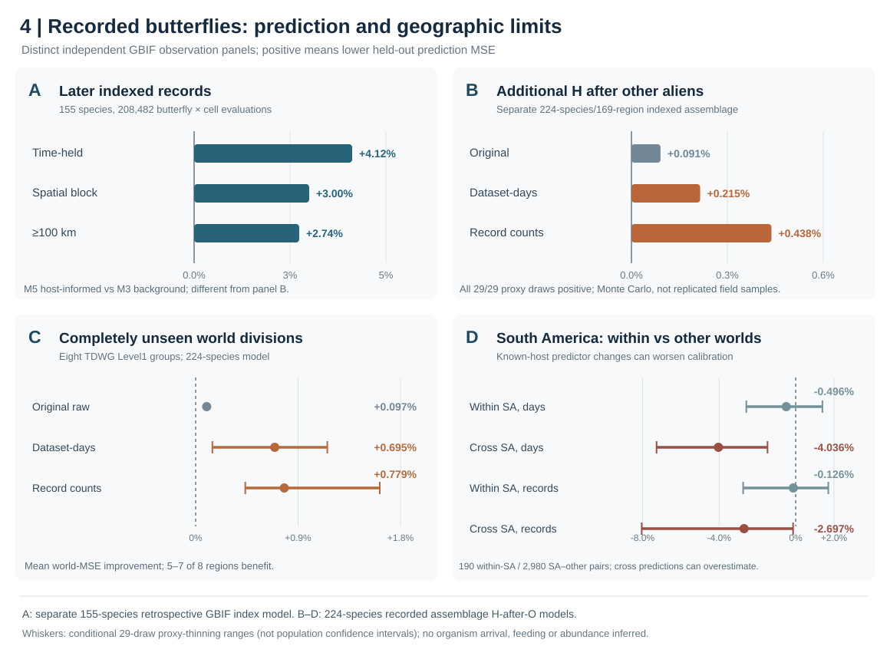

# Supporting Information — GEB Research Article

**A weaker island isolation gradient in butterfly host resources when introduced plants are included**

**20 November 2026; journal-facing coauthor-review working version, unsubmitted.** Eight consecutively numbered appendices; figures S3.1 and S5.1. The underlying complete old v0.3 source archives remain versioned and separate; this is a source-qualified summary, not a replacement for downloadable data and code.

## Appendix S1. Source populations, taxonomic identities and geographic grain

| Analysis | Cohort | Measured response |
|---|---|---|
| Fixed known-host opportunity | 239 HOSTS butterflies × 369 WGSRPD3 botanical regions | Presence of ≥1 reported native or native+introduced larval host plant, **not butterfly occurrence** |
| Island–mainland host opportunity | 126 insular and 237 mainland botanical regions (6 mixed separate) | Fixed-source host availability and new gap filling |
| Port × whole plant flora | The **same 126** botanical islands, WPI ports × WCVP accepted species | Adjusted contemporary native/introduced plant richness and 7,875 paired island floristic similarities |
| Marine resistance | Source-matched **104** island botanical regions × **5,355** reused flora pairs | Native vs introduced plant Jaccard and undirected sea electrical resistance (not measured currents) |
| Independent later butterfly indexing | **155** butterflies, 208,482 species×cell test cases | Retrospective later indexed GBIF records, not population change |
| Independent GBIF community | **224** butterflies, 169 original primary regions, 14,196 reused region pairs | 2018–2024 **recorded** butterfly Jaccard conditional on earlier records and observation proxies |
| External island endemic | Independent 41 extant Macaronesian butterflies incl. 18 endemic | Named host records, independent wild/garden larval use, catalogue coverage |

Source HOSTS DOI **10.5519/havt50xw**, pinned data mirror 808e0b869f9ec1adf8efff87cf6a395adda103e0; Kew WCVP **v13 21 May 2024** DOI **10.34885/0yex-xv26**. Independent 224 species source GBIF download DOI **10.15468/dl.umqmsf** and annual positive/effort aggregates pinned to commit dfd49cfcf9fb01a3db47cc611aae8cdd9c53cda0. HOSTS is incompletely documented and WCVP contemporary regional plant status is not a dated arrival history. Other GBIF index and port acquisition families cannot borrow the independent 224-species DOI.

## Appendix S2. Native baseline accounting and resource concentration

| Source fixed host coverage | Island (126 botanical regions) | Mainland (237) |
|---|---:|---:|
| Butterfly×region potential cells | 30,114 | 56,643 |
| Native known-host covered | 4,829 | 21,215 |
| Added by introduced known hosts | **5,741** | **8,686** |
| Current known-host covered | **10,570** | **29,901** |
| Native baseline coverage | **16.04%** | **37.45%** |
| Fraction of initially missing resource combinations newly filled | **22.71%** | **24.52%** |
| Relative gain over native host coverage | **+118.89%** | **+40.94%** |
| Introduced-only source coverage as fraction of current covered combinations | **54.31%** | 29.05% |

For the full 369-region panel, native-only coverage was 26,530 and contemporary coverage 41,083 butterfly–region combinations, an increase of 14,553 (+54.9%); 206/239 species gained at least one region. The absolute island–mainland coverage gap narrowed from 21.4 to 17.7 percentage points (contemporary coverage 35.1% and 52.8%, respectively). Host-family count versus proportional gain gave Spearman ρ=0.008 (bootstrap 95% −0.111 to +0.128; strict equivalence not confirmed). Species-equal and spatial checks and detailed crop-exclusion results remain in the underlying source receipts.

For a geography class with native coverage B and initially empty fraction filled F, relative gain = F(1−B)/B. This arithmetic shows why larger proportional island gains do not demonstrate better island gap filling. The matched area×Level1 test (+10.7 percentage points introduced-attributable contemporary share) has a **different denominator** from raw gap filling, which is 22.7% island vs 24.5% mainland.

Among **670** source-accepted introduced host contributors, **38 (5.7%)** provided half of all 14,553 added butterfly×region opportunities using equal split of credits within each newly covered combination (plant Gini 0.7774, top-ten cumulative contribution 25.1%). The original 239 butterfly source native-host geographical breadth predicted absolute island additions (tied-rank Spearman ρ=+0.578896); broadest 59 species gained 2,271/5,741 combinations (39.56%), narrowest 60 gained 644/5,741 (11.22%). **82/97** one-host-family butterflies gained new global potential regions; excluding FAO crop hosts still left +46–47% global resource increase. These are mapped opportunities, not larval abundance, food quality or individual fitness.

Source-constructed butterfly-resource island-pair Jaccard increased +0.23667, compared with mainland +0.15044, but the Level1×island-class × fixed species/region gain-margin null left island-specific excess only **+0.00119**. This is not observed butterfly community homogenization.

## Appendix S3. Port-associated plant supply and sea-related geography

Matched 126-botanical-island WPI whole-flora associations, adjusting area and TDWG Level1: introduced β=**+0.2854** (HC3 +0.0622,+0.5087); native β=**+0.0954** (−0.0774,+0.2683); directly paired introduced-minus-native β=**+0.1900** (−0.0187,+0.3987). Nine overlapping leave-Level1-out fits retained positive introduced slopes +0.202 to +0.380; the 91 port-positive islands also retained a positive introduced slope. The 98-island botanical-effort subset did not establish registered-host-specific enrichment beyond total introduced flora. The introduced result is not a significant *between-origin slope contrast* or historical ship-cargo effect.

Across 7,875 pairs from the identical 126 regions, whole introduced flora median Jaccard was **0.046030**, native **0.004487** (~10.26×); this is contemporary composition of different species pools, not tenfold change through time. Separate 104-island original single-island holdout electrical resistance yielded introduced **+4.239%**, native **−0.110%** plant-Jaccard predictive MSE reduction. Strict both-island-endpoints-unseen 1,089 dyads in five source folds yielded introduced **+2.735%** (descriptive −1.649,+5.508%) versus native **−0.044%** (−0.984,+0.431%); paired difference interval crosses zero. A *different* shortest water path helps both origin classes. Alternative Simpson similarity can reverse origin ordering. The electric resistance is undirected model geometry, not observed currents.

Native-minus-introduced share of plants with EuDiS recorded seawater-dispersal morphology was **+2.9515 percentage points** among 22 biased/mostly European island regions. The independent published Tonga Table 1's broader *water dispersal* category points in the other direction (native 137/364 vs post-European introduced 137/309); **not** the same trait ontology or a matched replication.

### S3.2. Isolation gradients of fixed-239 butterfly known-host opportunities

For the original 126 WCVP/WPI botanical islands and 239-species HOSTS×WCVP region counts (**4,829 native-only**, **10,570 contemporary**, **5,741 introduced-only additional** butterfly×region opportunities), approximate mainland distance was the nearest WGSRPD3 boundary separation to 237 botanical mainland regions (chosen in longitude–latitude and converted to WGS84 geodesic endpoint distance with ±360 longitude wrapping). This is **neither** the 104-island undirected ocean circuit **nor** an exact ellipsoidal polygon-distance optimization.

Each log1p plant/host count was standardized and regressed against standardized log2(1+modern ports), log1p(distance), log region area, absolute centroid latitude and TDWG Level1 intercepts (126 islands). Native whole-flora distance β=−0.083 (HC3 p=0.106) was uncertain, whereas introduced whole-flora port β=+0.350 (HC3 p=0.00865; nine-cluster p=0.049). Native-host distance β=−0.1676 (HC3 p=0.000095; nine-Level1 cluster p=0.014) and contemporary-host distance β=+0.0192 (HC3 p=0.751) produced paired standardized slope shift **+0.1868** (HC3 95% +0.0749,+0.2986). Critically, the **nine-Level1 CR1/t8 interval for that shift crossed zero** (95% −0.0172,+0.3907; p=0.0677). A non-significant contemporary slope does not establish exact absence of an isolation relationship.

For **123** host-covered islands, introduced-only potential share was fitted as log((introduced-only+0.5)/(native-covered+0.5)), one row per island: isolation β=+0.4251 (HC3 95% +0.2446,+0.6055; nine-cluster t8 95% +0.1121,+0.7381; p=0.0140). Equal-island fitted shares were **55.2%, 65.6%, 71.5%** at 100, 1,000 and 4,000 km; these are **not** measured butterfly dietary dependence or ratios of the separate fitted host-count curves. Within-Level1 999-draw bootstrap interval for paired distance shift was +0.095,+0.295, all 126 leave-one-island-out slopes were positive (+0.170,+0.203), and all nine Level1 leaveouts remained positive (+0.133,+0.220). Log port counts and log area correlated r=+0.807 (raw counts/area r=+0.271); geographical and historical dependence remain.

The original **125-island/2,517-butterfly** scratchpad was not inspectable and is **not** claimed as replicated. Figure 2D and the main text instead use the independently successful **126-island/239-butterfly** source-pinned CI, original frozen WCVP/HOSTS counts and TDWG geometry: `scripts/audit_island_port_isolation_239_20261120.py`, https://github.com/zuizui0223/chocho/actions/runs/44672145927. No butterfly presence, ship-borne plant arrival or demographic rescue was inferred.

### S3.3. Additional spatial autocorrelation and MEM10 sensitivity

Source-island WGSRPD3 region centroids (not necessarily individual island centroids) were linked using a prespecified **2,000 km** great-circle binary neighbourhood, with **350 undirected edges** and **five unconnected regions**. Plain model residual Moran's I used 1,999 global and within-TDWG-Level1 permutations. The **native-host** model had residual I=+0.132 (within-Level1 p=0.001), while the **introduced-only host opportunity log-odds** model had residual I=+0.123 (within-Level1 p=0.003), indicating that the plain HC3 regressions do not fully absorb geographic dependence.

As an additional exploratory spatial-filtering sensitivity, the top **10 positive eigenvectors** of the centered spatial weight matrix were added to the original fixed covariates without choosing vectors by outcome association. Under MEM10, the native-host mainland-distance coefficient remained negative (**β=−0.1330, HC3 p=0.0204**) and the contemporary-host distance coefficient was uncertain (**β=+0.0709, p=0.3170**). The paired standardized current-minus-native slope shift was positive (**β=+0.2039, HC3 p=0.0043**) and the introduced-only share log-odds distance association remained positive (**β=+0.3949, HC3 p=0.000786**). The port coefficient for introduced whole flora was also positive (**β=+0.3877, p=0.00560**). The *nine-Level1 cluster t8* paired-slope test remains uncertain (p=0.0677): MEM10+HC3 and nine-cluster t8 are distinct sensitivity designs and **must not be described as two independent confirmations**. Five disconnected regions, broad multi-island centroids, spatial residual structure and correlated ports/area remain limits.

The independently executed source run, full Moran weights and 1999-draw permutation receipts, and MEM10 result table are available in [source CI #44674041763](https://github.com/zuizui0223/chocho/actions/runs/44674041763) and reproduced by `scripts/audit_island_port_spatial_239_20261120.py` after `scripts/audit_island_port_isolation_239_20261120.py`. No historical plant introduction or butterfly population data are introduced by these models.

**Figure S3.1. Original historical port contributor plot (same source data, preserved).**

### S3.4. Mainland isolation and botanical observation-effort index sensitivity

We separately tested whether the original 126-island Figure 2D source-defined HOSTS×WCVP potential-resource association was solely a correlate of uneven botanical recording. The fixed 239-butterfly responses and approximate WGSRPD3 nearest-mainland distances were independently reconstructed from the same WCVP/port table, 369-region HOSTS panel and pinned TDWG polygons. We then linked the pre-existing GBIF all-Plantae index counts (1700–2026; historical pre-1900 subset separately) to the **98 of 126 botanical island regions with a successfully indexed plant-effort record**. For transparent cohort control, **all models below are re-estimated on the identical 98 islands** (all 98 resource-active), with fixed standardized log2(1+ports), log island region area, absolute centroid latitude and nine TDWG Level1 intercepts; the added covariate is standardized log1p(all indexed plant records). Response counts were standardized by log1p *within the common 98-island panel*, while the introduced-only host-share response remained region-level log odds with a 0.5 continuity adjustment.

| Same 98-island source | No plant-record effort: distance β, 9-Level1 t8 p | All-plant-record effort adjusted: distance β, 9-Level1 t8 p |
|---|---|---|
| Native documented host opportunities | **−0.1957**, p=0.0310 | **−0.2162**, p=0.0147 |
| Contemporary documented host opportunities | +0.0062, p=0.9522 | −0.0201, p=0.8406 |
| Paired contemporary-minus-native standardized slope | +0.2019, p=0.1207 | +0.1961, p=0.1390 |
| Introduced-only share of currently covered known-host opportunities (log odds) | **+0.5091**, p=0.0111 | **+0.5247**, p=0.0096 |

Using only pre-1900 indexed botanical records instead of the all-period count yielded native distance **β=−0.2104, nine-cluster p=0.0215** and introduced-only share **β=+0.5105, p=0.0088**, with the paired slope difference still uncertain (β=+0.1809, p=0.1206). The corresponding HC3 results and nine-cluster t8 intervals are included in the aggregate source receipt.

This is an observation-index *proxy sensitivity*, **not** an identified or full-population recording-effort adjustment. The 28 omitted botanical regions have no usable original indexed plant-effort measure rather than observed zero effort. They are not missing at random: the separate source audit identified disproportionately large and port-rich omitted regions. Results on the common 98 cannot be extrapolated to all 126 or described as independent biological replication. The original full-126 evidence and its conservative paired-slope uncertainty (nine-cluster p=0.0677) remain primary; no new historical ship/cargo, butterfly occurrence or recruitment evidence is inferred. Independent script `scripts/audit_GEB_v05_fig2D_botanical_record_effort_20261121.py`; machine-readable receipt `results/geb_v05_fig2d_effort_sensitivity_20261121/FIG2D_PLANT_INDEX_EFFORT_SENSITIVITY_20261121.json`.

### S3.5. Exploratory directional-current evidence and limits

Using the same WCVP origin assignments and EuDiS trait coding, we identified 17 source regions with adequate within-family trait-positive and trait-negative native plant pools. The historical OSCAR pilot lacked sufficient coastal and day-30 support; we therefore used the independent HYCOM+NCODA GLBu0.08 experiment 19.1 reanalysis ([source product](https://www.hycom.org/data/glbu0pt08/expt-19pt1); [2005 daily archive](https://ncss.hycom.org/thredds/ncss/grid/GLBu0.08/expt_19.1/2005/dataset.xml)), approximately 8-km horizontal resolution, 15-m depth, six release dates in May–October 2005. The fixed roster comprised three separated wet-grid starts per region/date within 50 km of original GSHHG wet anchors (306 trajectories). Midpoint integration used 6-hour steps, a 30-day horizon and a land-mask check along segments of at most 2 km. Missing velocities and land contact terminated integration; no missing trajectory was imputed as zero transport.

All 306 starts were reconciled; 52 reached day 30, from 12 source regions. The other 254 trajectories ended at masked/missing velocities (247) or land contact (7); source retrieval/boundary errors were zero. Across 1,236 directed comparisons with 104 recipient regions, we related family-standardized trait-positive-minus-negative listing excess to modeled progress toward the recipient representative point. Source and recipient fixed effects, cubic log initial distance, same Level1 and absolute latitude difference were included, with equal source weights and equal dates within source. For each 100 km of modeled progress, the native excess increased by 0.297 percentage points (full-design two-way clustered descriptive 95% interval 0.112–0.481), introduced excess was −0.101 (−0.223–0.022), and their paired difference was +0.397 (0.222–0.572). Requiring two valid dates retained the paired estimate +0.406 (0.236–0.576; 11 sources, 1,133 comparisons). These are exploratory spatial associations conditional on model-supported trajectories.

Sensitivity analyses constrain the interpretation. Omitting Japan changed the paired estimate to +0.006 and native estimate to −0.215; Japan accounted for 77.9% of residual predictor sum of squares. The paired estimate was −0.059 within 5,000 km (220 comparisons), −0.374 within 3,000 km (105 comparisons), and −0.752 within Level1 (121 comparisons); all intervals included zero. The 1,500-km cohort failed the minimum support gate. In 4,096 source-wise geometric orientation assignments, 33.8% had a partial correlation at least as large as the observed positive paired contrast. This placebo is geometric, not an exchangeable causal null or reversed-current simulation. The positive global association therefore provides no direction-specific support; the result is sensitive to the geographic composition of the comparisons, and the geometric diagnostic does not distinguish the observed direction from alternative orientations.

A separate fixed-anchor diagnostic identified 15 directed comparisons compatible with the computed path lengths among completed trajectories, involving eight sources. No completed trajectory newly ended within 50 km of another fixed recipient anchor. One incomplete trajectory, released from Sardinia on 26 September 2005, ended about 22.9 km from a Corsica anchor (initial distance 149.4 km, computed path length 208.2 km). This is model-supported proximity, not coast-wide arrival, viable seed dispersal or historical establishment. The narrow support prevented a new ecological fit. These exploratory directional and proximity diagnostics provide no additional direction-specific evidence for the two-layer interpretation, which rests on the separate native–introduced morphology, port association and undirected marine-geometry results.

Source and code provenance: source-fixed HYCOM launch, physical and trait diagnostics; full post-result sensitivities and fixed-anchor path-length audit are retained in the accompanying source archive. The 2005 model, present-day floras, nonrandom trait coverage and conditioning on complete water tracks limit historical inference. EuDiS is centered on European flora and only 17 source regions meet the trait-coverage gate; additional releases would not resolve this source-coverage constraint. We retain all completed tests and stop this exploratory analysis without further threshold or model searching. Public-input redistribution conditions and reviewer access remain unresolved.

## Appendix S4. Same-source HOSTS×WCVP potential resource controls

On the original 104 botanical islands, H=668 introduced WCVP plant taxa registered as hosts of the 239 butterflies; O=7,219 introduced taxa **not registered** as hosts (not confirmed true non-hosts). Under original geography E controls, H-after-O improved prediction of *WCVP/HOSTS-derived potential butterfly resource composition* by +17.609% MSE. With 199 plant-family×island-occupancy-matched label draws, observed source H-after-O +16.365% versus median matched null +7.699% (9/199 null scores at least as large, descriptive rank .050). Contemporary whole alien flora similarity improved source-potential butterfly-resource prediction +26.363% against a 225 serial-state fixed source-gain-margin null median +18.974% (excess +7.389 points). These models share WCVP/HOSTS taxonomic input between predictors and potential response and **are not independently observed butterfly evidence**.
### S4.1. Figure 3B: known-host documentation-richness proxy sensitivity

The original Figure 3B association on the fixed **239 butterflies** was between global native known-host resource breadth and the number of newly source-supported island butterfly–region opportunities (Spearman **ρ=+0.578896**). An important ascertainment alternative is that better-studied butterflies have more documented host plants, creating larger reconstructed native and introduced resource maps. The source-frozen 239-butterfly HOSTS/WCVP metrics and corresponding 126-island species-level source counts were therefore paired by identical accepted butterfly species names. We used the **number of distinct resolved documented host-plant species** and **number of documented host-plant families** as imperfect proxies for catalogue coverage; neither equals the number of independent field observations or publications.

Across the 239 species, the documented host-plant species count correlated with native global resource breadth (**ρ=+0.626**) and added island resources (**ρ=+0.573**). Residualizing tied midranks of the predictor and outcome against tied midranks of documented host-plant count alone retained a partial rank correlation **+0.344**; additionally controlling documented host-family count retained **+0.348**. A fixed-seed (20261121) 2,000-resample *species* bootstrap returned a descriptive percentile interval **+0.219 to +0.465**. A 2,000-draw permutation of island additions **within five predefined documented-host-count tiers** (1, 2, 3–4, 5–9, 10+; sample counts 29, 35, 43, 51, 81), recomputing the rank adjustment each draw, gave a descriptive two-sided tail probability **p=0.0005**. Omitting each butterfly separately gave adjusted correlations **+0.334 to +0.368**. The source-taxonomically more adequate subset (**n=215**) gave **+0.377** after both controls; butterflies with exactly one documented host family (**n=97**) gave **+0.463** after host-count control; butterflies with positive island additions (**n=198**) retained **+0.247** after both controls.

The follow-up used the same pinned 140,485-row HOSTS catalogue and WCVP name-resolution code. All 239 butterfly names and resolved host counts matched the frozen cohort. These butterflies had 6,672 raw rows (6,649 unique after excluding identifier fields and deduplicating identical content), including 4,695 complete plant-binomial rows and 3,898 resolved rows (3,890 unique). Neither catalogue identifier denotes a verified independent publication; the exported schema contains no explicit publication/reference field. Adding raw row count to both tied-rank controls retained partial ρ=+0.357 (2,000 species-bootstrap descriptive 95% interval +0.238 to +0.474; all 239 leave-one-out estimates +0.343 to +0.375). The four fixed alternative row-depth definitions gave partial ρ=+0.357 (deduplicated all rows), +0.348 (resolved rows), +0.348 (deduplicated resolved rows), and +0.348 (resolved rows per resolved host), with descriptive bootstrap intervals excluding zero in each case. The adequate-taxonomy and one-family subsets retained +0.380 (215 butterflies) and +0.464 (97 butterflies, controlling host species and raw rows), respectively. Raw row count was strongly correlated with resolved host count (ρ=+0.912), so these are correlated catalogue-depth controls, not an independent measurement of research effort. All predefined variants are retained in the accompanying source receipt.

These results show that **controlling for catalogued host species, families and recorded row depth does not numerically erase the original source-defined Figure 3B association**. They do *not* demonstrate that the relationship is independent of true research effort, host breadth, phylogenetic non-independence, species selection, or the common HOSTS/WCVP data construction of both axes. The bootstrap is across the fixed selected species, and the tier-restricted permutation depends on exchangeability assumptions; neither is an independent ecological replication or a field-derived population confidence interval. We retain the original Figure 3B as a source-potential resource relationship, not as evidence of butterfly population growth or superior host quality. Source-locked reproduction uses `scripts/audit_GEB_v05_fig3B_HOSTS_documentation_proxy_20261121.py` and the aggregate JSON receipt `results/geb_v05_fig3b_documentation_proxy_20261121/FIG3B_DOCUMENTATION_PROXY_SENSITIVITY_20261121.json`.

## Appendix S5. Independently indexed butterfly outcomes, effort and region transfer

### S5.1. Separate later indexed butterfly recording model (155 species)

Across 155 source-selected butterflies / 208,482 species×cell evaluations, adding known host-resource and host-family predictors lowered species-equal retrospective later GBIF record MSE by **+4.120%**, spatial block **+2.995%**, nested ≥100 km subset **+2.736%**; **119/155** and **115/155** benefited in temporal and spatial source tests. Contemporary plant maps may postdate the observation windows. These are **indexed records, not new colonies or biological abundances**.

**Original 155-model source and reproducibility scope.** The original 2026-10-29 source snapshot includes **54 SHA-verified output and validation assets**, **11 model/panel construction scripts**, locked random-forest settings and original score receipts, so the +4.120/+2.995/+2.736% arithmetic can be checked against stored evaluated model outputs. However, the original **842,964-row** `species_cell_period_panel.parquet` and **12 other work/temporal/remote-sensing inputs** are absent from the archived repository checkout; an independent 155-species raw-to-panel-to-model refit has **not** been completed. The separate original 224-species recorded-community model, independently refitted and validated against all 676 geographic holdouts, must not be substituted for this distinct 155-species random-forest exercise. Thus, the 155-species predictive result is **an archived, source-consistency-verified evaluation**, not a newly independently retrained model. Full reviewer reproducibility requires recovery/source-exact rebuilding of the original 155 training panel, or a transparent source-specific justified access limitation.

### S5.2. Original recorded community response and observation-intensity matched simulation

Independent GBIF DOI **10.15468/dl.umqmsf**: 14,637,152 original occurrence records; derived source 91,882 positive species×region×year records and 5,390 region×year effort cells. Mean indexed butterfly Jaccard was originally **0.114213** (2001–2010) and **0.167880** (2018–2024): raw delta +0.053667. Under 499 within-region recording-intensity-matched draw simulations, median raw delta was reduced to **+0.015064** (datasetKey×calendar-day proxy) or **+0.002914** (indexed record-count proxy). This does not quantify the proportion of biological homogenization due to observation effort.

Original primary recorded butterfly H-after-O regional held-out MSE increment: **+0.0913%**, 224 butterflies/169 botanical regions/14,196 dependent pairs. After 29 repeated proxy-thinning draws of BOTH prior and late butterfly similarity, median source MSE increments were **+0.215%** (conditional Monte Carlo 0.0659–0.4706) and **+0.438%** (0.1543–0.7362), positive 29/29 draws each. These 58 draws are not independent populations or true detection-corrected occupancy.

### S5.3. Crucial ORIGINAL eligible-region sensitivity (PR #183)

| Original effort cohort | Regions | Dependent region pairs | H-after-O recorded-community MSE improvement | Descriptive regional bootstrap central 95% |
|---|---:|---:|---:|---|
| Relaxed: at least 5 butterflies, 5 early dataset-days, 10 later | **194** | **18,721** | **+0.3325%** | +0.0712 to +0.5770% |
| Main: 5 butterflies, 10 early, 20 later | **169** | **14,196** | **+0.0913%** | −0.0915 to +0.2621% |
| Stringent: 10 butterflies, 20 early, 50 later | **133** | **8,778** | **−0.0764%** | −0.1554 to −0.0007% |

The stringent cohort reverses the sign. Region composition also changes with original selection threshold, so this comparison is an observation/region-source sensitivity, NOT a controlled observation-effort experiment. Later 169-region proxy matching does not erase original 194/133 source cohort sensitivity.

### S5.4. Entire biogeographic Level1 heldouts and the South American counterexample

Eight entire Level1 divisions removed from source fitting: original world-equal mean H-after-O MSE gain **+0.0971%**, proxy thinning medians **+0.6945% / +0.7793%**, with only 5–7 of eight world groups improving per draw. Level1=8 South America (20 regions, 3,170 heldout pairs) was adverse primarily for **2,980 South America–other-world pairs** rather than 190 within-SA pairs. Cross-world gain was **−4.036% / −2.697%** under the two original matching proxies. The unthinned source observed butterfly Jaccard mean was 0.06447 versus M2 prediction 0.08281 and after H added M3 prediction 0.08380. Registered H plants represented 24.1% of alien flora in South America and 23.6% elsewhere (regional medians). This indicates source prediction/calibration shift, not continent-specific biological rejection of introduced larval hosts.

**Figure S5.1. Full original South America within/cross test, including signed adverse source responses.**

## Appendix S6. Independent island-endemic coverage and named larval feeding

An independent Macaronesian checklist identified **41 living butterflies including 18 endemics** (13 Canary, three Madeira, two Azores). The fixed global 239 source selected **0/18** endemics (13/23 nonendemics). Among eight *nonrepresentative* endemic butterflies with accepted named foodplant species, four had added **global** potential host regions and four did not; none gained a newly host-present original *home archipelago* botanical region. Source-incomplete native hosts can change either side of the reconstructed envelope and make 4/8 nonrepresentative of all 18.

Independently verified source photographs document *Pieris cheiranthi* larvae on **introduced Tropaeolum majus**, Tenerife (wild, 2015) and La Palma (garden, 2011). Independent native feeding in *Euchloe grancanariensis* on native *Hirschfeldia incana* further clarifies that documented exotic host use is not evidence that native food options have disappeared. The first case identifies **individual local larval feeding**, not new establishment or population benefit. Third-party photographs are not reproduced in journal files without rights clearance.

## Appendix S7. Historical controls, localized port observations and exploratory mechanisms

**Geographically localized HOSTS reports.** Island locality median documented introduced-host use **42.4%** (13 localities) versus mainland **9.1%** (15); exact FAO crop exclusion **20.9% vs 8.1%**. In 67 butterflies reported in both types, plant-family-matched and floristic supply-adjusted *extra island introduced-host use* was **−3.87 percentage points** (descriptive −15.85,+8.13): raw documented differences do not identify preference beyond plant availability.

**Port-indexed butterfly/plant co-records.** In the original **17** sampled 5-km port buffers, **31** butterfly species were indexed, **16** with co-indexed compatible candidate-host plants from the same port neighborhood, yielding **8,525** original butterfly records and **59** species×port co-recording combinations (2001–2024 pooled; no synchronized larval feeding or matched nonport controls). Separately, among **1,596** port queries, **1,150** contained a source-indexed introduced host candidate; 8/10 leading host plants appeared within original **38** sampled early-period port buffers. These are not vessel cargo observations or field interactions.

**Port nutrient proxies (not measured terrestrial nitrogen).** Original near-port crop-N plant-composition proxy β **+0.08617** (descriptive +0.02375,+0.14859) and introduced-host fractional flora proxy β **+0.10144** (+0.03770,+0.16519) had positive source fits; stricter raster, botanical coverage and input-intensity sensitivities weakened some. These are botanical **record composition** correlations, not an identified sewage/fertilization-to-larval-host mechanism.

**First-index and physical route limits.** Among 317 apparently new 2001–2010-empty butterfly×island source cells, **145 already had pre-2001 GBIF records**. All 24/24 selected established-positive alien Lepidoptera cases had source-listed introduced hosts in recipient regions, but no controlled failed recipient comparison. Original NOAA pilot simulated 280 paths, 12 other-island coastal-nearshore directions and only two matched destinations, insufficient to identify a historical transport route. Colonisation, ships and individual propagule arrivals are not measured by the present paper.

## Appendix S8. Reproducibility, completeness and source-evidence tier register

The [complete R01–R37 and PR #181–#187 evidence coverage table](GEB_FULL_EVIDENCE_AUDIT_20261120.md) grades the 37 historically sourced findings by main-text, source-coupled SI and exploratory/archive tiers. Full original v0.3 References, all source S.A–S.F and historic data-note prose survive without deletion in the [unedited original source archive](SUPPLEMENTARY_LEGACY_REFERENCES_AND_APPENDICES_V03_UNEDITED.md). The separate original [complete pre-condensation methods](SUPPLEMENTARY_SOURCE_METHODS_V03.md) provide regional inclusion/model details for source eras that differ from main-text cohorts; they are not a second ecological study.

**Not promoted to main:** The older Lepidoptera-wide HOSTS plant-network-degree × introduced-range analysis (8,909 plant species; degree one consumers 26.2% introduced range increase versus ≥6 consumers 65.9%; family/native-geography stratified ρ≈+0.295) cannot partition botanical/host catalogue reporting bias from ecological interaction degree. The previous 51.4% first-index breadth claim lacks frozen source cohort and the original 32-species 66/115 vs 60/109 ratio has unresolved denominator scope. Such exploratory values should not appear as confirmatory main hypotheses or GEB-general biological mechanisms.

**Submission source gate:** HOSTS and WCVP v13 source DOI/version, GSHHG and original 224-butterfly GBIF DOI are fixed. The *other* 2026 butterfly first-index/plant port-acquisition sources still lack an exact, reviewer-accessible original derived GBIF citation/DOI and some original files have distribution limitations. An anonymous read-only repository/archive containing analysis code and redistributable derived data must be provided at **peer review** and deposited in a stable repository for **publication**. This SI does not magically create those original records or a DOI.

### Supporting Information references and source citations

- Fall, P. L., & Drezner, T. D. (2011). Plant dispersal, introduced species, and vegetation change in the South Pacific Kingdom of Tonga. *Pacific Science*, 65, 143–156. https://doi.org/10.2984/65.2.143
- Kew World Checklist of Vascular Plants v13 (21 May 2024). https://doi.org/10.34885/0yex-xv26.
- Natural History Museum HOSTS – a database of the world's Lepidopteran hostplants. https://doi.org/10.5519/havt50xw.
- Independent GBIF occurrence download for observed 224-butterfly community. https://doi.org/10.15468/dl.umqmsf.

Supporting Information figures are numbered by appendix: **Fig. S3.1** (original historical port source graphic) and **Fig. S5.1** (full South America 224-species source counterexample). These two figures must be embedded as actual media in any uploaded SI DOCX/PDF, not only linked. The manuscript's four main figures retain Fig. 1–4 numbering.
