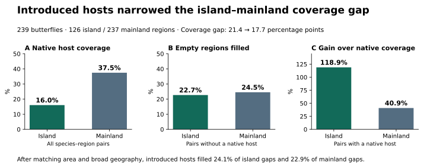
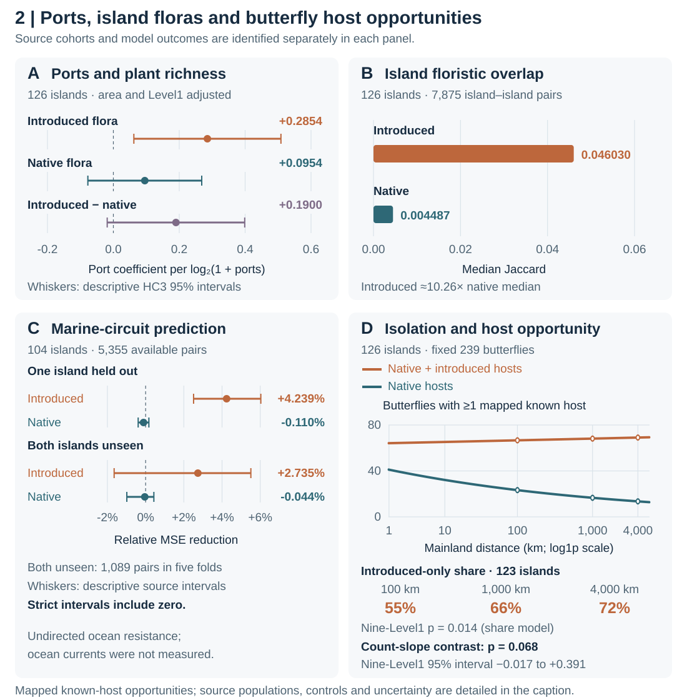
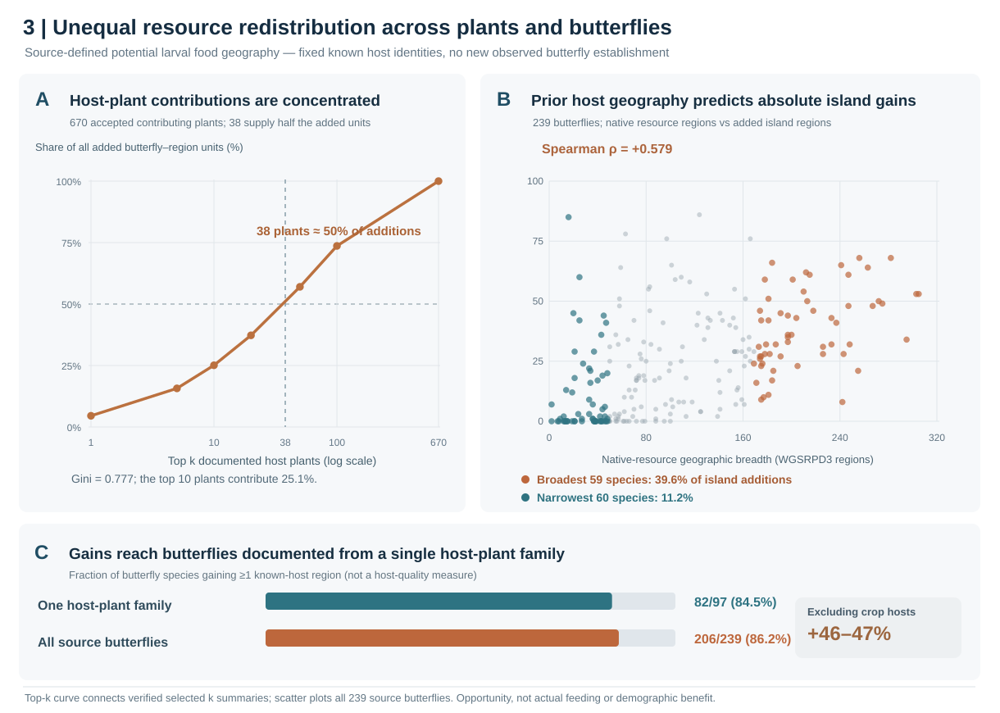
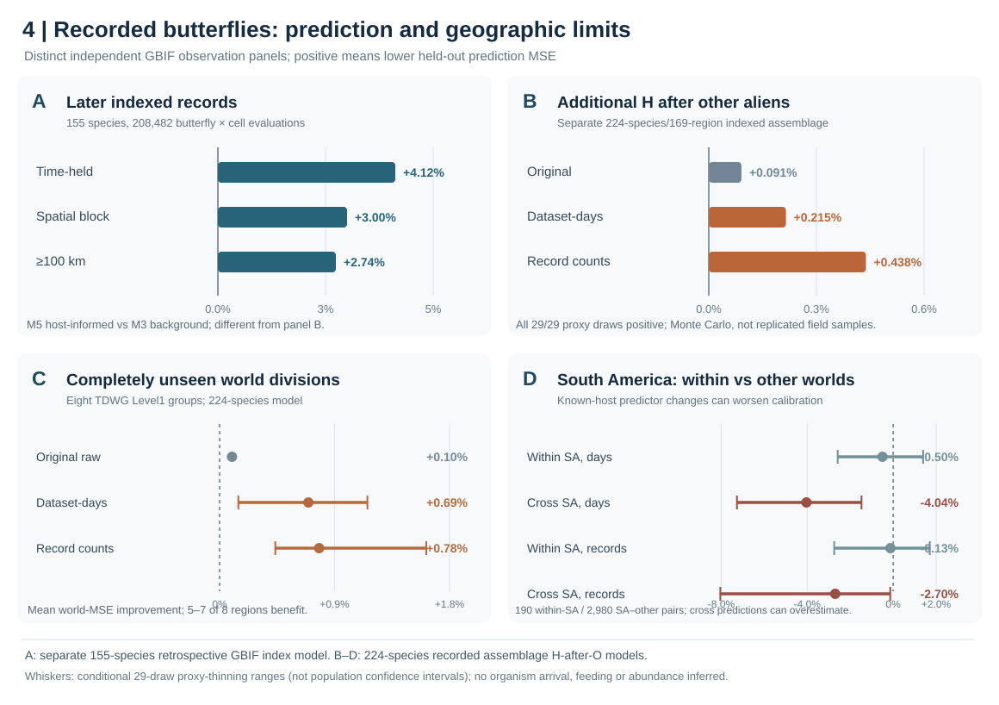
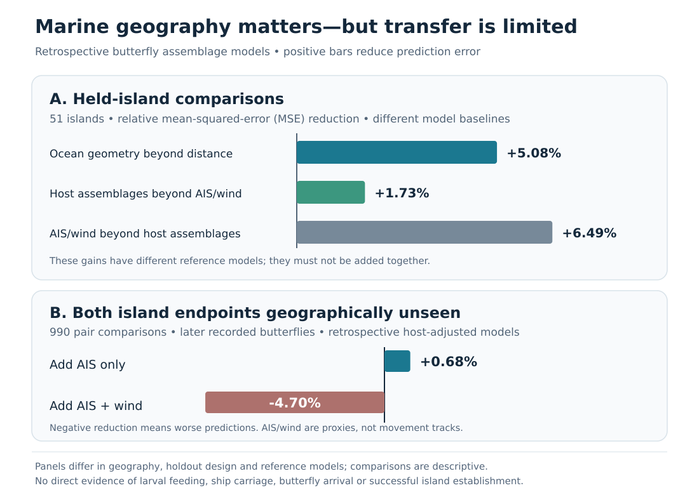

# Ports, the sea and two layers of island floras reshape butterfly larval-host opportunities

**ONE integrated Research Article | GEB editorial restructuring v0.4 | 19 November 2026**

**Status:** Coauthor review draft; unsubmitted. Earlier complete [v0.3 preserved at its immutable source commit](https://github.com/zuizui0223/chocho/blob/07ea8f9886d52bc944fe47c8fb32dd89a80358b9/manuscript/integrated_butterfly_resource_access_20261109/ISLAND_PORT_BUTTERFLY_RESEARCH_ARTICLE_V03.md). The new figures are editorial presentation of already source-verified results, not new ecological models.

**Running title:** Island butterfly host resources

**Keywords:** alien plants, butterflies, island biogeography, larval host plants, ports, resource geography, spatial prediction

## Structured abstract

**Aim.** Assess how introduced plants redistribute known butterfly larval-host opportunities and how ports, sea geography and independent butterfly records correspond to this change.

**Location.** Global botanical regions and Macaronesian islands.

**Time period.** Native versus contemporary floras; butterfly records, 2001–2024.

**Major taxa studied.** A fixed 239-butterfly host panel; separate 155- and 224-species recording cohorts.

**Methods.** We linked documented hosts to plant ranges, compared 126 island and 237 mainland botanical regions, and assessed port associations, island floristic similarity, seawater-dispersal morphology and undirected marine resistance. Independent GBIF models and endemic larval records tested consumer correspondence.

**Results.** Introduced hosts added 14,553 potential butterfly–region combinations (+54.9%). Island gains (+118.9%) exceeded mainland gains (+40.9%) because native-host coverage was lower (16.0% versus 37.5%), not because more gaps were filled; introduced hosts supplied 54.3% of currently covered island combinations. Gains occurred for 82/97 butterflies documented from one host-plant family; the widest native host-resource geographic group contributed 39.6% of island additions versus 11.2% for the narrowest group. Ports correlated with introduced whole-flora richness (β=+0.285). Native-host opportunity declined with mainland isolation (β=−0.168), unlike contemporary opportunity (β=+0.019). Introduced island floras showed 10.3-fold higher median pairwise Jaccard than native floras. In the original 104-island held-out test, undirected marine-circuit resistance improved introduced-flora prediction by 4.24% versus −0.11% for native floras; stricter geographic-transfer intervals crossed zero. Native flora showed +2.95 percentage points more seawater-dispersal morphology among 22 trait-covered islands. Known-host information improved independent later butterfly-record prediction by 4.12% (155 species); 224-species assemblage gains were smaller and geographically uneven. Canary-endemic *Pieris cheiranthi* larvae used introduced *Tropaeolum majus*.

**Main conclusions.** Port-associated, relatively shared introduced floras expand *potential* butterfly larval-host opportunities, particularly where native island host coverage is sparse. Sea-related morphology and spatial structure provide additional geographic information, although historical ship transport and new butterfly population establishment remain unmeasured.

## 1. Introduction

Human movement has rearranged plant floras (van Kleunen et al., 2015; Daru et al., 2021), and global establishment histories of non-native moths and butterflies have now been assembled (Couto et al., 2026). Yet the geography of *potential larval food* differs from that of established insects. A plant already recorded as a larval host can provide the first documented host available in one region but simply augment existing native hosts in another. Therefore, neither alien plant richness nor documented butterfly establishment measures how introduced distributions alter the geography of **known butterfly–host opportunities with diet held fixed**.

The effect might be pronounced on islands, yet a large proportional increase has two possible interpretations: introduced species might fill a larger fraction of the island's previously missing resources, or islands might begin with substantially fewer native resources so that a comparable gain yields a much larger percentage. Distinguishing these alternatives is important for island ecology. We separate the fraction of possible butterfly–region combinations originally supplied by native hosts from the fraction of the unsupplied combinations subsequently covered by introduced hosts. These quantities are source-documented *geographic opportunity*, not field survival or butterfly occupancy.

Ports and ocean geography address a second, more spatial question. Ports may coincide with horticulture, trade, disturbance and botanical sampling, while native and introduced island floras may have distinct histories and patterns of overlap (Essl et al., 2019; Tordoni et al., 2017). However, contemporary port numbers are not dated source-to-destination vessel networks. A source-identified port association and a difference in present-day native/alien floristic similarities cannot by themselves demonstrate that ships delivered a particular host plant. We consequently compare ports with **whole introduced floras**, not assume that hosts are preferentially imported, and treat marine geometry as a distinct observational predictor rather than measured historical currents.

The final step is biological. Reports of exotic butterfly host use already exist (Graves & Shapiro, 2003), and host availability has been implicated in some recorded butterfly range changes (Halsch et al., 2020; Rashid et al., 2026). Nevertheless, a plant distribution map cannot identify larval feeding, host quality, establishment or demographic dependence. We therefore evaluate *independent recorded butterflies* with two different source-selected GBIF designs and examine documented endemic caterpillar use separately. Recording itself is also a filter: indexed observations are not standardized monitoring visits or validated absences.

This study asks: **(1)** Does native-host scarcity, rather than unusually efficient gap filling, explain large proportional island resource gains? **(2)** Does mainland isolation constrain native-host geography while ports and introduced floras reshape potential resources? **(3)** Does known-host geography help predict independently recorded butterfly communities, and where does that relationship fail geographically? We maintain separate biological and geographical units for each question rather than combining these observations into a single causal mediation analysis.

## 2. Materials and methods

### 2.1. Distinct butterfly and botanical samples

We matched fixed butterfly larval-host identities in the Natural History Museum HOSTS catalogue to accepted native and introduced botanical distributions from WCVP v13 (21 May 2024). The global potential-resource reconstruction included **239 source-eligible butterflies × 369 WGSRPD3 botanical regions**. The original island–mainland contrast used **126 strictly insular and 237 mainland botanical regions**, with mixed or other classifications kept separate; a botanical region is not necessarily one physical island. Whole-flora and port contrasts used identical sets of 126 botanical islands, with a source-matched coastal subset of 104 regions for marine geometry. Independent observational tests had different populations: **155 butterflies** in a later-record indexing forecast and **224 butterflies × 169 WGSRPD3 regions (14,196 pairwise combinations)** in a separate original GBIF-assemblage model. A 225-candidate × 51-landmass island-index sample and source-defined endemic checklists provided contextual evidence only. Cohorts, source taxonomic crosswalks, original geographic units and licences are detailed in [Supplementary Source Methods](SUPPLEMENTARY_SOURCE_METHODS_V03.md) and [the source-verified evidence register](https://github.com/zuizui0223/chocho/blob/main/results/pr179_source_evidence_20261119/README.md).

### 2.2. Potential butterfly resource coverage and island baseline accounting

For each butterfly × botanical-region combination, native resource coverage required at least one of its documented larval hosts to occur as a WCVP-native plant in that region. Contemporary coverage used the **same host identities** and additionally counted introduced ranges of those hosts. We defined newly supplied region combinations as *potential* additional larval food opportunities, not newly evolved host preferences, observed feeding, insect occupancy or increased abundance. We recorded total additions and their concentration among butterfly species, host plants and host-family breadth classes; crop-host and other original source sensitivities were retained.

For each geography class, let T be the number of evaluated butterfly–region combinations, N the number supported by a native known host and A the number newly supported by an introduced known host. Native coverage is B=N/T, gap-filling fraction is F=A/(T−N), and proportional expansion is A/N=F(1−B)/B. This identity separates *low initial native-host coverage* from *efficient filling of missing opportunities*. We compared the original 126 island and 237 mainland region populations within 15 shared broad geography × area-overlap strata and retained species-equal and fixed whole-region permutation checks. This comparison describes reconstructed resource geography, not a causal introduced-plant intervention.

### 2.3. Port associations, mainland isolation and island-flora layers

For 126 botanical islands, original WPI port counts were related to log1p native and introduced whole-flora richness, controlling for log area and TDWG Level1. HC3 and paired origin contrasts were retained, with botanical-effort and port-positive sensitivities; native and introduced Jaccard similarities were compared across 7,875 island pairs.

In a separate fixed-239-butterfly analysis of the same 126 islands, approximate isolation was the shortest WGS84 endpoint distance from an island WGSRPD3 polygon to the union of 237 mainland botanical-region polygons, with nearest points selected in longitude–latitude space. Standardized log1p plant richness or butterfly species counts with at least one mapped native or contemporary known host were regressed on standardized log2(1+ports), log1p(isolation distance), log area, absolute latitude and Level1 effects. Paired standardized slopes were contrasted; introduced-only host coverage used log((newly supplied+0.5)/(native-covered+0.5)) for 123 active islands. HC3, nine-Level1 clustered t8 intervals, within-Level1 bootstrap and geographical exclusions assessed robustness. Residual spatial autocorrelation was evaluated using a 2,000-km neighbour graph and Moran's I, followed by ten geography-selected positive Moran eigenvectors (MEM10) as an additional sensitivity. The response is potential food geography, not butterfly occupancy.

Separate surveys covered 1,596 port buffers and 38 early-record buffers; 104-island undirected ocean circuits and shortest-water paths modelled plant similarity. EuDiS morphology (22 islands), Tonga dispersal categories, AIS and OSCAR sources remained distinct transport proxies, not historical ship or current observations.

### 2.4. Plant identities and potential resource geography

We ranked plant species by their contributions to the additional fixed-HOSTS butterfly–region resource units, quantified concentration and related the *geographic breadth of native known-host resources* to absolute island additions by butterfly species. This geographical extent is not necessarily dietary family breadth or butterfly movement ability. Additional exploratory predictions of *potential consumer-resource assemblage* similarity used WCVP introduced whole flora, H plants registered as hosts for the fixed butterfly panel and O introduced plants not registered as hosts for those butterflies. Because **both the H predictor and potential consumer response use the same HOSTS×WCVP records**, these source-coupled results, their matched-family/occurrence negative controls and exact resource-margin swapping nulls are supplementary rather than tests of independently realized butterfly ecology.

### 2.5. Separate independent GBIF butterfly observation endpoints

The first original independent recording analysis used **155 butterfly species** and **208,482 evaluated butterfly×cell combinations** to compare retrospective GBIF-record indexing predictions using geography, earlier records, climate and land cover against models adding known larval-host geography and host-family composition. Species-equal mean squared error (MSE) was evaluated on later recordings, spatial blocks and a further subset at least 100 km from training data. Plant distributions were contemporary and not independently dated to the start of the evaluated butterfly-record period, so this was not a historically frozen forecast.

The second and independent *recorded butterfly community* analysis used GBIF DOI **10.15468/dl.umqmsf** (original source 14,637,152 occurrence rows in 2001–2024). Original counts were aggregated by 224 indexed species, WGSRPD3 region and year, with regional observation-activity proxies. The original effort-supported cohort comprised **169 regions / 14,196 dependent region pairs**. The response was the Jaccard similarity of butterfly species indexed during 2018–2024; controls included prior 2001–2010 recorded similarity, geography, climate, native potential host resources, whole introduced flora, historical exposure and effort/record-count proxies. Model M2 additionally included introduced plants **not catalogued** as hosts of any focal butterfly (O); M3 added the *documented* larval-host alien plant similarity (H). O is not experimentally established non-host flora. The original Ridge used lambda 10, scaling only on source training pairs and Jaccard prediction clipping to [0,1]. The H-after-O measure was the percentage reduction in held-region mean MSE from M2 to M3.

We reproduced all source-original model folds and regional butterfly Jaccards before running post hoc **observation-intensity** sensitivities. Each fixed region's prior and late butterfly records were probabilistically thinned to the smaller total period-wide source activity, once using the datasetKey×calendar-day proxy and separately using recorded butterfly-occurrence counts. For each of the **29** simulation draws per proxy, **both** the original prior butterfly similarity predictor and the later butterfly similarity outcome were recomputed; other retrospective source covariates, including the original late effort and recorded counts, remained fixed. The original 169 region-holdouts and strict transfer tests holding out each **entire TDWG Level1 division** were rerun. The simulations share one GBIF source and cannot be interpreted as independent field populations or a detection-corrected occupancy model. All additional source replay, Monte Carlo and South American cross-world calibration diagnostics are detailed in [the corresponding main source reports](https://github.com/zuizui0223/chocho/blob/main/results/gbif224_thinned_world_transfer_20261119/README_JA.md) and [the South America failure diagnostic](https://github.com/zuizui0223/chocho/blob/main/results/gbif224_south_america_domain_shift_20261119/README_JA.md).

### 2.6. Independently documented island-endemic larvae and historic-index safeguards

The independent Macaronesian source checklist contained **41 living butterfly taxa, including 18 endemic species** (42 named taxa including one historical extinction). We audited accepted taxonomic synonyms, distinguished these species from the original 239-butterfly panel, and identified eight source-selected endemics with species-level documented larval host plants for a nonrepresentative separate WCVP reconstruction. Independently documented larval observations were checked for accepted plant identity, regional native/introduced status, wild versus garden context and observed use. In particular, original images document Canary-endemic *Pieris cheiranthi* larvae feeding on introduced *Tropaeolum majus* in Tenerife and La Palma. This supports individual interaction use, not additional butterfly populations. Historical butterfly first-index sources for the separate 225×51 island panel were tested against older records; negative first-index controls remain in Supplement S.B–S.D. Full evidence and limitations appear in [the endemic source-audit methods](SUPPLEMENTARY_ENDEMIC_HOST_VALIDITY_20261118.md).

## 3. Results

### 3.1. Island resource gains were amplified by sparse native-host coverage

Introduced geographic ranges of already documented larval hosts added **14,553 potential butterfly×botanical-region resource combinations**, increasing native-only **26,530** to contemporary **41,083** (+54.9%) across the source-selected 239 butterfly species. **206/239** butterflies gained at least one potential host-supplied region. Excluding FAO crop-host identities retained approximately **+46–47%** aggregate source opportunity expansion. Gains were found among one-host-family butterflies (**82/97** with a positive increment) as well as butterflies recorded from broader host-family repertoires, without a clear correlation between host-family count and proportional increase (Spearman ρ=0.008; bootstrap interval −0.111 to +0.128; strict equivalence not confirmed).

**Why islands gained more proportionally (Figure 1).** In **126 insular botanical regions**, native hosts originally covered **4,829** butterfly×region combinations, rising to **10,570** including introduced known-host ranges (**+118.9%**). The **5,741** newly supplied combinations made up **54.3%** of the contemporary host-covered island combinations—potential access, not directly measured larval food consumption. In **237 mainland regions**, corresponding coverage rose from **21,215 to 29,901** (**+40.9%**). However, the initial native-host fraction was only **16.0%** on islands, compared with **37.5%** on mainlands; introduced hosts newly covered **22.7% of previously unsupplied island combinations** and **24.5% of corresponding mainland combinations**. The larger island relative increase therefore reflects **lower starting native-host coverage, not unusually efficient island gap filling**. Contemporary coverage reached **35.1%** and **52.8%**, respectively, narrowing the reconstructed island–mainland absolute gap from **21.4 to 17.7 percentage points**. The original 15 matched geography×area strata retained a positive island excess in the *introduced-attributable contemporary share* (+10.7 points), while a matched gap-filling-efficiency test did not support a stronger island effect. Full species-equal and spatial sensitivity results are in Supplement S.F.

### 3.2. Ports and introduced floras formed an associated island supply layer

On **126 identical botanical islands** (Figure 2A), port counts were associated with whole introduced flora richness (**β=+0.2854**, HC3 95% **+0.0622 to +0.5087**) after area and Level1 adjustment. The native estimate was **+0.0954** (**−0.0774 to +0.2683**), and the directly paired introduced-minus-native contrast **+0.1900** (**−0.0187 to +0.3987**) was uncertain. Nine overlapping Level1 exclusions and 91 port-positive islands retained positive introduced slopes. The 98-island botanical-effort subset did not establish host-specific enrichment beyond total introduced flora. Ports describe contemporary exposure, not verified host cargo.

**Floristic composition (Figure 2B).** Across 7,875 pairs of the same 126 islands, introduced whole-flora Jaccard had median **0.046030** versus **0.004487** for native floras (**10.3-fold**). This describes contemporary sharing of different plant pools, not the relative efficacy of shipping and natural dispersal.

**Sea-related traits and marine geography (Figure 2C).** Across 22 EuDiS-covered islands, native floras had **+2.95 percentage points** more coded seawater-dispersal morphology (**+2.04 to +4.53**). Undirected resistance improved original 104-island held-island introduced-flora Jaccard prediction (**+4.24% MSE**, native **−0.11%**); the stricter both-islands-unseen gain (**+2.74%**) was uncertain; shortest-water distance helped both origins. An exploratory directional-current test (HYCOM 2005; 12 source regions) gave a positive global native-minus-introduced trait-sharing association, but depended on one source region, was uncertain in geographically restricted comparisons and was often matched or exceeded under geometric reorientation; it adds no direction-specific support (Appendix S3).

**Mainland isolation and mapped butterfly food (Figure 2D).** On these 126 islands, native-host coverage for the fixed 239 butterflies declined with mainland distance (standardized **β=−0.168**, HC3 p<0.001; nine-Level1 cluster **p=0.014**), whereas native-plus-introduced coverage did not (β=+0.019, HC3 p=0.751). The paired standardized distance-slope shift was +0.187 (HC3 p=0.001), but its nine-cluster uncertainty included zero (p=0.068). Among 123 host-covered islands, the *introduced-only* potential-resource share increased with isolation (log-odds β=+0.425; nine-cluster **p=0.014**), yielding adjusted shares of **55%, 66% and 72%** at **100, 1,000 and 4,000 km**. When mainland distance and latitude were additionally controlled, the introduced-flora port coefficient remained positive (standardized β=+0.350; nine-cluster p=0.049). An additional ten-eigenvector spatial filter retained negative native-host isolation (β=−0.133, HC3 p=0.020) and positive introduced-only share gradients (β=+0.395, p<0.001; Appendix S3). These associations do not establish shipping, field larval dependence or demographic compensation.

### 3.3. A small set of redistributed plant identities generated much of the potential food geography

The global resource increment was strongly concentrated among source-documented host plants (**Figure 3A**). Among **670 accepted introduced known-host species contributing added opportunities**, just **38 species (5.7%) supplied half** of the 14,553 new butterfly×region resource combinations (credit-weighted plant-contribution **Gini = 0.777**); the leading ten supplied **25.1%**. This concentration persisted qualitatively when contributors were collapsed to plant genera (Supplement S.F). In a separate historical port-buffer observation check, **eight of these ten leading species** appeared in the original 2001–2010 botanical records from **38 sampled port buffers on 17 landmass groups**; the wider inventory comprised **1,596 port queries**, with introduced candidate hosts indexed in **1,150**. The former sample and the wider inventory are not interchangeable, and none of these records directly demonstrates plant cargo delivery or local butterfly feeding.

The butterfly species gaining the largest numbers of new island resource opportunities also tended to have **geographically broad pre-existing native known-host resource distributions** (**Figure 3B**; tied-rank **Spearman ρ=+0.579** across all 239 butterflies). The association persisted after adjusting for documented host species, families and HOSTS row counts (partial ρ=+0.357; Appendix S4). The broadest 59 species by source-documented global native host-resource geography accounted for **2,271/5,741 (39.6%)** of added island opportunities, compared with **644/5,741 (11.2%)** for the narrowest 60. Separately, **82/97** butterflies documented from only one host-plant family gained at least one new potential host-supplied region (**Figure 3C**), and crop-host exclusion retained approximately **+46–47%** global source expansion. These values describe existing source partner geography and known-host availability—not wing-based dispersal ability, realized butterfly colonization, or a special advantage of one-family butterflies over broader diets.

An additional source-built *potential-resource composition* comparison found island-pair butterfly-resource Jaccard increase **+0.2367** versus mainland **+0.1504**, but a source species×region and biogeography/island-class margin-preserving null accounted for nearly all the difference (island-specific residual **+0.00119**). Separately, source-defined known-host H flora predicted the *same-source* HOSTS×WCVP potential-resource assemblage better than nonlisted O flora on 104 islands; a family×island-occurrence-matched source-label null limited its distinctiveness. Because predictor and dependent resource map share host identities, these are **supporting structural geography results, not independent butterfly consumer-community evidence** (Supplement S.F).

The positive marine-circuit source result, its stricter geographically unseen uncertainty and the native–alien EuDiS morphology contrast are presented together with port-associated plant supply in Section 3.2. Alternative Jaccard, Sørensen and Simpson definitions of floristic overlap changed the source-native/introduced circuit comparison (Supplement S.F); no calculation here identifies a dated vessel voyage or directional ocean-flow seed pathway.

### 3.4. Host geography improves prediction of independently recorded butterflies

**Retrospective later butterfly indexing (Figure 4A).** In a source-separated sample of **155 butterflies and 208,482 butterfly×cell evaluation cases**, known larval-host resource geography and host-family features reduced the species-equal MSE of subsequent GBIF indexing by **4.12%** compared with prior records, climate, land cover and geography alone. Spatial-block and at-least-100-km-from-training checks retained **3.00%** and **2.74%** improvements. The model did not robustly improve for butterflies absent from training, and the contemporary plant predictors were not independently dated to the start of the butterfly test period.

**Observed butterfly assemblages (Figure 4B).** In a separate source-vetted panel of **224 GBIF-indexed butterflies across 169 botanical regions / 14,196 dependent region pairs**, adding introduced known-host plant similarity H after controlling for general flora, other alien plant similarity O, historical recorded butterfly overlap, geography, climate, and original observation effort improved mean held-region Jaccard MSE only **+0.0913%** on the source-original GBIF observations. Repeating the original source models with both previous and later butterfly records thinned to explicit within-region period-matched observation-intensity proxies gave median incremental H-after-O MSE improvements of **+0.215%** for datasetKey×calendar-day and **+0.438%** for recorded-count intensity, positive in **29/29** conditional simulations for each proxy. These are small retrospective **independent recorded consumer** prediction increments, not a measure of local host use or abundance.

**Geographical transfer (Figure 4C–D).** Holding out an entire broad TDWG Level1 division rather than an individual region left a positive *eight-world-equal* incremental host prediction effect after the two intensity-matching assumptions (**+0.695% and +0.779%** median MSE gains), but only **5–7 of the eight world divisions** improved per simulation. For the **20 South American source regions** (Level1=8), host addition instead worsened transfer, concentrated in **2,980 South-America-to-other-world dyads**, rather than the **190 within-South-America dyads**. The cross-world H-after-O source gain was **−4.036%** under dataset-day matching and **−2.697%** under recorded-count matching. In original unthinned cross-world pairs, mean recorded butterfly Jaccard was **0.06447**, while M2 already predicted **0.08281** and adding H increased the M3 prediction to **0.08380**, worsening calibration. Registered H plants represented a comparable fraction of alien flora in South America (**24.1%** median) and elsewhere (**23.6%**), so this failure is not simply an observed shortage of registered host plants in proportional terms. It identifies **cross-geography extrapolation limits**, not a continent-specific inability of butterflies to use alien hosts.

The raw GBIF-indexed butterfly assemblage Jaccard increase from **0.11421 (2001–2010)** to **0.16788 (2018–2024)** was sensitive to uneven observation intensity: the raw difference **+0.05367** fell to **+0.01506** or **+0.00291** under the two source-conditional record-thinning assumptions. These decreases are not estimators of what fraction of actual biological homogenization was caused by observer behavior. The late-period recording and effort covariates in the retrospective host models were kept at original values while prior/late simulated butterfly composition changed ([Supplement S.G.2–S.G.5](SUPPLEMENTARY_INDEPENDENT_BUTTERFLY_RECORDS_20261119.md)).

**Direct local larval interaction and source omissions.** Independent, source-identified photographs document Canary-endemic *Pieris cheiranthi* larvae feeding on introduced *Tropaeolum majus* on **Tenerife (wild, 2015)** and **La Palma (garden, 2011)**. This demonstrates possible local realization of a larval host interaction beyond a botanical map, but not adult recruitment, demographic rescue or a new colonized island. The independent Macaronesian catalogue contained **41 living butterflies including 18 living endemic taxa; none of those 18 occurred in the original 239-species global resource panel**. Eight nonrepresentatively selected endemics with resolved species-level hosts showed heterogeneous *global* potential resource additions, but no newly host-present home archipelago under the available partial host lists. Hence the aggregate 239-species estimates cannot be transported to the independently enumerated endemic butterflies.

## 4. Discussion

### 4.1. Islands show larger relative resource gains because their native-host base is smaller

**Islands changed most not because more gaps were filled, but because their native-host base was smaller.** The same documented butterfly repertoire gained +118.9% potential island host coverage versus +40.9% on mainlands, although introductions supplied similar fractions of initially uncovered combinations (22.7% versus 24.5%). Percentage amplification thus reflects baseline arithmetic, not exceptional island efficacy. The new distance analysis adds geographical specificity: among these islands, more remote botanical regions supplied fewer known-host butterfly species from native plants, while the *introduced-only* resource share rose with isolation. This is a pattern of mapped food opportunities, not proof that the sea eliminated a known biological food source.

Classic island biogeography emphasizes area, isolation and colonization–extinction dynamics (MacArthur & Wilson, 1967); introduced plants can accumulate extensively alongside native floras (Sax & Gaines, 2008). We add a consumer question: **how much of an established larval-host repertoire is supplied by native plants, and how does that fraction vary with isolation?** An island can change sharply without efficient gap filling, and the current potential-host gradient is flatter than the native-only gradient. The next biological test is larval development and host limitation across similarly isolated islands with contrasting native-host baselines; a source-missing host is not evidence of true food limitation.

### 4.2. Ports and the sea reveal two spatial layers of island plant supply

**Island isolation predicts native-host opportunity more clearly than total native-flora richness.** After shared area, latitude, ports and Level1 controls, the native plant-richness distance slope remained uncertain, but the native known-host butterfly slope was negative. Which native plants supply documented hosts may therefore matter beyond total plant species richness. Meanwhile introduced floras were comparatively shared among islands and associated with port infrastructure. These two observations offer a consumer-resource interpretation of contrasting botanical layers without establishing the delivery of particular plants.

Marine geometry provides complementary evidence: undirected resistance improved introduced-flora prediction (+4.24% MSE), not native-flora prediction; shortest-water distance helped both. Native floras showed more seawater-dispersal morphology across 22 islands. **Geographic filtering of native resources can coexist with a broad human-associated supply layer** (van Kleunen et al., 2015; Daru et al., 2021). Strict unseen-island circuit and nine-Level1 slope-shift intervals include zero; none identifies transport or recruitment.

### 4.3. Plants and butterflies receive unequal shares of redistributed resources

**The expansion of potential host geography is highly unequal on both sides of the butterfly–plant interaction.** Of 670 accepted introduced plants contributing newly covered butterfly–region combinations, only 38 (5.7%) supplied half of all additions, and the source-weighted plant-contribution Gini coefficient was 0.777. This is not simply a greater number of alien plants being added everywhere: the identity and geographic reach of a relatively small set of familiar hosts determine a large proportion of mapped consumer opportunities. Excluding crop hosts still left approximately 46–47% global resource expansion, showing that the pattern is not confined to cultivated food plants.

Consumer identities also mattered. Among the 239 butterflies, the global geographic breadth of *existing native-host resources* was positively associated with the absolute number of newly supplied island regions (ρ=+0.579). The broadest 59 butterflies accounted for 39.6% of additional island opportunities, compared with 11.2% for the narrowest 60. Yet 82 of 97 butterflies documented from only one host-plant family also gained at least one new potential region. Thus **broad benefits across recorded dietary groups coexist with highly concentrated absolute gains**; an opportunity for a source-specialized butterfly is not evidence that specialists generally gain the most.

This is a potential-resource counterpart to nonrandom winners and losers under global change (McKinney & Lockwood, 1999), not a claim about winners in abundance. Indeed, a recent cross-taxon analysis found that initially localized species can drive observed homogenization or differentiation (Hatfield et al., 2026). Our **absolute new host-opportunity units** are a different response, so the association with geographically widespread host resources does not predict that these butterflies dominate real community homogenization. Its ecological importance can be tested using independent host validation, plant abundance and larval survival.

### 4.4. Independent butterfly records reveal a biological filter after potential supply

**Known-host geography also contains information about butterflies observed independently of the plant-based opportunity calculation.** In the separate 155-species GBIF index model, host-resource and host-family predictors reduced held-temporal MSE by 4.12%, with a 3.00% improvement in spatial-block validation. In another 224-species recorded-assemblage model, registered-host alien flora contributed smaller additional predictive information after general flora and observation controls, including under two explicit recording-intensity matching assumptions. These are complementary tests of recorded consumer geography: the first concerns where known butterflies are indexed, the second how similar regional recorded assemblages are. Together they identify a link between resource geography and consumer observations without equating a potential host with a new butterfly population.

An especially tangible local example is the Canary-endemic *Pieris cheiranthi*, whose larvae have been documented on introduced *Tropaeolum majus* on Tenerife and La Palma. This illustrates that an alien plant can enter an island butterfly's actual feeding relationships, bridging the gap between regional botanical compatibility and individual interaction. Whether such host use improves recruitment depends on plant quality, phenology, habitat proximity, natural enemies and other ecological filters (Braga, 2023; Yoon & Read, 2016). The limits to geographical transfer help define those filters: in the South American held-world test, added host composition worsened prediction primarily for South America–other-world pairs, where the model already overpredicted recorded butterfly similarity. This regional calibration counterexample does not erase the positive average information signal, but shows why resource opportunity and recorded community assembly should be analyzed separately.

### 4.5. Conservation: manage introduced host plants with consumer interactions in view

**Introduced hosts supplied 54.3% of the butterfly–region combinations that are currently classified as having a documented host on the sampled islands.** The numerator consists of combinations lacking a mapped native host but newly covered by an introduced known host; it is not a fraction of butterflies' measured diet, biomass or population dependence. Still, such a large source-defined share makes one practical point: removing an introduced plant can change the *set of candidate larval hosts* in a locality, and that consequence deserves evaluation alongside its invasion impacts. The direct *P. cheiranthi* feeding records show why the question is not purely theoretical.

The idea of *novel ecosystems* emphasizes that species introduced through human action can enter persistent new ecological combinations, creating management decisions not captured by a simple native–alien classification (Hobbs et al., 2006). Our results add a consumer-centered screening approach: before prioritizing removal of a widespread introduced host, identify the native host alternatives, verify eggs and larvae using each plant, measure larval survival and seasonal leaf availability, and determine whether local consumers persist where the introduced plant is absent. Such evidence could reveal either beneficial food access or an ecological trap. This is not an endorsement of spreading alien plants or delaying control of damaging invaders. It is a proposal to consider the **interaction network and replacement food availability** when making restoration decisions—especially on islands where documented native-host coverage is low.

## 5. Limitations

**Populations and resources.** The 239-butterfly resource reconstruction, 126 island/237 mainland regions, 104-island sea subset, independent 155- and 224-butterfly GBIF cohorts and separate endemics are different samples, not a joint causal series. HOSTS/WCVP-derived predictors share inputs with constructed potential-resource outcomes; the 239 species omit all 18 independently classified living Macaronesian endemics. A mapped known-host plant is neither proven local larval use nor sufficient food.

**Transport, isolation and history.** Modern ports do not document cargo, plant arrival or habitat quality, and log ports covary with log island area (r=0.807). Approximate nearest-mainland boundary distance does not measure historical dispersal or regional plant detection. The nine geographic clusters provide limited independent support: the native-host isolation slope and introduced-only share remain positive evidence, but the paired slope shift interval includes zero. EuDiS morphology, marine circuits, shortest-water paths, AIS and historical proxies are noninterchangeable; stricter circuit uncertainty crosses zero. For 145/317 apparently late-first-index butterfly–island combinations, pre-2001 GBIF records exist, so first indexing does not establish colonization.

**Independent butterfly records.** GBIF supplies opportunistic presence records rather than standardized repeat visits or confirmed absences. DatasetKey×day and record-total matched thinning assume recording intensity, not fitted species detection probabilities. All 29 draws per proxy reuse one archive; their ranges describe conditional Monte Carlo variation, not population confidence intervals. Original late-period effort covariates remained fixed while simulated butterfly composition changed. Uneven world holdouts reuse dyads, and South American cross-world transfer can be negative. Recorded-assemblage prediction does not estimate host quality, butterfly abundance or biological homogenization.

## 6. Conclusions

**A widely shared, port-associated introduced flora expands mapped butterfly food opportunities, especially on islands where native-host resources decline with mainland isolation.** In the fixed 239-butterfly panel, introduced hosts supplied **14,553 additional potential butterfly–botanical-region combinations (+54.9%)**; **54.3% of contemporary island host-covered combinations** lacked a mapped native host. Islands gained **+118.9%** versus mainland **+40.9%** largely because of their smaller native-host baseline, not superior gap filling. Among islands, the negative native-only distance gradient was not detected for current host coverage; introduced-only opportunity shares increased with isolation, although the paired slope difference was uncertain under nine-region clustering. **82/97** one-host-family butterflies also gained new potential regions, and introduced whole floras had approximately tenfold greater between-island overlap. Independent GBIF models retained conditional host-geography information and named endemic larvae used an introduced host locally. These are *potential resources and spatial associations*, not documented shipping or newly established butterfly populations.

## Data and code availability (draft; final rights and archive check required)

Butterfly–host identities derive from the Natural History Museum HOSTS catalogue (**DOI 10.5519/havt50xw**; source mirror commit 808e0b869f9ec1adf8efff87cf6a395adda103e0), and plant distributions from **WCVP v13, 21 May 2024 (DOI 10.34885/0yex-xv26)** through the source-locked rWCVPdata commit 65bed76bae9d644ccb6ad200c05f9f5071d89e05. The original NHM HOSTS dataset is licensed **CC0**, and the archived Kew WCVP v13 dataset **CC BY 3.0**; redistribution of any separate third-party material remains subject to its own terms. The independent 224-butterfly original GBIF occurrence download is **DOI 10.15468/dl.umqmsf** (14,637,152 original records); its original annual regional derived observations and effort counts are pinned at immutable source commit dfd49cfcf9fb01a3db47cc611aae8cdd9c53cda0 with matching SHA audits. The 225-butterfly×51-landmass reindex and 1,596-port query sample retain separate acquisition receipts but still require completed datasetKey-level attribution or their own suitable archived GBIF/derived dataset DOI. The older **10.15468/dl.pp5nc9** applies to a separate 32-butterfly pilot, not the above analyses. The original historical 83,573-row butterfly–island–year author Parquet and some occurrence-level inputs are not publicly archived in this Draft. The public 2019 World Port Index mirror lists Publication 150 as its 35th edition (31 August 2019); the archived study port coordinates match that mirror to six decimals, but the converted study GeoJSON lacks independent edition metadata. We therefore do not assert an unverified original-edition number.

Source-qualified results and original positive/adverse statistics are retained in [the main evidence register](https://github.com/zuizui0223/chocho/blob/main/results/pr179_source_evidence_20261119/README.md), in original frozen branches, and in versioned result protocols. New Figures 2 and 4 are editorial vector layouts from **existing verified numerical estimates**, not new model fits; their input values are declared in [the figure-source receipt](../../figures/integrated_island_port_butterfly_v03/FIGURE_V04_SOURCE_NUMBERS.json). The original v0.3 figures (including the marine omnibus) and source receipts remain versioned for Supplement and provenance. Original source/data sharing permissions, final citations, rights for individual larval photographs, independent GBIF index DOIs, figure accessibility and coauthor approval must be resolved before any submission. Draft PR #179 remains unmerged.

## Figure legends

Four figures appear in order of the main Results. Recent source-locked independent GBIF observational checks are kept in [Supplement S.G](SUPPLEMENTARY_INDEPENDENT_BUTTERFLY_RECORDS_20261119.md), whereas the original detailed port, marine and historical data remain in Supplement S.A–S.F below. Panel definitions, noninterchangeable estimands and source numerical references are specified in [Updated Figure Captions](FIGURE_CAPTIONS_V03.md). All four main figure links are source-traceable; previous v0.3 source figures remain available as supplementary evidence rather than removed.

## References (DOI identities checked; final source and style audit outstanding)

- Anantharaman, R., Hall, K., Shah, V. B. & Edelman, A. (2020). Circuitscape in Julia: High performance connectivity modelling to support conservation decisions. *Proceedings of the JuliaCon Conferences*, **1**, 58. https://doi.org/10.21105/jcon.00058
- Bach, W., Kreft, H., Craven, D., König, C., Schrader, J., Taylor, A., ... Weigelt, P. (2022). Phylogenetic composition of native island floras influences naturalized alien species richness. *Ecography*, e06227. https://doi.org/10.1111/ecog.06227
- Braga, M. P. (2023). Are exotic host plants a life raft or a trap for butterflies? *Current Opinion in Insect Science*, **58**, 101074. https://doi.org/10.1016/j.cois.2023.101074
- Braschler, B. & Hill, J. K. (2007). Role of larval host plants in the climate-driven range expansion of the butterfly *Polygonia c-album*. *Journal of Animal Ecology*, **76**, 415–423. https://doi.org/10.1111/j.1365-2656.2007.01217.x
- Chowdhury, S., Fuller, R. A., Dingle, H., Chapman, J. W. & Zalucki, M. P. (2021). Migration in butterflies: a global overview. *Biological Reviews*, **96**, 1462–1483. https://doi.org/10.1111/brv.12714
- Couto, H., Rebelo, R., Grosso-Silva, J., Cardoso, P., & Capinha, C. (2026). The Lepidopteran Hitchhiker's Guide to the Globe: The spread and dispersal of non-native moths and butterflies. *Global Ecology and Biogeography*, **35**, e70292. https://doi.org/10.1111/geb.70292
- Daru, B. H., Davies, T. J., Willis, C. G., Meineke, E. K., Ronk, A., Zobel, M., ... Davis, C. C. (2021). Widespread homogenization of plant communities in the Anthropocene. *Nature Communications*, **12**, 6983. https://doi.org/10.1038/s41467-021-27186-8
- ESR (2009). *OSCAR third-degree resolution ocean surface currents*, version 1 [data set]. NASA PO.DAAC. https://doi.org/10.5067/OSCAR-03D01
- Essl, F., Dawson, W., Kreft, H., Pergl, J., Pyšek, P., van Kleunen, M., ... Winter, M. (2019). Drivers of the relative richness of naturalized and invasive plant species on Earth. *AoB PLANTS*, **11**, plz051. https://doi.org/10.1093/aobpla/plz051
- Fall, P. L. & Drezner, T. D. (2011). Plant dispersal, introduced species, and vegetation change in the South Pacific Kingdom of Tonga. *Pacific Science*, **65**, 143–156. https://doi.org/10.2984/65.2.143
- Fall, P. L. & Drezner, T. D. (2020). Vascular plant species of the Kingdom of Tonga by vegetation type, species origin, growth form, and dispersal mechanism. *Ecology*, **101**, e02902. https://doi.org/10.1002/ecy.2902
- Govaerts, R. (ed.) (2024). *World Checklist of Vascular Plants (WCVP), version 13* (21 May 2024) [data set]. Royal Botanic Gardens, Kew. https://doi.org/10.34885/0yex-xv26
- Govaerts, R., Nic Lughadha, E., Black, N., Turner, R., & Paton, A. (2021). The World Checklist of Vascular Plants, a continuously updated resource for exploring global plant diversity. *Scientific Data*, **8**, 215. https://doi.org/10.1038/s41597-021-00997-6
- Graves, S. D. & Shapiro, A. M. (2003). Exotics as host plants of the California butterfly fauna. *Biological Conservation*, **110**, 413–433. https://doi.org/10.1016/S0006-3207(02)00233-1
- Halsch, C. A., Shapiro, A. M., Thorne, J. H., Waetjen, D. P., & Forister, M. L. (2020). A winner in the Anthropocene: changing host plant distribution explains geographical range expansion in the gulf fritillary butterfly. *Ecological Entomology*, **45**, 652–662. https://doi.org/10.1111/een.12845
- Hatfield, J. H., Gordon, J. D., Beale, C. M., & Thomas, C. D. (2026). Species contributions to biotic homogenisation and differentiation. *Global Ecology and Biogeography*, **35**, e70195. https://doi.org/10.1111/geb.70195
- Hobbs, R. J., Arico, S., Aronson, J., Baron, J. S., Bridgewater, P., Cramer, V. A., ... Zobel, M. (2006). Novel ecosystems: theoretical and management aspects of the new ecological world order. *Global Ecology and Biogeography*, **15**, 1–7. https://doi.org/10.1111/j.1466-822X.2006.00212.x
- Kawahara, A. Y., Storer, C., Carvalho, A. P. S., Plotkin, D. M., Condamine, F. L., Braga, M. P., ... Lohman, D. J. (2023). A global phylogeny of butterflies reveals their evolutionary history, ancestral hosts and biogeographic origins. *Nature Ecology & Evolution*, **7**, 903–913. https://doi.org/10.1038/s41559-023-02041-9
- Lancaster, L. T. (2020). Host use diversification during range shifts shapes global variation in Lepidopteran dietary breadth. *Nature Ecology & Evolution*, **4**, 963–969. https://doi.org/10.1038/s41559-020-1199-1
- MacArthur, R. H. & Wilson, E. O. (1967). *The Theory of Island Biogeography*. Princeton University Press.
- Maes, D., Wiemers, M., Verovnik, R., Warren, M., Brosens, D. & Desmet, P. (2020). *National checklists and red lists for European butterflies* (Version 1.1) [checklist data set]. Research Institute for Nature and Forest (INBO). https://doi.org/10.15468/ye7whj
- McKinney, M. L. & Lockwood, J. L. (1999). Biotic homogenization: a few winners replacing many losers in the next mass extinction. *Trends in Ecology & Evolution*, **14**, 450–453. https://doi.org/10.1016/S0169-5347(99)01679-1
- McRae, B. H., Dickson, B. G., Keitt, T. H. & Shah, V. B. (2008). Using circuit theory to model connectivity in ecology, evolution, and conservation. *Ecology*, **89**, 2712–2724. https://doi.org/10.1890/07-1861.1
- National Geospatial-Intelligence Agency (2019). *World Port Index (Publication 150)* [global port-location dataset]. https://msi.nga.mil/Publications/WPI
- Neu, A., Lötters, S., Nörenberg, L., Wiemers, M., & Fischer, K. (2021). Reduced host-plant specialization is associated with the rapid range expansion of a Mediterranean butterfly. *Journal of Biogeography*, **48**, 3016–3031. https://doi.org/10.1111/jbi.14258
- Rashid, S., Wessely, J., Hausharter, J., Moser, D., Gattringer, A., Fiedler, K., ... Dullinger, S. (2026). Food plant availability constrains climatic niches of host-specialized Europe-centred butterflies. *Diversity and Distributions*, **32**, e70245. https://doi.org/10.1111/ddi.70245
- Robinson, G. S., Ackery, P. R., Kitching, I., Beccaloni, G. W. & Hernández, L. M. (2023). *HOSTS - a Database of the World's Lepidopteran Hostplants* [data set]. Natural History Museum. https://doi.org/10.5519/havt50xw
- Sax, D. F. & Gaines, S. D. (2008). Species invasions and extinction: The future of native biodiversity on islands. *Proceedings of the National Academy of Sciences*, **105**(Supplement 1), 11490–11497. https://doi.org/10.1073/pnas.0802290105
- Schmidt, R. J., King, M. R., Aronson, M. F. J., & Struwe, L. (2023). Hidden cargo: The impact of historical shipping trade on the recent-past and contemporary non-native flora of northeastern United States. *American Journal of Botany*. https://doi.org/10.1002/ajb2.16224
- Shirey, V., Larsen, E., Doherty, A., Kim, C. A., Al-Sulaiman, F. T., Hinolan, J. D., ... Ries, L. (2022). LepTraits 1.0: A globally comprehensive dataset of butterfly traits. *Scientific Data*, **9**, 382. https://doi.org/10.1038/s41597-022-01473-5
- Slove, J. & Janz, N. (2011). The relationship between diet breadth and geographic range size in the butterfly subfamily Nymphalinae—a study of global scale. *PLOS ONE*, **6**, e16057. https://doi.org/10.1371/journal.pone.0016057
- Suchan, T., Bataille, C. P., Reich, M. S., Toro-Delgado, E., Vila, R., Pierce, N. E., & Talavera, G. (2024). A trans-oceanic flight of over 4,200 km by painted lady butterflies. *Nature Communications*. https://doi.org/10.1038/s41467-024-49079-2
- Tordoni, E., Napolitano, R., Nimis, P., Castello, M., Altobelli, A., Da Re, D., ... Bacaro, G. (2017). Diversity patterns of alien and native plant species in Trieste port area: exploring the role of urban habitats in biodiversity conservation. *Urban Ecosystems*, **20**, 1151–1160. https://doi.org/10.1007/s11252-017-0667-0
- van Kleunen, M., Dawson, W., Essl, F., Pergl, J., Winter, M., Weber, E., ... Pyšek, P. (2015). Global exchange and accumulation of non-native plants. *Nature*, **525**, 100–103. https://doi.org/10.1038/nature14910
- Vargas, P., Heleno, R. & Costa, J. (2025). *EuDiS — A comprehensive database of seed dispersal syndromes of the European flora*, source-used version 5 [data set]. Figshare. https://doi.org/10.6084/m9.figshare.22251028.v5
- Vargas, P., Heleno, R. & Costa, J. M. (2023). EuDiS — A comprehensive database of the seed dispersal syndromes of the European flora. *Biodiversity Data Journal*, **11**, e104079. https://doi.org/10.3897/BDJ.11.e104079
- Wessel, P. & Smith, W. H. F. (1996). A global, self-consistent, hierarchical, high-resolution shoreline database. *Journal of Geophysical Research: Solid Earth*, **101**, 8741–8743. https://doi.org/10.1029/96JB00104
- Wessel, P. & Smith, W. H. F. (2017). *GSHHG: Global Self-consistent Hierarchical High-resolution Geography*, version 2.3.7 [data set]. Zenodo. https://doi.org/10.5281/zenodo.7007502
- Yoon, S. & Read, Q. D. (2016). Consequences of exotic host use: impacts on Lepidoptera and a test of the ecological trap hypothesis. *Oecologia*, **181**, 985–996. https://doi.org/10.1007/s00442-016-3560-2

**Reference scope:** The article and dataset names/DOIs above were checked against the publisher, PubMed, museum or dataset landing records. This does not replace a final GEB-style author-list, punctuation and citation-in-text audit. The **WCVP v13 version and DOI are now traced to the pinned 2024 source and Kew archival dataset**; the 2019 WPI identity crosswalk beyond a source fingerprint, raw-data sharing permissions and **independent GBIF acquisition DOIs** still require documentation in [REFERENCE_DATA_ATTRIBUTION_AUDIT_V03.md](REFERENCE_DATA_ATTRIBUTION_AUDIT_V03.md). The `rWCVPdata` v13 embedded citation points to DOI `10.34885/nswv-8994`, which Kew currently identifies as **WCVP v10**; this manuscript deliberately cites the correct **v13 DOI `10.34885/0yex-xv26`**.

## Supplementary results: island record histories and maritime comparisons

### S.A. Butterfly record prediction improves when host geography is considered

An independent **155-species, 208,482-observation-combination** evaluation compared climate and land cover alone with models additionally including known host-resource and host-family geography. The host-informed model reduced species-equal mean squared recording-prediction error by **4.12%** for subsequent-period test records and **3.00%** for held spatial blocks. The 100-km-distant subset also improved (**2.74%**), and four recording-quality or source-sensitivity analyses retained the positive direction. The 100-km subset is nested within the held-spatial predictions, not a distinct third validation. In contrast, a **species-held-out** evaluation found **−0.21%** relative MSE improvement for host composition (95% fixed-prediction difference interval crossing zero), preventing a claim that host predictors transfer to butterflies with no training history. In **133,557** immediate-previous-window-recording-zero cells across 154 butterflies, known-species MSE improved **5.23%** (time) and **5.28%** (held space), but untrained species did not improve (**−0.76%**). Host-family composition reduced held-spatial MSE by an additional **1.44%** beyond host-resource totals, with an original fixed-prediction difference interval below zero. Both models use contemporary plant distributions; the time-held comparison does *not* verify that a particular introduced host arrived before a butterfly. A source-locked species-identity crosswalk found that the 155 modeled butterflies had more known larval hosts per species on average (**13.04**) than the **70** original candidate butterflies excluded for insufficient forecast support (**7.10**). Their species-equal island-minus-mainland introduced-host gap-filling contrast was **−7.91 percentage points**, versus **+0.34** in the 70 unmodeled candidates, with a descriptive between-cohort difference of **−8.25 points**. The contrast remained larger than source-stratified expectations in an exploratory host-family-breadth × native-resource-quartile relabeling of **208** common-support butterflies (**p=0.0008**), without making selection random or phylogenetically independent. **Fourteen** additional resource butterflies were never included in the original 225 forecasting candidates. These cohort differences limit extrapolation of the 155-species observed **prediction improvement** to the full 239-species plant-resource panel; they do not invalidate either original estimate ([complete resource-to-forecast cohort crosswalk](../../results/resource_forecast_cohort_selection_20261115/README.md)).

Within the independently checked island-cell subset of these predictions, **95 butterfly species and 39,753 strict-coordinate-matched evaluation rows** showed **4.98%** MSE improvement from host information. However, **97.2%** of these rows came from Great Britain and Ireland; this check is not a globally representative 51-island validation. A separate **32-butterfly** source recovery analysis found that introducing host geography covered **66/115** butterfly × region index observations outside native-only host envelopes.

A second, source-locked **original 32-butterfly GBIF DOI sample** was checked against the same frozen 126 strictly insular WGSRPD3 regions; 31 butterfly species had records in this archive and were retained for the observational denominator (**31 × 126 = 3,906** species–region cells). Of **159** archived positive butterfly×island-region indices, **138** occurred where at least one native known larval host was recorded, **13** where only regionally introduced known hosts were mapped, and **8** where no accepted known host was mapped. Introduced-only resource geography covered **920** of the 3,906 cells. A fixed-degree species×island-region permutation null that additionally preserved each butterfly's record totals within broad botanical biogeographic Level-1 regions expected **12.87** introduced-only positive indices (observed **13**, one-sided enrichment **p=0.632**) and **132.16** native-known positives (observed **138**, one-sided enrichment **p=0.0023**). Two independently seeded, longer-thinning permutation chains produced introduced-only expectations **12.81** and **12.84**. Under a weaker null preserving only species and island totals without broad biogeography, the introduced-only expectation changed to **46.82**, demonstrating substantial dependence on geographic conditioning. These are **exploratory, selected-source, retrospective positive-index comparisons**, not occupancy/absence estimates or population establishment tests. They do not refute the global plant-defined resource expansion, but show no preferential introduced-only **recording** signal at this coarse island-region support ([original GBIF DOI and native-host category audit](../../results/island_observed_host_degree_null_20261115/README.md)).

**Same-species island port-host documentation and later butterfly records (source-locked exploratory bridge).** We independently linked the fixed 225-butterfly × 51-landmass record panel to 2001–2010 butterfly-specific larval-host candidates indexed within 5 km of the original ports, using regional WCVP native/introduced status, and to the complete 1700–2000 GBIF historical butterfly-index screen. Restricting to 36 landmasses with at least ten baseline plant records yielded 8,100 butterfly–landmass cells, of which 713 were indexed at least once during 2011–2022. In a two-way butterfly/landmass fixed-effect linear probability model additionally adjusting for any 1700–2010 prior GBIF index, documented native-only port hosts corresponded to a **+5.91 percentage-point** later index difference (approximate two-way clustered 95% interval **+2.42 to +9.39**), both native and introduced candidates to **+7.00 points** (**+2.59 to +11.42**), and introduced-only candidates to **+0.68 points** (**−1.22 to +2.57**), each relative to cells with no documented catalogued port host. The direct native-only minus introduced-only difference was **+5.23 points** (**+1.86 to +8.60**). Requiring at least 30 or 100 botanical records, excluding Great Britain/Ireland, or limiting to the 7,365 cells without any pre-2011 GBIF index retained a positive native-minus-introduced source contrast; the last subset contributed only 121 later index events. These are **cross-sectional recording associations under a historical-record covariate, not true host absence, native-versus-alien larval performance, new island colonization or independent proof of the introduced-resource mechanism**. Species-specific climate suitability and taxon-correlated recording effort remain unresolved, and the 155-species host-informed recording model does not partition its predictive gains by host origin ([fixed-source direct-category audit](../../results/host_marine_bridge_audit_20261116/HOST_CATEGORIES_SOURCE_CROSSOVER_JA.md)).

### S.B. Earlier port-host records and subsequent butterfly first records

On the historically source-fixed subset, accepted host-plant GBIF indices in **2001–2010** were found around an original study port of the same island for **34/113 (30.1%)** eligible 2011–2017 newly indexed butterfly × island events (60 butterflies, 17 sampled landmasses). This exceeded the mean **25.2%** under a basic plant-family and host-degree-preserving structural null. After additionally preserving the plants' geographic indexing prevalence and regional occurrence profiles, the null mean was **30.26%**, close to the observed **30.09%**; the difference did not remain exceptional (356/499 null draws at least observed).

Five-year butterfly re-indexing on the same island occurred in 26/34 cases with a compatible earlier host record and 70/79 without one.

**Named plants across scales (Figure S6).** We fixed the ten leading hosts by fractional credit in the global reconstruction before tracing them in the 27-island cohort. Together they received 25.1% of global credit. Retaining their native ranges and all other plants' contemporary ranges, while removing only the ten plants' introduced ranges, eliminated 2,893 of 14,553 added butterfly–region combinations (19.9%). Shared credit and loss upon removal differ when multiple hosts cover one region. Seven of the ten had a regionally introduced-candidate port record in 2001–2010. Three preceded compatible butterfly first records: *Medicago sativa* (nine events on four islands), *Dactylis glomerata* (one on Honshu) and *Zea mays* (one on Santa Cruz Island, California). Among 11 distinct species–island events, ten were in botanical regions already containing another native host for that butterfly. The *Dactylis–Minois dryas* association occurs in the island diet catalogue but is missing from the original global diet list for this butterfly. Thus none of these named cases establishes that the focal plant supplied a previously missing regional resource.

**Local records of alternative native hosts (Figure S7).** For the ten events whose botanical region already contained another native host, we intersected the original butterfly-specific diets with WCVP regional native ranges. We searched GBIF for georeferenced, present plant occurrences without reported geospatial issues from 2001 through the calendar year before each butterfly's first record. We retained points on the destination GSHHG island and separated those within 5 km of any port where the focal introduced host had been recorded from the rest of that island. In all ten events (five islands), compatible regionally native plants were already recorded both at the focal ports and elsewhere on the island, even restricting plants to the common 2001–2010 inventory window. Zero events had only the introduced host documented locally. At Kerteminde on Fyn, *Lotus corniculatus* and *Vicia cracca* had both been recorded by 2001, before the respective 2019 first records of *Colias croceus* and *C. hyale*. Restricting to records with reported coordinate uncertainty above zero and at most 1 km retained port evidence in ten events over the full pre-butterfly windows and seven in 2001–2010. The three early-window exceptions shared Coupeville on Whidbey Island. These occurrences verify the presence of alternative plant taxa; local provenance, resource abundance and larval use remain unresolved.

In a separate paired coastal inventory restricted to the leading plant, *M. sativa* was recorded only at the port in four of 24 pairs, at both sites in two, and at neither in 18. Across 17 islands, three favoured ports and 14 tied (two-sided island sign test, p = 0.25). The 27-island annual rate for a compatible top-ten port host was 11/1,552 (0.71%) versus 255/40,676 (0.63%) when unconfirmed. Adjusting for other compatible prior hosts, distance, year, island and species gave −0.35 percentage points (approximate two-way clustered 95% interval −0.90 to +0.20). Restricting to island-years with another recorded butterfly gave −0.33 points (−0.96 to +0.29). These estimates concern a narrower exposure than the all-host comparison below.

**Annual first records across the same 27 islands.** From 2011 to 2024 we observed 266 first indices in 42,228 at-risk species–island–years (3,238 distinct combinations). Prior-host and unconfirmed groups contributed 66/5,675 (1.16%) and 200/36,553 (0.55%) events per at-risk year. A further 1,242 combination-years, including 13 first indices, had no earlier conspecific island in the sampled source frame and thus no defined distance. The annual distance-adjusted contrast was positive in 11 of 14 years; all individual annual 95% intervals included zero. Pooling years and adjusting for distance and year gave +0.345 percentage points (approximate 95% interval −0.035 to +0.726). Adding island and species fixed effects gave +0.354 points (+0.031 to +0.676). With another butterfly recorded in the island-year the latter contrast was +0.442 (+0.083 to +0.801); omitting Sakhalin gave +0.304 (+0.004 to +0.604). Rebuilding the 2024 risk set recovered the same 2,994 combinations and 22 events as the single-year study, with updated source distances through 2023.

**Introduced hosts where native hosts were already documented (Figure S8).** The comparison retained 560 distinct species–island combinations on 21 islands for 98 butterflies. Native-only combinations yielded 58 first records in 3,921 at-risk years (1.48%); combinations with both origins yielded 49 in 2,913 (1.68%). The introduced-only and neither-confirmed groups accounted for the remaining 17/2,762 and 142/32,632 first records per at-risk year. Among the native-positive groups, the difference adjusted for distance and year was +0.66 percentage points (approximate 95% interval −0.09 to +1.41). Adding island and species effects gave +0.26 points (−0.74 to +1.27). Both exposure categories were represented within 14 islands and, separately, within 55 species. Restricting to their intersection retained 60 first records and gave +0.39 points (−0.59 to +1.37). Of 107 comparison events, 44 occurred on six Danish islands and 22 on two German islands (World Port Index registry codes).

**Route-independent destinations outside Denmark and Germany (Figure S9).** Across 74 islands, 161 species and 1,401 distinct species–island combinations with prior native hosts, annual first-record rates were 99/12,369 (0.80%) for native hosts alone and 49/4,853 (1.01%) for both origins. The difference was +0.415 percentage points (95% interval −0.053 to +0.884) adjusting for distance and year, and +0.335 (−0.049 to +0.719) with island and species effects. Both statuses were represented within 29 islands and separately within 84 species. Requiring both statuses within each retained island and species yielded 26 islands, 81 species, 80 first records and a contrast of +0.545 (+0.094 to +0.997). The 61 comparison islands outside the previous 27-island panel contributed 105 first records, with an adjusted contrast of +0.102 (−0.445 to +0.649). Restricting the species pool to the previous 132 candidates retained 70 islands and 116 species (+0.347, −0.069 to +0.763).

**Influence of islands and taxa (Figure S10).** We independently rebuilt two-sided exposure support within the 61 additional destinations. Eighteen islands and 69 species remained. First records occurred in 23/4,616 native-only and 23/3,244 mixed-host years, giving a distance-, year-, island- and species-adjusted difference of +0.223 percentage points (95% interval −0.348 to +0.795). For each panel we dropped one geographic region, destination island or butterfly species at a time, reapplied the two-sided support rule and refitted the model. Geographic regions group destination islands by location, including overseas islands separately from their registry countries. Earlier source islands for the distance covariate remained fixed. For each introduced plant in turn we ignored its introduced records in the exposure definition, retaining the mixed classification if any other compatible introduced host remained; the native-host baseline remained fixed. These exploratory deletions share observations and are not independent tests.

In the 26-island panel all individual deletions retained a positive point estimate. Omitting Honshu gave the smallest island estimate (+0.389, −0.110 to +0.889); omitting East Asia or Macaronesia also gave intervals crossing zero. Among butterflies, omitting *Pieris brassicae* gave the smallest estimate (+0.433, +0.020 to +0.847). Among plants, ignoring *Isatis tinctoria* gave +0.418 (−0.106 to +0.943). This plant was the only recorded compatible introduced host for two mixed-group first records on Corsica: *Anthocharis cardamines* in 2011 and *Pieris rapae* in 2012. *Medicago sativa* was associated with the most mixed-group first records (7 of 42), but it was the sole recorded introduced host in only two of those seven. In the additional-island panel every single-removal estimate also remained positive, but all intervals crossed zero. Omitting *P. brassicae* gave +0.058, and ignoring *I. tinctoria* gave +0.044. The signed tendency therefore recurred in the additional islands, with appreciable uncertainty about its size and sensitivity to a small number of named records.

Across the separate 2019–2023 maritime comparison, 5/111 eligible combinations with a documented direct link and 8/212 with an unconfirmed link had a first record. Matching on year and distance yielded 24 pairs; equally distance-optimal comparisons ranged from two fewer to two more first records in the linked group. Excluding Danish destinations and route origins left eight pairs across four islands, including one first record, and zero pairs with both nearest-source distances within 250 km (Figures S4–S5).

**Box 1. A familiar larval resource on Bornholm.** In the expanded port-island analysis, 390 butterfly–island combinations on 20 islands had an earlier port record of a compatible candidate introduced plant. Eight combinations on six islands were first indexed in 2024. On Bornholm, the large tortoiseshell (*Nymphalis polychloros*) had three records that year. Apple (*Malus domestica*), pear (*Pyrus communis*) and basket willow (*Salix viminalis*) had already been recorded around both Rønne and Hasle.

Both Öland and Zealand had records of the butterfly by 2018. Öland was the closest sampled earlier island (172 km between representative port locations). Zealand had the documented ferry connection. The line joins the terminals of the service reported in Statistics Denmark SKIB31 (382, 395, 364 and 363 journeys to and fro in 2020–2023, respectively). Across all eligible islands, matching routed and route-unconfirmed combinations within a 1.25 distance ratio yielded seven pairs, with one first index among the routed members and zero or one among their controls across tied matches. None of the pairs matched the same butterfly species. Coastlines are from GSHHG 2.3.7 and terminal points from the 2019 World Port Index. [Case records and methods](https://github.com/zuizui0223/chocho/tree/ff642c8/provenance/reviewer_defenses/results/expanded_port_islands); [ferry statistics](https://www.statbank.dk/SKIB31).

### S.C. Host assemblages and marine geography provide complementary retrospective information about butterfly communities

In 51 held-island comparisons (1,275 dependent pairs), adding uniform-ocean resistance to distance, port count and earlier-community similarity reduced community MSE from 0.00679776 to 0.00645231 (5.082%; 33/51 islands improved). In the separate joint model, adding hosts beyond AIS and wind reduced MSE by 1.731% (31/51 improved); adding AIS and wind beyond hosts reduced MSE by 6.488% (39/51 improved). Relative to the geography/uniform-ocean reference, hosts alone reduced MSE by 2.276%, AIS and wind alone by 7.006%, and the combined predictors by 8.616%.

In the distinct **990-pair both-endpoints-geographically-unseen** comparison with source-only historical general-plant-index quality requirements, adding AIS to a retrospective host-adjusted later butterfly-community model improved MSE just **0.678%**, whereas adding AIS **and** wind together worsened it **4.699%**. Adding AIS alone worsened indexed **earlier general-plant** community predictions **1.294%** and **earlier butterfly** community predictions **8.541%**. The outcome dependence suggests a non-universal observational relation, and the modern AIS data postdate the older 2001–2010 flora. Source-only sensitivity tests explain the difference between model gain and identifiable transport: after latitude/hemisphere controls, adding the wind-only circuit **worsened held-out MSE by 4.662%** (compared with +1.359% in the earlier uncontrolled comparison); the observed AIS assignment, despite a +1.002% adjusted gain, was matched or beaten by **100/199 locally relabelled (≤750 km) marine-network placebos**.

Independently, the new public GBIF panel covered **225 butterflies × 51 sampled landmass groups (11,475 cells)**, containing **221** butterfly first-index events in 2011–2017 and **96** in 2018–2022. Among the 199 LepTraits-matched butterflies with earlier recorded conspecifics on other sampled islands, **187 early and 83 late** first-index events entered source-access tests. Under species-, island- and region-constrained swaps, later first indices were associated with proximity to previous conspecific indices (**p=0.00033**) and quadratic-geodesic-distance-residual uniform-ocean resistance (**p=0.00233**). However, adding this **uniform-ocean residual** to first-index prediction **worsened** late *geographic-region-held-out* Brier error by **6.48%**. This is a different response, model and holdout from the positive paired-community AIS/wind result and therefore cannot be substituted for or used to erase it. Wing-size × marine residual interactions were not supported (**p=0.645**), and the positive-only migratory-candidate subset lost its later within-region marine-residual signal after removal of two port-rich landmass groups (**p=0.229**).

A subsequent **source-uniform historical-index audit**, kept separate from the frozen LepTraits panel above, queried 1700–2000 GBIF records for **all 11,475 species–landmass cells**. It recovered prior indices for **122/221** apparent first-index cells from 2011–2017 and **23/96** from 2018–2022, leaving **99 and 73** source-defined first indexes under a consistent 1700–2010 reference. A separate historically refitted, species–island conditional comparison with at least ten pre-2011 plant index records estimated **no independent positive interaction** of indexed candidate introduced port hosts with distance-residual uniform-ocean access (early **−1.249 percentage points per SD**, approximate 95% **−2.530 to +0.032**, only **3** host-positive index events; late **−0.311**, **−1.685 to +1.063**, **5** host-positive index events). The historical-source correction does **not** re-estimate the original 51-island community-similarity prediction results or prove ecological noncolonization. [All-cell historical-index audit](../../results/pre2001_full11475_risk_20261114/README.md); [conditional refit and case-specific checks](../../results/port_host_ocean_long_history_20261114/README.md).

**Reverse-time benchmark and same-cell comparison.** The original 2001–2010 historical port-host catalogue was joined to uniformly recovered 1700–2000 butterfly indices for all 225 species × 51 sampled landmasses. Requiring at least ten source-era botanical records yielded 36 landmasses and a fixed 8,100-cell butterfly × landmass population; the counts of positive butterfly indices were 647 (1700–2000), 515 (2001–2010) and 713 (2011–2022). In the same butterfly/island fixed-effect models, adjusted native-only compatible-host coefficients were +17.11, +15.49 and +19.09 percentage points across those periods. Introduced-only coefficients were +1.93, +2.69 and +3.07 points, respectively. A paired same-cell model of later minus 1700–2000 index flags yielded introduced-only **+1.14 points** (approximate 95% **−0.89 to +3.18**) and native-only +1.98 (−1.21 to +5.18); later minus 2001–2010 yielded introduced-only +0.38 (−1.91 to +2.66) and native-only +3.60 (+0.61 to +6.59). These source-year contrasts do not correct historical GBIF detection or digitisation and are **not** changes in biological occupancy. They show no clearly identifiable later-specific increment for the *introduced-only* host class. [Full independent audit and thresholds](../../results/native_introduced_bridge_20261116/README.md); [locked source replay](https://github.com/zuizui0223/chocho/actions/runs/43866973919).

**Species-specific host resources versus port-connectivity prediction (independent temporal extension).** The separate original **155-butterfly** time-held predictor archive retains actual per-species MSE for the already host-informed model (M5), the same model plus nearest indexed-port location (T0), and added historical port-connectivity indicators (T1). Across the original **208,482** evaluation combinations, T1 improved species-equal MSE over M5 by just **+0.225%** (96/155 species individually improved). The same comparison **worsened** source-strict island MSE by **0.595%** across 95 butterfly species and by **0.506%** in the separately scored island subset excluding Great Britain and Ireland; these subsets reuse the same fitted models and suffer incomplete island port-index support. A new source-locked identity-level join to each butterfly's frozen global introduced-known-host resource gain yielded a **Spearman correlation ρ=−0.053** between added resource regions and its T1-over-M5 absolute MSE benefit (descriptive species bootstrap 95% **−0.200 to +0.100**; **4,999** family-breadth × native-resource-quartile conditional relabelings, exploratory **p=0.499**). The island subset correlation was **ρ=+0.034** (**95% −0.164 to +0.233**), and without Great Britain and Ireland it was **ρ=−0.015** (**−0.204 to +0.168**). Rank adjustment for global native resources, host count, GBIF recording volume, original M5 error and host-family breadth produced **ρ_partial=−0.067** for all 155. Thus host-range gains do not show a supported monotonic relationship with the *incremental port-connectivity predictor* in this sample. This does **not** test whether the missing per-species M3-to-M5 host-only forecasting benefit is related to host expansion, nor directly measure island settlement, port-mediated insect transport or historical plant arrivals ([source-verified 155-species joint audit](../../results/port_resource_predgain_species_20261115/README.md)).

Adding historical liner connectivity increased held-out MSE by 2.92% across 17 islands, yet reduced it by 8.15% after one composite landmass was excluded from training and testing. In a separate 25-island holdout, the gain from adding ports beyond natural geography changed sign when islands and species were weighted equally in turn. [Historical liner comparison](https://github.com/zuizui0223/chocho/pull/149); [whole-island holdout](https://github.com/zuizui0223/chocho/pull/125).

### S.D. Supplementary figures and case histories

**Port and coastal comparisons at finer spatial scales.** The independent **17-island, 24-port paired coastal pilot** found no selective introduced-host candidate surplus on the same island's port versus newly reconstructed nonport coastline after normalizing to all 2001–2010 indexed plant species (island-equal mean fraction difference **−1.31 percentage points**, bootstrap interval **−4.54 to +2.01**). This normalized botanical contrast was not associated with the subsequent 2011–2017 relative first-indexed butterfly richness (**ρ=−0.085**, island-permutation **p=0.749**). The later 2018–2022 contrast was likewise weak (ρ=+0.085, p=0.745).

Direct butterfly–host catalogue matching provided a taxonomic bridge. Of **1,163 butterfly × island-pair combinations** involving a butterfly newly indexed on both landmasses, **208 (17.9%)** contained a candidate introduced host recorded around ports of both islands. A 199-draw structural host-network null preserving plant family and host-link degree had **11.9%** mean matched combinations (descriptive Monte Carlo 0/199 ≥ observed). Plant records spanned 2001–2024. The structural null retained host degree and plant family; the separate historical analysis in Supplementary Results S.B also retained geographic prevalence.

The smaller locality-scale check also retained butterfly identities: across **17 original port buffers** (Japanese, British and Canadian), **16 butterfly species** had both their own GBIF records and those of a compatible introduced-host candidate within the same 5-km search area (**59 butterfly × port combinations**). Examples include *Pieris rapae*, *Vanessa cardui*, *Pieris brassicae* and *Anthocharis cardamines*.

**Full port-island comparison.** Across 27 islands and 132 species, first records occurred in 8/390 combinations with prior compatible host records (2.05%) and 14/2,604 with host records unconfirmed (0.54%). The crude difference was +1.51 percentage points. Adjusting for continuous distance gave +1.33 points (95% interval −0.29 to +2.96); including island and species fixed effects gave +1.74 (−0.17 to +3.65). Omitting one island at a time gave adjusted estimates from +0.86 (omitting Sakhalin) to +2.04 (omitting Honshu). Within 329 distance-matched pairs of the same species (92 species, 27 destinations), first records occurred in 3/329 versus 1/329 (0.91% versus 0.30%). These pairs retain 329 of the 390 prior-host combinations. The event difference was unchanged across equally distance-optimal matches.

**Annual shipping links conditional on earlier port hosts.** Of 2,011 host-positive species–island–years in 2019–2023, 1,340 had inbound coverage and 298 had an earlier conspecific island with departure coverage in the same registry and year (15 destinations, 60 species, 50 island-years). Five of 94 linked combinations (5.32%, six islands) and seven of 204 unconfirmed combinations (3.43%, 14 islands) had a first index. Median distances to the nearest earlier conspecific island were 155 and 2,049 km, respectively. The 2019 stratum had no confirmed links. Four of the five linked events shared the Danish domestic ferry source; the fifth had a Sakhalin LNG connection. Matching by year and distance yielded 24 pairs (nine destinations in the displayed solution), with one event in each group. Across equally optimal assignments the linked-minus-unconfirmed event difference ranged from −1 to +2. Within-species matching yielded five pairs across three islands (zero versus one event); within-destination matching yielded five pairs on one island (zero versus zero). Using service in the preceding year, the crude counts were 9/89 versus 5/197; year- and distance-matching gave 23 pairs (one versus two events in the displayed assignment; tied differences −1 to +2).

**Regional extension of the annual shipping comparison.** We retained the 2019–2023 risk set and matching rules, adding positive ridership or vehicle records for selected Washington State and British Columbia ferry services, Hakodate–Aomori fiscal-year passenger counts, and completed calls of all reported vessel types at five Balearic ports. We used the reported origin of an arrival; a port outside the 200-island source frame could establish coverage at its counterpart but could not establish a direct link from an earlier sampled island. Eligible host-positive combinations increased from 298 to 323 species–island–years (15 to 16 destinations, with Mallorca added; 60 butterfly species). Linked combinations had 5/111 first indices and unconfirmed combinations had 8/212. The maximum number of year- and distance-matched pairs remained 24. One optimal solution covered eight islands and yielded 1/24 versus 2/24; equally optimal solutions ranged from two fewer to two more first indices with a link. Limiting both nearest-source distances to 250 km gave 16 pairs, or zero after Danish destinations and Danish route origins were excluded. Without the 250-km restriction, the Denmark-excluded comparison gave eight pairs on four islands, with 1/8 versus 0/8. All eight linked members had LNG service, and their only first index was *Nymphalis antiopa* on Sakhalin in 2021. No same-species pairs survived the Denmark exclusion.

**Local breeding evidence on potential relay islands (Figure S12).** We screened 125 islands with dated port flora outside Denmark and Germany and 111 butterflies matched to the migrant catalogue. Island A required a known host recorded within 5 km of a port in 2001–2010 and assigned native or introduced status at botanical-region scale. Island B required a later first same-species record in the 2001–2024 index. We measured geodesic distance between representative island port locations. On candidate islands A we queried GBIF for larvae, eggs and English oviposition terms, checked island polygons, and matched occurrence ID, species, island and year to the frozen index. We required a larva or explicit egg-laying observation on A in a strictly earlier calendar year than the record on B. Egg presence alone was examined separately. Missing stage annotations, incomplete observation histories and the restriction to islands with dated port flora limit ascertainment.

Within 250 km, 96 ordered species–island pairs had an earlier host and an earlier butterfly record on A. Nine had a qualifying immature-stage or laying record (five islands A, three species, seven islands B and eight distinct species-by-destination first records). All nine included larvae. One also included explicit egg-laying by *Danaus plexippus* on Hawaiʻi in 2020 before the 2021 Molokaʻi first index. A regionally introduced host was recorded on A in eight of nine sequences. The same count of nine was recovered when stage coordinates required positive stated uncertainty of at most 1 km. Restricting B to the nearest other island in the panel retained five sequences across four potential relay islands and three species. Within 100 and 500 km there were respectively three and 19 qualifying sequences. These are counts of observable chronologies conditional on a later record, rather than estimates of onward movement probability.

**Comparison across the six destinations.** Of 390 host-positive combinations, 19 had a documented link to an earlier same-species island (five newly indexed); 371 had no confirmed link (three newly indexed). Hokkaido and Sakhalin had a service from the nearest earlier island. The Ōarai–Tomakomai ferry connects Honshu and Hokkaido, whereas the host on Hokkaido was recorded at Ishikari Bay New Port. Three butterfly species shared the same Sakhalin destination-year. Their nearest earlier island was Hokkaido; the voyage ledger identifies one 2021 return from Kushiro to Sakhalin II LNG Terminal. The two Sakhalin ports with earlier host records were Uglegorsk and Kholmsk. Bornholm had a service from a different earlier island. Zealand, Whidbey and Santa Catalina had new entries with no direct service confirmed from an earlier same-species island. The other 14 host-positive islands had no new entry in 2024. [Table S1](TABLE_S1_six_island_cases.md) gives the plants, ports, first indexed years on earlier islands and vessel records for each species.

### S.E. Independent island-endemic selection and named larval-host evidence

The original INBO checklist included 42 named butterfly taxa on 18 Macaronesian islands; excluding one historically extinct taxon left 41 living butterflies, 18 independently classified as endemic. Source-typed original GEB selection was 0/18 for endemics and 13/23 for nonendemics. Extended nonuniform literature tracing named at least a host genus in 36/41 living taxa, but this is only an ascertainment lower bound, not a uniformly searched coverage fraction. Eight endemics had exact accepted host plant species; four showed positive *global botanical region* additions with their source-ascertained diets and none gained a newly covered home-archipelago region. Missing hosts make the added-region estimate nonmonotonic, so a target-population mean or even a positive lower bound is not identified.

Wild *Pieris cheiranthi* L4 larval use of introduced *Tropaeolum majus* on Tenerife (17 February 2015) and a garden larval observation on La Palma (20 May 2011) derive from the source-identified [Lepiforum photographs](https://lepiforum.org/wiki/page/Pieris_Cheiranthi), with regional introduced status checked separately against [Canary EXOS](https://www.biodiversidadcanarias.es/exos/especie/F00988) and WCVP v13. A separate source reported 15 wild *Euchloe grancanariensis* larvae on native *Hirschfeldia incana*, of which five reached pupation, and original records identify eggs/larvae of *Gonepteryx cleobule* on native *Rhamnus crenulata*. Survival to adult, local population increase, historic host introduction dates and butterfly first arrivals were not established. Full denominators, partial-identification tests, case-quality notes and original source citations are retained in [Supplementary Endemic Host Methods](SUPPLEMENTARY_ENDEMIC_HOST_VALIDITY_20261118.md).

### S.F. Full island–port–marine estimates, alternate comparisons and prior main-text detail

**Provenance:** The entire earlier reference list and supplementary source, before editorial heading renumbering, is preserved verbatim in the [original unedited v0.3 References and Supplement S.A–S.F](SUPPLEMENTARY_LEGACY_REFERENCES_AND_APPENDICES_V03_UNEDITED.md). Only heading structure was regularized; source-positive and adverse numerical prose remains intact.

**Island–mainland decomposition of resource assemblage similarity (new source-locked analysis).** Using the exact original PR #118 binary matrix (239 butterflies; 369 official botanical regions; native **26,530** and contemporary **41,083** resource units), we scored only the **355** regions with nonempty native candidate-host resources. The total **62,835** non-independent region pairs have mean Jaccard change **+0.1851015**, exactly reproducing the original global source. By region status, **6,328 island–island** pairs changed by **+0.2366674**, **27,730 mainland–mainland** by **+0.1504446**, **26,668 island–mainland** by **+0.2138117**; the raw island–island minus mainland–mainland delta was **+0.0862227**. Baseline means were **0.1727** for island–island and **0.3711** for mainland–mainland: different starting resource pools require separate interpretation. The original **126 island / 237 mainland / 6 mixed** regions yielded **113/236/6** with native resources; 13 island and one mainland regions lacked *documented* native known-host resources and were excluded from the nonempty comparison, **not treated as true species absences**.

**Degree-preserving geographical nulls (199 sequential, correlated swaps each; new run).** Both constrained 2×2 source rewiring methods held all native species×region entries fixed, preserved each butterfly's exact number of newly accessible regions and each region's exact number of newly supported butterflies, and never placed a new gain over a native resource. The original Level1-only null was re-run with its original seed to reproduce global mean **+0.1815811**; for the island–island minus mainland–mainland observed difference **+0.0862227**, the source restricted null median was **+0.0795367**, leaving **+0.0066860**. A stricter null also preserved species-specific additions **within each Level1 × island/mainland/mixed class**; its contrast median was **+0.0850338**, leaving just **+0.0011889**. Comparing only same-Level1 island and mainland pairs under the stricter null gave a residual **−0.0001083**. Both methods used **199 serial MCMC draws**, not independent sampling experiments; descriptive tail frequencies are not confirmatory p-values. The stricter conditioning absorbs variation in whether a butterfly's added resources were located on islands, and the small remaining excess cannot identify plant trafficking, sea-current dispersal, butterfly colonization or demographic convergence. The original +54.9% resource and +118.9% island-proportional gains retain their separate denominators. [Protocol](../../results/island_mainland_butterfly_resource_beta_20261118/PROTOCOL.md), [full method/result report](../../results/island_mainland_butterfly_resource_beta_20261118/README_JA.md), [machine-readable source receipt](../../results/island_mainland_butterfly_resource_beta_20261118/VERIFIED_ISLAND_MAINLAND_SOURCE_SUMMARY.json), [executed CI #44299353236](https://github.com/zuizui0223/chocho/actions/runs/44299353236).

**Source-locked port flora contrast.** On the same 126 WCVP native/alien response islands, source-original WPI port and plant counts yielded HC3 port slopes (area + TDWG Level1 adjusted): introduced +.2854 [+.0622,+.5087], native +.0954 [−.0774,+.2683], introduced given native +.2214 [+.0209,+.4219], native given introduced −.0326 [−.1891,+.1238], and direct alien-minus-native +.1900 [−.0187,+.3987], **not** evidence of a nonzero difference. [Source replay](https://github.com/zuizui0223/chocho/blob/main/results/port_native_alien_cross_20261118/port_native_alien_cross_source_verified.json) uses an existing 126-row Git-blob-pinned WCVP/WPI aggregate, HC3 not a spatial cluster correction.

**Source-locked geographical stability (new sensitivity, unchanged main model).** Removing any single TDWG Level1 region and refitting the same area/port/geographic controls preserves a positive **introduced**-flora port slope in **all nine** overlapping regional deletions (β **+0.202 to +0.380**), while native slopes remain **+0.060 to +0.126**; the *introduced-minus-native* point slopes are **+0.130 to +0.268**. Restricting to the **91 islands with at least one indexed WPI port** gives native β **+0.084** (descriptive HC3 95% **−0.147 to +0.316**), introduced **+0.311** (**+0.042 to +0.580**) and direct difference **+0.227** (**−0.012 to +0.465**). This strengthens the claim that the **port–alien positive association** is not due to one Level1 block or only the zero-port/nonzero-port split, **not** that the difference is significant, ports had no native association, or ships delivered specific propagules. The nine strongly overlapping holdouts are not independent confirmations ([full original-source regional refits](../../results/port_native_alien_geographic_robustness_20261118/README.md); [code](../../scripts/verify_island_port_native_alien_matched_20261118.py)).

**Strict double-unseen *electrical* ocean-circuit transfer, completed source-replay.** Before touching the current ocean electrical predictor, we exactly reproduced the prior *shortest-water* same-five-fold scores on **1,089** pairwise tests (native +1.735107%, alien +1.857653%). Original 104-island/5,355-pair botanical responses, model B distance/geography/richness/area, modern WPI port proxy P, training-only z-scores, fixed ridge α=20 and the outcome-independent held-island hash bins were identical; only the marine predictor was exchanged for the authentic uniform-sea effective electrical resistance. On both-endpoints-unseen pairs, baseline B→C improved alien MSE **+2.7350%**, native **−0.0443%**, versus previously reported single-unseen alien +4.239%/native −0.110%. Five-fold common-resample 95% descriptive intervals alien **[−1.6488,+5.5082]**, native **[−0.9844,+0.4308]**, and alien minus native proportional gain **+2.7793 points [−1.6933,+5.4000]**. Per-fold signs were **3/5 positive in both outcomes**, and all adverse folds are archived. Pair-weighted sensitivity gave **alien +3.2599%**/native **−0.1556%**. Adding the modern port-count pair proxy *after circuit* worsened alien score **−0.2999%**. These are dependent, source-overlapping folds and different floral Jaccard margins, not repeated oceanographic transport experiments, direct evidence of seed movement, or a confirmed floral origin interaction. [Full exact-fold source receipt](../../results/WCVP126_circuit_strict_geographic_transfer_20261118/README.md), [code](../../scripts/audit_WCVP126_uniform_circuit_double_unseen_20261118.py) and [completed source CI](https://github.com/zuizui0223/chocho/actions/runs/44290887759).

**Zero-floor and alternate-overlap endpoint audit (same original source; executed CI).** The 5,355 paired native/introduced Jaccard records contained **884 native zeros (16.51%)**, versus **524 introduced zeros (9.79%)**; on the strict 1,089 held-pair set these were **186 (17.08%)** and **113 (10.38%)**. Among source pairs with positive overlap, native Jaccard median was **0.006793** versus alien **0.058366**, so the low native similarity cannot be attributed only to more exact-zero pairs. On all original pairs the within-Level1 native/alien Jaccard medians were **0.08475 / 0.14545** (**634 pairs**), but between-Level1 medians were **0.003304 / 0.043523** (**4,721 pairs**); the pair counts are non-independent and this is a descriptive spatial stratification, not a controlled transfer effect.

**Fixed source-geography predictions under different overlap definitions.** On the original **1,089** both-endpoints-unseen test pairs with the same source fivefold island split and no change to the native/alien-specific geographical baseline, the native/alien uniform-circuit MSE improvements were **−0.044% / +2.735%** for Jaccard; **+0.418% / +0.331%** for a binary indicator that at least one accepted species was shared (Brier); and **+0.057% / +3.017%** for Sørensen. The same-fold descriptive 95% interval of introduced-minus-native MSE improvement was **−0.968 to +0.769 points** for binary shared-species presence and **−1.739 to +6.256** for Sørensen (Jaccard **−1.693 to +5.400**). For **Simpson overlap**, 204 original source dyads had an undefined value where the smaller flora contained no accepted taxa; these were *not imputed as zeros*. Among the **5,151** original pairs with both Simpson outcomes defined (**1,043** strict test pairs), native/alien circuit improvements were **+1.586% / +0.898%**, giving a *reversed* origin-comparison point sign **−0.688 points** (descriptive interval **−2.960 to +0.910**). Thus Jaccard and Sørensen retain an alien-positive magnitude signal, whereas Simpson does not support an invariant selective effect.

**Outcome-conditioned sensitivity only, not held-out biological confirmation.** Training and evaluating on positive Jaccard pairs separately yielded native **−0.135%** (903 test pairs) and alien **+3.361%** (976 test pairs), but their paired fivefold descriptive interval for difference crossed zero. Scoring source-fitted models *only* among the **881** test pairs sharing at least one accepted native **and** alien plant gave native **−0.086%**, alien **+4.339%**, and difference interval **+0.792 to +6.730 points**. This last subgroup is **defined using the test response itself**, so even its positive descriptive interval must **not** be treated as independent or confirmatory evidence of different marine transport mechanisms. All alternate measures reuse the same WCVP flora, shared geography, source selection, and five dependent training folds, and neither ocean currents nor seed arrival are measured. [Full numerical source record](../../results/WCVP126_circuit_floor_diagnostic_20261118/README_JA.md), [machine receipt](../../results/WCVP126_circuit_floor_diagnostic_20261118/VERIFIED_FLOOR_ALTERNATE_RESPONSES_20261118.json), [original-source CI](https://github.com/zuizui0223/chocho/actions/runs/44293674389).

**Source-overlapping introduced flora → potential butterfly resource similarities (new three-chain margin-null audit).** Joining the original 104 WCVP botanical islands and 5,355 native/alien flora pairs with the exact source PR #118 **239-butterfly** resource matrix retained **5,353** pairs with defined current-resource Jaccard and **1,088 both-endpoints-unseen test pairs** under the frozen source-only fivefold split. Adding introduced whole-flora Jaccard reduced retrospective prediction MSE by **+26.363%** beyond geography, native flora and native butterfly resources (model E), or by **+33.768%** when also conditioning on contemporary candidate butterfly resource richness at the test island (model S). The latter richness is target-derived, so S is **not a prospective distribution forecast**.

For a structural negative control, the exact native resource bits, every butterfly's introduced-added region count, every region's added butterfly count and each butterfly's **TDWG Level1×island/mainland/mixed** allocation of new opportunities were held fixed. Three differently seeded 75-state constrained 2×2 exchange chains (225 serial MCMC scores, with 72,765 proposals between saved scores) gave **null median +18.974%** for E (central 95% draw quantiles **+17.107 to +20.917%**) and **+24.507%** for S (**+22.201 to +26.436%**). Source data exceeded these same-sample null medians by **+7.389** and **+9.261 percentage points**, respectively. Neither observed gain was met by any of the 225 states (descriptive add-one high tail **1/226**). These values are **not independent replicate p-values**: three chains remain serially correlated, the analysis follows exploration of the original effect, and all region pairs depend on repeated botanical islands.

**Ecological boundary:** predictor and potential-consumer outcome share **WCVP plant records plus a fixed HOSTS network**, so even the above-null association can reflect particular WCVP plant taxa, host-family composition and geographic prevalence rather than a measured trophic response. The null cannot preserve the complete plant-to-butterfly mapping, phylogenetic similarity, climate patterns or historical dispersal routes. This model measures **no butterfly arrivals, reproduction, population change or true island biotic homogenization**. A source-level negative control separating named HOSTS host plants from other alien WCVP taxa is needed next. This distinct within-source stage does not replace the weak independent GBIF observed-butterfly community improvement (**+0.157% MSE** under its separate 169-region controls). [Corrected CI](https://github.com/zuizui0223/chocho/actions/runs/44306092217); [225-draw artifact](https://github.com/zuizui0223/chocho/actions/runs/44306092217/artifacts/14426384784); [audited summary](../../results/island104_alien_flora_resource_margin_null_20261118/README_JA.md); [machine receipt](../../results/island104_alien_flora_resource_margin_null_20261118/VERIFIED_SOURCE_MARGIN_NULL_20261119.json).

**Crossed original plant geography.** The 126 WCVP island botanical regions contain 184,997 native versus 39,024 introduced accepted plant species×region records; shared-species Jaccard medians are **0.004487 native** and **0.046030 alien**. The archived 104-region uniform-ocean circuit comparison (positive-evidence register R08) gave **introduced +4.239%** versus **native −0.110%** held-island flora-similarity MSE improvement. Different GSHHG shortest-path geometry (5,355 matched pairs, original [crossed audit](../../results/WCVP126_crossed_native_alien_20261117/README_JA.md)) improved native **+2.234%** and alien **+1.775%** beyond baseline land distance; two-endpoints-unseen transfer gave native **+1.735%**, alien **+1.858%** with descriptive intervals including zero. Contemporary port-count proxy added **−0.077% native**, **+0.043% alien** and is not actual vessel traffic (only seven 2020 AIS-origin-destination island pairs source-verified among 7,875 possible pairs). The true-circuit model was verified directly from its [source-locked 104-region/5,355-pair CI](https://github.com/zuizui0223/chocho/actions/runs/44013825017): the circuit-only native **−0.10961%** [−0.39059,+0.16519], introduced **+4.23901%** [+2.51143,+6.02941] (descriptive 95% island-fold intervals); adding the modern port-count proxy after this circuit gave native **−0.07344%**, introduced **−0.23555%**. The geographically and biologically distinct shortest-water-path model improves both flora classes, so the observed circuit contrast is **predictor-specific**, not evidence that native sea-dispersal ceased or that actual ships propagated alien plants.

**Independent traits and ocean physics.** The EuDiS v5 fixed 22-island comparison found native-minus-alien thalassochorous morphology **+2.9515 pp**, descriptive CI **+2.0395 to +4.5323**, 17 positive, four negative, one tie. It is not a random global trait sample and is not measured seed movement. A 2005 legacy NOAA OSCAR physical sensitivity used 53 source times and 280 coarse one-degree, maximum-90-day model trajectories; only 12 between-region approaches occurred, with matched controls for only two (both expected under background), and no observed seed arrivals. [Raw-source limitations](../../results/WCVP126_crossed_native_alien_20261117/README_JA.md).

**Tropical external comparison — different dispersal definition, not an exact replication.** Fall and Drezner (2011, *Pacific Science*, Table 1, 737 pooled Tongan plant species) tabulate broad **water-dispersal** for **137/364 = 37.64%** endemic/indigenous plants, **35/64 = 54.69%** Polynesian introductions and **137/309 = 44.34%** introductions after European contact. Combining the two latter classes gives **172/373 = 46.11%**, native-minus-introduced **−8.48 percentage points**, numerically opposite to EuDiS's **+2.95 pp** Europe-focused *thalassochory* morphology result. **This is not a matched test or a falsification:** the Pacific paper codes general water dispersal (not specifically seawater flotation), includes multiple possible dispersal vectors and different growth-form/source compositions, and pools all Tonga rather than producing 11 independent island estimates. The same source tabulates **bat-associated** dispersal for 98/364 native plants versus 64/373 introduced plants, underscoring that natural tropical flora assembly includes animals as well as wind and water. The later 1,020-species Tonga data paper (Fall & Drezner, 2020) has supplementary source records, but its taxon-level ZIP and metadata were not independently acquired in this audit, so no 2020 accepted-name or island-level reanalysis was claimed. [Published-table source audit](../../results/tropical_dispersal_source_bridge_20261118/README.md).

**The 51-island butterfly source results and their non-equivalent controls.** The original 51-group uniform-ocean Circuitscape gain was **+5.0819% MSE** (33/51 improved); the separate conditional AIS/wind addition beyond host assemblages was **+6.4880%** (descriptive fold-resampling +3.338 to +9.609), with host addition beyond circuits **+1.7312%** (descriptive interval −1.305 to +4.440) and weak host×marine interaction **+0.3427%**. Strict **990-pair, double-unseen**, 2001–2010 general-plant-indexed comparison: AIS beyond host/geography/effort **+0.6776%**, AIS+wind **−4.6986%**. This differs in exposure, fold and baseline from +5.08 and is **not its direct correction**. The +0.71% figure mentioned in manuscript review cannot yet be linked to an identical source model/receipt and has not replaced the source-verifiable +0.6776%. [Original 51 circuit](../../results/island51_observed_ocean_circuit_20261106/README.md) and [990-pair source](../../results/island51_cross_community_marine_20261107/README.md).

**Shared HOSTS×WCVP crosswalk.** The original species-specific global resource and port-compatible host correlation **ρ=+0.652** (partial **+0.550**) is source-overlapping and can be partly structural; do not treat it as independent evidence of port-caused butterfly colonization. Port-host candidate Jaccard and later butterfly Jaccard were **ρ=+0.300** on 51 landmass groups, with partial **+0.215**, a separate non-independent paired endpoint.

**Broadly resource-distributed butterflies.** Frozen [species×island resource rows](../../results/island_resource_gap_filling/by_species.csv) sum to **5,741** added island butterfly–region pairs. Ranking the **239** sampled species by native-host-covered island regions, the top **59** (last native count 29, next 28) account for **2,271/5,741=39.5576%**. This is an observed native host-resource geography rank, **not flight dispersal ability**.

**Prior quantitative main-text details moved to Supplement rather than discarded:**

**abstract methods.** **Methods.** We held known host repertoires constant for 239 butterflies and compared native versus contemporary resource coverage in 126 insular and 237 mainland botanical regions. We compared port-associated floras, geographically attributed HOSTS reports after crop and plant-family controls, later butterfly-record prediction and island marine geography. An independent checklist of 41 living Macaronesian butterflies assessed coverage of 18 endemics; source-documented larvae were audited separately.

**abstract results.** **Results.** Redistribution expanded potential resources for 206/239 butterflies (+54.9% globally). Island-relative gains (+118.9%) exceeded mainland gains (+40.9%) mainly because baseline native-host coverage was lower (16.0% versus 37.5%), not because more remaining gaps were filled (22.7% versus 24.5%). Introduced hosts had higher shares in island than mainland localized HOSTS reports (42.4% versus 9.1%), but family-matched botanical supply explained much of this contrast. The 239-species panel contained none of 18 independent island endemics. Photographed *Pieris cheiranthi* larvae used introduced *Tropaeolum majus* on two Canary islands. Known-host geography improved later butterfly-record prediction (4.12% MSE reduction), while marine geography added independent retrospective information.

**abstract conclusions.** **Main conclusions.** Human-assembled floras reshape potential butterfly food-resource geography, amplified by sparse documented native-host baselines on islands. Direct larval use shows that at least some introduced resources are used, but biased endemic coverage and historical record limitations prevent inferring new colonization or demographic gains.

**introduction.** Ports let us connect the regional calculation to records of individual plants. Previous island-flora work used port counts as a measure of transport connectivity (Bach et al., 2022). We ask whether the plants contributing most to global gains also occur near island ports, and whether port-rich regions contain more host taxa than expected from the richness of their introduced flora. Dated observations on individual islands help interpret what the presence of these plants could mean for a butterfly.

**method 2.4.** We related World Port Index port counts to total introduced vascular-plant richness and distinct known introduced larval-host candidate richness within **98 insular botanical regions**, adjusting for botanical effort, region area, baseline flora and broad geography. The host-specific model additionally conditioned on the **whole introduced flora**. The global GBIF plant inventory had completed queries for **1,596 ports**; an earlier dated taxon comparison searched the ten largest host contributors within **38 port buffers on 17 landmasses (2001–2010)**. We labelled origin by contemporary *regional* WCVP status, not by proven local introduction at a particular port. The exploratory species-specific port/candidate-host networks and a **24-port versus 24 nonport-coast** within-island source comparison used separate denominators. Port neighbourhoods were defined by 5-km buffers, not observed shipborne plant or butterfly movement. Detailed annual ferry/liner contrasts, 27-island risk construction and matching rules remain in [Supplementary Source Methods](SUPPLEMENTARY_SOURCE_METHODS_V03.md) and Supplementary Results S.B–S.D.

**method 2.7.** The 51-landmass source defined distance between representative island-port locations and an undirected **uniform-ocean Circuitscape resistance** (water-cell conductivity fixed to one), as well as AIS-density and wind-derived marine fields. Retrospective island-pair models predicted Jaccard similarity of indexed butterfly assemblages. A common geographical reference included distance, port counts, earlier butterfly similarity and uniform-ocean resistance; separate host (H), marine-field (C) and combined (HC) models tested incremental prediction from candidate host assemblages and AIS/wind proxies. An additional model (I) included candidate host × signed marine-field terms. **Leave-one-island-out** errors compared the same 51 held-island folds; descriptive 9,999-draw island-fold paired resampling examined uncertainty without refitting. A distinct test excluded **both island endpoints** from geographic training on 990 pairs. Additional 199-butterfly LepTraits proxies and source-index risk models were exploratory, not independent measures of flight ability or immigration; unlisted taxa in an author-selected migratory-candidate list were not treated as verified nonmigrants. Contemporary host and AIS predictors can postdate butterfly records. Circuit resistance is a geographic predictor, **not a mapped shipping route or butterfly crossing**.

**resource gap.** **Why the proportional gain differs (Figure 1).** Of 30,114 island and 56,643 mainland species–region combinations, 4,829 (16.0%) and 21,215 (37.5%) had a native host. Of the remaining gaps, introduced hosts filled 5,741/25,285 (22.7%) on islands and 8,686/35,428 (24.5%) on the mainland. The pooled difference in proportional gain (+77.9 percentage points) decomposed into +84.2 points associated with baseline coverage and −6.3 points with gap filling. Across 15 shared area–biogeographic strata, standardized gap filling was 24.1% versus 22.9% (+1.27 points, descriptive permutation p = 0.5622). Species-equal gap filling averaged 5.44 points lower on islands (65 butterflies higher on islands, 141 higher on the mainland, 33 ties). Restricting to **215 butterflies with taxonomically adequate host catalogues** retained a **5.59-point island deficit**. This geographic effect was not confined to extreme island regions: excluding the **13 insular regions with zero native-host coverage** retained **+109.9%** island relative gain, excluding Antarctic Level-1 regions retained **+109.9%**, and restricting to **67 island botanical regions with whole-region area ≥1,000 km²** retained **+80.9%**. These filters change the island panel and are descriptive sensitivities, not new area-matched mainland contrasts. The island-minus-mainland gap-filling contrast was negative across all four fixed dietary-breadth categories (one host family **−4.36**, two **−6.15**, three–five **−7.83**, and six or more **−3.74 percentage points**); these are descriptive species-equal contrasts, not phylogenetically independent tests. The three original pooled, species-equal and area–biogeography-matched estimates use different weights; none indicates a consistently higher fraction of gaps filled on islands.

**trim host details.** In the same source, **125/321 (38.9%)** island reports classified as introduced hosts involved exact FAO crop species, rising to **156/321 (48.6%)** for all FAO-represented genera. Examples included *Oryza sativa*, *Saccharum officinarum*, *Urochloa mutica*, *Cocos nucifera* and *Imperata cylindrica*. Operationally defined oceanic islands had a **61.2%** median versus **10.6%** for continental islands, but only four and five localities met the main threshold (two-sided **p=0.063**); geological status and sampling are insufficient for a definitive island-type law. In locality-level regressions controlling for island status, regional area and HOSTS report counts, WPI port count did **not** show a robust independent positive coefficient (log-odds β=**−0.128** per doubling of one plus ports; descriptive bootstrap interval **−0.482 to +0.143**). Across all 140,485 original HOSTS entries, only 21,011 (15.0%) were linked to an unambiguous regional plant origin in the curated geographic subset, before restricting to Papilionoidea. Record-weighted percentages were **22.6% on islands versus 14.5% on mainlands**; the equal-locality median difference had a descriptive bootstrap 95% interval of **+0.25 to +47.31 percentage points**, but the FAO-excluded median difference interval was **−0.97 to +32.49 points**. The original fixed 239-species butterfly panel alone retained only 9 island and 6 mainland localities (48.1% versus 16.5%; exploratory p=0.088). Source-locality resampling intervals, alternative geography mappings, butterfly-panel restrictions and the complete 24-scope FAO audit are reported separately. This **observed report-composition endpoint** does not estimate plant deliveries or host-specific port causation.

**trim predictions.** Among **154 butterflies and 133,557** combinations with no focal-species recording in the immediately preceding **2015–2018** interval, host-informed predictions still reduced MSE by **5.23%** in the later-period test and **5.28%** in held spatial blocks. Conversely, improvement did **not** transfer to previously untrained butterfly species (overall **−0.21%**; subset **−0.76%**). In held spatial blocks, host-family composition improved MSE by an additional **1.44% beyond aggregate host-resource indicators**; that additional increment was not clearly replicated in the later-period or untrained-species comparisons.

**marine main result.** ### 3.5. Port-host similarity and marine geography of butterfly records

The original 225-butterfly crosswalk linked the number of additional native-to-contemporary butterfly resource units to the number of island port buffers where compatible introduced-host candidates were indexed (Spearman **rho=+0.652**). A descriptive partial rank adjusting host-taxon count, native resource opportunity and earlier butterfly index breadth was **+0.550**. Within the 225 candidates, **197** had any global added resource opportunity and **159** had an indexed candidate introduced host in at least one sampled island port. This species-level correspondence links the global and port datasets, although **both reuse HOSTS–WCVP identities**, and the 2001–2024 port records can postdate butterfly records; it is not an independent pathway test.

At the assemblage level, island pairs sharing more port-associated candidate introduced larval hosts tended also to share more butterfly species indexed during 2011–2022 (**rho=+0.300**, **51 landmass groups / 1,275 dependent pairs**). A descriptive partial rank adjusting geographical distance and earlier butterfly similarity retained **+0.215**. Host assemblage similarity related even more strongly to butterfly species indexed *earlier* (**rho=+0.418**).

A complementary **51-landmass paired-community** analysis assessed geographic access independently of the global 239-butterfly resource calculation. Adding **uniform-ocean Circuitscape resistance** to a geography-, port- and earlier-community-controlled model reduced retrospective held-island butterfly-community MSE by **5.08%** (**33/51** held islands improved). In a separate joint model allowing contemporary host inventories, adding host assemblages beyond AIS/wind proxies improved MSE by **1.73%** (descriptive 51-island-fold resampling interval **−1.30 to +4.44%**), while adding those marine proxies beyond hosts improved MSE by **6.49%** (**+3.34 to +9.61%**). The latter gain was specific to the later recorded assemblages and was not reproduced for earlier ones. Adding explicit host × marine predictor interactions beyond both main effects improved MSE by only **0.34%** (**−2.80 to +3.22%**): no stable synergistic information gain was identified. These intervals resample saved overlapping island-pair predictions without refitting models, and are **not independent geographic-transfer confidence intervals**. In a geographically stricter subset of **990 pairs with both endpoints unseen**, AIS plus wind added to host-adjusted controls **worsened MSE by 4.70%**. The marine results therefore document source-dependent geographic information in recorded assemblages, not actual shipping or butterfly movement routes, plant delivery, or island stepping stones (Supplementary Results S.C; [conditional-uncertainty audit](../../results/host_marine_bridge_audit_20261116/README.md)).

**discussion 4.1.** Graves & Shapiro (2003) documented butterflies feeding on introduced plants in California, including species that extended their ranges. Rashid et al. (2026) evaluated how host distributions constrain the thermal range margins of European butterflies. Our comparison quantifies a different component of resource availability: the regional gain possible with the host repertoire held constant. The island excess persists after matching area and broad biogeography, extending the global floristic island contrast of Essl et al. (2019) to potential resources for named consumers. A species can gain a region through one familiar plant, even if it uses a single host family. The matched 10.7-point contrast concerns the share of contemporary combinations contributed by introduced hosts; the unadjusted 118.9% and 40.9% gains use native-only combinations as their denominators. The gap-filling comparison identifies the main arithmetic source of the island excess. For every combination already covered by native plants there were about 5.2 uncovered combinations on islands and 1.7 on the mainland. Filling even a similar or modestly lower fraction of those gaps produces a much larger proportional change on islands. Reapplying each butterfly's mainland gap-filling fraction to its existing native-host gaps on islands would yield **7,135 expected added butterfly–region combinations**, compared with **5,741 actually reconstructed**; this is accounting standardisation, not a simulation of plant introductions or butterfly establishment. The absolute observed gains remain real additions to the reconstructed resource map. Catalogue coverage, area and the composition of regional floras all bear on how many native gaps are recorded. The independent recording evaluation adds a second, complementary implication: the existing geography and composition of larval hosts carry predictive information for a **known** butterfly's later and geographically held-out records beyond climatic and land-cover layers. The lack of benefit for **untrained butterfly species** restricts this inference to populations with an observed recording history; it does not identify evolutionary specialization, introduced-host utilization or newly established island populations.

**discussion port.** Field surveys in the port of Trieste described native and alien flora across port habitats (Tordoni et al., 2017). Here the additional question is whether port-rich island regions contain a disproportionate subset of plants usable by known butterfly species. The regional whole-flora adjustment and the smaller within-island coastal comparison provide little evidence for such selectivity. Port inventories identify actual plant records in a human-used setting; gardening, cultivation, disturbance and botanical recording can all contribute to their distribution. A port record localizes a plant, but its route of introduction and its use by local larvae would require different observations. Ports thus provide a source-verified geographic window onto redistributed floras, rather than a measured mediator converting added potential resources into new butterfly populations.

**discussion endemic/connectivity.** Some islands with earlier port-host records also supported immature butterflies. For example, both Hawaiʻi and Maui had monarch larvae before the first indexed monarch record on Molokaʻi (Figure S12). This chronology identifies two plausible breeding sites and illustrates the difficulty of assigning a source to a later observation. The broader comparison of subsequent butterfly records was sensitive to which islands and species could be compared under both host conditions. Taken together, the local observations document opportunities for breeding and motivate the stepping-stone hypothesis. Establishing onward dispersal would require linking offspring from a particular island to arrivals elsewhere. The retrospective Circuitscape gains indicate that modeled marine geography can retain information beyond simple distance for **recorded assemblage similarity**; their inconsistent transfer to geographically unseen island pairs prevents interpreting those scores as mapped routes, directional winds or demonstrated immigration. The reverse-time check additionally places the strong native-host/butterfly recording association before the 2001–2010 plant-inventory window. This is compatible with longstanding host-resource geography and observation selection rather than demonstrating a newly created host–butterfly link; introduced-only port hosts showed no clear later-specific excess over the early source-index association. Accordingly, the supported resource redistribution and recording-geography results motivate, but do not empirically complete, a port–larval food–overwater access–establishment chain.

**limit concision.** ## 5. Limitations

In the independent checklist, the original 239-butterfly analysis had **zero overlap with 18 living Macaronesian endemics**. Thus its numerical gain cannot identify a mean endemic effect by reweighting. Exact named host plants were found for only eight source-selected endemics; adding missing native or introduced hosts can change both numerator and denominator of their calculated potential gains. One photographed larva was in a garden; neither photo establishes adult survival, colonization or population growth. The separate HOSTS locality comparisons reuse the original host network, and their extra alien-host preference after matching plant-family opportunities was not reliably positive.

The location-stratified HOSTS analysis reuses the original HOSTS interaction catalogue (it is not an independent consumer data source), and uses literature references at the resolution of a free-text Location, not verifiable coordinates of field feeding. Only 21,011 of 140,485 original rows could be matched to WCVP origin under the curated locality scheme, making taxonomic and geographical selection important. Although explicitly marked laboratory-rearing records were removed, blank flags cannot prove wild consumption. WCVP v13 provides contemporary *regional* native/introduced status, not dates of host introduction or evidence of local naturalization when the HOSTS record was published. Only 13 and 15 original localities entered the primary butterfly-family island/mainland contrast; FAO exclusions changed these denominators, and the result is subject to repeated species/plant reports, agricultural-pest publication bias, manual island-geological classification and historical WCVP mismatch. The 239-butterfly source panel is narrower and not independently significant under the stricter locality threshold. The region-median association cannot be equated with the share of added butterfly × WGSRPD3 resource units or treated as independent biological introductions. Port-number adjustment did not establish an independent positive effect on the use-report fraction.

The plant and butterfly layers have different units, species filters, geography and temporal resolution. A separate 31-recordable-species independent GBIF DOI subset did not show an introduced-only butterfly-recording excess under a fixed species×region×biogeographic-realm source null, despite the positive global resource reconstruction and known-species host prediction. HOSTS is incomplete; WCVP introduction status is a region-level contemporary record without a date or vector of actual establishment. WGSRPD3 opportunity does not ensure that a host and larva coexist at a field site. The host-family equivalence margin was post hoc and was not passed in a strict test. Butterfly occurrence prediction uses static contemporary host layers and opportunistic recording; time holdout on butterfly records is not a historical prospective test of host movement. The **155** species qualifying for recording forecasts differ substantially from the other **70** original candidates in host-catalogue breadth and island-versus-mainland native-host-gap filling, so their MSE gains cannot be numerically generalized to the full **239**-species global resource panel. Original individual-species M3/M5 prediction losses are absent from the committed public forecast snapshot, preventing a supported correlation between a butterfly's host-range expansion and its per-species prediction gain. A separate temporal port-extension archive **does** retain per-species M5/T0/T1 losses, permitting the narrower test of whether larger globally added host resources correspond to the *extra* predictive value of port connectivity beyond existing host predictors. This test found no monotonic trend (155-species ρ=−0.053, descriptive interval −0.200 to +0.100); the small positive overall T1-minus-M5 predictive gain did not transfer to the island-only subset. This exploratory observation cannot rule out biological effects because port-feature support on non-British/Irish islands was especially sparse.

The reverse-time host benchmark is not a causal negative-control experiment: plants recorded near ports in 2001–2010 may have existed there much earlier, while butterfly record detectability, digitisation and taxonomic reporting differ between the historical windows. The 51-landmass GBIF panel comprises selected port-linked groups and uses a new 2026 public index rather than the unavailable 83,573-row author original. Non-indexing is not absence, first indexing is not first arrival, and the independently dated source distances are among sampled landmasses only. A subsequent all-cell 1700–2000 GBIF historical-index check found prior source records for **145 of 317 (45.7%)** apparent post-2010 first-index species–island cells defined by an empty 2001–2010 window. Older published island faunal reports also precede several of the remaining cases; neither a longer-window first index nor a newly indexed adult establishes colonization or breeding. Pairwise Jaccard rows reuse the same island identities and do not constitute 1,275 independent biological replicates. Modelled electrical marine resistance, current concentration, present-day port abundance and maritime activity proxies must not be interpreted as realized immigration, ship routes or historically dated propagule delivery. The conditional randomisations are retrospective and multiple comparisons are exploratory. The jointly fitted host–marine regressions permit predictors from a held island's contemporary host inventory, so they are retrospective held-island rather than full prospective establishment forecasts. The separate 990-pair test with both endpoints geographically unseen shows both smaller positive AIS-only gains and adverse AIS-plus-wind results. The 17-island port/nonport coastal pilot has selection on previous botanical recording and incompletely matched habitat and survey effort. Although results about the geography of *recording* are reproducible, no integrated historical island host × access × butterfly establishment likelihood is estimated.

**Archived v0.3 conclusions.**

Moving **already-known larval-host plants** changes the geography of potential resources even when butterfly diets are held fixed: across 239 butterflies, introduced host ranges added **14,553 butterfly × botanical-region combinations (+54.9%)**. The disproportionately large **relative** island expansion (+118.9%, versus +40.9% on the mainland) arose mainly because fewer butterfly–region combinations initially contained native hosts on islands—not because introduced hosts filled a greater share of resource gaps. This distinguishes a change in consumer resource geography from a change in dietary specialization.

An independent island-endemic example adds a direct biological endpoint: an identified larva used an introduced host plant on a named island. This strengthens the link from regional resource opportunity to possible use, but is not evidence that plant introduction caused a butterfly to colonize an island. None of the 18 independently listed endemics was sampled in the original 239-species panel, so those global resource percentages do not estimate their mean response.

Complementary analyses add two consumer-facing endpoints: regionally localized **Papilionoidea HOSTS reports** involve introduced host plants more frequently on the sampled islands than on the sampled mainland, including after FAO crop exclusions; and contemporary host geography improves prediction of known-species GBIF records in later and spatially held-out panels. Leading introduced host plants are also independently recorded near ports, and sea geography carries conditional information for recorded island assemblages. These results connect **mapped opportunity, reported host association and recorded butterfly geography**, without identifying a causal sequence among them. Historical source-indexing and contemporary plant origins cannot establish new island colonization, port-mediated transport, increased butterfly abundance or wild larval development on every reported host.

**Independent tropical source contrast, with incompatible trait coding.** The published 2011 Tonga table assigns **broad water dispersal** to **137/364 (37.6%)** native (indigenous/endemic) plants and **137/309 (44.3%)** post-European-contact introduced plants (native minus introduced **−6.70 percentage points**); Polynesian introductions were **35/64 (54.7%)**. Species can have several dispersal modes. This is **not the same trait** as EuDiS's morphology specifically facilitating seawater transport, and the Tonga 2011 assemblage is neither a replicate of the 22-region EuDiS panel nor an independent 2020 native/alien species-level reconstruction. The separate 2020 Tonga *Ecology* data paper contains 1,020 plant species with island groups, origin and dispersal categories, but its source supplementary ZIP had not yet passed a local species-level and WCVP synonym/origin audit when the current manuscript was written. We therefore **retain EuDiS +2.95 points as an explicitly Europe-biased source finding**, not a worldwide natural-sea-dispersal rule; the Tonga table serves as an independent signal that broad dispersal categories and geographical context matter (Fall & Drezner, 2011, 2020; [source-typed tropical audit](../../results/tropical_dispersal_source_bridge_20261118/README.md)). No tropical thalassochory effect has been estimated here.

**Editorial source archive of the complete prior main-text panels moved for word count (no estimates deleted).**

#### S.F.1. Port whole flora results

**Archived v0.3 result: globally influential host plants in island port vegetation.**

We followed the same plant species from the global reconstruction into dated port inventories (Figure 2). The **ten most influential plants** in the global resource calculation supplied **25.1%** of added opportunity across the 239 butterflies. **Eight of those ten species** had a 2001–2010 accepted-name GBIF index in at least one of **38 surveyed port buffers on 17 landmasses** (contributor credits together accounting for **20.7%** of the global added units). *Medicago sativa* appeared at **7 ports/3 landmasses**, *Poa pratensis* at **8/4**, and *Dactylis glomerata* at **9/5**.

The source inventory included **1,596 GBIF-query-complete ports across 142 country codes**, with **1,150** containing at least one candidate introduced larval host; it identified **687 candidate host plant species** and **25,742 plant × port combinations**.

Among **98 botanical-effort-covered insular regions**, higher modern World Port Index port numbers were associated with more introduced vascular plant taxa (**beta=+0.2445**, permutation **p=0.0012**) and more distinct introduced taxa in the known butterfly host catalogue (**beta=+0.1639**, **p=0.011**). Importantly, after accounting for the *whole introduced flora*, there was **no additional positive host-specific port coefficient** (**beta=−0.0415**, **p=0.093**).

**Source-reproduced port–native/introduced contrast.** On the same **126** islands, modern port count had a positive association with introduced **whole-flora** richness (β=**+0.285**, HC3 descriptive 95% **+0.062 to +0.509**), while the native-flora association was uncertain (β=**+0.095**, **−0.077 to +0.268**), with area and TDWG Level1 controls shared. Adding the other origin class as a covariate gave **introduced given native β=+0.221** (**+0.021 to +0.422**) and **native given introduced β=−0.033** (**−0.189 to +0.124**). The direct introduced-minus-native log-ratio slope had **β=+0.190** (**−0.019 to +0.399**), with an interval spanning zero: these data **do not demonstrate an exclusive port effect on introduced rather than native floras**. The same source 123-island subset reproduced introduced given native β=+0.233. The separate **98-island** botanical-effort model yielded +0.2445, but host-specific enrichment beyond all introduced plants was not positive. Port numbers measure infrastructure, not seed delivery ([source-locked crossed model](https://github.com/zuizui0223/chocho/blob/main/results/port_native_alien_cross_20261118/port_native_alien_cross_source_verified.json)).

**Location-attributed butterfly host reports from the same HOSTS catalogue.** Among **2,604 WCVP-origin-resolved HOSTS reports** with conservative geographic mappings, **1,004 Papilionoidea insect labels** and **1,095 accepted host plants** provided a separate source of geographically attributed butterfly–plant associations. For localities containing at least ten resolved reports, the *locality-median* share involving regionally introduced hosts was **42.4% across 13 island localities** versus **9.1% across 15 mainland localities** (exploratory Mann–Whitney **p=0.0099**). Removing exactly matched FAO crop species retained **20.9% across 12 islands versus 8.1% across 14 mainland localities** (**p=0.0349**). An intentionally conservative exclusion of all FAO-listed crop genera still retained **17.5% versus 7.1%** (12 versus 12 localities; **p=0.0240**). These are geographic subsets of the HOSTS catalogue that also defined the resource interaction network, not an independent field study, uniformly verified feeding, or butterfly abundance.

| Location-attributed Papilionoidea host reports | Island median (localities) | Mainland median (localities) |
|---|---:|---:|
| All WCVP-origin-resolved known hosts | **42.4% (13)** | **9.1% (15)** |
| Excluding FAO exact crop species | **20.9% (12)** | **8.1% (14)** |
| Excluding all FAO-represented crop genera (conservative) | **17.5% (12)** | **7.1% (12)** |

**Family-matched plant supply as a reporting baseline.** In 12 island and 12 mainland localities with comparable WCVP flora, the raw island-minus-mainland locality-median reported alien-host share was +34.65 percentage points. Removing exact FAO crop species and correcting for alien-plant prevalence within reported host families left **−2.08 points** (95% descriptive locality-bootstrap −10.04 to +12.69). In **67 butterfly species** reported in both island and mainland localities, the raw difference was **+11.32 points** (−0.89 to +23.53), whereas family-matched plant supply predicted **+15.19 points**; the adjusted excess was **−3.87 points** (−15.85 to +8.13). The positive regional reported-use difference is real in this catalogue, but it does not identify preferential alien-host use beyond available flora or independent wild larval feeding ([source-matched analysis](../../results/hosts_use_vs_flora_20261116/README_JA.md)).

The introduced-host reports included **125/321 (38.9%)** exact FAO crop species, indicating strong agricultural/resource reporting contexts. Extra alien-host preference beyond plant-family and botanical supply was not independently established. The much fuller crop, geography and HOSTS sampling audits are preserved in Supplementary Results S.F.

#### S.F.2. Endemic source selection

**Archived v0.3 result: source-independent island-endemic larvae and incomplete taxonomic coverage.**

From the external Macaronesian checklist, **18 of 41 living butterfly taxa** were independently classified as endemic (13 Canary, three Madeira, two Azores). **None of these 18 endemics** was included in the frozen original 339-species source or the GEB **239-butterfly** model (versus **13/23** living nonendemics in the final panel). Just eight of the 18 endemic species had named accepted host-plant *species* in the curated sources. Applying the original WCVP method to their currently documented plants yielded positive extra *global botanical resource regions* for four taxa: *Pieris cheiranthi* **2→80**, *Euchloe grancanariensis* **30→77**, *E. hesperidum* **60→111** and *Pararge xiphioides* **92→101**. However, none of the eight gained a newly host-present region within its **home archipelago**. Because additional undocumented native hosts could reduce an apparent introduced-only gain, **4/8 is neither a representative rate nor a lower bound for all 18 endemics**.

Original photographic records independently show a wild L4 larva of Canary-endemic *P. cheiranthi* on accepted introduced *Tropaeolum majus* on **Tenerife** in 2015 and another larva on the same named plant in a **La Palma garden** in 2011. WCVP and the Canary alien-flora registry confirm the regional introduced status of that plant; native host alternatives are also documented. A separate field study recorded **15 wild larvae of *E. grancanariensis*** on native *Hirschfeldia incana* (five pupated, adult emergence unverified), and documented *Gonepteryx cleobule* eggs and larvae on native *Rhamnus crenulata*. These establish **individual larval use of named plants**, not historical plant importation, a newly founded butterfly population, increased recruitment or an island-level prevalence of alien-host dependence (Supplementary Results S.E; [source and evidence classification](SUPPLEMENTARY_ENDEMIC_HOST_VALIDITY_20261118.md)).

#### S.F.3. Independent butterfly recording source results

**Archived v0.3 result: independent butterfly-record prediction and host-geography information.**

In a separate **155-butterfly** evaluation, adding known larval-host resources and host-family composition to a climate-, land-cover-, geography- and earlier-record-based model improved prediction of **later GBIF recording probability**, rather than merely increasing a plant-defined envelope. Species-equal MSE decreased from **0.032064 to 0.030743** (**4.12%**) for **208,482** time-held test combinations. Retaining spatial blocks outside training reduced MSE from **0.032327 to 0.031359** (**3.00%**); the subset at least **100 km** from training cells improved **2.74%**, without constituting an independent model fit. The host-informed model improved MSE for **119/155** butterflies in temporal evaluation and **115/155** in spatial evaluation. Fixed-prediction resampling intervals for both positive differences excluded zero.

| Butterfly recording evaluation | Species × cell test combinations | Reduction in species-equal MSE after adding host information |
|---|---:|---:|
| Known species, later 2019–2022 records | 208,482 | **+4.12%** |
| Known species, held spatial blocks | 208,482 | **+3.00%** |
| Held spatial blocks, ≥100 km from training cells (nested subset) | 102,728 | **+2.74%** |
| Butterfly species absent from model training | 208,482 | **−0.21%**, with an interval crossing zero |

This improvement also appeared when the focal butterfly lacked an immediate prior-period record (+5.23% later, +5.28% spatial), but **did not generalize to previously unseen butterfly species**. Host-family composition improved MSE by another 1.44% beyond host-resource indicators under held spatial blocks; this increment was not stable across all transfer evaluations (Supplementary Results S.A).

These observations provide a complementary butterfly-recording endpoint, but the **155 recording species**, **239 global resource species**, and **51 selected island landmasses** represent different analysis populations. Current host distributions may postdate the butterfly records; neither model comparison establishes introduced-host feeding, a historical island arrival or a causal port–ocean-access pathway. Full model differences, recording-quality sensitivities and the original source-lock audit are documented in Supplementary Results S.A and the [155-species transfer audit](../../results/host_prediction_transfer_bridge_20261115/README.md). A selected **31-species** independent GBIF-DOI island overlap check did **not** show a positive surplus of butterfly source records in regions supported **only** by introduced known hosts after conditioning on species, island source margins and broad biogeography (13 observed versus 12.87 null expectation; Supplementary Results S.A); the positive 155-species prediction results must not be attributed specifically to alien hosts.

#### S.F.4. Historical record safeguards

**Archived v0.3 result: historical butterfly records constrain a port–host establishment interpretation.**

An observational reverse-time check on **8,100 butterfly × landmass cells** compared fixed 2001–2010 port-host inventories with butterfly records indexed before and after that inventory. With species and island fixed effects, native-only known-host records were associated with butterfly indexing **already in 1700–2000** (**+17.11 percentage points**, approximate 95% **+11.86 to +22.36**) as well as **2011–2022** (**+19.09**, **+12.82 to +25.36**). For introduced-only candidate hosts, the corresponding coefficients were **+1.93** (−0.31 to +4.16) and **+3.07** (+0.27 to +5.87). The paired same-cell *later-minus-pre-2001* introduced-only coefficient difference was **+1.14 percentage points** (−0.89 to +3.18). The contemporary host-index association therefore cannot be identified as a newly created introduced-host-specific colonization effect. The historical source windows differ strongly in recording effort and duration, so these are observation-index contrasts rather than inferred changes in populations (Supplementary Results S.C).

Positive retrospective first-index associations also occurred in separate, smaller island samples: among 26 islands with both native-only and mixed-origin port-host categories represented within the retained species and islands, the adjusted mixed-minus-native-only annual first-index difference was **+0.545 percentage points** (approximate 95% **+0.094 to +0.997**). The comparable additional-destination sample retained 18 islands and gave **+0.223** (−0.348 to +0.795). Moreover, in all ten named cases where a candidate introduced port host preceded the butterfly record and a regional native alternative existed, compatible native hosts were also indexed near those ports. A full 1700–2000 source-history search found earlier butterfly indices for **145/317** apparent post-2010 first records defined solely by an empty 2001–2010 window. These distinct selected cohorts cannot be combined as independent establishment events, and the positive historical index association is retained without treating it as proven port-mediated arrival or successful larval recruitment (Supplementary Results S.B–S.D).

#### S.F.5. Historical data and code availability (source archive)

**Archived v0.3 data-availability detail (supplementary source record).**

The independently reprocessed NHM HOSTS source is version-pinned to GloBI HOSTS commit `808e0b869f9ec1adf8efff87cf6a395adda103e0` (NHM portal query DOI 10.5519/qd.bsucrxdz), with the original 140,485 raw records left in its source repository. The new analysis includes exact accepted-plant WCVP v13 resolution, location-to-WGSRPD3 crosswalk, FAO crop-taxonomy parser output, and a 24-scope locality-level table, archived in [source-linked research PR #162](https://github.com/zuizui0223/chocho/pull/162). The raw HOSTS literature entries and location labels do not contain verified field feeding coordinates; these reports are an observational host-use layer.

The integrated analyses reuse several distinct datasets rather than a single interchangeable global butterfly–host–island observation file. Accepted butterfly larval-host identities are based on the Natural History Museum HOSTS source (DOI: 10.5519/havt50xw) and **WCVP v13 (21 May 2024; DOI: 10.34885/0yex-xv26)**, frozen through the reproducibility-sidecar rWCVPdata commit `65bed76bae9d644ccb6ad200c05f9f5071d89e05` (Kew archived dataset licence: CC BY 3.0; the R-package GPL licence describes the package, not the underlying Kew archive); butterfly traits are from the source-locked LepTraits dataset (DOI: 10.1038/s41597-022-01473-5). Original population definitions, archived source commit identities, reconstruction scripts, result receipts and figure data are maintained in the project's GitHub repository. The old 32-species GBIF occurrence validation source has the archived GBIF DOI **10.15468/dl.pp5nc9**; **this DOI does not describe the new 225-by-51 public GBIF reindex or all other butterfly occurrence analyses**.

For the new island record analysis, a derived **11,475-row, 225-butterfly × 51-landmass GBIF period-index table**, six original GBIF query receipt/geometry audits, the fixed source panels, every main-figure renderer and source-checker script have been committed on the single working Draft branch, under data/exploratory/public51_butterfly_index_20261109/, results/, scripts/ and figures/integrated_island_port_butterfly_v02/. GBIF indexing is not verified establishment. Global 1,596-completed-port plant inventory metrics, original butterfly–host concordance, pre-2011 38-port botanical audit and the original 239-species resource envelopes remain source-referenced with their own cohort and permission boundaries.

**Independent GBIF provenance and citation gate:** According to GBIF's data-citation guidance, research based on occurrence search API queries should identify contributing publisher datasets and obtain suitable occurrence-download or derived-dataset DOI citations. The older exact-record download **10.15468/dl.pp5nc9** applies only to its prior butterfly occurrence-validation subset. It must **not** be reused as a citation for the new 225-butterfly×51-landmass reindex or the 1,596-port plant facet queries. Those independent acquisitions currently retain API receipts, query date and source-hash metadata but require datasetKey-level attribution or an appropriate GBIF derived-data DOI before the submission package can be declared complete. See the source-by-source audit for remaining permissions and citation tasks.

**Important reproducibility limitation:** The historical 83,573-row author-side butterfly×island×year Parquet and some original author-side butterfly–host linking / occurrence-level coordinate inputs have not been released as raw files in this Draft. Certain historic named-host comparisons can therefore currently be checked against source-locked published aggregate receipts and preserved scripts, but not fully rebuilt by an unauthenticated reviewer from publicly committed raw rows alone. We will not imply complete reproduction of those analyses until licence and permission checks, restricted-input access or an approved public derivative are resolved.

The main figures are presented in the source-named formats listed in the Figure legends; the new Figure 4 is a source-driven SVG, whereas the archived Figure 4 source fit and numerical receipt are retained separately for supplementary inspection. Final data licences, source metadata/GBIF citations for all independent acquisitions, coauthor rights, long-term repository DOI, unblinded/anonymous submission-package segregation and figure accessibility remain to be audited before submission.

#### S.F.6. Source archive and reproducibility pointers (NOT independent extra studies)

1. Frozen original butterfly global manuscript: ../butterfly_specialization_ecology_v0.2.md (239-species source, claims and supplementary methods).
2. Frozen island-port manuscript from the separate source branch: https://github.com/zuizui0223/chocho/blob/manuscript/island-resources-marine-access-jbi-v02-20261108/manuscript/island_resources_marine_access_20261108/ISLAND_RESOURCES_MARINE_ACCESS_MANUSCRIPT_V02.md .
3. Full public butterfly 225 × 51 independent source, and its reindex receipts: ../../data/exploratory/public51_butterfly_index_20261109/full51_source_validation.json .
4. Original species-first 270 index records: ../../results/public51_butterfly_species_index_profiles_20261109/butterfly_candidate_source_event_audit.json .
5. Migrant-proxy-only source positive-list and 49-landmass sensitivity: ../../results/public51_author_selected_migrant_access_20261109/ .
6. Original GEB/JBI figure renders remain versioned source evidence. No duplicated independent publication, submission, or merge is part of this draft.

**Reporting rule:** Wherever an observed association, a predictive improvement and a proposed causal mechanism appear near each other, state their different underlying measurements explicitly. No input-source record was reclassified as an actual biological colonisation or shipping event.

---

#### S.F.7. Original v0.3 provenance and scientific claims

- **No new models fitted for this revision.** The [archived 51-island joint result](../../results/island51_host_circuit_joint_20261106/README.md), its [complete 10 contrasts](../../results/island51_host_circuit_joint_20261106/comparison_summary.csv), and the stricter [990-pair cross-community result](../../results/island51_cross_community_marine_20261107/README.md) already exist in the repository and are now explicitly integrated into the scientific argument.
- Existing v0.2 main Figure 1–5 rendering, 27-claim ledger, 239-species global increase, 126/237 area-matched resource analysis, 98-region port coefficient, 155-species record prediction, 225×51 community similarity and original historical host nulls are preserved rather than replaced.
- The archived [marine model comparison](../../figures/integrated_island_port_butterfly_v03/Fig5_hosts_marine_conditional_vs_transfer_v03.png) retains its source receipt. Complete references/rights, version-specific review DOCX visual QA, coauthor approval and journal submission remain separate open gates.
