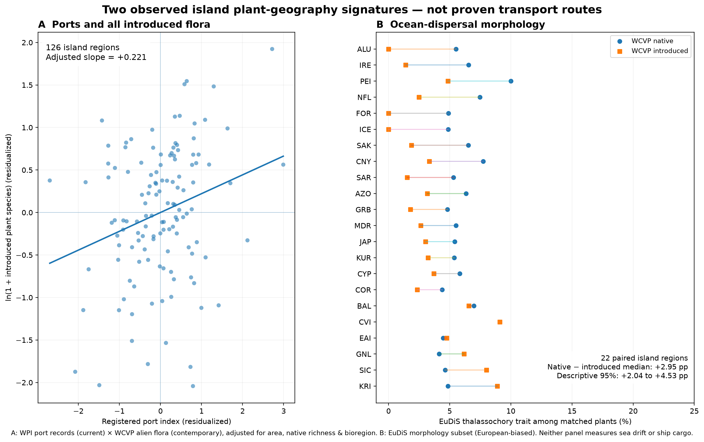
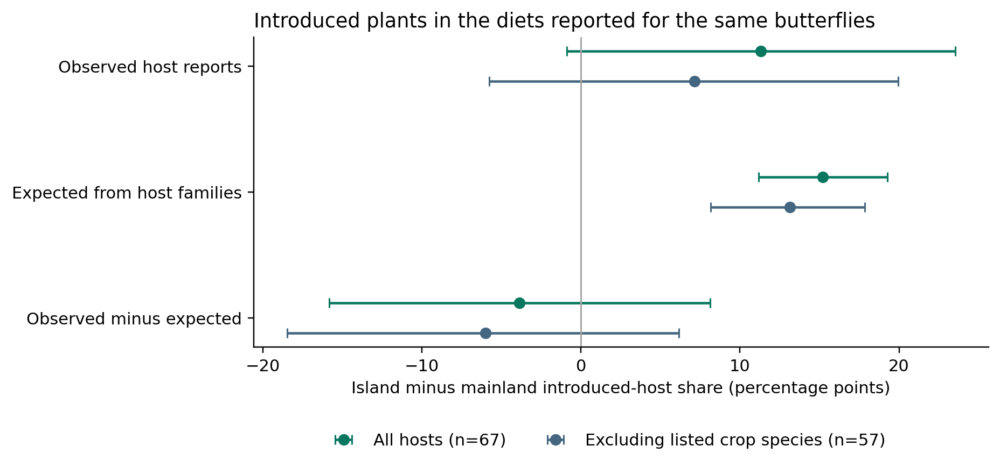

# Human-assembled floras expand the potential resource geography of island butterflies

**ONE integrated Research Article | Butterfly island–port–marine synthesis v0.3 | Global Ecology and Biogeography | 17 November 2026**

**Status:** Coauthor review draft; unsubmitted.

**Running title:** Human-assembled butterfly resources

**Keywords:** alien plants, butterflies, Circuitscape, island biogeography, larval host plants, marine resistance, ports, resource geography

## Structured abstract

**Aim.** Human-redistributed host plants can provide butterflies with potential island food without changing their diets. We asked which butterflies gain resources and whether the same potential consumer pools become available across islands.

**Location.** Global botanical regions, ports and marine networks.

**Time period.** Native and contemporary plant ranges; plant and butterfly records, 2001–2024.

**Major taxa studied.** Butterflies and vascular plants.

**Methods.** For 239 butterflies, we compared native and contemporary known-host ranges across 126 island and 237 mainland botanical regions. We partitioned gains by native-host resource breadth and compared potential butterfly-pool similarity with constrained reallocations, then examined separate port-flora and marine-network associations.

**Results.** Native hosts covered 16.0% of island versus 37.5% of mainland butterfly–region combinations. Introductions filled similar fractions of gaps (22.7% vs 24.5%), yet island resource gain was +118.9%, versus +40.9% on mainlands; global potential opportunities rose +54.9%. Host-resource footprint quartiles received 39.6% versus 11.2% of island gains, but the butterflies' independently recorded country breadth related weakly to gains (ρ=0.053). Mean potential butterfly-pool Jaccard across 7,797 island pairs increased from 0.140 to 0.368, largely as expected from the added-resource margins. A separate 225-species, 51-landmass GBIF record index showed cumulative butterfly Jaccard increasing 0.121→0.178, exceeding a geography- and record-margin-matched expectation of 0.171. Port-rich islands had richer introduced floras; native floras more frequently possessed sea-dispersal morphologies in a 22-region subset. Marine resistance improved separate introduced-flora and recorded-butterfly assemblage predictions by +4.24% and +5.08%, respectively. Host geography improved subsequent butterfly-record prediction by +4.12% across 155 species.

**Main conclusions.** Human-assembled floras expand and partly standardize *potential* butterfly resources on islands, particularly where native-host coverage is sparse. Neither resource similarity nor marine association proves observed butterfly homogenization, transport or colonization.

## 1. Introduction

Moving a plant can change a butterfly's geography without changing the butterfly's diet. If the plant is already a documented larval host, its introduced range may turn an otherwise host-free region into one with a potential food resource. The same addition may leave regional resource coverage unchanged for a butterfly whose native hosts were already present. These consequences differ even when the number of introduced plant species is identical. Empirical studies describe butterfly range changes associated with introduced plants and changing host availability (Graves & Shapiro, 2003; Braschler & Hill, 2007), and historical plant introductions have been linked to subsequent insect invasions (Bonnamour et al., 2023). Yet a global assessment needs to distinguish the *geography of potentially usable food* from the butterfly's dispersal, feeding and establishment.

Islands sharpen this distinction. Naturalized species constitute a large share of many island floras (Essl et al., 2019), but more introduced plants need not mean more resources for a particular insect. The overlooked quantity is the **initial gap in its known native-host coverage**. A consumer with no documented native host can gain a new region from the introduction of just one plant it already uses elsewhere; a consumer with several native alternatives may experience changed food quality or abundance without gaining any new region. This yields a testable prediction: even if introductions fill a similar *fraction* of uncovered butterfly–region combinations on islands and mainlands, a lower initial native-host coverage should amplify the proportional gain on islands. We quantify the effect by holding the host repertoire fixed and comparing native-only with contemporary HOSTS–WCVP resource envelopes, then matching island and mainland regions by area and broad biogeography.

But **where** do these new resources accumulate? Ports are plausible focal points for human-redistributed plant species, through commerce, cultivation, disturbance and repeated introductions; they are not proof of an individual plant's arrival route. Natural coastal colonization provides another filter. Traits consistent with sea dispersal may be more prevalent among native island floras, while the *geometry of connected water passages* can organize regional plant compositions without revealing whether water currents or ships carried any particular taxon. By contrasting the full native and introduced floras, a sea-dispersal trait subset, contemporary port richness and undirected marine circuit resistance, we can test whether these geographic layers have distinguishable observational signatures without assigning causal voyages.

Consumer identity provides a stronger test than floristic homogenization alone. If introduced plants create a shared resource layer, the same butterflies can acquire potential food on multiple islands. We therefore measure *which* butterflies gain native-to-contemporary resources and how the overlap of *potential* consumer pools changes, using constrained reallocations to distinguish the expected effect of adding food opportunities from composition-specific excess. A butterfly's known native-host resource geography is not its actual native range, and potential consumer lists are not censuses of realized butterfly communities.

Finally, the ecological consumer must remain visible. We trace the plants contributing most to global resource gains into dated island-port inventories, check named larval-host reports, and examine whether host geography and marine resistance contribute predictive information about later *recorded butterfly assemblages*. These are separate tests on source-locked but sometimes nonidentical island and butterfly cohorts. Together they address one question: **does human plant redistribution create a disproportionately large new layer of potential butterfly resources on islands, and what geographic structure accompanies that layer?** We explicitly reserve actual arrival, local larval success and onward island-to-island breeding relays as unresolved mechanisms rather than results inferred from GBIF indexing alone.

## 2. Materials and methods

### 2.1. Data sources and geographic units

Analyses were assembled from source-versioned, non-interchangeable populations. The global resource reconstruction uses **239 resource-eligible butterflies** and botanical regions of the World Geographical Scheme for Recording Plant Distributions at Level 3 (WGSRPD3). A separate climate/land-cover-plus-host recording evaluation contains **155 butterflies** with sufficient indexed records; a small supplementary host-envelope overlap comparison includes **32 selected butterflies**. The island record and access reconstruction uses a **fixed list of 225 butterflies across 51 WPI-associated GSHHG landmass groups**, of which **199 butterflies** have complete frozen LepTraits wing-size and disturbance descriptors. The 51 landmass groups, 98 effort-covered insular botanical regions, and WGSRPD3 insular regions are different geographic supports; their counts and coefficients are never pooled as though they share one denominator. The joint butterfly-community host–marine comparison uses 51 islands and 1,275 non-independent pairs; the stricter double-unseen geographic marine sensitivity uses a different **990-pair historical general-plant-indexed** population.

We used the NHM HOSTS catalogue for larval associations, WCVP for regional plant origin, WGSRPD3 for botanical boundaries, and the World Port Index for coastal infrastructure. EuDiS v5 supplies plant dispersal morphology, GBIF supplies dated records and legacy OSCAR supplies directional ocean velocities. All analyses retain their own observation unit. Several physical islands may share a WCVP status, whereas a plant observation within a 5-km port buffer and an immature butterfly elsewhere on the island occupy distinct sites.

### 2.2. Reconstructing resource coverage

The frozen HOSTS interaction dataset links butterflies to accepted larval hosts in the World Checklist of Vascular Plants (WCVP), **version 13 (21 May 2024)**, as represented in the pinned `matildabrown/rWCVPdata` commit `65bed76bae9d644ccb6ad200c05f9f5071d89e05` (Govaerts, 2024). We held accepted butterfly–host identities fixed and used each host plant's native and contemporary (native plus introduced) WGSRPD3 distributions to construct a binary potential resource envelope for each butterfly. For butterfly s and region r, the envelope was coded as a candidate opportunity if at least one accepted host of s was recorded in r. The native-only and contemporary envelopes used the same interaction list. The difference therefore measures the geography added by plant distributions and not host-switching or expanded taxonomic diet.

We calculated the added number of butterfly–region combinations, the contemporary/native resource ratio and the occurrence of gains across classes of host-family breadth. We decomposed added butterfly–region credit among contributing host species and genera using the original fractional attribution, preserving the finite number of possible regions. We retained published analyses excluding exact FAO crop-host identities and a more conservative plant-genus crop exclusion, Poaceae-feeder exclusion, native-resource breadth controls, family mixed effects, geographically stratified comparisons, and a taxon-matched butterfly phylogenetic sensitivity. A post hoc narrow-equivalence test for the host-breadth association was reported as a bound, not proof of zero association.

WGSRPD3 regions were classified using the archived strict island coding rule rather than assuming that every geographically named island belongs to an island region. We contrasted native and contemporary butterfly–region resource combinations across **126 insular and 237 mainland botanical regions** in the original comparison, with area- and broad-biogeographic matching based on **15 supported Level-1 × region-area overlap strata**. Relative gains are computed within each geography class. Because alternative classifications and exclusions affect denominators, class-specific butterfly–region counts are not added to reconstruct the different overall 239-species total.

The matched comparison estimates a difference in the *share of contemporary opportunities attributable to introduced host geography* for comparable strata. It is not a controlled field experiment, an increase in butterfly abundance or an established proportion of opportunities actually used.

We separately reconstructed gap filling across all 239 butterflies and all 363 strictly classified regions, including four regions without any contemporary coverage. For total combinations T, native-covered combinations N and newly covered combinations A, native coverage is B = N/T, gap filling is F = A/(T−N), and the proportional gain A/N equals F × (1−B)/B. We partitioned the pooled island–mainland difference in A/N by averaging the two orders of replacing B and F. For a standardized gap comparison we defined pooled log-area quartiles across these 363 regions, calculated F within each geographic class in each Level-1 × area stratum, and weighted both classes by the smaller number of regions in each shared stratum. A descriptive two-sided test permuted whole-region class labels 4,999 times within strata. A species-equal sensitivity calculated the island–mainland gap-filling difference separately for each butterfly before averaging.

### 2.3. Port floras and morphological sea-dispersal traits

For **98 insular botanical regions** with source-defined plant indexing effort, we examined associations between modern World Port Index (WPI; National Geospatial-Intelligence Agency, 2019) port counts and (a) total introduced vascular-plant richness, (b) distinct introduced taxa known as butterfly larval hosts, and (c) the host-taxon response conditional on the whole introduced flora. Geographic, native-baseline, area and botanical-indexing controls followed the source analysis. We retain each model's own coefficient rather than interpreting different response-model coefficients as directly comparable causal effects. We did not infer ships, botanical propagule routes or port-specific plant arrival dates from current WPI port counts.

**Port survey coverage and species-level bridges.** The broader original GBIF port inventory contains **3,630** registered port candidates; plant queries were completed at **1,596 ports across 142 country codes**, including **1,150 ports** with a recorded introduced larval-host candidate, **687 candidate introduced host plant species** and **25,742 plant × port records** (not unique plant observations and not all 3,630 ports). Contemporary WCVP regional introduced status defines *candidate* non-native plants, not independently confirmed historical introductions to each port. For an illustrative source-matched set, we compared the ten largest contributors to global added butterfly resource opportunity with **2001–2010 GBIF species-key records from 38 port buffers on 17 studied landmasses**. The resulting species-name overlap is a taxonomic/date check, not proof of ship transport or at-site larval use.

For the complete 126-region comparison, we regressed log-transformed introduced vascular plant richness on log₂(1 + registered ports), conditional on area, native richness and broad botanical biogeography. We examined the distribution of native and introduced plants with morphology consistent with dispersal by sea (thalassochory) within each island region. Both origin groups needed at least 20 EuDiS-matched plants and at least 5% taxonomic coverage. We calculated the median paired difference in proportions and a descriptive regional bootstrap interval. The port and morphology analyses draw on different geographic samples.

### 2.4. Reported larval hosts relative to the flora

We joined geographic HOSTS reports for Papilionoidea to accepted plant identities and unambiguous regional origin. We used reports resolving to a single botanical region, excluded entries explicitly marked as laboratory rearing, and required at least ten accepted entries at a locality. A blank rearing flag leaves field conditions unknown. We deduplicated butterfly–plant–locality combinations and retained butterflies represented on both islands and the mainland. For each butterfly, localities received equal weight within each geographic class. Each shared species contributed one paired difference to the summary. We calculated the expected fraction of introduced hosts using the regional introduced fraction within each reported plant family. Subtracting this expectation from the observed contrast asks whether island reports contain more introduced plants than their familial composition predicts. Descriptive intervals resample butterfly species 9,999 times. We repeated the comparison after removing exact FAO crop binomials.

### 2.5. Marine resistance and held-island predictions

We used electrical resistance on water-cell networks to represent the number and configuration of possible sea connections. For vascular plants, 104 island botanical regions could be anchored on the uniform-conductance GSHHG water grid. We computed pairwise Jaccard similarity separately for native and introduced accepted taxa and kept the same pairs for both responses. The baseline included geographic distance and its curvature, broad region, latitude difference, island areas and richness. We tested the increment from finite-volume effective resistance in a ridge model with training-only standardization. Entire islands were withheld from training and errors averaged by held island. This is a prediction conditional on the geographic and richness information available for that island.

The source-locked marine network uses original island-port representative locations and a modelled undirected ocean-resistance surface. **Joint host–marine community model.** The already completed, independently audited [joint analysis](../../results/island51_host_circuit_joint_20261106/README.md) tested 1,275 original island pairs across 51 landmasses, using Jaccard similarity of butterflies newly indexed during 2011–2022 as the outcome. Every model included source-defined great-circle distance (and its squared log), original WPI port-count sum/difference and earlier butterfly similarity. Before the joint comparisons, a source-verified **uniform-ocean Circuitscape baseline** assigned conductivity 1 to water cells, without AIS or wind. The base prediction included log great-circle distance (and its square), port-count controls and, for the later butterfly response, earlier butterfly similarity; adding uniform-ocean resistance isolated the incremental retrospective information of sea geometry under those statistical controls. The common geographic joint-model reference G included that uniform-ocean resistance. H additionally included original pooled candidate introduced-host Jaccard; C instead added observed modern native-AIS-density and wind-speed-based Circuitscape resistance; HC included hosts and both extra circuits. Leave-one-island-out cross-validation excluded all pairs incident on the test island, made separate endpoint-specific predictions and averaged their squared errors by island. **The held-island host inventory and marine coordinates were available to the predictors**; plant records pooled 2001–2024 may postdate the target. Improvements are therefore conditional *retrospective* prediction differences, not independent causal effects.

We compared each assemblage against its own baseline. Electrical connectivity is symmetric, whereas an ocean velocity field has direction and changes with time. To assess sensitivity to the definition of sea connection we also considered shortest-water detours, both-endpoint holdouts, and spatially constrained AIS relabelling (Supplementary Results).

### 2.6. Predicting butterfly records

Two separate observation checks guard against a purely arithmetic interpretation of larger plant-defined envelopes. In a stratified 32-butterfly host-envelope comparison, we examined whether contemporary butterfly records outside native-only host envelopes fell inside the expanded envelopes, testing geometric and region-matched null expectations. In a larger **155-butterfly** panel, we compared climate-plus-land-cover recording predictions against models also including host-resource and host-composition information under a subsequent-period evaluation, held spatial blocks, and documented observation/source sensitivities. These analyses assess correspondence and prediction of GBIF records; static contemporary host geography is **not** a dated pre-colonisation exposure. Temporal holdout refers to butterfly records, not historically frozen host maps. We also compared the **original public 225-species × 51-landmass cumulative GBIF butterfly record index** across 2001–2010, cumulatively through 2017 and cumulatively through 2022 (the same **1,275** unordered island pairs throughout). An explicit 317-new-index constrained null preserved every butterfly's number of newly indexed islands and every island's number of newly indexed butterfly taxa, without assigning new records to previously indexed cells; the geographic version also held each butterfly's added records within its original fixed five longitude-block groups. The original 399 configurations were rechecked with four separately seeded chains of 199 configurations each; stable Markov-chain means establish numerical sensitivity only, not true new colonizations or complete historical detection control. As an independent sensitivity to the changing *number of indexed records*, we repeated the same-island-pair comparison after selecting landmasses with sufficient pre-2011 butterfly records and calculating exact hypergeometric expected species inclusion at equal GBIF record depth (20, 50, 100, or 200 per landmass). This conditions on public record counts, not actual observer-hours or survey design; butterfly native range, establishment and single-island versus archipelago endemism were not inferred from GBIF zeroes or plant host ranges.

## 3. Results

### 3.1. Introduced hosts narrowed the resource-coverage gap

Across the 239 butterflies, native host coverage was 16.0% on islands and 37.5% on the mainland. With introduced hosts included, coverage reached 35.1% and 52.8%, respectively. The absolute difference narrowed from 21.4 to 17.7 percentage points (3.7 points using unrounded counts). Most of the initial gap remained.

On the native-only host map, 126 strictly insular WGSRPD3 regions contained **4,829** butterfly × region opportunities. Incorporating introduced ranges of *already-known* larval hosts raised this to **10,570**, a **+118.9%** expansion. The added **5,741/10,570 (54.3%)** contemporary island opportunities were attributable to introduced known-host ranges. The mainland comparison (237 regions) increased from **21,215** to **29,901** combinations (**+40.9%**). A matched analysis across **15 Level-1 biogeographic × area-overlap strata** retained an insular excess of **+10.7 percentage points** in the contemporary share attributable to introduced hosts (descriptive within-stratum permutation **p=0.0002**).

**Why the proportional gain differs (Figure 1).** Of 30,114 island and 56,643 mainland species–region combinations, 4,829 (16.0%) and 21,215 (37.5%) had a native host. Of the remaining gaps, introduced hosts filled 5,741/25,285 (22.7%) on islands and 8,686/35,428 (24.5%) on the mainland. The pooled difference in proportional gain (+77.9 percentage points) decomposed into +84.2 points associated with baseline coverage and −6.3 points with gap filling. Across 15 shared area–biogeographic strata, standardized gap filling was 24.1% versus 22.9% (+1.27 points, descriptive permutation p = 0.5622). Species-equal gap filling averaged 5.44 points lower on islands (65 butterflies higher on islands, 141 higher on the mainland, 33 ties). The three estimates use different weights; none indicates a consistently higher fraction of gaps filled on islands.

The island contrast sits within a wider global butterfly result. Across the separately defined **239-butterfly** resource reconstruction, contemporary host maps added **14,553 butterfly × region units** (from **26,530 to 41,083**, **+54.9%**) and expanded the opportunity of **206/239 (86.2%)** butterflies. Gains appeared among dietary specialists (including **82/97 one-family** butterflies) and generalists. Proportional gain was poorly described by the number of host families (Spearman **rho=0.008**, bootstrap **95% CI −0.111 to +0.128**); a strict post hoc equivalence test for |rho|<0.10 was inconclusive (**p=0.078**). Excluding crop hosts still left **46–47%** aggregate potential expansion.

### 3.2. Ports and sea-dispersal morphology distinguish two aspects of island floras

Across 126 island regions, port number was positively associated with introduced vascular plant richness after area, native richness and broad biogeography were accounted for (β = +0.221 per unit of log₂[1 + port count]). Across the 22 regions with sufficient trait coverage in both layers, the median native-minus-introduced difference in the proportion of sea-dispersal morphologies was +2.95 percentage points (descriptive 95% interval +2.04 to +4.53). Seventeen regions had a positive difference, four a negative difference and one was tied.

We followed the same plant species from the global reconstruction into dated port inventories (Figure S13). The **ten most influential plants** in the global resource calculation supplied **25.1%** of added opportunity across the 239 butterflies. **Eight of those ten species** had a 2001–2010 accepted-name GBIF index in at least one of **38 surveyed port buffers on 17 landmasses** (contributor credits together accounting for **20.7%** of the global added units). *Medicago sativa* appeared at **7 ports/3 landmasses**, *Poa pratensis* at **8/4**, and *Dactylis glomerata* at **9/5**.

The wider inventory included **1,596 GBIF-query-complete ports across 142 country codes**, with **1,150** containing at least one candidate introduced larval host; it identified **687 candidate host plant species** and **25,742 plant × port combinations**.

Among **98 botanical-effort-covered insular regions**, higher modern World Port Index port numbers were associated with more introduced vascular plant taxa (**beta=+0.2445**, permutation **p=0.0012**) and more distinct introduced taxa in the known butterfly host catalogue (**beta=+0.1639**, **p=0.011**). This correspondence points to a broader introduced botanical supply pool, not necessarily selective accumulation of larval hosts at ports (Limitations; Supplementary Results S.E).

### 3.3. Which butterflies benefit, and do islands share potential consumers?

Introduced known hosts added **5,741** potential butterfly × island-region resources across **239 butterfly species** (Figure 3A). Butterflies in the narrowest quartile of **native-host resource geographic breadth** (60 species, **2–48** native host-covered WGSRPD3 regions) gained **644** island opportunities (**11.2%** of all added island resources). Those in the broadest quartile (59 species, **169–305** native host-covered regions) gained **2,271 (39.6%)**. Intermediate quartiles gained **1,077 (18.8%)** and **1,749 (30.5%)**. Native-host resource breadth correlated with islands gaining potential resources (**Spearman ρ=+0.579**) and with the fraction of each butterfly's initially host-uncovered island regions filled (**ρ=+0.668**). Broader resource footprints included more known larval-host taxa (**24.4** host species on average in the top quartile, versus **4.5** in the bottom quartile). These are host-plant geographic categories, **not direct estimates of butterfly range breadth or endemic status**. An independent *butterfly-centred* check retrieved worldwide **2001–2010** GBIF country facets for all original **225** species, yielding **9,648,232** country-assigned indexed records. With each butterfly standardised to the expected country categories in **30** indexed records, **222** species had sufficient pre-2011 coverage. Their **own observed global country breadth** was only weakly associated with island HOSTS-resource gains (**Spearman ρ=+0.053**, species-level descriptive 95% **−0.073 to +0.180**); a partial rank controlling native known-host geography, HOSTS catalogue size, global GBIF record volume and early 51-landmass index breadth was **−0.002** (**−0.127 to +0.128**). Reclassifying butterflies by these observed-country quartiles gave **25.3%** of source-covered new island resources to the narrowest and **26.3%** to the broadest quartile, not the 11.2%/39.6% distribution when classified by *plants* (Supplementary Figure S15).

We next reconstructed each island's set of **potential butterfly consumers**, counting a butterfly when at least one of its known HOSTS larval-food plants had a recorded regional range. For **7,797** island pairs with a defined native baseline, mean potential-consumer Jaccard overlap increased from **0.140** for native hosts to **0.368** with introduced hosts added (**+0.227**, Figure 3B); **92.3%** of pairs increased. Between distinct Level-1 biogeographic regions, mean potential overlap increased **0.113 to 0.350**. This is **a shared map of possible food for the same butterfly species**, not actual butterfly assemblage homogenization or colonization.

Much of the similarity gain is a structural consequence of adding species×island opportunities. A descriptive 199-draw fixed-margin null, preserving each butterfly's number of gained islands and each island's number of newly covered potential consumers while excluding already-native cells, gave mean similarity gain **+0.216** versus the observed **+0.227**. Retaining each butterfly's gain totals within broad Level-1 regions further raised the expected gain to **+0.224**, leaving a small excess of approximately **+0.0038** Jaccard. Those constrained Markov-chain configurations are not independent tests of historical transport. A second, observation-based geographic-breadth proxy from pre-2011 GBIF records of **225 butterflies × 51 sampled landmass groups** related more weakly to island resource additions (**ρ=+0.198**), and cannot classify true island endemics.

**Independent butterfly-record comparison (Figure 3C).** In a different, original **225-butterfly × 51-port-linked landmass** GBIF-index panel, **736** butterfly×island cells were indexed during 2001–2010, with **221** newly indexed in 2011–2017 and **96** in 2018–2022. Across **1,275 common island pairs**, mean Jaccard of **cumulative indexed butterfly lists** rose **0.121 → 0.162 → 0.178**; **945 pairs (74.1%)** increased, 193 decreased and 137 were unchanged. The observed 2010-to-2022 increment **+0.05681** exceeded the **+0.03815** mean of a null preserving each species's new island count and each island's number of newly indexed butterflies. A stricter geography-constrained null additionally fixing the number of new records for each butterfly within the original five longitude groups yielded **+0.04961** on four independent chains, leaving an observed excess **+0.00720**. Across 796 dependent Markov-chain configurations the four chain means spanned only **0.00024**. This supports recorded spatial convergence but cannot separate biological colonization from changing record effort or first indexing of previously present butterflies.

**Butterfly recording-effort sensitivity (Figure 3C, source-specific caution).** Across the original 225 species, the 51 landmasses contributed **5,814,636** indexed GBIF records in 2001–2010, of which **5,699,068 (98.0%)** came from one GB-associated landmass (ID 15); **15/51** landmasses had fewer than 20 prior butterfly records and accounted for **94/317** later first-indexed cells. Excluding ID 15 left cumulative recorded-list similarity gain **+0.05723** (50 landmasses), but record-count standardisation substantially reduced gains within pre-specified eligible sets. In the **36 landmasses** with at least 20 prior records, raw same-pair ΔJaccard was **+0.04761**, versus **+0.01410** for expected-overlap/expected-union Jaccard at equal depth of 20 records. Among **20 landmasses** with at least 100 prior records, the corresponding increases were **+0.02001** and **+0.00560**. This sensitivity shows changing reporting volume can materially affect recorded similarity, without identifying genuine ecological turnover; complete observational effort and species-specific detectability remain unresolved (Supplementary Results S.F).

**Independent historical island-fauna counterchecks.** On the original Phu Quoc landmass (ID 471, Duong Dong port, Viet Nam), all **12 butterfly species first indexed by GBIF only in 2018–2022** were already named in island-specific **2006 or 2007** field sources: nine in a 2006 73-species survey checklist and three more with 2007 locality-dated species records. A **second, geographically independent historical fauna** was then cross-checked on **Mauritius** (ID 218, Port Louis port): **three of its five** later first-indexed butterflies (*Lampides boeticus*, *Zizula hylax* and *Danaus chrysippus*) occur under the same species names in a **1993** island-specific annotated checklist, all earlier than their 2011–2017 GBIF first-index windows. The remaining two Mauritius cases remain **unresolved**: *Zizina otis* requires taxonomy-concept reconciliation with the checklist's *Z. antanossa*, while the single *Zerynthia polyxena* index requires original occurrence-geography and identification QA. Thus **15/317 source-selected first-index cells from two distinct islands are independently documented before the first indexed period**; the **other 302** are not classified as true new arrivals or historical absences. These source-matched examples cannot estimate a global GBIF first-index misclassification rate (Supplementary Results S.F).

The broadest native-host **resource-footprint** quartile accounted for **163/317 (51.4%)** of newly indexed butterfly×island cells, compared with **23/317 (7.3%)** in the narrowest matched quartile, even though these categories measure host plants' geography rather than native butterfly ranges. However, species-level newly indexed island counts were only weakly associated with the number of plant-defined island resource gains (**ρ=+0.192**), and their descriptive partial rank after native host footprint, catalogued known-host count and earlier indexed butterfly breadth was **−0.068**. The two independent data layers thus show partly concordant *geographic organisation*, not a demonstrated causal host-led insect expansion (Supplementary Results S.F). In another source-locked comparison, **observed butterfly global country breadth** generated a different species-quartile contrast: the Q4 group (55 species) contributed **153/317 (48.3%)** of subsequent GBIF first-indexed species×island cells, versus **26/317 (8.2%)** in the Q1 group (56 species), despite near-equal shares of host-resource opportunities. This apparent concentration did **not** independently improve later first-index prediction after the original recorded source geography, sea resistance, port counts and botanical/GBIF observation controls: adding the country-breadth score worsened Brier error by **0.242%** under 51 held-island tests, **0.596%** in five held geographic groups and **0.222%** for genus-blocked butterflies (Supplementary Results S.G).

Named butterfly–plant use reports support some consumer identities across island and mainland contexts, but excess introduced-host use relative to botanical family composition remained unresolved (Supplementary Figure S14).

### 3.4. Marine networks distinguish the assembled introduced flora and recorded butterfly communities

Across **104** coastal-anchored botanical regions and **5,355** common plant-flora pairs, adding undirected, uniform-ocean effective resistance beyond distance, broad biogeography, latitude, island area and species richness improved held-island prediction of **introduced-flora similarity by +4.239%** (descriptive island bootstrap 95% **+2.511 to +6.029%**). The matched **native-flora** model did not gain (**−0.110%**, **−0.391 to +0.165%**). The introduced-minus-native contrast in *relative prediction gains*, using the same 104 held regions, was **+4.349 percentage points** (descriptive paired interval **+2.711 to +6.087**). Adding the circuit after the contemporary port-number proxy still improved introduced-flora prediction **+3.972%**. The same port-number proxy on its own added only **+0.043%** introduced and **−0.077%** native; these are proxies for current infrastructure, not recorded voyages. Shortest-water paths, by contrast, improved both native (**+2.234%**) and introduced (**+1.775%**) similarities. Thus the nonpositive native *circuit* increment is not absence of native marine biogeography (Figure 4).

The consumer layer showed a complementary geographic correspondence on a **separate sample**. Across **51 landmass groups and 1,275 dependent pairs**, marine circuit resistance improved later GBIF-indexed butterfly assemblage similarity prediction by **+5.082%** beyond original geographic, port and earlier-butterfly-composition controls (**33/51** held islands improved). Island pairs sharing more candidate introduced known larval-host taxa near ports also tended to share more later indexed butterflies (**Spearman ρ=+0.300**, descriptive partial rank association **+0.215** after distance and earlier butterfly similarity). The botanical circuit used coastline terminals and ridge regression; the butterfly circuit used weighted port terminals and OLS. They therefore show separately measurable marine-network-associated structure, **not a matched mediation pathway**.

### 3.5. Known-host geography improves subsequent butterfly-record prediction

In a distinct **155-butterfly** temporal recording-prediction evaluation, adding known larval-host geographic information to climate and land-cover covariates reduced subsequent-period squared prediction error by **4.12%** across **208,482** evaluation combinations. The improvement remained **3.00%** when holding out spatial blocks and **2.74%** among locations at least 100 km from training records, with four source/recording sensitivity analyses retaining the positive direction. These gains show that potential host-resource geography adds observational predictive information about butterflies beyond abiotic and land-cover predictors, even though plant distributions were contemporary rather than dated to the start of the butterfly prediction window (Supplementary Results S.A).

## 4. Discussion

### 4.1. Low native coverage amplifies the contribution of introductions

Graves & Shapiro (2003) documented butterflies feeding on introduced plants in California, including species that extended their ranges. Rashid et al. (2026) evaluated how host distributions constrain the thermal range margins of European butterflies. Our comparison quantifies a different component of resource availability: the regional gain possible with the host repertoire held constant. The island excess persists after matching area and broad biogeography, extending the global floristic island contrast of Essl et al. (2019) to potential resources for named consumers. A species can gain a region through one familiar plant, even if it uses a single host family. The matched 10.7-point contrast concerns the share of contemporary combinations contributed by introduced hosts; the unadjusted 118.9% and 40.9% gains use native-only combinations as their denominators. The gap-filling comparison identifies the main arithmetic source of the island excess. For every combination already covered by native plants there were about 5.2 uncovered combinations on islands and 1.7 on the mainland. Filling a similar fraction of those gaps produces a much larger proportional change on islands. The absolute gains remain real additions to the reconstructed resource map. Catalogue coverage, area and the composition of regional floras all bear on how many native gaps are recorded.

### 4.2. Ports locate introduced hosts within a wider flora

A port can affect the resources available to a butterfly at two distinct stages: moving a plant across a sea barrier and providing conditions in which it persists after arrival. Ships can supply propagules repeatedly from distant sources. Historical evidence comes from herbarium specimens at nineteenth-century solid-ballast deposits in the northeastern United States (Schmidt et al., 2023). A modern counterpart is the recovery of seeds on the air-intake grilles of refrigerated containers arriving at Savannah (Lucardi et al., 2020). This mechanism matters for weeds because a seed can accompany a shipment whose declared commodity bears no relationship to the plant. Deliberate transport creates another pathway: live plants and seed imported for gardens, cultivation or pasture can subsequently escape.

What happens after unloading also matters. Disturbed ground, storage areas and planted margins can support different floras within the same port landscape, as surveys at Trieste illustrate (Tordoni et al., 2017). In our sample, the most revealing comparison concerns the whole flora. Port-rich island regions contained more introduced plants and more introduced hosts, but the additional positive host association disappeared when the total introduced flora was included. One ecological interpretation is that trade and land use enlarge the pool of plants from which butterflies can draw. These records locate plants in a butterfly's documented diet. Feeding at a particular port would also require spatial and seasonal overlap with larvae. The 687 candidates include crops and ornamentals as well as plants that grow as weeds. Neither a 5-km botanical record nor a count of ports distinguishes accidental seed transport from planting and escape. Shipping manifests, propagule interceptions and records of subsequent reproduction of the same plant would connect those processes for an individual island.

The regional calculation and the local observations answer different ecological questions. A regional gain occurs only when an introduced plant supplies the first documented host for a butterfly in that botanical region. At a particular port, an introduced host may grow alongside native alternatives. Native hosts were already recorded locally in all ten selected cases where a regional native alternative was known. The introduced plants could still change the quantity, seasonality or location of larval food. The inventories measure plant presence, leaving those changes unresolved.

### 4.3. Two kinds of sea-associated floristic structure, one resource consequence

The butterfly-beneficiary perspective adds a distinction beyond the already known homogenization of introduced plant floras. Independent pre-2011 global GBIF country facets show that a butterfly's **observed geographic breadth** is not equivalent to the breadth of its **known native host-plant resources**. Potential island food resources were spread nearly evenly across observed country-breadth quartiles, whereas later indexed island butterflies were strongly concentrated among broadly indexed species; source access and observation controls absorbed the extra predictive contribution of both country breadth and host opportunity. This separates the **supply of possible food** from the **recorded realisation of consumers**, without mistaking an index filter for an identified dispersal mechanism. The added host geography is **unequally distributed among potential insect consumers**, concentrating in butterflies with broad native-host resource footprints (Figure 3A). As a result, islands can share more *potential butterfly consumers* even without local butterfly recruitment, because the same known food plants become geographically available (Figure 3B). The overwhelming majority of this potential-consumer overlap increment is expected once the gained-resource totals per butterfly and per island are fixed. The geographical consumer pool therefore supplies an informative counterfactual baseline for actual butterfly homogenization, **not evidence that the latter has already occurred**. A separate **225-species, 51-island cumulative GBIF index** also shows increasing similarity of *recorded* butterfly lists, modestly beyond geographically constrained fixed new-record margins (Figure 3C). This independent consumer observation strengthens the presence of an island-wide record-geography pattern, but neither measuring true populations nor aligning its 51 landmasses directly with 126 plant-geographic regions. Even repeated, stable constrained-null results do not show that new host availability drove insect establishment or true biotic homogenization.

The positive results connect **different properties** of island floras without reducing them to a single transport mechanism. Among the 22 trait-covered regions, native floras had a greater proportion of structures consistent with sea dispersal. Among 104 coastline-resolved regions, undirected effective resistance predicted the *introduced* floristic layer beyond the declared baseline, whereas shortest-water distance aided both layers. A network with many parallel water paths can encode geographic or historical relatedness that is missed by a single distance measure; it cannot identify the direction of currents, a seed's seawater viability or a vessel's cargo. The 22-region trait subset is European-biased and morphologically inferred, so even the apparent native/introduced contrast is not a global proof of two distinct delivery modes.

What connects this to butterflies is not the assertion that they followed the same ships. The introduced layer contains geographically redistributed members of known larval diets, so it increases *potential* food access in regions formerly lacking a documented host. Ports supply independently indexed examples of these taxa in coastal habitat; recorded butterfly assemblages also retain marine-network-associated spatial structure in a separate 51-landmass sample. The interpretation is a **human-assembled layer of possible consumer resources situated within a structured marine landscape**, not proven co-transport or simultaneous colonization. The extra butterfly circuit signal attenuates after additional controls for candidate-host richness and early botanical observation effort, so it must not be treated as an independent causal sea pathway (Limitations; Supplementary Results S.C).

### 4.4. Separating maritime transport, independent flight and breeding relays

On Hawaiian islands, monarchs use introduced milkweeds, including *Calotropis gigantea* (Freedman et al., 2020). Our dated port inventory records this plant on Hawaiʻi, and separate island-wide records document monarch larvae and egg-laying. These observations locate a known resource near a port and confirm breeding activity on the island. They leave the oviposition plant and the origin of the recorded butterflies unresolved. In particular, Molokaʻi already fell within the published Hawaiian distribution before the 2021 entry in our index (Starr & Starr, 2007). The two sequences ending with that monarch record in Figure S12 therefore illustrate renewed detection in a known range. The nine larval-to-later-record sequences in Figure S12 were selected conditional on a later detection. They identify places to test dispersal; they supply no comparison of onward colonisation rates. A breeding stepping stone would require successful local reproduction and movement of descendants onward. Population-genetic and historical reconstructions can test such pathways at archipelago scale (Zalucki & Clarke, 2004), whereas occurrence chronology alone cannot identify them.

Historical cargo with a dated origin and recipient, a viable plant or propagule identified to species, and subsequent wild establishment would connect a particular port to plant transfer. For ocean delivery the analogous observations are departure, survival under the relevant drift conditions, and recruitment on the recipient shore. Butterfly dispersal requires a further link: individuals emerging on the intermediate island must contribute to a subsequent population. Historical specimens, population assignment and repeated observations of immature stages can address different parts of that question. Our independently source-locked, species-specific historical host test reinforces that separation: compatible plants were indexed around original island ports before the butterfly-record window, and their presence showed a positive crude association with later butterfly first indexing. Yet after controlling butterfly and island identities and distance to a previously indexed conspecific island, that positive association did not persist, and prior compatible-host indexing failed to improve held-out-island recording predictions (Supplementary Results S.C). These observations do not negate potential resource gains; they show that host opportunity alone does not identify the route or successful realization of a butterfly's distribution. The sampled 2020 vessel network confirms direct links for only seven of 7,875 botanical-region pairs; missing vessel coverage supplies no evidence against maritime traffic.

### 4.5. Implications for managing introduced host plants

A plant targeted for removal may be among the few documented local larval foods even where its wider environmental impacts warrant control. Resource maps can identify the butterflies for which losing that plant merits a site assessment. Decisions about timing or replacement need observations of eggs, larval survival and seasonal availability of alternative hosts. Ten selected port histories already contained native alternatives. Elsewhere a listed native host can be inaccessible because suitable habitat is distant or its foliage is unavailable during breeding. The distinction matters both for island conservation and for evaluating the risk that a newly introduced plant supports an expanding herbivore. Regional host counts alone cannot decide whether retaining or removing a local population benefits native biodiversity.

### 4.6. Limitations and what the evidence does not establish

**Resource coverage is not demographic success.** HOSTS is incomplete; a contemporary WCVP host range is neither an historical arrival date nor a site-level observation of larval feeding, plant abundance, suitability, performance, competitors or seasonality. Gains of +54.9% overall and +118.9% on islands measure potential access to *already-known* hosts with the same butterfly diet fixed. They cannot establish a corresponding increase in butterfly abundance, species richness, colonization, fitness or a change in realized diet.

**The geographic layers cannot be concatenated into one causal chain.** WPI port numbers are current infrastructure, not vessel voyages, and the positive port–introduced-flora richness relationship becomes nonspecific to known larval hosts after adjusting whole introduced flora (**host-specific β=−0.0415, p=0.093** in 98 effort-covered regions). The EuDiS sea-dispersal morphology contrast covers only 22 botanically sampled regions with European-biased trait coverage. For the same **104** botanical regions, adding effective-resistance circuits improved introduced-flora prediction, while a stricter **1,089-pair, two-unseen-endpoint** test retained a positive **+2.735%** but a five-group descriptive interval **−1.649 to +5.738%** spanning zero. Shortest-water paths improved *both* floral origins. No direction or historical velocity is contained in the undirected electrical circuit. In the exploratory 2005 NOAA OSCAR source pilot only **12 of 7,313** eligible model directions approached recipient shores within 50 km, and **four** made another-region land-mask contact. Source–destination co-listing did not exceed the matched comparison expectation; these are not viable seed deliveries (Supplementary Results S.E).

**Beneficiary identity and potential similarity are not observed butterfly composition.** The quartiles of resource gain use the number of regions containing native **host plants**, not the butterfly's observed distribution, island-endemic status or dispersal ability. Known host-plant species counts also differ substantially between quartiles. The 225-species early-GBIF breadth check covers only 51 originally selected port-linked landmass groups and is recording-effort dependent. The reconstructed potential consumer Jaccard is a function of HOSTS–WCVP resource presence, not new butterfly populations, and most of its increase arises under the fixed-margin assignment null; the Markov-chain replicates are dependent and exploratory. Although a separately acquired GBIF butterfly record index now shows a spatial convergence signal after fixed new-record-marginal reassignment, those cumulative records do not measure complete biological butterfly communities and cannot distinguish newly established populations from formerly overlooked residents. Its 51 port-linked landmass groups are not the original 126 WCVP botanical regions. The constrained models adjust only recorded new species counts per butterfly and island, plus butterfly-specific allocation across five broad geographic groups; they cannot remove time-varying observer effort, dataset and nomenclatural drift, differential species detectability or incomplete source populations. Four-chain convergence tests numerical stability, not causal identifiability. No actual ecological biotic homogenization, population growth or competitive exclusion was measured. The newly retrieved global **2001–2010 GBIF country faceting** for 225 butterflies is an index of **observed country breadth**, not a verified native geographic range or island endemic status. Exact 30- and 100-record country rarefaction limits sample-count bias but cannot remove country-area effects, spatially uneven observer efforts, later-reinterpreted older records or source-data overlap with the subsequent island GBIF index. The weak raw/adjusted source-country breadth–HOSTS resource relation must not be promoted to a formal equivalence result, and the large raw breadth difference in later first-index counts cannot establish who biologically colonized islands.

**Butterfly records and independent resource effects have their own uncertainty.** The butterfly circuit sample comprises **51 selected landmass groups**, not the same botanical units as the 104 plant regions. GBIF first indexing does not certify arrival, reproduction or community abundance. Candidate introduced-host Jaccard pools 2001–2024 and may postdate 2011–2022 butterfly records. Its additional predictive effect across islands is unstable. When the 51-island models additionally account for candidate-host marginal richness and actual **2001–2010** botanical recording effort, adding uniform marine resistance after candidate hosts changes later-butterfly MSE by only **+0.712%** under island holdout (descriptive interval **−0.665 to +2.009%**) and **−0.522%** with both geographic endpoints withheld. A distinct *temporally prior* species-specific test across **218 butterflies, 10,431 at-risk species–island cells** found a crude **4.93% versus 2.70%** later butterfly-index rate with versus without a pre-2011 recorded compatible host, but this positive relationship disappeared after earlier-conspecific geographic-distance adjustment; historical host presence did not improve held-region prediction (Supplementary Results S.C). These controls do not negate resource availability; they limit claims of an independently identified arrival or mediation mechanism.

**Further inference and publication boundaries.** The geographic host-use comparison did not establish an island introduced-host preference after plant-family background adjustment, and 10 selected port histories already contained native alternatives. Plant and butterfly occurrence, HOSTS reports and port sampling are uneven. Pairwise island observations share endpoints; island bootstrap intervals are descriptive, not independent randomized causal confidence intervals. The 155-butterfly prediction used contemporary host maps even when butterflies were held out by recording year. Independent GBIF dataset citation/derived data DOI, restricted-author host-edge accessibility and coauthor permissions, source licence verification and journal-ready artwork remain unresolved (Data and code availability; Supplement).

## 5. Conclusions

The major change created by human plant redistribution is not simply a richer island flora. It is a larger and more geographically shared **set of potential larval food resources for named butterfly consumers**, especially in island regions with low initial native-host coverage. The additions concentrate in butterflies with broad *native-host resource footprints*, while resource-defined potential butterfly pools grow more similar across island regions, largely as expected from their shared new resource opportunities. Independent pre-2011 global butterfly GBIF country breadth does **not** show a similarly strong concentration of those potential food gains; in contrast, later island butterfly indexing is concentrated in globally broadly indexed species. This disparity supports a research distinction between potential resource geography and recorded butterfly geography, not observed historical community replacement. Independently indexed GBIF butterfly species lists also became modestly more similar across a separate 51-landmass panel than expected from new-index marginal richness and coarse geographic constraints, supporting a parallel *recorded-consumer* geography. Port-associated introduced floras and marine-network-associated plant and butterfly patterns provide complementary context. These distinct datasets do not establish that globally widespread rather than endemic butterflies have colonized, that actual butterfly populations have homogenized, or that individual plants and insects followed ships or ocean currents.

## Data and code availability (draft; final rights and archive check required)

The integrated analyses reuse several distinct datasets rather than a single interchangeable global butterfly–host–island observation file. Accepted butterfly larval-host identities are based on the Natural History Museum HOSTS source (DOI: 10.5519/havt50xw) and **WCVP v13 (21 May 2024; DOI: 10.34885/0yex-xv26)**, frozen through the reproducibility-sidecar rWCVPdata commit `65bed76bae9d644ccb6ad200c05f9f5071d89e05` (Kew archived dataset licence: CC BY 3.0; the R-package GPL licence describes the package, not the underlying Kew archive); butterfly traits are from the source-locked LepTraits dataset (DOI: 10.1038/s41597-022-01473-5). Original population definitions, archived source commit identities, reconstruction scripts, result receipts and figure data are maintained in the project's GitHub repository. The old 32-species GBIF occurrence validation source has the archived GBIF DOI **10.15468/dl.pp5nc9**; **this DOI does not describe the new 225-by-51 public GBIF reindex or all other butterfly occurrence analyses**.

For the new island record analysis, a derived **11,475-row, 225-butterfly × 51-landmass GBIF period-index table**, six original GBIF query receipt/geometry audits, the fixed source panels, every main-figure renderer and source-checker script have been committed on the single working Draft branch, under data/exploratory/public51_butterfly_index_20261109/, results/, scripts/ and figures/integrated_island_port_butterfly_v02/. GBIF indexing is not verified establishment. Global 1,596-completed-port plant inventory metrics, original butterfly–host concordance, pre-2011 38-port botanical audit and the original 239-species resource envelopes remain source-referenced with their own cohort and permission boundaries.

**Independent GBIF provenance and citation gate:** According to GBIF's data-citation guidance, research based on occurrence search API queries should identify contributing publisher datasets and obtain suitable occurrence-download or derived-dataset DOI citations. The older exact-record download **10.15468/dl.pp5nc9** applies only to its prior butterfly occurrence-validation subset. It must **not** be reused as a citation for the new 225-butterfly×51-landmass reindex or the 1,596-port plant facet queries. Those independent acquisitions currently retain API receipts, query date and source-hash metadata but require datasetKey-level attribution or an appropriate GBIF derived-data DOI before the submission package can be declared complete. The additional **225-butterfly global pre-2011 GBIF country-facet acquisition** is a distinct indexed-record source snapshot with its own query/response receipts and also lacks an appropriate source-publisher attribution or dedicated derived-data DOI; it must not reuse the old occurrence-subset DOI. See the source-by-source audit for remaining permissions and citation tasks.

**Important reproducibility limitation:** The historical 83,573-row author-side butterfly×island×year Parquet and some original author-side butterfly–host linking / occurrence-level coordinate inputs have not been released as raw files in this Draft. Certain historic named-host comparisons can therefore currently be checked against source-locked published aggregate receipts and preserved scripts, but not fully rebuilt by an unauthenticated reviewer from publicly committed raw rows alone. We will not imply complete reproduction of those analyses until licence and permission checks, restricted-input access or an approved public derivative are resolved.

The four main figures are available in PNG, SVG and PDF. Final data licences, source metadata/GBIF citations for all independent acquisitions, coauthor rights, long-term repository DOI, unblinded/anonymous submission-package segregation and figure accessibility remain to be audited before submission.

## Figure legends

The four main figures appear alongside their results. See [panel definitions and figure sources](FIGURE_CAPTIONS_V03.md).

## References (DOI identities verified; dataset-specific attribution gates remain)

- Braga, M. P. (2023). Are exotic host plants a life raft or a trap for butterflies? *Current Opinion in Insect Science*, **58**, 101074. https://doi.org/10.1016/j.cois.2023.101074
- Braschler, B. & Hill, J. K. (2007). Role of larval host plants in the climate-driven range expansion of the butterfly *Polygonia c-album*. *Journal of Animal Ecology*, **76**, 415–423. https://doi.org/10.1111/j.1365-2656.2007.01217.x
- Chowdhury, S., Fuller, R. A., Dingle, H., Chapman, J. W. & Zalucki, M. P. (2021). Migration in butterflies: a global overview. *Biological Reviews*, **96**, 1462–1483. https://doi.org/10.1111/brv.12714
- Daru, B. H. et al. (2021). Widespread homogenization of plant communities in the Anthropocene. *Nature Communications*, **12**, 6983. https://doi.org/10.1038/s41467-021-27186-8
- Essl, F. et al. (2019). Drivers of the relative richness of naturalized and invasive plant species on Earth. *AoB PLANTS*, **11**, plz051. https://doi.org/10.1093/aobpla/plz051
- Govaerts, R. (ed.) (2024). *World Checklist of Vascular Plants (WCVP), version 13* (21 May 2024) [data set]. Royal Botanic Gardens, Kew. https://doi.org/10.34885/0yex-xv26
- Govaerts, R. et al. (2021). The World Checklist of Vascular Plants, a continuously updated resource for exploring global plant diversity. *Scientific Data*, **8**, 215. https://doi.org/10.1038/s41597-021-00997-6
- Bach et al. (2022). Phylogenetic composition of native island floras influences naturalized alien species richness. *Ecography*, e06227. https://doi.org/10.1111/ecog.06227
- Halsch, C. A. et al. (2020). A winner in the Anthropocene: changing host plant distribution explains geographical range expansion in the gulf fritillary butterfly. *Ecological Entomology*, **45**, 652–662. https://doi.org/10.1111/een.12845
- Bonnamour, A. et al. (2023). Historical plant introductions predict current insect invasions. *Proceedings of the National Academy of Sciences*. https://doi.org/10.1073/pnas.2221826120
- Freedman, M. G. et al. (2020). Host plant adaptation during contemporary range expansion in the monarch butterfly. *Evolution*, **74**, 377 ff. https://academic.oup.com/evolut/article/74/2/377/6726937
- Starr, F. & Starr, K. (2007). New records for arthropods from Kaho‘olawe Island, Hawai‘i. *Bishop Museum Occasional Papers*, **96**, 46–48. https://hbs.bishopmuseum.org/HBS-Records/pdf/op96.pdf
- Zalucki, M. P. & Clarke, A. R. (2004). Monarchs across the Pacific: the Columbus hypothesis revisited. *Biological Journal of the Linnean Society*. https://doi.org/10.1111/j.1095-8312.2004.00322.x
- Lucardi, R. D. et al. (2020). Seeds attached to refrigerated shipping containers represent a substantial risk of nonnative plant species introduction and establishment. *Scientific Reports*, **10**, 15017. https://doi.org/10.1038/s41598-020-71954-3
- Gross, C. P., Kawahara, A. Y. & Daru, B. H. (2026). Climate and regional plant richness drive diet specialization in butterfly caterpillars. *Nature Communications*, **17**, 7127. https://doi.org/10.1038/s41467-026-73236-4
- Graves, S. D. & Shapiro, A. M. (2003). Exotics as host plants of the California butterfly fauna. *Biological Conservation*, **110**, 413–433. https://doi.org/10.1016/S0006-3207(02)00233-1
- Kawahara, A. Y. et al. (2023). A global phylogeny of butterflies reveals their evolutionary history, ancestral hosts and biogeographic origins. *Nature Ecology & Evolution*, **7**, 903–913. https://doi.org/10.1038/s41559-023-02041-9
- Lancaster, L. T. (2020). Host use diversification during range shifts shapes global variation in Lepidopteran dietary breadth. *Nature Ecology & Evolution*, **4**, 963–969. https://doi.org/10.1038/s41559-020-1199-1
- National Geospatial-Intelligence Agency (2019). *World Port Index (Publication 150)*, 27th edition. https://msi.nga.mil/Publications/WPI. **Note:** the exact archived source snapshot of the study’s port file must still be matched to the original version and date.
- Neu, A. et al. (2021). Reduced host-plant specialization is associated with the rapid range expansion of a Mediterranean butterfly. *Journal of Biogeography*, **48**, 3016–3031. https://doi.org/10.1111/jbi.14258
- Rashid, S. et al. (2026). Food plant availability constrains climatic niches of host-specialized Europe-centred butterflies. *Diversity and Distributions*, **32**, e70245. https://doi.org/10.1111/ddi.70245
- Robinson, G. S., Ackery, P. R., Kitching, I., Beccaloni, G. W. & Hernández, L. M. (2023). *HOSTS - a Database of the World's Lepidopteran Hostplants* [data set]. Natural History Museum. https://doi.org/10.5519/havt50xw
- Shirey, V. et al. (2022). LepTraits 1.0: A globally comprehensive dataset of butterfly traits. *Scientific Data*, **9**, 382. https://doi.org/10.1038/s41597-022-01473-5
- Slove, J. & Janz, N. (2011). The relationship between diet breadth and geographic range size in the butterfly subfamily Nymphalinae—a study of global scale. *PLOS ONE*, **6**, e16057. https://doi.org/10.1371/journal.pone.0016057
- Schmidt, R. J. et al. (2023). Hidden cargo: The impact of historical shipping trade on the recent-past and contemporary non-native flora of northeastern United States. *American Journal of Botany*. https://doi.org/10.1002/ajb2.16224
- Suchan, T. et al. (2024). A trans-oceanic flight of over 4,200 km by painted lady butterflies. *Nature Communications*. https://doi.org/10.1038/s41467-024-49079-2
- Tordoni, E. et al. (2017). Diversity patterns of alien and native plant species in Trieste port area: exploring the role of urban habitats in biodiversity conservation. *Urban Ecosystems*, **20**, 1151–1160. https://doi.org/10.1007/s11252-017-0667-0
- van Kleunen, M., Dawson, W., Essl, F. et al. (2015). Global exchange and accumulation of non-native plants. *Nature*, **525**, 100–103. https://doi.org/10.1038/nature14910
- Wessel, P. & Smith, W. H. F. (1996). A global, self-consistent, hierarchical, high-resolution shoreline database. *Journal of Geophysical Research: Solid Earth*, **101**, 8741–8743. https://doi.org/10.1029/96JB00104
- Wessel, P. & Smith, W. H. F. (2017). *GSHHG: Global Self-consistent Hierarchical High-resolution Geography*, version 2.3.7 [data set]. Zenodo. https://doi.org/10.5281/zenodo.7007502
- Yoon, S. & Read, Q. D. (2016). Consequences of exotic host use: impacts on Lepidoptera and a test of the ecological trap hypothesis. *Oecologia*, **181**, 985–996. https://doi.org/10.1007/s00442-016-3560-2

**Reference scope:** The article and dataset names/DOIs above were checked against the publisher, PubMed, museum or dataset landing records. This does not replace a final GEB-style author-list, punctuation and citation-in-text audit. The **WCVP v13 version and DOI are now traced to the pinned 2024 source and Kew archival dataset**; the 2019 WPI identity crosswalk beyond a source fingerprint, raw-data sharing permissions and **independent GBIF acquisition DOIs** still require documentation in [REFERENCE_DATA_ATTRIBUTION_AUDIT_V03.md](REFERENCE_DATA_ATTRIBUTION_AUDIT_V03.md). The `rWCVPdata` v13 embedded citation points to DOI `10.34885/nswv-8994`, which Kew currently identifies as **WCVP v10**; this manuscript deliberately cites the correct **v13 DOI `10.34885/0yex-xv26`**.

## Supplementary results: island record histories and maritime comparisons

### S.A. Butterfly record prediction improves when host geography is considered

An independent **155-species, 208,482-observation-combination** evaluation compared climate and land cover alone with models additionally including known host-resource and host-family geography. The host-informed model reduced species-equal mean squared recording-prediction error by **4.12%** for subsequent-period test records and **3.00%** for held spatial blocks. The 100-km-distant subset also improved (**2.74%**), and four recording-quality or source-sensitivity analyses retained the positive direction. The 100-km subset is nested within the held-spatial predictions, not a distinct third validation. Both models use contemporary plant distributions; the time-held comparison does *not* verify that a particular introduced host arrived before a butterfly.

Within the independently checked island-cell subset of these predictions, **95 butterfly species and 39,753 strict-coordinate-matched evaluation rows** showed **4.98%** MSE improvement from host information. However, **97.2%** of these rows came from Great Britain and Ireland; this check is not a globally representative 51-island validation. A separate **32-butterfly** source recovery analysis found that introducing host geography covered **66/115** butterfly × region index observations outside native-only host envelopes.

The 687 port candidates included documented hosts of 192 of the 225 candidate butterflies. The overlap was 144/155 in the prediction panel and 109/119 among species whose later-record prediction improved. Thus overlap was common in the panel as a whole (92.9%) and among improving species (91.6%). The predictor used regional host geography; its performance cannot be attributed specifically to plants at ports. See the [taxonomic crosswalk](../../provenance/reviewer_defenses/results/host_island_synthesis_20261030/port_host_forecast_connection_development_ja.md).

### S.B. Earlier port-host records and subsequent butterfly first records

On the historically source-fixed subset, accepted host-plant GBIF indices in **2001–2010** were found around an original study port of the same island for **34/113 (30.1%)** eligible 2011–2017 newly indexed butterfly × island events (60 butterflies, 17 sampled landmasses). This exceeded the mean **25.2%** under a basic plant-family and host-degree-preserving structural null. After additionally preserving the plants' geographic indexing prevalence and regional occurrence profiles, the null mean was **30.26%**, close to the observed **30.09%**; the difference did not remain exceptional (356/499 null draws at least observed).

Five-year butterfly re-indexing on the same island occurred in 26/34 cases with a compatible earlier host record and 70/79 without one.

**Named plants across scales (Figure S6).** We fixed the ten leading hosts by fractional credit in the global reconstruction before tracing them in the 27-island cohort. Together they received 25.1% of global credit. Retaining their native ranges and all other plants' contemporary ranges, while removing only the ten plants' introduced ranges, eliminated 2,893 of 14,553 added butterfly–region combinations (19.9%). Shared credit and loss upon removal differ when multiple hosts cover one region. Seven of the ten had a regionally introduced-candidate port record in 2001–2010. Three preceded compatible butterfly first records: *Medicago sativa* (nine events on four islands), *Dactylis glomerata* (one on Honshu) and *Zea mays* (one on Santa Cruz Island, California). Among 11 distinct species–island events, ten were in botanical regions already containing another native host for that butterfly. The *Dactylis–Minois dryas* association occurs in the island diet catalogue but is missing from the original global diet list for this butterfly. Thus none of these named cases establishes that the focal plant supplied a previously missing regional resource.

**Local records of alternative native hosts (Figure S7).** For the ten events whose botanical region already contained another native host, we intersected the original butterfly-specific diets with WCVP regional native ranges. We searched GBIF for georeferenced, present plant occurrences without reported geospatial issues from 2001 through the calendar year before each butterfly's first record. We retained points on the destination GSHHG island and separated those within 5 km of any port where the focal introduced host had been recorded from the rest of that island. In all ten events (five islands), compatible regionally native plants were already recorded both at the focal ports and elsewhere on the island, even restricting plants to the common 2001–2010 inventory window. Zero events had only the introduced host documented locally. At Kerteminde on Fyn, *Lotus corniculatus* and *Vicia cracca* had both been recorded by 2001, before the respective 2019 first records of *Colias croceus* and *C. hyale*. Restricting to records with reported coordinate uncertainty above zero and at most 1 km retained port evidence in ten events over the full pre-butterfly windows and seven in 2001–2010. The three early-window exceptions shared Coupeville on Whidbey Island. These occurrences verify the presence of alternative plant taxa; local provenance, resource abundance and larval use remain unresolved.

In a separate paired coastal inventory restricted to the leading plant, *M. sativa* was recorded only at the port in four of 24 pairs, at both sites in two, and at neither in 18. Across 17 islands, three favoured ports and 14 tied (two-sided island sign test, p = 0.25). The 27-island annual rate for a compatible top-ten port host was 11/1,552 (0.71%) versus 255/40,676 (0.63%) when unconfirmed. Adjusting for other compatible prior hosts, distance, year, island and species gave −0.35 percentage points (approximate two-way clustered 95% interval −0.90 to +0.20). Restricting to island-years with another recorded butterfly gave −0.33 points (−0.96 to +0.29). These estimates concern a narrower exposure than the all-host comparison below.

**Annual first records across the same 27 islands.** From 2011 to 2024 we observed 266 first indices in 42,228 at-risk species–island–years (3,238 distinct combinations). Prior-host and unconfirmed groups contributed 66/5,675 (1.16%) and 200/36,553 (0.55%) events per at-risk year. A further 1,242 combination-years, including 13 first indices, had no earlier conspecific island in the sampled source frame and thus no defined distance. The annual distance-adjusted contrast was positive in 11 of 14 years; all individual annual 95% intervals included zero. Pooling years and adjusting for distance and year gave +0.345 percentage points (approximate 95% interval −0.035 to +0.726). Adding island and species fixed effects gave +0.354 points (+0.031 to +0.676). With another butterfly recorded in the island-year the latter contrast was +0.442 (+0.083 to +0.801); omitting Sakhalin gave +0.304 (+0.004 to +0.604). Rebuilding the 2024 risk set recovered the same 2,994 combinations and 22 events as the single-year study, with updated source distances through 2023.

**Introduced hosts where native hosts were already documented (Figure S8).** The comparison retained 560 distinct species–island combinations on 21 islands for 98 butterflies. Native-only combinations yielded 58 first records in 3,921 at-risk years (1.48%); combinations with both origins yielded 49 in 2,913 (1.68%). The introduced-only and neither-confirmed groups accounted for the remaining 17/2,762 and 142/32,632 first records per at-risk year. Among the native-positive groups, the difference adjusted for distance and year was +0.66 percentage points (approximate 95% interval −0.09 to +1.41). Adding island and species effects gave +0.26 points (−0.74 to +1.27). Both exposure categories were represented within 14 islands and, separately, within 55 species. Restricting to their intersection retained 60 first records and gave +0.39 points (−0.59 to +1.37). Of 107 comparison events, 44 occurred on six Danish islands and 22 on two German islands (World Port Index registry codes).

**Route-independent destinations outside Denmark and Germany (Figure S9).** Across 74 islands, 161 species and 1,401 distinct species–island combinations with prior native hosts, annual first-record rates were 99/12,369 (0.80%) for native hosts alone and 49/4,853 (1.01%) for both origins. The difference was +0.415 percentage points (95% interval −0.053 to +0.884) adjusting for distance and year, and +0.335 (−0.049 to +0.719) with island and species effects. Both statuses were represented within 29 islands and separately within 84 species. Requiring both statuses within each retained island and species yielded 26 islands, 81 species, 80 first records and a contrast of +0.545 (+0.094 to +0.997). The 61 comparison islands outside the previous 27-island panel contributed 105 first records, with an adjusted contrast of +0.102 (−0.445 to +0.649). Restricting the species pool to the previous 132 candidates retained 70 islands and 116 species (+0.347, −0.069 to +0.763).

**Influence of islands and taxa (Figure S10).** We independently rebuilt two-sided exposure support within the 61 additional destinations. Eighteen islands and 69 species remained. First records occurred in 23/4,616 native-only and 23/3,244 mixed-host years, giving a distance-, year-, island- and species-adjusted difference of +0.223 percentage points (95% interval −0.348 to +0.795). For each panel we dropped one geographic region, destination island or butterfly species at a time, reapplied the two-sided support rule and refitted the model. Geographic regions group destination islands by location, including overseas islands separately from their registry countries. Earlier source islands for the distance covariate remained fixed. For each introduced plant in turn we ignored its introduced records in the exposure definition, retaining the mixed classification if any other compatible introduced host remained; the native-host baseline remained fixed. These exploratory deletions share observations and are not independent tests.

In the 26-island panel all individual deletions retained a positive point estimate. Omitting Honshu gave the smallest island estimate (+0.389, −0.110 to +0.889); omitting East Asia or Macaronesia also gave intervals crossing zero. Among butterflies, omitting *Pieris brassicae* gave the smallest estimate (+0.433, +0.020 to +0.847). Among plants, ignoring *Isatis tinctoria* gave +0.418 (−0.106 to +0.943). This plant was the only recorded compatible introduced host for two mixed-group first records on Corsica: *Anthocharis cardamines* in 2011 and *Pieris rapae* in 2012. *Medicago sativa* was associated with the most mixed-group first records (7 of 42), but it was the sole recorded introduced host in only two of those seven. In the additional-island panel every single-removal estimate also remained positive, but all intervals crossed zero. Omitting *P. brassicae* gave +0.058, and ignoring *I. tinctoria* gave +0.044. The signed tendency therefore recurred in the additional islands, with appreciable uncertainty about its size and sensitivity to a small number of named records.

Across the separate 2019–2023 maritime comparison, 5/111 eligible combinations with a documented direct link and 8/212 with an unconfirmed link had a first record. Matching on year and distance yielded 24 pairs; equally distance-optimal comparisons ranged from two fewer to two more first records in the linked group. Excluding Danish destinations and route origins left eight pairs across four islands, including one first record, and zero pairs with both nearest-source distances within 250 km (Figures S4–S5).

**Box 1. A familiar larval resource on Bornholm.** In the expanded port-island analysis, 390 butterfly–island combinations on 20 islands had an earlier port record of a compatible candidate introduced plant. Eight combinations on six islands were first indexed in 2024. On Bornholm, the large tortoiseshell (*Nymphalis polychloros*) had three records that year. Apple (*Malus domestica*), pear (*Pyrus communis*) and basket willow (*Salix viminalis*) had already been recorded around both Rønne and Hasle.

Both Öland and Zealand had records of the butterfly by 2018. Öland was the closest sampled earlier island (172 km between representative port locations). Zealand had the documented ferry connection. The line joins the terminals of the service reported in Statistics Denmark SKIB31 (382, 395, 364 and 363 journeys to and fro in 2020–2023, respectively). Across all eligible islands, matching routed and route-unconfirmed combinations within a 1.25 distance ratio yielded seven pairs, with one first index among the routed members and zero or one among their controls across tied matches. None of the pairs matched the same butterfly species. Coastlines are from GSHHG 2.3.7 and terminal points from the 2019 World Port Index. [Case records and methods](https://github.com/zuizui0223/chocho/tree/ff642c8/provenance/reviewer_defenses/results/expanded_port_islands); [ferry statistics](https://www.statbank.dk/SKIB31).

### S.C. Host assemblages and marine geography provide complementary retrospective information about butterfly communities

In 51 held-island comparisons (1,275 dependent pairs), adding uniform-ocean resistance to distance, port count and earlier-community similarity reduced community MSE from 0.00679776 to 0.00645231 (5.082%; 33/51 islands improved). In the separate joint model, adding hosts beyond AIS and wind reduced MSE by 1.731% (31/51 improved); adding AIS and wind beyond hosts reduced MSE by 6.488% (39/51 improved). Relative to the geography/uniform-ocean reference, hosts alone reduced MSE by 2.276%, AIS and wind alone by 7.006%, and the combined predictors by 8.616%.

In the distinct **990-pair both-endpoints-geographically-unseen** comparison with source-only historical general-plant-index quality requirements, adding AIS to a retrospective host-adjusted later butterfly-community model improved MSE just **0.678%**, whereas adding AIS **and** wind together worsened it **4.699%**. Adding AIS alone worsened indexed **earlier general-plant** community predictions **1.294%** and **earlier butterfly** community predictions **8.541%**. The outcome dependence suggests a non-universal observational relation, and the modern AIS data postdate the older 2001–2010 flora. Source-only sensitivity tests explain the difference between model gain and identifiable transport: after latitude/hemisphere controls, adding the wind-only circuit **worsened held-out MSE by 4.662%** (compared with +1.359% in the earlier uncontrolled comparison); the observed AIS assignment, despite a +1.002% adjusted gain, was matched or beaten by **100/199 locally relabelled (≤750 km) marine-network placebos**.

Independently, the new public GBIF panel covered **225 butterflies × 51 sampled landmass groups (11,475 cells)**, containing **221** butterfly first-index events in 2011–2017 and **96** in 2018–2022. Among the 199 LepTraits-matched butterflies with earlier recorded conspecifics on other sampled islands, **187 early and 83 late** first-index events entered source-access tests. Under species-, island- and region-constrained swaps, later first indices were associated with proximity to previous conspecific indices (**p=0.00033**) and quadratic-geodesic-distance-residual uniform-ocean resistance (**p=0.00233**). However, adding this **uniform-ocean residual** to first-index prediction **worsened** late *geographic-region-held-out* Brier error by **6.48%**. This is a different response, model and holdout from the positive paired-community AIS/wind result and therefore cannot be substituted for or used to erase it. Wing-size × marine residual interactions were not supported (**p=0.645**), and the positive-only migratory-candidate subset lost its later within-region marine-residual signal after removal of two port-rich landmass groups (**p=0.229**).

Adding historical liner connectivity increased held-out MSE by 2.92% across 17 islands, yet reduced it by 8.15% after one composite landmass was excluded from training and testing. In a separate 25-island holdout, the gain from adding ports beyond natural geography changed sign when islands and species were weighted equally in turn. [Historical liner comparison](https://github.com/zuizui0223/chocho/pull/149); [whole-island holdout](https://github.com/zuizui0223/chocho/pull/125).

**Source-locked nested uniform-ocean and candidate-host comparison.** We re-fitted four predictors to the **same original 51 landmasses/1,275 pairs**, with the original OLS, train-only standardization, the original port-count and great-circle-distance controls, and prior butterfly-community Jaccard for the later response: base B; B+uniform-ocean effective resistance U; B+port-indexed introduced candidate-host similarity H; and B+U+H. In 51 leave-one-island-out folds, the later recorded-butterfly target gained **5.082%** MSE reduction from U alone, **4.158%** from H alone and **7.242%** jointly. Adding U *after* H still improved MSE by **3.218%** (descriptive island-bootstrap 95% **+0.513 to +5.763%**); adding H *after* U improved by **2.276%** (descriptive 95% **−1.371 to +5.490%**). These are gains under different denominators, not additive effects or a causal decomposition of dispersal.

On the same source data, 15 **original outcome-blind longitude-block-pair folds** excluded *both* test-island endpoints from training, predicting every original pair exactly once. Later butterfly MSE improved by **12.345%** from U alone, **1.088%** from H alone, and **11.175%** jointly. Adding H after U was **adverse (−1.335%)**, whereas adding U after H remained positive (**+10.198%**). On earlier (2001–2010) butterfly assemblage Jaccard, adding U to B in this strict comparison was **adverse (−10.680%)**. Under the original baseline, the marine circuit retains additional predictive information after adding candidate hosts, whereas candidate-host transfer is unstable; whether that extra marine information is independent of sampling effort and resource richness is evaluated below. This newly evaluated four-model strict comparison does **not** include the additional early general-plant recording-effort or host-richness controls in earlier, non-equivalent AIS/wind comparisons. H aggregates 2001–2024 candidate host records and can postdate the 2011–2022 butterfly response: these tests are **retrospective prediction, not historical host-mediated transport or independently observed establishment**. Exact source pins, 51 and 15 fold scores and saved predictions: [one-paper source ledger](../../results/island51_host_uniform_bridge_20261117/README_JA.md) and [reexecuted GitHub CI](https://github.com/zuizui0223/chocho/actions/runs/44025831765).

**Host-richness and historical botanical-effort sensitivity on the same 51 islands.** To examine whether marine resistance was proxying plant-documentation opportunity, we repeated both four-model holdouts with four source-verified additional baseline predictors: the sum and absolute difference of log-transformed per-island candidate introduced-host richness and of the **2001–2010 all-plant GBIF port-buffer record counts** (original 194 port buffers, 155,002 summed records; overlapping buffers may duplicate records). These are observation and marginal-pool controls, **not dated host species identities**. In 51 held-island folds, the previously +3.218% increment for adding U after H became **+0.712%** (descriptive 95% **−0.665 to +2.009%**, including zero), and U alone improved the expanded baseline by **+1.502%** (descriptive 95% **−0.536 to +3.374%**). Under the strict 15-fold both-endpoints-unseen evaluation, adding U after H became **adverse (−0.522%)**, while U alone improved error by only **+0.764%**. Candidate-host composition added after U was +2.451% under LOIO but +0.225% under strict geographic transfer. The early (2001–2010) butterfly response with this adjusted strict baseline worsened by **7.733%** when U was added. These results substantially qualify any claim of an independent marine-transport contribution to butterfly assemblage turnover: the **original positive circuit association remains correctly measured**, but much of its incremental predictive gain shares information with source-observation and resource-richness covariates. This sensitivity does not change the separate 104-region WCVP alien-flora finding (+4.239%) or the other positive host-resource and port-flora results. [Source-locked reexecution CI](https://github.com/zuizui0223/chocho/actions/runs/44026547052); [complete data, methods and receipt](../../results/island51_host_uniform_bridge_20261117/README_JA.md).

**Temporally ordered, species-specific host records before butterfly indexing.** To replace the temporally pooled 2001–2024 host covariate with a genuine *pre-2011 recorded* indicator, we retrieved the original 194 WPI 5-km GBIF botanical port facets for **2001–2010** (27,598 port × speciesKey combinations across 4,876 botanical species), then joined exact-accepted GBIF species IDs to the original HOSTS-derived butterfly-specific larval-host roster, reading the author-side 2,524 individual host links transiently. Of the 1,581 strictly resolved distinct known-host taxa, **413** were already GBIF-indexed in the original port panel before 2011. Accepted-name and uniquely verified source-synonym matches covered **218** of the independently queried 225 butterflies on **51** sampled landmasses, with **10,431 species × island combinations** that lacked a pre-2011 local butterfly record and **306 first-indexed butterfly combinations** in 2011–2022. These are historically indexed *known* host plants, **not a contemporaneous map of locally introduced plants**, recorded feeding, or a certified plant introduction chronology.

The crude association was positive: **53/1,075 (4.93%)** species–island combinations with a prior locally indexed compatible plant had a later butterfly first index, versus **253/9,356 (2.70%)** without such a record. Controlling butterfly and island fixed effects, this was a **+2.841-percentage-point** difference (descriptive two-way species/island-clustered 95% interval **+0.084 to +5.598 points**). However, additionally conditioning on the minimum **great-circle distance to an island with an already indexed conspecific** in the original 51-landmass panel removed the positive signal (**−1.103 points**, descriptive 95% **−3.720 to +1.515**); adding the original undirected uniform-ocean resistance yielded **−0.890 points** (**−3.452 to +1.671**). This sign change was associated primarily with **pre-existing conspecific geographic proximity**, not a demonstrated directional ocean-transport effect. Restriction to the 45 islands with at least one earlier general-plant GBIF record or to the 203 directly name-matched butterfly species likewise gave an interval overlapping zero.

An independent *later-record* geography-transfer diagnostic (fixed-penalty L2 logistic, original 51 island holdouts and original five outcome-independent longitude groups) added only the presence/absence of a butterfly's exact historically indexed known host to a baseline with source-to-target conspecific geographic and marine accessibility, source/range history, original port abundance, early general-flora richness and records, early butterfly observation, longitude/latitude and butterfly identity/known-host catalogue breadth. The added host indicator **worsened** held-island **Brier loss by 0.271%** (log loss −0.238%) and five-region-heldout **Brier by 0.382%** (log loss −0.374%). We therefore found **no additional transferable predictive gain from pre-2011 local compatible-host indexing conditional on prior butterfly geography and observation controls** in this sampled source. Absence of a GBIF plant index is not absence of a usable larval host. Neither the crude association nor the adjusted negative result proves or refutes a causal plant-mediated dispersal mechanism. [Source-audited exact-cohort report](../../results/prior2010_exact_HOSTS_butterfly_20261117/README_JA.md), [machine-readable aggregate](../../results/prior2010_exact_HOSTS_butterfly_20261117/SOURCE_LOCKED_PRIOR_2010_HOSTS_BUTTERFLY_RESULTS_20261117.json) and [reproduced source-CI](https://github.com/zuizui0223/chocho/actions/runs/44029498482). The original private host edges and per-species host intersections were **not** re-published.

### S.D. Supplementary figures and case histories

**Named island and mainland butterfly–host reports (Supplementary Figure S14).**

Across a geographically matched report panel, **1,928 distinct butterfly–host–locality records** linked known larval food plants to **67 butterflies** reported from both island and mainland settings (Figure S14). Among **29 butterfly–plant pairs** reported in both settings, **13** involved a plant classified as regionally introduced on an island but native at the mainland locality. For example, monarch–*Calotropis gigantea* host reports occur in Hawaiʻi and Fiji and in Thailand. These are named consumer–resource associations spanning floristic origins, not just statistical overlaps of unnamed plant richness. The source's geographic representation is uneven: after exact crop exclusion, ten of eleven contrasts had their mainland comparison in Thailand.

The same-butterfly comparison showed a descriptive **+11.32 percentage-point** island-minus-mainland difference in the reported introduced-host fraction (95% interval **−0.89 to +23.53**). However, the expected difference from the reported plant-family composition was **+15.19 points** (**+11.15 to +19.27**), leaving no supported extra island preference beyond that botanical background (residual **−3.87 points**, **−15.85 to +8.13**; crop exclusion: **−6.01**, **−18.49 to +6.15**). This distinction matters: identifiable plant–butterfly links support the *potential-resource* interpretation, while reports alone cannot show superior performance on introduced hosts or selective adoption on islands.

**Port and coastal comparisons at finer spatial scales.** The independent **17-island, 24-port paired coastal pilot** found no selective introduced-host candidate surplus on the same island's port versus newly reconstructed nonport coastline after normalizing to all 2001–2010 indexed plant species (island-equal mean fraction difference **−1.31 percentage points**, bootstrap interval **−4.54 to +2.01**). This normalized botanical contrast was not associated with the subsequent 2011–2017 relative first-indexed butterfly richness (**ρ=−0.085**, island-permutation **p=0.749**). The later 2018–2022 contrast was likewise weak (ρ=+0.085, p=0.745).

Direct butterfly–host catalogue matching provided a taxonomic bridge. Of **1,163 butterfly × island-pair combinations** involving a butterfly newly indexed on both landmasses, **208 (17.9%)** contained a candidate introduced host recorded around ports of both islands. A 199-draw structural host-network null preserving plant family and host-link degree had **11.9%** mean matched combinations (descriptive Monte Carlo 0/199 ≥ observed). Plant records spanned 2001–2024. The structural null retained host degree and plant family; the separate historical analysis in Supplementary Results S.B also retained geographic prevalence.

The smaller locality-scale check also retained butterfly identities: across **17 original port buffers** (Japanese, British and Canadian), **16 butterfly species** had both their own GBIF records and those of a compatible introduced-host candidate within the same 5-km search area (**59 butterfly × port combinations**). Examples include *Pieris rapae*, *Vanessa cardui*, *Pieris brassicae* and *Anthocharis cardamines*.

**Full port-island comparison.** Across 27 islands and 132 species, first records occurred in 8/390 combinations with prior compatible host records (2.05%) and 14/2,604 with host records unconfirmed (0.54%). The crude difference was +1.51 percentage points. Adjusting for continuous distance gave +1.33 points (95% interval −0.29 to +2.96); including island and species fixed effects gave +1.74 (−0.17 to +3.65). Omitting one island at a time gave adjusted estimates from +0.86 (omitting Sakhalin) to +2.04 (omitting Honshu). Within 329 distance-matched pairs of the same species (92 species, 27 destinations), first records occurred in 3/329 versus 1/329 (0.91% versus 0.30%). These pairs retain 329 of the 390 prior-host combinations. The event difference was unchanged across equally distance-optimal matches.

**Annual shipping links conditional on earlier port hosts.** Of 2,011 host-positive species–island–years in 2019–2023, 1,340 had inbound coverage and 298 had an earlier conspecific island with departure coverage in the same registry and year (15 destinations, 60 species, 50 island-years). Five of 94 linked combinations (5.32%, six islands) and seven of 204 unconfirmed combinations (3.43%, 14 islands) had a first index. Median distances to the nearest earlier conspecific island were 155 and 2,049 km, respectively. The 2019 stratum had no confirmed links. Four of the five linked events shared the Danish domestic ferry source; the fifth had a Sakhalin LNG connection. Matching by year and distance yielded 24 pairs (nine destinations in the displayed solution), with one event in each group. Across equally optimal assignments the linked-minus-unconfirmed event difference ranged from −1 to +2. Within-species matching yielded five pairs across three islands (zero versus one event); within-destination matching yielded five pairs on one island (zero versus zero). Using service in the preceding year, the crude counts were 9/89 versus 5/197; year- and distance-matching gave 23 pairs (one versus two events in the displayed assignment; tied differences −1 to +2).

**Regional extension of the annual shipping comparison.** We retained the 2019–2023 risk set and matching rules, adding positive ridership or vehicle records for selected Washington State and British Columbia ferry services, Hakodate–Aomori fiscal-year passenger counts, and completed calls of all reported vessel types at five Balearic ports. We used the reported origin of an arrival; a port outside the 200-island source frame could establish coverage at its counterpart but could not establish a direct link from an earlier sampled island. Eligible host-positive combinations increased from 298 to 323 species–island–years (15 to 16 destinations, with Mallorca added; 60 butterfly species). Linked combinations had 5/111 first indices and unconfirmed combinations had 8/212. The maximum number of year- and distance-matched pairs remained 24. One optimal solution covered eight islands and yielded 1/24 versus 2/24; equally optimal solutions ranged from two fewer to two more first indices with a link. Limiting both nearest-source distances to 250 km gave 16 pairs, or zero after Danish destinations and Danish route origins were excluded. Without the 250-km restriction, the Denmark-excluded comparison gave eight pairs on four islands, with 1/8 versus 0/8. All eight linked members had LNG service, and their only first index was *Nymphalis antiopa* on Sakhalin in 2021. No same-species pairs survived the Denmark exclusion.

**Local breeding evidence on potential relay islands (Figure S12).** We screened 125 islands with dated port flora outside Denmark and Germany and 111 butterflies matched to the migrant catalogue. Island A required a known host recorded within 5 km of a port in 2001–2010 and assigned native or introduced status at botanical-region scale. Island B required a later first same-species record in the 2001–2024 index. We measured geodesic distance between representative island port locations. On candidate islands A we queried GBIF for larvae, eggs and English oviposition terms, checked island polygons, and matched occurrence ID, species, island and year to the frozen index. We required a larva or explicit egg-laying observation on A in a strictly earlier calendar year than the record on B. Egg presence alone was examined separately. Missing stage annotations, incomplete observation histories and the restriction to islands with dated port flora limit ascertainment.

Within 250 km, 96 ordered species–island pairs had an earlier host and an earlier butterfly record on A. Nine had a qualifying immature-stage or laying record (five islands A, three species, seven islands B and eight distinct species-by-destination first records). All nine included larvae. One also included explicit egg-laying by *Danaus plexippus* on Hawaiʻi in 2020 before the 2021 Molokaʻi first index. Published distribution records already included Molokaʻi by 2007 (Starr & Starr, 2007). A regionally introduced host was recorded on A in eight of nine sequences. The same count of nine was recovered when stage coordinates required positive stated uncertainty of at most 1 km. Restricting B to the nearest other island in the panel retained five sequences across four potential relay islands and three species. Within 100 and 500 km there were respectively three and 19 qualifying sequences. These are counts of observable chronologies conditional on a later record, rather than estimates of onward movement probability.

**Comparison across the six destinations.** Of 390 host-positive combinations, 19 had a documented link to an earlier same-species island (five newly indexed); 371 had no confirmed link (three newly indexed). Hokkaido and Sakhalin had a service from the nearest earlier island. The Ōarai–Tomakomai ferry connects Honshu and Hokkaido, whereas the host on Hokkaido was recorded at Ishikari Bay New Port. Three butterfly species shared the same Sakhalin destination-year. Their nearest earlier island was Hokkaido; the voyage ledger identifies one 2021 return from Kushiro to Sakhalin II LNG Terminal. The two Sakhalin ports with earlier host records were Uglegorsk and Kholmsk. Bornholm had a service from a different earlier island. Zealand, Whidbey and Santa Catalina had new entries with no direct service confirmed from an earlier same-species island. The other 14 host-positive islands had no new entry in 2024. [Table S1](TABLE_S1_six_island_cases.md) gives the plants, ports, first indexed years on earlier islands and vessel records for each species.

### S.E. Regional history, source comparisons and pathway sensitivities

The original 225-butterfly crosswalk linked the number of additional native-to-contemporary butterfly resource units to the number of island port buffers where compatible introduced-host candidates were indexed (Spearman **rho=+0.652**). A descriptive partial rank adjusting host-taxon count, native resource opportunity and earlier butterfly index breadth was **+0.550**. Within the 225 candidates, **197** had any global added resource opportunity and **159** had an indexed candidate introduced host in at least one sampled island port. This species-level correspondence links the global and port datasets, although **both reuse HOSTS–WCVP identities**, and the 2001–2024 port records can postdate butterfly records; it is not an independent pathway test.

Among ten named species–island events with a prior introduced port host and a known regional native alternative, that butterfly's native hosts were also documented near the focal ports during 2001–2010 in all ten cases (Figure S7). Outside Denmark and Germany, the broader 74-island comparison estimated a +0.335-percentage-point adjusted annual first-record difference between mixed and native-only port inventories (95% interval −0.049 to +0.719). Where both inventory types occurred within each retained island and butterfly species, the difference was +0.545 points across 26 islands (+0.094 to +0.997). Rebuilding that comparison within the additional destinations retained 18 of those islands and gave +0.223 points (−0.348 to +0.795). Supplementary results detail the recording histories, sensitivity to individual taxa and exploratory predictive and maritime comparisons (Figures S1–S12 and the archived community and marine comparisons).

The units of inference differ across comparisons. The global reconstruction counts butterfly species × botanical regions for 239 butterflies (126 insular and 237 mainland regions in the island contrast). The 1,596-port inventory describes plant observations; the association with port numbers uses 98 island botanical regions. The 155-species forecasting panel evaluates recording error. The 225-species, 51-landmass panel evaluates community similarity across 1,275 pairs sharing endpoints. For the separate 2024 case comparison we screened 200 port islands outside Britain and Ireland in the eligible frame; 33 had inbound coverage in two or more years, 31 also had butterfly records in both observation periods, and 27 had early plant records. These supported 2,994 at-risk species–island combinations (132 species). For each butterfly, a prior host required an indexed plant within 5 km of a destination port during 2001–2010, a species-specific catalogue link and regional introduced-candidate status. Earlier same-species islands were indexed by 2018, ship services were compiled for 2019–2023, and the destination outcome was its first entry in 2024 in the index beginning in 2001. Plant, service and butterfly observations therefore resolve a port neighbourhood, a pair of islands and an entire destination island, respectively.

We compared all 2,994 at-risk combinations by compatible prior port-host indexing, irrespective of shipping links. The unconfirmed group had early botanical coverage on its island but no matching regional candidate host in the sampled port buffers. Equal-weight linear probability models estimated absolute rate differences with a four-degree-of-freedom cubic B-spline of log distance to the nearest earlier conspecific island, then additive destination and species fixed effects. Approximate 95% intervals use a two-way island/species cluster sandwich with finite-sample corrections and 26 t degrees of freedom. A separate overlap comparison paired destinations within species without replacement at distance ratios ≤1.25, maximizing pair count then minimizing total absolute log-distance difference without using outcomes. All comparisons concern recording in 2024.

We extended the 2024 comparison retrospectively over 2011–2024 using the same 27 destination islands and 132 species. We rebuilt the annual risk sets from all 3,564 species–destination combinations, including those first indexed before 2024. Host status remained fixed to the 2001–2010 port plant inventory. A combination contributed while unrecorded through the preceding year, starting when another of the 200 candidate port islands already had a conspecific record. For year t, we recomputed the minimum representative-port distance using records through t−1; a first index in year t ended follow-up. Unlike the original 2024 study, the annual comparison used all prior recorded islands irrespective of shipping coverage. The selection of destination islands and species uses the later cohort and makes this a retrospective analysis. Year-specific contrasts adjusted for a four-degree-of-freedom spline of log distance. Pooled models weighted each at-risk combination-year equally and included year fixed effects, with or without destination and species fixed effects. Intervals were clustered by destination and species. One sensitivity restricted island-years to those with at least one other butterfly species recorded.

For the native-host comparison (Figure S8), we screened all 27 × 132 species–island combinations against the same 2001–2010 plant inventories from 164 port neighbourhoods. We matched recorded plant species to butterfly-specific diets. Regional origin required agreement across all botanical regions intersecting a port buffer. Records with unresolved origin or taxonomy could not establish either origin category. We combined ports on the same island. Among annual risk rows with a confirmed native host, we contrasted those with and without a confirmed introduced host, using the same distance spline, year, island and species adjustments and two-way clustered intervals. Both categories refer to recorded plants during a fixed baseline period.

We also removed the shipping-coverage requirement and screened the original 225 candidates (Figure S9). Destinations required an unambiguous single-island WPI 5-km port buffer, a positive 2001–2010 plant inventory and an annual butterfly record during 2001–2024. We excluded destinations containing a Danish or German registry port, retaining British and Irish islands. Of 583 ports screened at 154 islands outside Denmark and Germany, 430 ports on 125 islands had baseline plant records. We combined archived facets with 280 new dated GBIF port queries. Source distance used all 163 unambiguous port islands with butterfly records, including Danish and German sources, irrespective of plant or shipping coverage. Each year through 2024 we selected the nearest distinct island with a conspecific record by the preceding year. The comparison used the same plant-origin rules, distance spline and two-way island/species clustered intervals as Figure S8. For a stricter overlap check we iteratively retained islands and species represented in both exposure groups within the retained sample.

For the annual shipping comparison, we retained prior-host combinations in service years 2019–2023. For each year we required observed inbound coverage at the destination and outbound coverage of an earlier conspecific island in the same source that year. A direct link required a reported route from any such earlier island to the destination. Ferries were coded as two-way services; directional LNG and container legs retained their reported direction. Fiscal-year sources used the year ending in March. No documented direct link within this frame was coded as unconfirmed. Missing endpoint coverage was tabulated separately. We paired linked and unconfirmed rows within year at nearest-source distance ratios ≤1.25 without replacement, maximizing pair count then minimizing total absolute log-distance difference. We checked alternative equally optimal assignments and repeated matching within species or destination separately. A lagged sensitivity used service in the preceding year, required a conspecific record before that service year, and retained nearest-source distance at the beginning of the outcome year.

**More demanding marine transfers.** The distinct 990-pair historical all-plant-indexed [cross-community test](../../results/island51_cross_community_marine_20261107/README.md) used 15 geographic folds excluding *both island endpoints* for the held pair and evaluated native AIS, wind and their combination on earlier general-plant, earlier butterfly and later butterfly Jaccard responses, including a retrospective host-adjusted later-butterfly panel. It cannot be pooled with 51-island leave-one-island-out results. The first-indexed species×landmass test below asks yet another, harder generalization question. The 51-landmass uniform-ocean pair matrix is used to construct the minimum resistance to earlier indexed conspecific landmasses. We separately model nearest geographic distance and the residual of log marine resistance after a source-only quadratic regression on log geographic distance. In analyses of retrospective initial indexing, geographic access, island area, latitude/longitude, prior species indexing, target butterfly indexing effort, modern port count and early general botanical indexing are included as controls where supported. The ocean residual is a statistical quantity, not an observed directed ship route.

The 199 matched LepTraits butterflies provided a composite mean of recorded wing-span and forewing numerical bounds and disturbance-affinity categories. Wing-size proxy is not independently measured migratory range or aerodynamic performance. A positive-only set of **111 candidate migratory butterflies** was also matched exactly to a later researcher's GBIF request based indirectly on the migration review of Chowdhury et al. (2021); the review's original supplementary species table was not accessible. **All 114 unlisted candidate species have UNKNOWN migratory status and are not non-migrant controls.**

We evaluated L2-regularised logistic retrospective indexing models with training-only standardization, holding out individual landmasses, seven source-only geographic groups, or fixed species groups. We reported Brier score and log loss, including worse-performing comparisons. A separate 2×2 constrained null exchanged initial-index events across eligible butterfly × landmass cells while preserving the number of events for each butterfly and target landmass. A stricter null additionally restricted exchanges within the original seven geographic groups, preserving butterfly × region event counts. Trait interactions were centred by the event-weighted trait mean to avoid mistaking the main spatial-access association for a trait effect. These are exploratory conditional randomisation diagnostics, not a random experiment on biological colonisation.

In the 123 matched regions, separate linear interactions suggested a stronger port–introduced-flora association in smaller regions and regions with fewer native plants. Adding the interactions worsened equally weighted out-of-region prediction in all six specifications (2.19–10.92% higher error). Their geographic transfer was sensitive to weighting: in the 126-region linear comparison, weighting by island instead gave a 5.51% improvement. These diagnostics qualify the moderation result in [the initial analysis](https://github.com/zuizui0223/chocho/pull/173) and [its geographic holdout](https://github.com/zuizui0223/chocho/pull/174).

Across 1,041 ports in 42 countries, a modelled agricultural nutrient-input indicator was positively associated with a pseudocount-adjusted ratio of introduced to native candidate hosts. For the 860 ports with a defined observed introduced fraction, the interval for the fractional-logit slope included zero. The exposure and outcome concern land use and recording at ports, and do not identify a wastewater or shipping pathway ([response-definition audit](https://github.com/zuizui0223/chocho/pull/122)).

The host-breadth and phylogenetic analyses, together with FAO crop exclusions, are documented in the [global resource archive](https://github.com/zuizui0223/chocho/pull/43). Colonial-history comparisons and recorded VOC voyages and botanical cargo have separate denominators ([historical routes](https://github.com/zuizui0223/chocho/pull/117), [historical geography](https://github.com/zuizui0223/chocho/pull/119)). Port-richness contrasts did not establish selective enrichment of introduced annual herbs ([trait filtering](https://github.com/zuizui0223/chocho/pull/124)). A [reverse-time comparison](https://github.com/zuizui0223/chocho/pull/161) used earlier butterfly records to assess whether correspondence with hosts predated the apparent new records. Figures S1–S12 document local realization and recording effort. Spatial AIS placebo and double-unseen-island predictions are in S.C.

**Directional-current model specification (exploratory only).** We integrated historical NOAA legacy OSCAR velocities at approximately 15 m depth from original one-third-degree, roughly five-day fields subsampled to a one-degree global grid; this coarsening does not resolve coastal currents. We modeled three fixed 2005 release dates with time-dependent RK2 midpoint paths, up to 90 days; source coverage and missing velocity fields were separately censored. We distinguished a model path approaching within 50 km of an island-region shoreline from another-region raster land-mask contact and required alternative recipients matched on distance, richness and broad floristic region for the limited source-positive test. None of these computations included species-specific floating viability, release, real delivery or establishment.

For 104 anchorable regions, replacing electrical resistance with shortest-water detour improved held-island plant-flora prediction by 2.23% for native and 1.78% for introduced flora. With both endpoints withheld, estimates were +1.74% and +1.86%; descriptive intervals crossed zero. The current pilot released 280 particles from 94 regions on 28 May, 27 July and 26 September 2005. Of these, 129 completed 90 days, 45 contacted the land mask, and 106 stopped at missing velocity or the domain boundary. Limiting releases to 50 km from the source coast left ten approach directions and four cross-region contacts. Across the 7,313 model-eligible original source→destination directions, 12 had a modeled approach within 50 km of another region's shoreline and four had another-region land-mask contacts. Among 10 approach-positive directions with evaluable reverse trajectories, none also approached in reverse; however, the event count was too sparse for causal attribution. Ten of the 12 approach-positive directions co-listed taxa native in the modeled source region and introduced in the destination, but only two directions had at least three matched alternative recipients, and those two co-listings equalled the matched expectation of two. No historical viable-seed arrival or butterfly movement is established. See the [original source and sensitivity tables](https://github.com/zuizui0223/chocho/pull/175) and [same-pair current–circuit comparison](../../results/port_weed_current_review_20261117/README_JA.md).

### S.F. Cumulative island butterfly record-index similarity and geographically constrained new-record null

The original, independently reindexed 9 November 2026 GBIF source contained **225 butterflies × 51 selected WPI-associated landmass groups = 11,475 possible species–island cells**. Presence of at least one indexed species record during **2001–2010** was the fixed initial recorded state (**736** cells); **221** first-indexed combinations appeared during 2011–2017 and **96** during 2018–2022, creating **1,053** cumulative indexed cells by the end of 2022. On the exact same **1,275** island pairs, mean cumulative butterfly-record Jaccard was **0.120963, 0.162253 and 0.177773**, respectively. Of all pairs, **945** showed an increase, **193** a decrease and **137** no change. The **235 within-longitude-group pairs** changed **0.238819→0.345156**, whereas the **1,040 between-group pairs** changed **0.094332→0.139951**.

A binary fixed-margin null kept the initial 736 indexed cells in place, never duplicated an existing cell, and reassigned only the **317** post-2010 newly indexed species–island combinations. All resamplings retained both the number of newly indexed islands for every butterfly species and the number of newly indexed species for each island. On 399 descriptive Markov-chain configurations, expected whole-sample 2010-to-2022 mean Jaccard gain was **+0.038145** versus the observed **+0.056810**. Retaining each butterfly's new-index count in each of the five outcome-independent original longitude groups changed the original expected gain to **+0.049634**. **Four additional independently initialized chains × 199 configurations each** produced mean global-null gain **+0.038205** and geography-constrained expected gain **+0.049609**, leaving respectively **+0.018605** and **+0.007201** observational excess above these constrained *indexed-record* expectations. The four geography-constrained chain means differed by at most **0.000237**, below a predeclared descriptive 0.004 stability threshold, but geographic swaps were relatively rare (about **4.16%** accepted). These models preserve record-incidence margins and coarse spatial assignment but not a complete time-dependent observation process: the Monte Carlo configurations are dependent, not new biological islands or independent field censuses, and tail fractions are not confirmatory evidence of colonization.

**Source-locked recording-effort and native-range separation (17 November 2026).** Across the source-fixed 225×51×3-period matrix, 2001–2010 indexed record counts sum to **5,814,636**, of which **5,699,068 (98.0%)** are from one GB-associated landmass ID 15. There are **15/51** landmasses with fewer than 20 indexed butterfly records before 2011; those landmasses account for **94/317** later first-indexed species–landmass cells. Omitting ID 15 from the raw equal-landmass-pair Jaccard yields **+0.057229** across 50 landmasses versus **+0.056810** across all 51: the raw pairwise direction does not depend solely on the UK landmass, yet uneven effort is still severe.

We then used the exact hypergeometric probability that each species is represented when randomly selecting the same number of GBIF records *without replacement* at each landmass in the pre-2011 and cumulative through-2022 windows. For each island pair, the ratio of **expected species overlap to expected union** is a deterministic probability-weighted similarity index and should not be confused with the exact expectation of the random Jaccard ratio, biological occupancy or equal observer-hours. Each row retains the exact same island pairs in both columns:

| Minimum early GBIF butterfly record count = common record depth | Landmasses / pairs | Unthinned ΔJaccard | Same-record-depth expected-overlap/union Δ |
|---|---:|---:|---:|
| 20 | 36 / 630 | **+0.047609** | **+0.014104** |
| 50 | 26 / 325 | +0.029031 | +0.013037 |
| 100 | 20 / 190 | +0.020008 | +0.005596 |
| 200 | 13 / 78 | +0.023313 | +0.003580 |

Differences are descriptive within the fixed eligible cohort, not a causal effort-correction estimate or independent p-values. An island's accumulation of records over time does not itself establish the butterfly's actual range extension. Nor does absence of GBIF records outside an island establish endemicity. We kept **butterfly origin** (native / introduced / vagrant / unknown), **reproduction or establishment** (established / reproducing / casual / unknown), and **endemism** (single-island / archipelago / nonendemic / unassessed) separate, with exact-island independent checklist provenance required for any positive endemic classification. No such source-matched butterfly-native-range evidence has yet been joined to these **11,475** species–landmass cells; therefore all **317** later first-index labels are unresolved for genuine native origin or endemism. This is **not** a count of zero island endemics.

**Independent historical-source contradiction to first arrival.** The original WPI Duong Dong study port maps to Phu Quoc Island, Viet Nam (landmass **471**). Its **12 species×island** cells with zero pre-2011 and zero 2011–2017 GBIF records all had first-index records only in **2018–2022**. However, *Butterflies of Phu Quoc National Park* (Nguyen Vu Khoi & Bui Huu Manh, Wildlife At Risk, **printed 2006**, printed p.4) already listed **nine** of those exact species; the same field team's later *Các loài Bướm ngày ở Phú Quốc* (Bui Huu Manh, Wildlife At Risk, **printed December 2007**) recorded the remaining **three** with local dated species accounts: *Euchrysops cnejus* (p.131), *Danaus genutia* (p.48), and *Zizina otis* (p.129). Original publications: [2006 checklist](https://wildlifeatrisk.org/wp-content/uploads/2019/01/books.P6.-Initial-photographic-checklist-of-Butterfly-of-PQ.pdf) and [2007 field guide](https://wildlifeatrisk.org/wp-content/uploads/2019/01/books.P9.-PQ-Butterfly-book.pdf). Both are **independent of the GBIF period-index source but share the field-publisher provenance**. The exact original GBIF speciesKey×landmass matches, source year, printed page and identity provenance are stored as a 12-row review table. These 12 butterflies were **already documented on Phu Quoc by 2007**, at least 11 years before their first GBIF index window; they **cannot** be treated as true first island arrivals in 2018–2022. Sources do not establish their original native arrival dates, later breeding success, establishment or endemism.

**Descriptive source-augmented early baseline.** Adding only the **12 previously documented** butterfly×island rows to the 2001–2010 baseline changes the early known list from **736** to **748** source-indexed cells across the exact same 51 landmasses/1,275 pairs. Mean early Jaccard changes **0.120963→0.124359**, while the 2022 cumulative GBIF list remains **0.177773**; its baseline-to-late Jaccard increase changes **+0.056810→+0.053414**. This is a **heterogeneous-source, non-exhaustive historical presence augmentation**, not an unbiased true occupancy reconstruction or a formal historical survey-effort correction. The other **305** first GBIF indices have not been checked against independent island historical sources; no all-island misclassification rate is estimable.

**Native, vagrant and endemic organisms may not be represented by this selected butterfly list.** The Australian Government's *Christmas Island Biodiversity Monitoring Program* (**2008**, printed pp.100–101) identifies *Melanitis leda* ssp. *bankia* as a historical island **vagrant**, yet the original 225×51 GBIF period-index table has **zero** indexed records of *Melanitis leda* on Christmas Island (landmass **1210**) across 2001–2022. The same government report names the Christmas Island Emperor, *Polyura andrewsii* (report's spelling), as an **endemic species**, but this taxon does not occur in the original 225 butterfly names. This source demonstrates selected-list coverage limitations, not a quantified rate of unobserved or missing island endemics. The taxon's modern synonymy and subspecific resolution were not independently resolved. 2008 source: [Australian Government monitoring report](https://www.aph.gov.au/binaries/senate/committee/eca_ctte/estimates/add_0809/ewha/christmas_island_report_sept08.pdf).

**Second independent historic island checklist: Mauritius (1993).** Davis and Barnes's *The Butterflies of Mauritius* (bibliographically published in **1993**; *Journal of Research on the Lepidoptera* 30:145–161, DOI 10.5962/p.332210) documented the exact species names *Lampides boeticus* (p.154, citing the 1866 island fauna), *Zizula hylax* (p.154, citing a 1907 island record), and *Danaus chrysippus* (p.147, describing 1976–1980 island observation). All three original speciesKey×Mauritius landmass 218 records had **zero GBIF indices in 2001–2010**, followed by first GBIF indices in **2011–2017**; these are not biological first island arrivals in that decade. The Mauritius target has five such later first-index names: the two not independently confirmed by exact historical binomial remain *Zizina otis* and *Zerynthia polyxena*. An independent **official GBIF backbone API requery** found *Zizina otis* (accepted key **7346444**) and the 1993 checklist's *Z. antanossa* (accepted key **8177775**) as **separate accepted species**, even though a 2008 molecular revision subsumed the latter within *Z. otis*. These taxonomic concepts cannot be silently substituted. A targeted official GBIF record trace independently verified the one *Zerynthia polyxena* Mauritius record as **GBIF occurrence 5023737393**, dated **11 October 2022**, at **20.038742° S, 57.545460° E**, from citizen-science dataset **NABU|naturgucker** (dataset DOI **10.15468/uc1apo**). The record has no GBIF-supplied identification agent or media, so this European butterfly's Mauritius identity cannot be independently verified from the occurrence payload. Neither the separate species-key status nor the unusual occurrence establishes native range, colonization, arrival mechanism, breeding, or a proven misidentification ([source-verified 7-endpoint audit](../../results/butterfly_GBIF_effort_origin_gate_20261117/MAURITIUS_OFFICIAL_GBIF_TAXON_OCCURRENCE_SOURCE_AUDIT_20261117.json); [GitHub Actions SUCCESS](https://github.com/zuizui0223/chocho/actions/runs/44077684191)).

Adding **only those 3** exact-name Mauritius historical records to the original source-augmented Phu Quoc early checklist produces a total of **751 earlier documented butterfly×island cells**, versus original GBIF-only **736** and Phu Quoc-only **748**, on the *same* 51 island landmasses and 1,275 island pairs. The early mean Jaccard is **0.120963** (GBIF-only), **0.124359** (Phu Quoc historical source included), and **0.126495** (both islands' historical records included). With the **same late GBIF cumulative Jaccard 0.177773**, the corresponding descriptive late-minus-early recorded-list increments are **+0.056810**, **+0.053414**, and **+0.051278**, respectively. This is *heterogeneous-source historic checklist supplementation* illustrating missed earlier occurrences, not a formal time-series correction of true biotic homogenization. The confirmed historical source cases are **15 of the selected 317 later GBIF first-index cells on two islands**, not 15 independent ecological replicated islands and not an estimate of misclassification among the other 302 cells.

**Endemicity sampling-frame control.** The same 1993 Mauritius paper explicitly calls *Euploea euphon* an endemic species and notes *Cyclyrius mandersi* as confined to Mauritius. **Neither accepted binomial appears among the original 225 HOSTS-selected butterfly names**. Together with the older Christmas Island *Polyura andrewsii* example, this shows the selected consumer set does **not** enumerate all historical island-endemic butterflies. Historical nomenclature and present-day status must be reviewed before making a modern endemic/native-range label; no missing-endemic proportion is estimated. The 1993 article is independent of the GBIF period-index source, not a census of every butterfly or independently validated phylogenetic assignment.

[Original butterfly GBIF effort source and limits](../../results/butterfly_GBIF_effort_origin_gate_20261117/README_JA.md); [two-island historical source report](../../results/butterfly_GBIF_effort_origin_gate_20261117/TWO_ISLAND_HISTORICAL_SOURCE_NATIVE_RANGE_AUDIT_JA_20261117.md); [1993 Mauritius primary source](https://www.biodiversitylibrary.org/part/332210); [three matched species, keys and printed source pages](../../results/butterfly_GBIF_effort_origin_gate_20261117/MAURITIUS_1993_INDEPENDENT_CHECKLIST_MATCHES_20261117.csv); [Phu Quoc 2006–2007 historical audit](../../results/butterfly_GBIF_effort_origin_gate_20261117/HISTORICAL_FIELD_CHECKLIST_GBIF_FIRST_INDEX_AUDIT_JA_20261117.md); [strict cross-source GitHub Actions #44076800265 SUCCESS](https://github.com/zuizui0223/chocho/actions/runs/44076800265); [offline two-island source-locked script](../../scripts/audit_two_island_independent_butterfly_history_20261117.py); [original record-effort check](https://github.com/zuizui0223/chocho/actions/runs/44063068687).

The top native known-host *resource-footprint* quartile contained **59 butterfly species** and contributed **163/317** of later new indexed cells (**51.4%**), compared with **23/317 (7.3%)** for the **52** matched bottom-quartile species. Among species–island combinations unindexed by 2010, first-index proportions were **6.091%** versus **0.886%**, a butterfly-cluster bootstrap descriptive difference of **+5.205 points** (95% interval **+3.316 to +7.383**). However, across individual species, plant-derived island resource opportunities added and butterfly island indices first recorded were only weakly associated (**ρ=+0.192**). Adjusting native-host footprint breadth, HOSTS catalogue host count and prior recorded butterfly island breadth gave a descriptive partial rank of **−0.068**. This comparison uses different sampled geographic units for regional potential host opportunities and earlier butterfly indexing. It identifies a geographic pattern in *records*, not the effect of historical introduced host plants on butterfly populations, local larval performance or island-to-island colonization.

[Original 225×51 source audit](../../data/exploratory/public51_butterfly_index_20261109/full51_source_validation.json); [new cumulative source-pinned numerical results](../../results/butterfly_record_index_similarity_20261117/CUMULATIVE_GBIF_BUTTERFLY_ISLAND_INDEX_SIMILARITY_20261117.json); [independent four-chain source audit](../../results/butterfly_record_index_similarity_20261117/MULTICHAIN_225_51_RECORD_SIMILARITY_SOURCE_NULL_20261117.json); [recomputed full 317-index counterfactual CI](https://github.com/zuizui0223/chocho/actions/runs/44050020101); [4-chain CI](https://github.com/zuizui0223/chocho/actions/runs/44050612089).

### S.G. Butterfly country breadth is distinct from native host-resource geography

The biological question "for which butterflies were new island larval resources created?" requires separating **the distribution of a butterfly** from the geographic distribution of **the plants that it is known to feed upon**. Our original 239-butterfly analysis measures the latter, which is not endemic or cosmopolitan butterfly status. To audit the former without substituting the host resource proxy, we queried the official GBIF occurrence/search API worldwide for the original **225** taxonomically reconciled butterfly species, limiting occurrence year to **2001–2010**, retaining records with interpreted coordinates and no geospatial issues, and obtaining country-level facets without downloading original coordinates. All **225 source requests succeeded**; the fixed country-facet snapshot represents **9,648,232 georeferenced country-indexed occurrence records**. The 2026 API snapshot, precise query parameters, response hashes and aggregated country counts are committed as a distinct, re-queryable input. These are *indexed* records in an earlier observation-year window, not verified original archives of the historical butterfly ranges.

Each butterfly was assigned an **expected number of countries in 30 records drawn without replacement** from its own original country count distribution, using exact hypergeometric absence probabilities (222 taxa with at least 30 records). A 100-record sensitivity retained 211 butterflies. The independent 2001–2010 butterfly country-breadth proxy was weakly associated with the island resource opportunities added by introduced known hosts (**Spearman ρ=+0.05274** for the 30-record estimate; descriptive species-bootstrap 95% **−0.07283 to +0.18023**; 100-record sensitivity **ρ=+0.05279**). Adjusting native-host geographic footprint, catalogued host-plant count, early GBIF butterfly index breadth on 51 source landmasses and global GBIF recording volume yielded **partial rank −0.00203** (species bootstrap **−0.12669 to +0.12766**). The narrowest and broadest quartiles of butterflies' **own observed global country breadth** received similar proportions (**25.3%** and **26.3%**, respectively) of the **5,617** added butterfly–botanical-island opportunities among these 222 eligible species. This is unlike the **11.2% and 39.6%** contrast when classifying all 239 species by their **known native host-plant resource footprints**, which are a different axis.

The later, independently indexed **225-species × 51-landmass** butterfly record panel displays another pattern. Among the same 222 eligible butterflies, country-breadth Q1/Q2/Q3/Q4 contributed **26, 56, 82 and 153** of the **317** 2011–2022 first-indexed species×landmass combinations (**8.2%, 17.7%, 25.9%, 48.3%**). These differing shares do not establish that wide-ranging butterflies preferentially colonized: a time-ordered global observed-country index and first-indexed island observations still share spatially heterogeneous GBIF providers and detection processes. We therefore evaluated new-record prediction for exactly **10,586 previously unindexed butterfly×island combinations** among 222 species, controlling earlier conspecific indexed-island distance and undirected marine resistance, original port counts, early GBIF butterfly and botanical recording, global GBIF occurrence volume, island geography and native HOSTS resource characteristics. Adding global 30-record country breadth to this retrospective baseline did **not** improve withheld butterfly first-index predictions (Brier-error reduction **−0.242%** for 51 left-island-out folds, **−0.596%** for five withheld geographic groups, **−0.222%** for genus-blocked butterfly folds). Adding the **contemporary** introduced-host resource gain likewise worsened those three out-of-fold tests (**−0.045%, −0.093%, −0.357%**, respectively) and is explicitly a retrospective, temporally noncausal sensitivity.

The main conclusion remains a large human-assembled **potential larval resource layer**, accompanied by separate island butterfly **record-list geography**. Neither the weak resource association nor the stronger unadjusted recorded-butterfly quartile trend identifies true endemic versus cosmopolitan butterflies, source-to-island dispersal mechanisms, causal impact of introduced host plants or biological population homogenization. The missing independent GBIF occurrence download/derived dataset DOI and publisher source attribution for this new global facet acquisition are submission gates.

Sources: [225 complete 2001–2010 GBIF country-facet receipts](../../results/butterfly_global_GBIF_country_breadth_20261117/SOURCE_GBIF2001_2010_225COUNTRY_FACETS_20261117.json); [rarefaction, correlations, per-species bootstrap and genus-heldout resource prediction](../../results/butterfly_global_GBIF_country_breadth_20261117/BUTTERFLY_GBIF_COUNTRY_BREADTH_VS_ISLAND_HOST_GAIN_20261117.json); [51-island first-index prediction with geographic and genus holdouts](../../results/butterfly_global_GBIF_country_breadth_20261117/GLOBAL_COUNTRY_BREADTH_AND_HOST_RESOURCE_FIRSTINDEX_OOF_20261117.json); [Japanese audit](../../results/butterfly_global_GBIF_country_breadth_20261117/README_JA.md); [original GBIF source acquisition CI #44056003554](https://github.com/zuizui0223/chocho/actions/runs/44056003554), [rarefaction/source model CI #44056562651](https://github.com/zuizui0223/chocho/actions/runs/44056562651), [butterfly island OOF CI #44057283685](https://github.com/zuizui0223/chocho/actions/runs/44057283685), [figure CI #44057599363](https://github.com/zuizui0223/chocho/actions/runs/44057599363).

### Source archive and reproducibility pointers (NOT independent extra studies)

1. Frozen original butterfly global manuscript: ../butterfly_specialization_ecology_v0.2.md (239-species source, claims and supplementary methods).
2. Frozen island-port manuscript from the separate source branch: https://github.com/zuizui0223/chocho/blob/manuscript/island-resources-marine-access-jbi-v02-20261108/manuscript/island_resources_marine_access_20261108/ISLAND_RESOURCES_MARINE_ACCESS_MANUSCRIPT_V02.md .
3. Full public butterfly 225 × 51 independent source, and its reindex receipts: ../../data/exploratory/public51_butterfly_index_20261109/full51_source_validation.json .
4. Original species-first 270 index records: ../../results/public51_butterfly_species_index_profiles_20261109/butterfly_candidate_source_event_audit.json .
5. Migrant-proxy-only source positive-list and 49-landmass sensitivity: ../../results/public51_author_selected_migrant_access_20261109/ .
6. Original GEB/JBI figure renders remain versioned source evidence. No duplicated independent publication, submission, or merge is part of this draft.

**Reporting rule:** Wherever an observed association, a predictive improvement and a proposed causal mechanism appear near each other, state their different underlying measurements explicitly. No input-source record was reclassified as an actual biological colonisation or shipping event.

---

## v0.3 provenance and scientific claims

- **This is an editorial reordering of previously source-verified analyses; no additional model was fitted by the manuscript rewrite.** The [archived 51-island joint result](../../results/island51_host_circuit_joint_20261106/README.md), its [complete 10 contrasts](../../results/island51_host_circuit_joint_20261106/comparison_summary.csv), and the stricter [990-pair cross-community result](../../results/island51_cross_community_marine_20261107/README.md) already exist in the repository and are now explicitly integrated into the scientific argument.
- Existing v0.2 main Figure 1–5 rendering, 27-claim ledger, 239-species global increase, 126/237 area-matched resource analysis, 98-region port coefficient, 155-species record prediction, 225×51 community similarity and original historical host nulls are preserved rather than replaced.
- The archived [marine model comparison](../../figures/integrated_island_port_butterfly_v03/Fig5_hosts_marine_conditional_vs_transfer_v03.png) retains its source receipt. Complete references/rights, version-specific review DOCX visual QA, coauthor approval and journal submission remain separate open gates.
