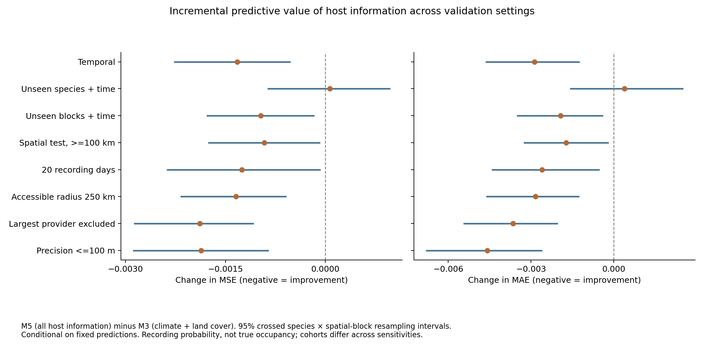
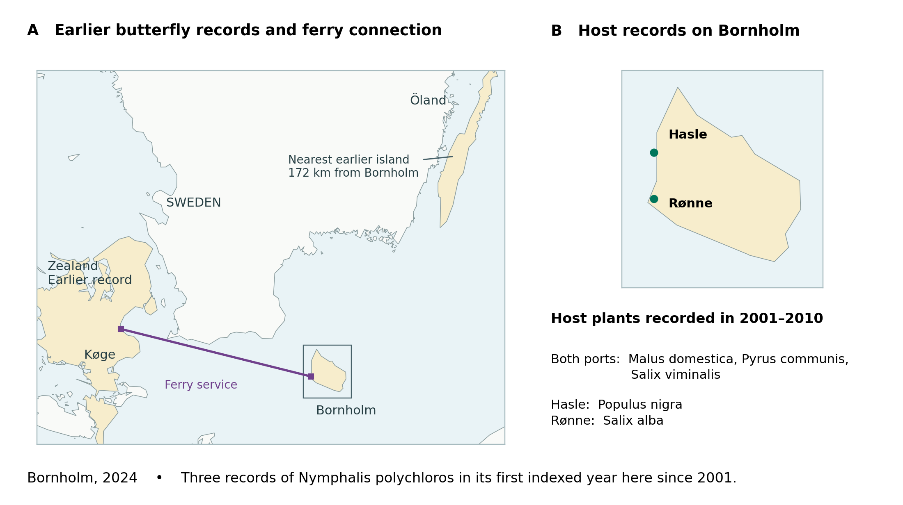

# Two layers of island floras: ports, marine geometry and butterfly larval-resource opportunities

**ONE integrated Research Article | Butterfly island–port–marine synthesis v0.3 | Global Ecology and Biogeography | 18 November 2026 external-validity integration**

**Status:** Coauthor review draft; unsubmitted.

**Running title:** Island butterfly host resources

**Keywords:** alien plants, butterflies, Circuitscape, island biogeography, larval host plants, marine resistance, ports, resource geography

## Structured abstract

**Aim.** To evaluate contrasting native and introduced island plant assemblages as two spatial resource layers, asking how port association, marine geography and native-host baselines organize butterfly food opportunities and recorded interactions.

**Location.** Global botanical regions, island ports and Macaronesian islands.

**Time period.** Native versus contemporary plant distributions; 2001–2024 GBIF indices and source-dated larval observations.

**Major taxa studied.** Butterflies and their larval-host plants.

**Methods.** We held known larval-host repertoires fixed for 239 butterflies and compared native versus contemporary resources in 126 insular and 237 mainland botanical regions. We related port distributions, whole introduced floras, paired native/introduced marine geography and source-identified dispersal traits, and evaluated separately sampled butterfly records. An independent checklist of 41 living Macaronesian butterflies and identified larvae tested island-endemic coverage and use.

**Results.** Plant redistribution expanded potential resources for 206/239 butterflies (+54.9% globally). Relative gains were larger on islands (+118.9%, mainland +40.9%) mainly because native-host coverage was lower (16.0% versus 37.5%), not because more gaps were filled. The island–mainland resource-coverage gap narrowed from 21.4 to 17.7 points. Port counts were positively associated with whole introduced island floras. In 22 trait-covered island regions, native plants had 2.95 percentage points more sea-dispersal morphology; on a distinct 104-region circuit test, marine resistance improved introduced-flora similarity prediction (+4.24%) but not native flora (−0.11%), while shortest-water-path geometry improved both. Known-host geography reduced later butterfly-record prediction error by 4.12%. The original panel contained 0/18 independently listed island endemics; photographed *Pieris cheiranthi* larvae used introduced *Tropaeolum majus* on Tenerife and La Palma.

**Main conclusions.** A more shared, port-associated introduced layer can enlarge known butterfly food opportunities against geographically distinct native floras; the island effect is amplified by sparse recorded native hosts. These are observational layers, not demonstrated sea-current or shipping histories. Direct larval use does not establish new butterfly populations.

## 1. Introduction

When a plant is introduced to an island, its addition to the flora can have different consequences for two butterflies. For one species the plant may be the first of its known larval hosts recorded in that botanical region. For another, it may join several hosts already present. Counting plant species gives the same increment in both cases. The ecological question is how often plant redistribution changes where a particular consumer could find any suitable larval resource.

Islands provide a reason to expect a geographic difference. Naturalized plants make up a relatively large part of many island floras (Essl et al., 2019). Whether that changes resource coverage depends on which plants arrived and which hosts were already represented in the native flora. A large addition to an island flora could consist entirely of plants with no documented link to a given butterfly. We therefore compare island and mainland botanical regions and repeat the comparison within overlapping area and biogeographic strata.

Regional studies have documented exotic host use by California butterflies (Graves & Shapiro, 2003), linked changing passionflower distributions to the range expansion of the gulf fritillary (Halsch et al., 2020), and examined how host availability constrains the thermal range margins of European butterflies (Rashid et al., 2026). Here we hold the known hosts of each butterfly fixed and change the map of those plants. We count a new butterfly–region combination only where the native flora contained none of that butterfly's documented hosts. This permits a common comparison across species, including those without a documented butterfly range shift.

**Two-layer hypothesis.** We separate the established *native floristic layer*, assembled through long-term natural dispersal, local persistence and evolutionary history, from the more recent *introduced layer*, assembled through human movement among many other processes. If they differ, ports may covary more with introduced than native flora, traits linked to seawater transport may differ by origin, and marine geometry may predict their island-to-island similarities in different ways. A key discriminating prediction is **not** merely that alien floras are more similar, but whether a circuit descriptor predicts introduced assemblages **more reliably than native assemblages under the same geography and survey conditions**.

Ports and marine geography connect the regional host calculations to a spatially patterned plant supply. We ask whether ports are associated with introduced **whole** floras rather than with special host enrichment, whether native and introduced plants differ in seawater-dispersal morphology, and whether separate marine circuit and shortest-water-path predictors help explain floristic similarities. These are correlational geographic layers, **not measurements of currents, vessel cargo or organism movements**. Distinct island species pools, introduced-flora residence times, botanical coverage and island endemism are alternative explanations; no evolutionary divergence mechanism is inferred merely from a low native Jaccard index. Dated butterfly records and independently documented island-endemic larval use then test the biological endpoints.

## 2. Materials and methods

### 2.1. Study populations and geographic units

We used distinct, source-versioned datasets to examine the geography of known butterfly larval hosts and recorded butterflies. The **239-species** potential-resource reconstruction covered World Geographical Scheme for Recording Plant Distributions Level-3 (WGSRPD3) botanical regions, including **126 insular and 237 mainland regions** in the island contrast. Plant origin was resolved at the botanical-region scale, which can include several physical islands. The separate butterfly-recording model covered **155 species**, and the port-flora comparison included **98 botanically effort-covered insular regions** from an inventory of **1,596 queried ports**. The island-record study fixed **225 candidate butterflies × 51 GSHHG landmass groups**; island-community analyses contained **1,275 non-independent pairs**, and a stricter geographical-transfer study used a different **990-pair** population. We did not combine these populations into a single mediation estimate. The complete source-specific eligibility, original matching and shipping comparison rules are provided in [Supplementary Source Methods](SUPPLEMENTARY_SOURCE_METHODS_V03.md).

### 2.2. Reconstructing potential larval-resource geography

We matched fixed butterfly–host identities from the Natural History Museum HOSTS catalogue to the World Checklist of Vascular Plants (**WCVP v13, 21 May 2024**), using source-locked rWCVPdata commit `65bed76bae9d644ccb6ad200c05f9f5071d89e05` (Govaerts, 2024). For each butterfly–botanical-region pair, native-only resource coverage required at least one known host with a native range in that region; contemporary coverage retained the same host identities but also included introduced host ranges. The difference identifies **potential regional resource opportunities added by plant redistribution**, not changes in butterfly diet, larval use, abundance or occupancy. We quantified additional butterfly–region combinations, proportional expansion, contributions of host taxa and differences among dietary host-family breadth classes. Original analyses excluded crop hosts and Poaceae feeders, and evaluated host breadth, baseline range size and phylogenetic sensitivity.

### 2.3. Separating island baseline resource scarcity from gap filling

We compared the 126 insular and 237 mainland botanical regions in **15 overlapping area × broad-biogeographic strata**. For a class containing T butterfly–region combinations, with N combinations having a native host and A gaining a known introduced host, we defined native coverage B=N/T, gap filling F=A/(T−N), and relative expansion A/N=F(1−B)/B. This identity separates proportional gain attributable to sparse native coverage from the fraction of initially uncovered opportunities filled. We decomposed the island–mainland contrast by symmetrically replacing B and F, then compared F using shared-stratum weighting and **4,999 whole-region label permutations**. Species-equal gap-filling contrasts and exclusions of zero-native, Antarctic and small island regions assessed sensitivity. These are geographic accounting and exploratory comparisons, not controlled plant introductions.

### 2.4. Port floras and known butterfly-host candidates

We related World Port Index (WPI) port counts to introduced whole-flora richness and distinct known larval-host taxa in 98 insular botanical regions, accounting for botanical effort, area, native baseline and broad geography. A new crossed source-locked WCVP test used the **same 126 island regions** for both native and introduced whole-flora responses, comparing log1p richness against log2(1+WPI ports), log(area) and TDWG Level1 fixed effects (HC3 descriptive intervals), then conditioning on the other origin class and testing their log-richness ratio. The 123 HOSTS-eligible islands were a matched subset, not a separate transport mechanism. A common-population port-count predictor was also evaluated against both native and introduced island-pair flora similarities. The global GBIF plant inventory covered 1,596 ports, with older botanical records in 38 port buffers on 17 landmasses; port exposure represents modern infrastructure, not proven deliveries. Geographic host-use records from HOSTS were analyzed separately below.

**Geographically reported host associations.** We re-examined geographic fields of the same pinned Natural History Museum HOSTS literature source (140,485 rows; original GloBI mirror commit 808e0b8) for accepted insect and plant identities and an explicit source Location. WCVP v13 classified each accepted host as native or introduced in the corresponding WGSRPD3 region; broad or discordant localities were excluded. The primary source cohort included Papilionoidea-family reports, while the original fixed 239 butterflies and all Lepidoptera served as separate taxonomic sensitivities. We omitted explicitly laboratory-reared rows but did not interpret blank rearing fields as proof of field feeding. For each original locality with at least ten classifiable records, we calculated the fraction involving introduced host plants and compared locality medians among islands, mainlands and operationally designated oceanic/continental islands. We repeated comparisons after exact-species FAO crop exclusion, FAO explicit-genus exclusion and an intentionally over-conservative all-crop-genera exclusion. Locality-level regressions conditioned on current WPI port count, WGSRPD3 area and HOSTS record count; all comparisons are observational and post-source exploratory. [Complete methods, coverage and source hashes](../../results/hosts_island_local_use_20261116/README.md).

### 2.5. Does host geography improve butterfly-recording prediction?

To test a butterfly observation endpoint distinct from plant-defined resource expansion, the original source-locked random-forest analysis covered **155 butterflies** with sufficient GBIF records. Recording probability was standardized to ten target-group recording days. Models used prior recording, geography, climate and land cover (M3), with known host-resource indicators added (M4) and host-family composition added (M5). Original source windows trained on 2011–2014 predictors against 2015–2018 recordings, and evaluated 2015–2018 predictors against **2019–2022** recordings, with additional held-spatial-block and butterfly-species transfer comparisons. We reported species-equal mean squared error and fixed-prediction bootstrap intervals, rather than interpreting record indexing as biological presence–absence. Host maps were contemporary and could postdate evaluation records: this is a **retrospective prediction**, not a historically frozen host-arrival forecast.

### 2.6. Historical butterfly indices and native/introduced host classes

For the independent **225 × 51** selected butterfly–landmass grid, source-verified GBIF queries indexed butterflies during **2001–2010, 2011–2017 and 2018–2022**, and an additional uniform all-cell search indexed **1700–2000**. Records were matched to exact GSHHG 2.3.7 landmass polygons and accepted butterfly species keys. New source indexing required no record in any earlier queried period, but even a source-uniform zero does not prove biological absence, immigration or breeding. Original 2001–2010 plant species indexed near sampled ports defined butterfly-specific candidate native-only, introduced-only, mixed-origin, unresolved and no-indexed-host classes. A reverse-time comparison used **8,100 species × landmass cells on 36 landmasses** with at least ten early botanical records; butterfly/species and island fixed-effect linear probability models compared indexing in pre-2001, 2001–2010 and 2011–2022 periods, as well as within-cell binary index differences, with approximate species/island two-way clustered intervals. We also compared subsequent GBIF reindexing among previously indexed butterflies, conditioning on prior butterfly record counts. These are **observation-source associations**, not evidence that introduced hosts were used locally or supported new residents.

### 2.7. Marine geography and geographically held-out assemblage models

For the floral response, we compared accepted WCVP native and introduced island-pair similarities and a source-archived uniform-ocean Circuitscape effective-resistance analysis on 104 botanical regions. We also evaluated a different **GSHHG shortest-water-path distance** predictor on 104 eligible regions, using the **same 5,355 pairs** and leave-one-island-out or both-endpoints-unseen designs for both flora origin classes. EuDiS v5 thalassochorous plant morphologies were compared within 22 trait-covered island regions, with the European-flora ascertainment limitation. As an explicitly non-equivalent tropical external check, we also audited the published Tonga source-origin categories for **broad water-dispersal classifications**, without treating these as EuDiS thalassochory or matching the two floristic panels. NOAA legacy OSCAR flow trajectories were an exploratory separate physical check only, not a regressor in these undirected models (McRae et al., 2008; Anantharaman et al., 2020; Vargas et al., 2023, 2025; ESR, 2009). The separate 51-landmass butterfly analysis used original island-port representative positions, uniform-ocean Circuitscape resistance, modern AIS-density and wind fields, and 1,275 dependent landmass pairs. Source and predictor differences prohibit pooling the plant- and butterfly-model MSE improvements.

### 2.8. Independent endemic denominator and direct larval host use

An independent INBO Macaronesian checklist (42 named taxa on 18 islands, including one historically extinct taxon) and Canary BIOTA, Madeira and Azorean origin sources defined 41 living butterflies, including 18 endemics. We checked name equivalences against the 339-species source and final 239-species GEB panels and LepTraits trait coverage. Eight endemic butterflies with exact accepted named larval-host plants formed a separate **source-ascertained**, nonrepresentative WCVP v13 reconstruction. Independently documented larval observations were screened for source island, accepted plant identity, regional native/introduced status, wild versus garden context and evidence of development. Details and original URLs are in [Supplementary Endemic Host Methods](SUPPLEMENTARY_ENDEMIC_HOST_VALIDITY_20261118.md).

## 3. Results

### 3.1. Islands gained disproportionately large introduced larval-host opportunities

On the native-only host map, 126 strictly insular WGSRPD3 regions contained **4,829** butterfly × region opportunities. Incorporating introduced ranges of *already-known* larval hosts raised this to **10,570**, a **+118.9%** expansion. The added **5,741/10,570 (54.3%)** contemporary island opportunities were attributable to introduced known-host ranges. The mainland comparison (237 regions) increased from **21,215** to **29,901** combinations (**+40.9%**). A matched analysis across **15 Level-1 biogeographic × area-overlap strata** retained an insular excess of **+10.7 percentage points** in the contemporary share attributable to introduced hosts (descriptive within-stratum permutation **p=0.0002**).

**Why the proportional gain differs (Figure 1).** Native known-host coverage was **4,829/30,114 (16.0%)** for islands and **21,215/56,643 (37.5%)** for mainlands, a **21.4-point** gap. After adding introduced host ranges, coverage became **10,570/30,114 (35.1%)** and **29,901/56,643 (52.8%)**, narrowing the gap to **17.7 points**. Introduced hosts filled **22.7%** of initially uncovered island pairs versus **24.5%** on mainlands. The large relative gain therefore reflects lower island baseline coverage, not higher gap-filling efficiency. Species-equal island gap filling was **−5.44 points** below mainland; 15 shared area/biogeography strata gave a non-confirmatory **+1.27-point** contrast (descriptive permutation p=0.5622). Full accounting decomposition, stratification and sensitivities are in Supplementary Results S.F.

The island contrast sits within a wider global butterfly result. Across the separately defined **239-butterfly** resource reconstruction, contemporary host maps added **14,553 butterfly × region units** (from **26,530 to 41,083**, **+54.9%**) and expanded the opportunity of **206/239 (86.2%)** butterflies. Gains appeared among dietary specialists (including **82/97 one-family** butterflies) and generalists. Proportional gain was poorly described by the number of host families (Spearman **rho=0.008**, bootstrap **95% CI −0.111 to +0.128**); a strict post hoc equivalence test for |rho|<0.10 was inconclusive (**p=0.078**). Excluding crop hosts still left **46–47%** aggregate potential expansion. The distribution of island additions among **239** butterflies was geographically unequal. Ranked by **global native known-host geographic coverage**, the upper **59/239** contributed **2,271/5,741 (39.6%)** of potential island additions, whereas the lowest **60** contributed **644/5,741 (11.2%)**. Across species, native resource breadth and absolute island additions were positively related (tied-rank **Spearman ρ=+0.579**). This measures **geographic breadth of already documented larval resources**, not dietary family breadth, independently measured flight ability or realized colonization; the network-derived quantities share HOSTS/WCVP data.

### 3.2. Ports concentrate introduced whole floras, not specially enriched hosts

The ten leading host plants supplied **25.1%** of the global **14,553** additional resource units. Eight of those ten were independently indexed in **2001–2010** around one or more of the **38 original port buffers on 17 landmasses** (Figure 2). The wider survey completed botanical queries for **1,596 ports**, of which **1,150** contained at least one introduced candidate larval host; it recorded **687 distinct candidate plant species**.

On **98 botanically effort-covered insular regions**, port counts were positively associated with introduced *whole-flora* richness (**β=+0.2445**, descriptive permutation p=0.0012) and candidate known-host plant richness (**β=+0.1639**, p=0.011). After accounting for the entire introduced flora, the independent host-specific port coefficient was not positive (**β=−0.0415**, p=0.093). On the **same 126 botanical island regions**, matching area and broad biogeography gave a positive **introduced-flora** port coefficient (**β=+0.2854**, descriptive HC3 95% interval +0.0622 to +0.5087) but an uncertain **native-flora** coefficient (**β=+0.0954**, −0.0774 to +0.2683). The paired difference (**+0.1900**, −0.0187 to +0.3987) is also uncertain (Figure 4). Models with additional native-flora or effort controls retain separate alien coefficients of **+0.221 to +0.2445** (Supplement S.F).

Geographically attributed HOSTS reports showed more regionally alien plants in island than mainland butterfly food-plant reports (**42.4% versus 9.1%** locality medians), including after exact FAO crop exclusion (**20.9% versus 8.1%**). However, in 67 butterfly species with reports from both geography classes, conditioning on plant-family composition and origin supply left **−3.87 percentage points** extra alien-host reporting (descriptive 95% interval **−15.85 to +8.13**). These are literature records derived partly from the same HOSTS catalogue, not a representative independent field assay of preference. All crop, origin, locality and historical port sensitivities are in Supplement S.F.

### 3.3. Independent island-endemic butterflies sometimes feed on alien plants

An independent Macaronesian checklist identified **41 living butterflies**, including **18 endemic taxa**. **None of these 18** occurred in the original HOSTS-selected **239-butterfly** panel (versus **13/23** nonendemics), so original island-wide resource gains cannot be generalized to island endemics. Among eight nonrepresentatively sourced endemic species with accepted named larval-host plants, four gained additional *global* potential host regions under the fixed-host WCVP reconstruction; **none acquired a newly host-present region in its home archipelago**. Missing host plants can reverse individual classifications, so 4/8 is not endemic prevalence.

Original photographs document Canary-endemic *Pieris cheiranthi* larvae using introduced *Tropaeolum majus* on **Tenerife** (wild, 2015) and **La Palma** (garden, 2011). Separate field evidence documents native-host larvae of *Euchloe grancanariensis* on *Hirschfeldia incana*, including pupation, and native-host observations in *Gonepteryx cleobule*. This independent evidence demonstrates **individual larval use**, not transported propagules, successful adult recruitment or newly established butterfly populations (Supplement S.E).

### 3.4. Known-host geography adds information to independent butterfly records

A separate **155-butterfly** study found that adding known larval-host geographic resources and host-family composition to climate, land cover, prior GBIF records and geographic predictors reduced the retrospective later-recording **species-equal MSE by 4.12%** across **208,482** butterfly×cell evaluations (from **0.032064 to 0.030743**). The geographic-block holdout improved by **3.00%** and the nested subset over 100 km from training cells improved by **2.74%**; the host-informed model improved MSE for **119/155** temporally and **115/155** spatially evaluated butterflies.

The model **did not improve for butterfly species absent from training**. Modern plant maps could postdate butterfly records, and a separate 31-species independent occurrence subset did not show excess indexed butterflies specifically in regions supported *only* by introduced known hosts (13 observed versus 12.87 under its null). These positive record predictions do not identify introduced-host feeding, new island arrival or butterfly abundance (Supplement S.A).

### 3.5. Two floristic layers: marine geometry and their distinct butterfly-record signatures

**Plant assemblages: contrasting marine metrics on matched origin classes.** The complete **126-island** WCVP whole-flora panel contained **7,875 botanical-region pairs**, with median accepted-species Jaccard **0.004487 for native** and **0.046030 for introduced** flora. On a matched **104-region** held-island sample, the archived **uniform-ocean electrical circuit** comparison gave **+4.24% introduced-flora** MSE reduction versus **−0.11% native-flora** when marine resistance was added. A separate source-verified GSHHG **shortest-water-path** model, which is **not a circuit model or ocean-current direction**, instead improved **both** origin classes beyond land-based geometry: **+2.23% native**, **+1.78% introduced** (5,355 same source pairs). Even with two geographically unseen endpoints, corresponding positive point estimates remained **+1.74%** and **+1.86%**, but their small-group resampling intervals crossed zero. The modern paired port-count proxy added almost no prediction on its own (**−0.077% native**, **+0.043% introduced**). Neither a universal sea-current mechanism for native plants nor a selective shipping mechanism for alien plants follows from these crossed results (Supplementary Results S.F).

**Dispersal traits: a distinct source selection.** In **22 EuDiS-trait-covered island botanical regions** with native and introduced plant matches, native flora contained **+2.95 percentage points** more species with seawater-dispersal morphology (17 positive, four negative, one tie; descriptive 95% interval **+2.04 to +4.53**). This is a difference in coded dispersal syndromes in a Europe-biased trait database, *not* observed thalassochory or seed arrivals. The exploratory OSCAR trajectories did not identify source-resolved plant delivery (Supplementary Results S.F).

**Butterflies: a separate and less transferable marine contrast.** Across selected **51 island groups and 1,275 non-independent pairs**, port-associated candidate-host assemblage similarity correlated with later indexed butterfly similarity (Spearman **ρ=+0.300**, geographic/prior-record partial **+0.215**). The original uniform-ocean circuit model produced **+5.08%** retrospective held-island MSE reduction, but additional controls and stronger geographically unseen tests severely restrict interpretation. On **990 both-endpoints-unseen pairs** with historical general-plant indexing, source-effort, geographical and host controls, the verifiable **AIS-only** increment was **+0.678%**, while adding **AIS+wind** gave **−4.699%**. Unlike the +5.08% predictor, +0.678% refers to an AIS addition under a different baseline and cannot be called its direct adjustment. The shared-HOSTS/WCVP species-level port/resource correlation **ρ=+0.652**, original +5.08% and selected joint-model +6.49% gains are fully retained in Supplementary Results S.C/F, rather than used as causal or independently replicated main outcomes. No model here observes colonization, actual shipborne larvae or a seed-to-butterfly stepping stone.

The strongest interpretation is spatial filtering of potential and recorded communities, without a single identified sequence from shipping to biological establishment.

![Figure 4. Four source-defined panels: A, matched 126-island port/native-versus-alien whole-flora slopes with an uncertain slope difference, alongside the 98-island botanical-effort sensitivity; B, 22 EuDiS-trait-covered island regions with native excess seawater-dispersal morphology; C, distinct uniform-circuit and shortest-water-path comparisons for native and introduced floristic similarity; D, strict geographic-transfer limits for 990 butterfly-community island pairs. These are observational associations and retrospective predictive gains, not identified natural current or shipborne dispersal pathways.](../../figures/integrated_island_port_butterfly_v03/Fig4_island_port_marine_crossed_source_verified.svg)

### 3.6. Historical butterfly indexing does not establish new arrival

In **8,100 butterfly×landmass cells**, native-only known-host records around original 2001–2010 ports were associated with butterfly GBIF indexing **already in 1700–2000** (**+17.11 percentage points**) as well as **2011–2022** (**+19.09 points**). Introduced-only candidate host associations were much smaller: **+1.93** and **+3.07 points**, respectively; their within-cell later-minus-early excess was **+1.14 points** (approximate 95% interval **−0.89 to +3.18**). Moreover, **145 of 317 (45.7%)** apparent late first-index butterfly–island combinations were already indexed before 2001. Selected additional positive same-island index associations, including island/species fixed-effect contrasts, remain in Supplement S.B–S.D. None identifies new colonization or a port-mediated establishment sequence.

## 4. Discussion

### 4.1. What changes for a butterfly when a plant is introduced?

The fixed-host comparison isolates redistribution of **known larval food geography** rather than changes to diet breadth (Graves & Shapiro, 2003; Rashid et al., 2026). The remarkable relative island effect is a *native baseline asymmetry*, not more efficient island gap filling, and the modelled mainland–island coverage gap narrows from **21.4 to 17.7 points**. The source-specific 155-butterfly recorded-distribution prediction provides a complementary response, but contemporary hosts may postdate the target and the results do not transfer to unseen butterfly species. Full numerical counterfactuals and stratum sensitivities are preserved in Supplementary Results S.F.

A complementary literature-based comparison moves the question one step beyond the potential-resource reconstruction: butterfly host-use reports with regional location attribution more often involve plants classified as introduced on sampled islands than on sampled mainland regions. That direction persisted under FAO crop exclusions, although both absolute fractions and island sample counts changed. The result is therefore **consistent with actual reported use of redistributed partners**, not merely a larger plant-defined envelope. It remains subject to strong geographic, taxonomic, agricultural-pest and publication selection. In particular, missing laboratory-rearing flags do not establish field feeding, and WCVP's contemporary regional introduction status is not a dated source-local use event.

The directly documented *Pieris cheiranthi* larva on introduced *Tropaeolum majus* demonstrates a realized interaction beyond mapped plant occurrence. In contrast, independently documented native-host larvae in other island endemics show that host availability, host adoption and demographic dependence remain distinct stages. The new field evidence therefore strengthens the ecological interpretation of potential resource reassembly, but provides no endemic-wide mean gain, wild adult recruitment or evidence of a new island population.

### 4.2. Distinguishing port-linked plant supply from marine spatial structure

The proposed two-layer account is most strongly anchored in distinct botanical origins, a greater contemporary *between-island* overlap among introduced floras, and port-associated *whole introduced floras*, rather than host-specific enrichment beyond those floras (Tordoni et al., 2017). Distinct island models gave positive port–alien whole-flora coefficients, while native versus introduced plant similarity responded differently to one undirected circuit comparison and **both** responded to shortest-water-path geography. The EuDiS native excess of seawater-dispersal morphology motivates alternative natural dispersal histories, but does not verify current-driven dispersal or speciation as a cause of low native Jaccard. Independent tropical Tonga literature codes broad water dispersal differently and cannot yet transport the EuDiS sign outside its European-biased sample (Supplementary Results S.F). Since contemporary port numbers are not a historical cargo network, these results cannot disentangle ship delivery, gardens, disturbance and botanical survey from marine spatial filtering.

Historical ballast-site floras in the northeastern United States document one way plant propagules reached ports (Schmidt et al., 2023). Shipping therefore gives a biological rationale for examining ports, alongside cultivation and disturbance. Identifying the introduction pathway for any named host would require evidence linking its source and arrival.

### 4.3. What island records reveal about potential host availability

The regional calculation and the local observations answer different ecological questions. A regional gain occurs only when an introduced plant supplies the first documented host for a butterfly in that botanical region. At a particular port, an introduced host may grow alongside native alternatives. Native hosts were already recorded locally in all ten selected cases where a regional native alternative was known. The introduced plants could still change the quantity, seasonality or location of larval food. The inventories measure plant presence, leaving those changes unresolved.

In the independent endemic source panel, all eight named-host species already had at least one native host in their home archipelago; none acquired a newly host-present home region under the observed partial diets. A local caterpillar using introduced food and a modelled global increase in host-plant regions are complementary but different endpoints, not paired steps in an identified cause-and-effect colonization chain.

The documented *Pieris cheiranthi* larvae establish that an island endemic can actually feed on an alien plant, while other endemics have native-host larvae; neither demonstration measures recruitment attributable to the introduced plant. The independent **18/18 endemic omission** from the original panel prevents generalizing the 239-species mean to island endemics. Historical GBIF indices already existed for **145/317** supposed post-2010 first records. Marine circuit predictions also lose strength under strict geographic transfer. Thus ports, regional food supply and modeled sea access remain distinct potential filters, not observed steps of an identified island-colonization process.

## 5. Limitations

The reported panels are deliberately **not** a single matched mediation analysis: 239 global resource butterflies, 126/104 botanical island floras, 22 EuDiS-characterized islands, 155 independently forecast butterflies, a selected 51-island community panel and a distinct 990-pair geographic-transfer sample have different units and ascertainment. Botanical region-level WCVP status neither dates local plant arrival nor measures actual larval access, density, nutrition or fitness. The original HOSTS catalogue omits **all 18** independently classified living Macaronesian endemics in the audited checklist; localized HOSTS reports share the original interaction network and are not uniformly confirmed wild feeding. The introduced-host larval photographs demonstrate use, not adult recruitment or population growth.

Port numbers do not encode vessel origin-destination history, and plant-family conditioning eliminates a clear extra alien-host-use preference. EuDiS thalassochory is a Europe-biased *morphological* proxy; GSHHG circuit resistance and shortest marine paths are undirected and mathematically distinct. Legacy 2005 OSCAR trajectories are coarse physical pilots, not observed seed arrivals. Most AIS and contemporary plant layers postdate at least some butterfly records. The +5.08% circuit result, +6.49% AIS/wind result and +0.678% strict AIS result cannot be merged into an effect-size progression. GBIF first indexing is not immigration: 145 of 317 putative late first indices had earlier records. Fuller historical, rights, sampling and sensitivity limitations are preserved verbatim in Supplementary Results S.F.

## 6. Conclusions

Human redistribution of already documented larval hosts added **14,553 potential butterfly × botanical-region combinations (+54.9%)** among 239 sampled butterflies. The larger relative island gain (+118.9%, mainland +40.9%) was driven by fewer initially covered native-host regions: introduction filled no larger fraction of island gaps, but it narrowed the **reconstructed resource coverage gap from 21.4 to 17.7 percentage points**.

These results support a **two-layer description** of island floras: native assemblages are relatively distinct between islands, whereas alien assemblages contain more shared accepted plant taxa and are associated with port-rich regions. Native versus introduced dispersal-trait composition and source-specific marine circuit predictions add spatial context, but marine shortest-water-path structure predicts **both** origins and the causal construction of either layer remains unresolved. The independently sampled butterfly gains are *potential larval resources from the introduced layer*, not proof that observed butterfly diets have shifted away from native plants. Known host geography improves butterfly-record prediction, and identified endemic larvae really use an introduced plant on two Canary islands. Yet the incomplete endemic sampling and weaker geographical-transfer results separate **mapped food opportunity** from butterfly dispersal, recruitment and colonization. The ecological claim is about **where resources become available and which butterflies could benefit**, not that shipping or currents caused new populations.

## Data and code availability (draft; final rights and archive check required)

Butterfly food-plant identities derive from the Natural History Museum HOSTS catalogue (**DOI 10.5519/havt50xw**; pinned GloBI source commit `808e0b869f9ec1adf8efff87cf6a395adda103e0`) and botanical distributions from **WCVP v13, 21 May 2024 (DOI 10.34885/0yex-xv26)**, pinned through rWCVPdata commit `65bed76bae9d644ccb6ad200c05f9f5071d89e05`. EuDiS v5, WPI, GSHHG, NOAA OSCAR and available source-versioned derived results, tables, scripts, model receipts and figure source are linked in the manuscript and Supplement S.F.

The **225-butterfly×51-landmass GBIF reindex** and **1,596-port** flora queries have source receipts but still require complete constituent-dataset attribution or appropriate derived/occurrence-download DOIs; **10.15468/dl.pp5nc9** describes only an older, separate 32-butterfly validation. An historical **83,573-row** author butterfly–island–year Parquet and some occurrence-level inputs are not publicly present in this Draft; some results remain reproducible from archived aggregate receipts rather than unrestricted raw rows. Source rights, licenses, final citations, anonymous submission bundle, image attribution and coauthor approval **remain unresolved publication gates**. Full source-by-source data-availability qualifications are preserved in Supplement S.F.

## Figure legends

The four main figures appear alongside their results. See [panel definitions and figure sources](FIGURE_CAPTIONS_V03.md).

## References (DOI identities checked; final source and style audit outstanding)

- Anantharaman, R., Hall, K., Shah, V. B. & Edelman, A. (2020). Circuitscape in Julia: High performance connectivity modelling to support conservation decisions. *Proceedings of the JuliaCon Conferences*, **1**, 58. https://doi.org/10.21105/jcon.00058
- Braga, M. P. (2023). Are exotic host plants a life raft or a trap for butterflies? *Current Opinion in Insect Science*, **58**, 101074. https://doi.org/10.1016/j.cois.2023.101074
- Braschler, B. & Hill, J. K. (2007). Role of larval host plants in the climate-driven range expansion of the butterfly *Polygonia c-album*. *Journal of Animal Ecology*, **76**, 415–423. https://doi.org/10.1111/j.1365-2656.2007.01217.x
- Chowdhury, S., Fuller, R. A., Dingle, H., Chapman, J. W. & Zalucki, M. P. (2021). Migration in butterflies: a global overview. *Biological Reviews*, **96**, 1462–1483. https://doi.org/10.1111/brv.12714
- Daru, B. H. et al. (2021). Widespread homogenization of plant communities in the Anthropocene. *Nature Communications*, **12**, 6983. https://doi.org/10.1038/s41467-021-27186-8
- Essl, F. et al. (2019). Drivers of the relative richness of naturalized and invasive plant species on Earth. *AoB PLANTS*, **11**, plz051. https://doi.org/10.1093/aobpla/plz051
- Fall, P. L. & Drezner, T. D. (2011). Plant dispersal, introduced species, and vegetation change in the South Pacific Kingdom of Tonga. *Pacific Science*, **65**, 143–156. https://doi.org/10.2984/65.2.143
- Fall, P. L. & Drezner, T. D. (2020). Vascular plant species of the Kingdom of Tonga by vegetation type, species origin, growth form, and dispersal mechanism. *Ecology*, **101**, e02902. https://doi.org/10.1002/ecy.2902
- Govaerts, R. (ed.) (2024). *World Checklist of Vascular Plants (WCVP), version 13* (21 May 2024) [data set]. Royal Botanic Gardens, Kew. https://doi.org/10.34885/0yex-xv26
- Govaerts, R. et al. (2021). The World Checklist of Vascular Plants, a continuously updated resource for exploring global plant diversity. *Scientific Data*, **8**, 215. https://doi.org/10.1038/s41597-021-00997-6
- Bach et al. (2022). Phylogenetic composition of native island floras influences naturalized alien species richness. *Ecography*, e06227. https://doi.org/10.1111/ecog.06227
- Halsch, C. A. et al. (2020). A winner in the Anthropocene: changing host plant distribution explains geographical range expansion in the gulf fritillary butterfly. *Ecological Entomology*, **45**, 652–662. https://doi.org/10.1111/een.12845
- INBO. *European butterfly checklist and distributions*, GBIF dataset. https://doi.org/10.15468/ye7whj. **Dataset-version citation to finalize before submission.**
- Graves, S. D. & Shapiro, A. M. (2003). Exotics as host plants of the California butterfly fauna. *Biological Conservation*, **110**, 413–433. https://doi.org/10.1016/S0006-3207(02)00233-1
- Kawahara, A. Y. et al. (2023). A global phylogeny of butterflies reveals their evolutionary history, ancestral hosts and biogeographic origins. *Nature Ecology & Evolution*, **7**, 903–913. https://doi.org/10.1038/s41559-023-02041-9
- Lancaster, L. T. (2020). Host use diversification during range shifts shapes global variation in Lepidopteran dietary breadth. *Nature Ecology & Evolution*, **4**, 963–969. https://doi.org/10.1038/s41559-020-1199-1
- National Geospatial-Intelligence Agency (2019). *World Port Index (Publication 150)*, 27th edition. https://msi.nga.mil/Publications/WPI. **Note:** the exact archived source snapshot of the study’s port file must still be matched to the original version and date.
- Neu, A. et al. (2021). Reduced host-plant specialization is associated with the rapid range expansion of a Mediterranean butterfly. *Journal of Biogeography*, **48**, 3016–3031. https://doi.org/10.1111/jbi.14258
- Rashid, S. et al. (2026). Food plant availability constrains climatic niches of host-specialized Europe-centred butterflies. *Diversity and Distributions*, **32**, e70245. https://doi.org/10.1111/ddi.70245
- Robinson, G. S., Ackery, P. R., Kitching, I., Beccaloni, G. W. & Hernández, L. M. (2023). *HOSTS - a Database of the World's Lepidopteran Hostplants* [data set]. Natural History Museum. https://doi.org/10.5519/havt50xw
- Shirey, V. et al. (2022). LepTraits 1.0: A globally comprehensive dataset of butterfly traits. *Scientific Data*, **9**, 382. https://doi.org/10.1038/s41597-022-01473-5
- Slove, J. & Janz, N. (2011). The relationship between diet breadth and geographic range size in the butterfly subfamily Nymphalinae—a study of global scale. *PLOS ONE*, **6**, e16057. https://doi.org/10.1371/journal.pone.0016057
- Schmidt, R. J. et al. (2023). Hidden cargo: The impact of historical shipping trade on the recent-past and contemporary non-native flora of northeastern United States. *American Journal of Botany*. https://doi.org/10.1002/ajb2.16224
- Suchan, T. et al. (2024). A trans-oceanic flight of over 4,200 km by painted lady butterflies. *Nature Communications*. https://doi.org/10.1038/s41467-024-49079-2
- Tordoni, E. et al. (2017). Diversity patterns of alien and native plant species in Trieste port area: exploring the role of urban habitats in biodiversity conservation. *Urban Ecosystems*, **20**, 1151–1160. https://doi.org/10.1007/s11252-017-0667-0
- van Kleunen, M., Dawson, W., Essl, F. et al. (2015). Global exchange and accumulation of non-native plants. *Nature*, **525**, 100–103. https://doi.org/10.1038/nature14910
- Wessel, P. & Smith, W. H. F. (1996). A global, self-consistent, hierarchical, high-resolution shoreline database. *Journal of Geophysical Research: Solid Earth*, **101**, 8741–8743. https://doi.org/10.1029/96JB00104
- Wessel, P. & Smith, W. H. F. (2017). *GSHHG: Global Self-consistent Hierarchical High-resolution Geography*, version 2.3.7 [data set]. Zenodo. https://doi.org/10.5281/zenodo.7007502
- Yoon, S. & Read, Q. D. (2016). Consequences of exotic host use: impacts on Lepidoptera and a test of the ecological trap hypothesis. *Oecologia*, **181**, 985–996. https://doi.org/10.1007/s00442-016-3560-2
- Fall, P. L. & Drezner, T. D. (2011). Plant dispersal, introduced species, and vegetation change in the South Pacific Kingdom of Tonga. *Pacific Science*, **65**, 143–156. https://doi.org/10.2984/65.2.143
- Fall, P. L. & Drezner, T. D. (2020). Vascular plant species of the Kingdom of Tonga by vegetation type, species origin, growth form, and dispersal mechanism. *Ecology*, **101**, e02902. https://doi.org/10.1002/ecy.2902
- McRae, B. H., Dickson, B. G., Keitt, T. H. & Shah, V. B. (2008). Using circuit theory to model connectivity in ecology, evolution, and conservation. *Ecology*, **89**, 2712–2724. https://doi.org/10.1890/07-1861.1
- ESR (2009). *OSCAR third-degree resolution ocean surface currents*, version 1 [data set]. NASA PO.DAAC. https://doi.org/10.5067/OSCAR-03D01
- Vargas, P., Heleno, R. & Costa, J. M. (2023). EuDiS — A comprehensive database of the seed dispersal syndromes of the European flora. *Biodiversity Data Journal*, **11**, e104079. https://doi.org/10.3897/BDJ.11.e104079
- Vargas, P., Heleno, R. & Costa, J. (2025). *EuDiS — A comprehensive database of seed dispersal syndromes of the European flora*, source-used version 5 [data set]. Figshare. https://doi.org/10.6084/m9.figshare.22251028.v5

**Reference scope:** The article and dataset names/DOIs above were checked against the publisher, PubMed, museum or dataset landing records. This does not replace a final GEB-style author-list, punctuation and citation-in-text audit. The **WCVP v13 version and DOI are now traced to the pinned 2024 source and Kew archival dataset**; the 2019 WPI identity crosswalk beyond a source fingerprint, raw-data sharing permissions and **independent GBIF acquisition DOIs** still require documentation in [REFERENCE_DATA_ATTRIBUTION_AUDIT_V03.md](REFERENCE_DATA_ATTRIBUTION_AUDIT_V03.md). The `rWCVPdata` v13 embedded citation points to DOI `10.34885/nswv-8994`, which Kew currently identifies as **WCVP v10**; this manuscript deliberately cites the correct **v13 DOI `10.34885/0yex-xv26`**.

## Supplementary results: island record histories and maritime comparisons

### S.A. Butterfly record prediction improves when host geography is considered

An independent **155-species, 208,482-observation-combination** evaluation compared climate and land cover alone with models additionally including known host-resource and host-family geography. The host-informed model reduced species-equal mean squared recording-prediction error by **4.12%** for subsequent-period test records and **3.00%** for held spatial blocks. The 100-km-distant subset also improved (**2.74%**), and four recording-quality or source-sensitivity analyses retained the positive direction. The 100-km subset is nested within the held-spatial predictions, not a distinct third validation. In contrast, a **species-held-out** evaluation found **−0.21%** relative MSE improvement for host composition (95% fixed-prediction difference interval crossing zero), preventing a claim that host predictors transfer to butterflies with no training history. In **133,557** immediate-previous-window-recording-zero cells across 154 butterflies, known-species MSE improved **5.23%** (time) and **5.28%** (held space), but untrained species did not improve (**−0.76%**). Host-family composition reduced held-spatial MSE by an additional **1.44%** beyond host-resource totals, with an original fixed-prediction difference interval below zero. Both models use contemporary plant distributions; the time-held comparison does *not* verify that a particular introduced host arrived before a butterfly. A source-locked species-identity crosswalk found that the 155 modeled butterflies had more known larval hosts per species on average (**13.04**) than the **70** original candidate butterflies excluded for insufficient forecast support (**7.10**). Their species-equal island-minus-mainland introduced-host gap-filling contrast was **−7.91 percentage points**, versus **+0.34** in the 70 unmodeled candidates, with a descriptive between-cohort difference of **−8.25 points**. The contrast remained larger than source-stratified expectations in an exploratory host-family-breadth × native-resource-quartile relabeling of **208** common-support butterflies (**p=0.0008**), without making selection random or phylogenetically independent. **Fourteen** additional resource butterflies were never included in the original 225 forecasting candidates. These cohort differences limit extrapolation of the 155-species observed **prediction improvement** to the full 239-species plant-resource panel; they do not invalidate either original estimate ([complete resource-to-forecast cohort crosswalk](../../results/resource_forecast_cohort_selection_20261115/README.md)).

Within the independently checked island-cell subset of these predictions, **95 butterfly species and 39,753 strict-coordinate-matched evaluation rows** showed **4.98%** MSE improvement from host information. However, **97.2%** of these rows came from Great Britain and Ireland; this check is not a globally representative 51-island validation. A separate **32-butterfly** source recovery analysis found that introducing host geography covered **66/115** butterfly × region index observations outside native-only host envelopes.

A second, source-locked **original 32-butterfly GBIF DOI sample** was checked against the same frozen 126 strictly insular WGSRPD3 regions; 31 butterfly species had records in this archive and were retained for the observational denominator (**31 × 126 = 3,906** species–region cells). Of **159** archived positive butterfly×island-region indices, **138** occurred where at least one native known larval host was recorded, **13** where only regionally introduced known hosts were mapped, and **8** where no accepted known host was mapped. Introduced-only resource geography covered **920** of the 3,906 cells. A fixed-degree species×island-region permutation null that additionally preserved each butterfly's record totals within broad botanical biogeographic Level-1 regions expected **12.87** introduced-only positive indices (observed **13**, one-sided enrichment **p=0.632**) and **132.16** native-known positives (observed **138**, one-sided enrichment **p=0.0023**). Two independently seeded, longer-thinning permutation chains produced introduced-only expectations **12.81** and **12.84**. Under a weaker null preserving only species and island totals without broad biogeography, the introduced-only expectation changed to **46.82**, demonstrating substantial dependence on geographic conditioning. These are **exploratory, selected-source, retrospective positive-index comparisons**, not occupancy/absence estimates or population establishment tests. They do not refute the global plant-defined resource expansion, but show no preferential introduced-only **recording** signal at this coarse island-region support ([original GBIF DOI and native-host category audit](../../results/island_observed_host_degree_null_20261115/README.md)).

**Same-species island port-host documentation and later butterfly records (source-locked exploratory bridge).** We independently linked the fixed 225-butterfly × 51-landmass record panel to 2001–2010 butterfly-specific larval-host candidates indexed within 5 km of the original ports, using regional WCVP native/introduced status, and to the complete 1700–2000 GBIF historical butterfly-index screen. Restricting to 36 landmasses with at least ten baseline plant records yielded 8,100 butterfly–landmass cells, of which 713 were indexed at least once during 2011–2022. In a two-way butterfly/landmass fixed-effect linear probability model additionally adjusting for any 1700–2010 prior GBIF index, documented native-only port hosts corresponded to a **+5.91 percentage-point** later index difference (approximate two-way clustered 95% interval **+2.42 to +9.39**), both native and introduced candidates to **+7.00 points** (**+2.59 to +11.42**), and introduced-only candidates to **+0.68 points** (**−1.22 to +2.57**), each relative to cells with no documented catalogued port host. The direct native-only minus introduced-only difference was **+5.23 points** (**+1.86 to +8.60**). Requiring at least 30 or 100 botanical records, excluding Great Britain/Ireland, or limiting to the 7,365 cells without any pre-2011 GBIF index retained a positive native-minus-introduced source contrast; the last subset contributed only 121 later index events. These are **cross-sectional recording associations under a historical-record covariate, not true host absence, native-versus-alien larval performance, new island colonization or independent proof of the introduced-resource mechanism**. Species-specific climate suitability and taxon-correlated recording effort remain unresolved, and the 155-species host-informed recording model does not partition its predictive gains by host origin ([fixed-source direct-category audit](../../results/host_marine_bridge_audit_20261116/HOST_CATEGORIES_SOURCE_CROSSOVER_JA.md)).

### S.B. Earlier port-host records and subsequent butterfly first records

On the historically source-fixed subset, accepted host-plant GBIF indices in **2001–2010** were found around an original study port of the same island for **34/113 (30.1%)** eligible 2011–2017 newly indexed butterfly × island events (60 butterflies, 17 sampled landmasses). This exceeded the mean **25.2%** under a basic plant-family and host-degree-preserving structural null. After additionally preserving the plants' geographic indexing prevalence and regional occurrence profiles, the null mean was **30.26%**, close to the observed **30.09%**; the difference did not remain exceptional (356/499 null draws at least observed).

Five-year butterfly re-indexing on the same island occurred in 26/34 cases with a compatible earlier host record and 70/79 without one.

**Named plants across scales (Figure S6).** We fixed the ten leading hosts by fractional credit in the global reconstruction before tracing them in the 27-island cohort. Together they received 25.1% of global credit. Retaining their native ranges and all other plants' contemporary ranges, while removing only the ten plants' introduced ranges, eliminated 2,893 of 14,553 added butterfly–region combinations (19.9%). Shared credit and loss upon removal differ when multiple hosts cover one region. Seven of the ten had a regionally introduced-candidate port record in 2001–2010. Three preceded compatible butterfly first records: *Medicago sativa* (nine events on four islands), *Dactylis glomerata* (one on Honshu) and *Zea mays* (one on Santa Cruz Island, California). Among 11 distinct species–island events, ten were in botanical regions already containing another native host for that butterfly. The *Dactylis–Minois dryas* association occurs in the island diet catalogue but is missing from the original global diet list for this butterfly. Thus none of these named cases establishes that the focal plant supplied a previously missing regional resource.

**Local records of alternative native hosts (Figure S7).** For the ten events whose botanical region already contained another native host, we intersected the original butterfly-specific diets with WCVP regional native ranges. We searched GBIF for georeferenced, present plant occurrences without reported geospatial issues from 2001 through the calendar year before each butterfly's first record. We retained points on the destination GSHHG island and separated those within 5 km of any port where the focal introduced host had been recorded from the rest of that island. In all ten events (five islands), compatible regionally native plants were already recorded both at the focal ports and elsewhere on the island, even restricting plants to the common 2001–2010 inventory window. Zero events had only the introduced host documented locally. At Kerteminde on Fyn, *Lotus corniculatus* and *Vicia cracca* had both been recorded by 2001, before the respective 2019 first records of *Colias croceus* and *C. hyale*. Restricting to records with reported coordinate uncertainty above zero and at most 1 km retained port evidence in ten events over the full pre-butterfly windows and seven in 2001–2010. The three early-window exceptions shared Coupeville on Whidbey Island. These occurrences verify the presence of alternative plant taxa; local provenance, resource abundance and larval use remain unresolved.

In a separate paired coastal inventory restricted to the leading plant, *M. sativa* was recorded only at the port in four of 24 pairs, at both sites in two, and at neither in 18. Across 17 islands, three favoured ports and 14 tied (two-sided island sign test, p = 0.25). The 27-island annual rate for a compatible top-ten port host was 11/1,552 (0.71%) versus 255/40,676 (0.63%) when unconfirmed. Adjusting for other compatible prior hosts, distance, year, island and species gave −0.35 percentage points (approximate two-way clustered 95% interval −0.90 to +0.20). Restricting to island-years with another recorded butterfly gave −0.33 points (−0.96 to +0.29). These estimates concern a narrower exposure than the all-host comparison below.

**Annual first records across the same 27 islands.** From 2011 to 2024 we observed 266 first indices in 42,228 at-risk species–island–years (3,238 distinct combinations). Prior-host and unconfirmed groups contributed 66/5,675 (1.16%) and 200/36,553 (0.55%) events per at-risk year. A further 1,242 combination-years, including 13 first indices, had no earlier conspecific island in the sampled source frame and thus no defined distance. The annual distance-adjusted contrast was positive in 11 of 14 years; all individual annual 95% intervals included zero. Pooling years and adjusting for distance and year gave +0.345 percentage points (approximate 95% interval −0.035 to +0.726). Adding island and species fixed effects gave +0.354 points (+0.031 to +0.676). With another butterfly recorded in the island-year the latter contrast was +0.442 (+0.083 to +0.801); omitting Sakhalin gave +0.304 (+0.004 to +0.604). Rebuilding the 2024 risk set recovered the same 2,994 combinations and 22 events as the single-year study, with updated source distances through 2023.

**Introduced hosts where native hosts were already documented (Figure S8).** The comparison retained 560 distinct species–island combinations on 21 islands for 98 butterflies. Native-only combinations yielded 58 first records in 3,921 at-risk years (1.48%); combinations with both origins yielded 49 in 2,913 (1.68%). The introduced-only and neither-confirmed groups accounted for the remaining 17/2,762 and 142/32,632 first records per at-risk year. Among the native-positive groups, the difference adjusted for distance and year was +0.66 percentage points (approximate 95% interval −0.09 to +1.41). Adding island and species effects gave +0.26 points (−0.74 to +1.27). Both exposure categories were represented within 14 islands and, separately, within 55 species. Restricting to their intersection retained 60 first records and gave +0.39 points (−0.59 to +1.37). Of 107 comparison events, 44 occurred on six Danish islands and 22 on two German islands (World Port Index registry codes).

**Route-independent destinations outside Denmark and Germany (Figure S9).** Across 74 islands, 161 species and 1,401 distinct species–island combinations with prior native hosts, annual first-record rates were 99/12,369 (0.80%) for native hosts alone and 49/4,853 (1.01%) for both origins. The difference was +0.415 percentage points (95% interval −0.053 to +0.884) adjusting for distance and year, and +0.335 (−0.049 to +0.719) with island and species effects. Both statuses were represented within 29 islands and separately within 84 species. Requiring both statuses within each retained island and species yielded 26 islands, 81 species, 80 first records and a contrast of +0.545 (+0.094 to +0.997). The 61 comparison islands outside the previous 27-island panel contributed 105 first records, with an adjusted contrast of +0.102 (−0.445 to +0.649). Restricting the species pool to the previous 132 candidates retained 70 islands and 116 species (+0.347, −0.069 to +0.763).

**Influence of islands and taxa (Figure S10).** We independently rebuilt two-sided exposure support within the 61 additional destinations. Eighteen islands and 69 species remained. First records occurred in 23/4,616 native-only and 23/3,244 mixed-host years, giving a distance-, year-, island- and species-adjusted difference of +0.223 percentage points (95% interval −0.348 to +0.795). For each panel we dropped one geographic region, destination island or butterfly species at a time, reapplied the two-sided support rule and refitted the model. Geographic regions group destination islands by location, including overseas islands separately from their registry countries. Earlier source islands for the distance covariate remained fixed. For each introduced plant in turn we ignored its introduced records in the exposure definition, retaining the mixed classification if any other compatible introduced host remained; the native-host baseline remained fixed. These exploratory deletions share observations and are not independent tests.

In the 26-island panel all individual deletions retained a positive point estimate. Omitting Honshu gave the smallest island estimate (+0.389, −0.110 to +0.889); omitting East Asia or Macaronesia also gave intervals crossing zero. Among butterflies, omitting *Pieris brassicae* gave the smallest estimate (+0.433, +0.020 to +0.847). Among plants, ignoring *Isatis tinctoria* gave +0.418 (−0.106 to +0.943). This plant was the only recorded compatible introduced host for two mixed-group first records on Corsica: *Anthocharis cardamines* in 2011 and *Pieris rapae* in 2012. *Medicago sativa* was associated with the most mixed-group first records (7 of 42), but it was the sole recorded introduced host in only two of those seven. In the additional-island panel every single-removal estimate also remained positive, but all intervals crossed zero. Omitting *P. brassicae* gave +0.058, and ignoring *I. tinctoria* gave +0.044. The signed tendency therefore recurred in the additional islands, with appreciable uncertainty about its size and sensitivity to a small number of named records.

Across the separate 2019–2023 maritime comparison, 5/111 eligible combinations with a documented direct link and 8/212 with an unconfirmed link had a first record. Matching on year and distance yielded 24 pairs; equally distance-optimal comparisons ranged from two fewer to two more first records in the linked group. Excluding Danish destinations and route origins left eight pairs across four islands, including one first record, and zero pairs with both nearest-source distances within 250 km (Figures S4–S5).

**Box 1. A familiar larval resource on Bornholm.** In the expanded port-island analysis, 390 butterfly–island combinations on 20 islands had an earlier port record of a compatible candidate introduced plant. Eight combinations on six islands were first indexed in 2024. On Bornholm, the large tortoiseshell (*Nymphalis polychloros*) had three records that year. Apple (*Malus domestica*), pear (*Pyrus communis*) and basket willow (*Salix viminalis*) had already been recorded around both Rønne and Hasle.

Both Öland and Zealand had records of the butterfly by 2018. Öland was the closest sampled earlier island (172 km between representative port locations). Zealand had the documented ferry connection. The line joins the terminals of the service reported in Statistics Denmark SKIB31 (382, 395, 364 and 363 journeys to and fro in 2020–2023, respectively). Across all eligible islands, matching routed and route-unconfirmed combinations within a 1.25 distance ratio yielded seven pairs, with one first index among the routed members and zero or one among their controls across tied matches. None of the pairs matched the same butterfly species. Coastlines are from GSHHG 2.3.7 and terminal points from the 2019 World Port Index. [Case records and methods](https://github.com/zuizui0223/chocho/tree/ff642c8/provenance/reviewer_defenses/results/expanded_port_islands); [ferry statistics](https://www.statbank.dk/SKIB31).

### S.C. Host assemblages and marine geography provide complementary retrospective information about butterfly communities

In 51 held-island comparisons (1,275 dependent pairs), adding uniform-ocean resistance to distance, port count and earlier-community similarity reduced community MSE from 0.00679776 to 0.00645231 (5.082%; 33/51 islands improved). In the separate joint model, adding hosts beyond AIS and wind reduced MSE by 1.731% (31/51 improved); adding AIS and wind beyond hosts reduced MSE by 6.488% (39/51 improved). Relative to the geography/uniform-ocean reference, hosts alone reduced MSE by 2.276%, AIS and wind alone by 7.006%, and the combined predictors by 8.616%.

In the distinct **990-pair both-endpoints-geographically-unseen** comparison with source-only historical general-plant-index quality requirements, adding AIS to a retrospective host-adjusted later butterfly-community model improved MSE just **0.678%**, whereas adding AIS **and** wind together worsened it **4.699%**. Adding AIS alone worsened indexed **earlier general-plant** community predictions **1.294%** and **earlier butterfly** community predictions **8.541%**. The outcome dependence suggests a non-universal observational relation, and the modern AIS data postdate the older 2001–2010 flora. Source-only sensitivity tests explain the difference between model gain and identifiable transport: after latitude/hemisphere controls, adding the wind-only circuit **worsened held-out MSE by 4.662%** (compared with +1.359% in the earlier uncontrolled comparison); the observed AIS assignment, despite a +1.002% adjusted gain, was matched or beaten by **100/199 locally relabelled (≤750 km) marine-network placebos**.

Independently, the new public GBIF panel covered **225 butterflies × 51 sampled landmass groups (11,475 cells)**, containing **221** butterfly first-index events in 2011–2017 and **96** in 2018–2022. Among the 199 LepTraits-matched butterflies with earlier recorded conspecifics on other sampled islands, **187 early and 83 late** first-index events entered source-access tests. Under species-, island- and region-constrained swaps, later first indices were associated with proximity to previous conspecific indices (**p=0.00033**) and quadratic-geodesic-distance-residual uniform-ocean resistance (**p=0.00233**). However, adding this **uniform-ocean residual** to first-index prediction **worsened** late *geographic-region-held-out* Brier error by **6.48%**. This is a different response, model and holdout from the positive paired-community AIS/wind result and therefore cannot be substituted for or used to erase it. Wing-size × marine residual interactions were not supported (**p=0.645**), and the positive-only migratory-candidate subset lost its later within-region marine-residual signal after removal of two port-rich landmass groups (**p=0.229**).

A subsequent **source-uniform historical-index audit**, kept separate from the frozen LepTraits panel above, queried 1700–2000 GBIF records for **all 11,475 species–landmass cells**. It recovered prior indices for **122/221** apparent first-index cells from 2011–2017 and **23/96** from 2018–2022, leaving **99 and 73** source-defined first indexes under a consistent 1700–2010 reference. A separate historically refitted, species–island conditional comparison with at least ten pre-2011 plant index records estimated **no independent positive interaction** of indexed candidate introduced port hosts with distance-residual uniform-ocean access (early **−1.249 percentage points per SD**, approximate 95% **−2.530 to +0.032**, only **3** host-positive index events; late **−0.311**, **−1.685 to +1.063**, **5** host-positive index events). The historical-source correction does **not** re-estimate the original 51-island community-similarity prediction results or prove ecological noncolonization. [All-cell historical-index audit](../../results/pre2001_full11475_risk_20261114/README.md); [conditional refit and case-specific checks](../../results/port_host_ocean_long_history_20261114/README.md).

**Reverse-time benchmark and same-cell comparison.** The original 2001–2010 historical port-host catalogue was joined to uniformly recovered 1700–2000 butterfly indices for all 225 species × 51 sampled landmasses. Requiring at least ten source-era botanical records yielded 36 landmasses and a fixed 8,100-cell butterfly × landmass population; the counts of positive butterfly indices were 647 (1700–2000), 515 (2001–2010) and 713 (2011–2022). In the same butterfly/island fixed-effect models, adjusted native-only compatible-host coefficients were +17.11, +15.49 and +19.09 percentage points across those periods. Introduced-only coefficients were +1.93, +2.69 and +3.07 points, respectively. A paired same-cell model of later minus 1700–2000 index flags yielded introduced-only **+1.14 points** (approximate 95% **−0.89 to +3.18**) and native-only +1.98 (−1.21 to +5.18); later minus 2001–2010 yielded introduced-only +0.38 (−1.91 to +2.66) and native-only +3.60 (+0.61 to +6.59). These source-year contrasts do not correct historical GBIF detection or digitisation and are **not** changes in biological occupancy. They show no clearly identifiable later-specific increment for the *introduced-only* host class. [Full independent audit and thresholds](../../results/native_introduced_bridge_20261116/README.md); [locked source replay](https://github.com/zuizui0223/chocho/actions/runs/43866973919).

**Species-specific host resources versus port-connectivity prediction (independent temporal extension).** The separate original **155-butterfly** time-held predictor archive retains actual per-species MSE for the already host-informed model (M5), the same model plus nearest indexed-port location (T0), and added historical port-connectivity indicators (T1). Across the original **208,482** evaluation combinations, T1 improved species-equal MSE over M5 by just **+0.225%** (96/155 species individually improved). The same comparison **worsened** source-strict island MSE by **0.595%** across 95 butterfly species and by **0.506%** in the separately scored island subset excluding Great Britain and Ireland; these subsets reuse the same fitted models and suffer incomplete island port-index support. A new source-locked identity-level join to each butterfly's frozen global introduced-known-host resource gain yielded a **Spearman correlation ρ=−0.053** between added resource regions and its T1-over-M5 absolute MSE benefit (descriptive species bootstrap 95% **−0.200 to +0.100**; **4,999** family-breadth × native-resource-quartile conditional relabelings, exploratory **p=0.499**). The island subset correlation was **ρ=+0.034** (**95% −0.164 to +0.233**), and without Great Britain and Ireland it was **ρ=−0.015** (**−0.204 to +0.168**). Rank adjustment for global native resources, host count, GBIF recording volume, original M5 error and host-family breadth produced **ρ_partial=−0.067** for all 155. Thus host-range gains do not show a supported monotonic relationship with the *incremental port-connectivity predictor* in this sample. This does **not** test whether the missing per-species M3-to-M5 host-only forecasting benefit is related to host expansion, nor directly measure island settlement, port-mediated insect transport or historical plant arrivals ([source-verified 155-species joint audit](../../results/port_resource_predgain_species_20261115/README.md)).

Adding historical liner connectivity increased held-out MSE by 2.92% across 17 islands, yet reduced it by 8.15% after one composite landmass was excluded from training and testing. In a separate 25-island holdout, the gain from adding ports beyond natural geography changed sign when islands and species were weighted equally in turn. [Historical liner comparison](https://github.com/zuizui0223/chocho/pull/149); [whole-island holdout](https://github.com/zuizui0223/chocho/pull/125).

### S.D. Supplementary figures and case histories

**Port and coastal comparisons at finer spatial scales.** The independent **17-island, 24-port paired coastal pilot** found no selective introduced-host candidate surplus on the same island's port versus newly reconstructed nonport coastline after normalizing to all 2001–2010 indexed plant species (island-equal mean fraction difference **−1.31 percentage points**, bootstrap interval **−4.54 to +2.01**). This normalized botanical contrast was not associated with the subsequent 2011–2017 relative first-indexed butterfly richness (**ρ=−0.085**, island-permutation **p=0.749**). The later 2018–2022 contrast was likewise weak (ρ=+0.085, p=0.745).

Direct butterfly–host catalogue matching provided a taxonomic bridge. Of **1,163 butterfly × island-pair combinations** involving a butterfly newly indexed on both landmasses, **208 (17.9%)** contained a candidate introduced host recorded around ports of both islands. A 199-draw structural host-network null preserving plant family and host-link degree had **11.9%** mean matched combinations (descriptive Monte Carlo 0/199 ≥ observed). Plant records spanned 2001–2024. The structural null retained host degree and plant family; the separate historical analysis in Supplementary Results S.B also retained geographic prevalence.

The smaller locality-scale check also retained butterfly identities: across **17 original port buffers** (Japanese, British and Canadian), **16 butterfly species** had both their own GBIF records and those of a compatible introduced-host candidate within the same 5-km search area (**59 butterfly × port combinations**). Examples include *Pieris rapae*, *Vanessa cardui*, *Pieris brassicae* and *Anthocharis cardamines*.

**Full port-island comparison.** Across 27 islands and 132 species, first records occurred in 8/390 combinations with prior compatible host records (2.05%) and 14/2,604 with host records unconfirmed (0.54%). The crude difference was +1.51 percentage points. Adjusting for continuous distance gave +1.33 points (95% interval −0.29 to +2.96); including island and species fixed effects gave +1.74 (−0.17 to +3.65). Omitting one island at a time gave adjusted estimates from +0.86 (omitting Sakhalin) to +2.04 (omitting Honshu). Within 329 distance-matched pairs of the same species (92 species, 27 destinations), first records occurred in 3/329 versus 1/329 (0.91% versus 0.30%). These pairs retain 329 of the 390 prior-host combinations. The event difference was unchanged across equally distance-optimal matches.

**Annual shipping links conditional on earlier port hosts.** Of 2,011 host-positive species–island–years in 2019–2023, 1,340 had inbound coverage and 298 had an earlier conspecific island with departure coverage in the same registry and year (15 destinations, 60 species, 50 island-years). Five of 94 linked combinations (5.32%, six islands) and seven of 204 unconfirmed combinations (3.43%, 14 islands) had a first index. Median distances to the nearest earlier conspecific island were 155 and 2,049 km, respectively. The 2019 stratum had no confirmed links. Four of the five linked events shared the Danish domestic ferry source; the fifth had a Sakhalin LNG connection. Matching by year and distance yielded 24 pairs (nine destinations in the displayed solution), with one event in each group. Across equally optimal assignments the linked-minus-unconfirmed event difference ranged from −1 to +2. Within-species matching yielded five pairs across three islands (zero versus one event); within-destination matching yielded five pairs on one island (zero versus zero). Using service in the preceding year, the crude counts were 9/89 versus 5/197; year- and distance-matching gave 23 pairs (one versus two events in the displayed assignment; tied differences −1 to +2).

**Regional extension of the annual shipping comparison.** We retained the 2019–2023 risk set and matching rules, adding positive ridership or vehicle records for selected Washington State and British Columbia ferry services, Hakodate–Aomori fiscal-year passenger counts, and completed calls of all reported vessel types at five Balearic ports. We used the reported origin of an arrival; a port outside the 200-island source frame could establish coverage at its counterpart but could not establish a direct link from an earlier sampled island. Eligible host-positive combinations increased from 298 to 323 species–island–years (15 to 16 destinations, with Mallorca added; 60 butterfly species). Linked combinations had 5/111 first indices and unconfirmed combinations had 8/212. The maximum number of year- and distance-matched pairs remained 24. One optimal solution covered eight islands and yielded 1/24 versus 2/24; equally optimal solutions ranged from two fewer to two more first indices with a link. Limiting both nearest-source distances to 250 km gave 16 pairs, or zero after Danish destinations and Danish route origins were excluded. Without the 250-km restriction, the Denmark-excluded comparison gave eight pairs on four islands, with 1/8 versus 0/8. All eight linked members had LNG service, and their only first index was *Nymphalis antiopa* on Sakhalin in 2021. No same-species pairs survived the Denmark exclusion.

**Local breeding evidence on potential relay islands (Figure S12).** We screened 125 islands with dated port flora outside Denmark and Germany and 111 butterflies matched to the migrant catalogue. Island A required a known host recorded within 5 km of a port in 2001–2010 and assigned native or introduced status at botanical-region scale. Island B required a later first same-species record in the 2001–2024 index. We measured geodesic distance between representative island port locations. On candidate islands A we queried GBIF for larvae, eggs and English oviposition terms, checked island polygons, and matched occurrence ID, species, island and year to the frozen index. We required a larva or explicit egg-laying observation on A in a strictly earlier calendar year than the record on B. Egg presence alone was examined separately. Missing stage annotations, incomplete observation histories and the restriction to islands with dated port flora limit ascertainment.

Within 250 km, 96 ordered species–island pairs had an earlier host and an earlier butterfly record on A. Nine had a qualifying immature-stage or laying record (five islands A, three species, seven islands B and eight distinct species-by-destination first records). All nine included larvae. One also included explicit egg-laying by *Danaus plexippus* on Hawaiʻi in 2020 before the 2021 Molokaʻi first index. A regionally introduced host was recorded on A in eight of nine sequences. The same count of nine was recovered when stage coordinates required positive stated uncertainty of at most 1 km. Restricting B to the nearest other island in the panel retained five sequences across four potential relay islands and three species. Within 100 and 500 km there were respectively three and 19 qualifying sequences. These are counts of observable chronologies conditional on a later record, rather than estimates of onward movement probability.

**Comparison across the six destinations.** Of 390 host-positive combinations, 19 had a documented link to an earlier same-species island (five newly indexed); 371 had no confirmed link (three newly indexed). Hokkaido and Sakhalin had a service from the nearest earlier island. The Ōarai–Tomakomai ferry connects Honshu and Hokkaido, whereas the host on Hokkaido was recorded at Ishikari Bay New Port. Three butterfly species shared the same Sakhalin destination-year. Their nearest earlier island was Hokkaido; the voyage ledger identifies one 2021 return from Kushiro to Sakhalin II LNG Terminal. The two Sakhalin ports with earlier host records were Uglegorsk and Kholmsk. Bornholm had a service from a different earlier island. Zealand, Whidbey and Santa Catalina had new entries with no direct service confirmed from an earlier same-species island. The other 14 host-positive islands had no new entry in 2024. [Table S1](TABLE_S1_six_island_cases.md) gives the plants, ports, first indexed years on earlier islands and vessel records for each species.

### S.E. Independent island-endemic selection and named larval-host evidence

The original INBO checklist included 42 named butterfly taxa on 18 Macaronesian islands; excluding one historically extinct taxon left 41 living butterflies, 18 independently classified as endemic. Source-typed original GEB selection was 0/18 for endemics and 13/23 for nonendemics. Extended nonuniform literature tracing named at least a host genus in 36/41 living taxa, but this is only an ascertainment lower bound, not a uniformly searched coverage fraction. Eight endemics had exact accepted host plant species; four showed positive *global botanical region* additions with their source-ascertained diets and none gained a newly covered home-archipelago region. Missing hosts make the added-region estimate nonmonotonic, so a target-population mean or even a positive lower bound is not identified.

Wild *Pieris cheiranthi* L4 larval use of introduced *Tropaeolum majus* on Tenerife (17 February 2015) and a garden larval observation on La Palma (20 May 2011) derive from the source-identified [Lepiforum photographs](https://lepiforum.org/wiki/page/Pieris_Cheiranthi), with regional introduced status checked separately against [Canary EXOS](https://www.biodiversidadcanarias.es/exos/especie/F00988) and WCVP v13. A separate source reported 15 wild *Euchloe grancanariensis* larvae on native *Hirschfeldia incana*, of which five reached pupation, and original records identify eggs/larvae of *Gonepteryx cleobule* on native *Rhamnus crenulata*. Survival to adult, local population increase, historic host introduction dates and butterfly first arrivals were not established. Full denominators, partial-identification tests, case-quality notes and original source citations are retained in [Supplementary Endemic Host Methods](SUPPLEMENTARY_ENDEMIC_HOST_VALIDITY_20261118.md).

### S.F. Full island–port–marine estimates, alternate comparisons and prior main-text detail

**Source-locked port flora contrast.** On the same 126 WCVP native/alien response islands, source-original WPI port and plant counts yielded HC3 port slopes (area + TDWG Level1 adjusted): introduced +.2854 [+.0622,+.5087], native +.0954 [−.0774,+.2683], introduced given native +.2214 [+.0209,+.4219], native given introduced −.0326 [−.1891,+.1238], and direct alien-minus-native +.1900 [−.0187,+.3987], **not** evidence of a nonzero difference. [Source replay](https://github.com/zuizui0223/chocho/blob/main/results/port_native_alien_cross_20261118/port_native_alien_cross_source_verified.json) uses an existing 126-row Git-blob-pinned WCVP/WPI aggregate, HC3 not a spatial cluster correction.

**Source-locked geographical stability (new sensitivity, unchanged main model).** Removing any single TDWG Level1 region and refitting the same area/port/geographic controls preserves a positive **introduced**-flora port slope in **all nine** overlapping regional deletions (β **+0.202 to +0.380**), while native slopes remain **+0.060 to +0.126**; the *introduced-minus-native* point slopes are **+0.130 to +0.268**. Restricting to the **91 islands with at least one indexed WPI port** gives native β **+0.084** (descriptive HC3 95% **−0.147 to +0.316**), introduced **+0.311** (**+0.042 to +0.580**) and direct difference **+0.227** (**−0.012 to +0.465**). This strengthens the claim that the **port–alien positive association** is not due to one Level1 block or only the zero-port/nonzero-port split, **not** that the difference is significant, ports had no native association, or ships delivered specific propagules. The nine strongly overlapping holdouts are not independent confirmations ([full original-source regional refits](../../results/port_native_alien_geographic_robustness_20261118/README.md); [code](../../scripts/verify_island_port_native_alien_matched_20261118.py)).

**Crossed original plant geography.** The 126 WCVP island botanical regions contain 184,997 native versus 39,024 introduced accepted plant species×region records; shared-species Jaccard medians are **0.004487 native** and **0.046030 alien**. The archived 104-region uniform-ocean circuit comparison (positive-evidence register R08) gave **introduced +4.239%** versus **native −0.110%** held-island flora-similarity MSE improvement. Different GSHHG shortest-path geometry (5,355 matched pairs, original [crossed audit](../../results/WCVP126_crossed_native_alien_20261117/README_JA.md)) improved native **+2.234%** and alien **+1.775%** beyond baseline land distance; two-endpoints-unseen transfer gave native **+1.735%**, alien **+1.858%** with descriptive intervals including zero. Contemporary port-count proxy added **−0.077% native**, **+0.043% alien** and is not actual vessel traffic (only seven 2020 AIS-origin-destination island pairs source-verified among 7,875 possible pairs). The more selective circuit result cannot replace the same-pair shortest-path cross-check.

**Independent traits and ocean physics.** The EuDiS v5 fixed 22-island comparison found native-minus-alien thalassochorous morphology **+2.9515 pp**, descriptive CI **+2.0395 to +4.5323**, 17 positive, four negative, one tie. It is not a random global trait sample and is not measured seed movement. A 2005 legacy NOAA OSCAR physical sensitivity used 53 source times and 280 coarse one-degree, maximum-90-day model trajectories; only 12 between-region approaches occurred, with matched controls for only two (both expected under background), and no observed seed arrivals. [Raw-source limitations](../../results/WCVP126_crossed_native_alien_20261117/README_JA.md).

**Tropical external comparison — different dispersal definition, not an exact replication.** Fall and Drezner (2011, *Pacific Science*, Table 1, 737 pooled Tongan plant species) tabulate broad **water-dispersal** for **137/364 = 37.64%** endemic/indigenous plants, **35/64 = 54.69%** Polynesian introductions and **137/309 = 44.34%** introductions after European contact. Combining the two latter classes gives **172/373 = 46.11%**, native-minus-introduced **−8.48 percentage points**, numerically opposite to EuDiS's **+2.95 pp** Europe-focused *thalassochory* morphology result. **This is not a matched test or a falsification:** the Pacific paper codes general water dispersal (not specifically seawater flotation), includes multiple possible dispersal vectors and different growth-form/source compositions, and pools all Tonga rather than producing 11 independent island estimates. The same source tabulates **bat-associated** dispersal for 98/364 native plants versus 64/373 introduced plants, underscoring that natural tropical flora assembly includes animals as well as wind and water. The later 1,020-species Tonga data paper (Fall & Drezner, 2020) has supplementary source records, but its taxon-level ZIP and metadata were not independently acquired in this audit, so no 2020 accepted-name or island-level reanalysis was claimed. [Published-table source audit](../../results/tropical_dispersal_source_bridge_20261118/README.md).

**The 51-island butterfly source results and their non-equivalent controls.** The original 51-group uniform-ocean Circuitscape gain was **+5.0819% MSE** (33/51 improved); the separate conditional AIS/wind addition beyond host assemblages was **+6.4880%** (descriptive fold-resampling +3.338 to +9.609), with host addition beyond circuits **+1.7312%** (descriptive interval −1.305 to +4.440) and weak host×marine interaction **+0.3427%**. Strict **990-pair, double-unseen**, 2001–2010 general-plant-indexed comparison: AIS beyond host/geography/effort **+0.6776%**, AIS+wind **−4.6986%**. This differs in exposure, fold and baseline from +5.08 and is **not its direct correction**. The +0.71% figure mentioned in manuscript review cannot yet be linked to an identical source model/receipt and has not replaced the source-verifiable +0.6776%. [Original 51 circuit](../../results/island51_observed_ocean_circuit_20261106/README.md) and [990-pair source](../../results/island51_cross_community_marine_20261107/README.md).

**Shared HOSTS×WCVP crosswalk.** The original species-specific global resource and port-compatible host correlation **ρ=+0.652** (partial **+0.550**) is source-overlapping and can be partly structural; do not treat it as independent evidence of port-caused butterfly colonization. Port-host candidate Jaccard and later butterfly Jaccard were **ρ=+0.300** on 51 landmass groups, with partial **+0.215**, a separate non-independent paired endpoint.

**Broadly resource-distributed butterflies.** Frozen [species×island resource rows](../../results/island_resource_gap_filling/by_species.csv) sum to **5,741** added island butterfly–region pairs. Ranking the **239** sampled species by native-host-covered island regions, the top **59** (last native count 29, next 28) account for **2,271/5,741=39.5576%**. This is an observed native host-resource geography rank, **not flight dispersal ability**.

**Prior quantitative main-text details moved to Supplement rather than discarded:**

**abstract methods.** **Methods.** We held known host repertoires constant for 239 butterflies and compared native versus contemporary resource coverage in 126 insular and 237 mainland botanical regions. We compared port-associated floras, geographically attributed HOSTS reports after crop and plant-family controls, later butterfly-record prediction and island marine geography. An independent checklist of 41 living Macaronesian butterflies assessed coverage of 18 endemics; source-documented larvae were audited separately.

**abstract results.** **Results.** Redistribution expanded potential resources for 206/239 butterflies (+54.9% globally). Island-relative gains (+118.9%) exceeded mainland gains (+40.9%) mainly because baseline native-host coverage was lower (16.0% versus 37.5%), not because more remaining gaps were filled (22.7% versus 24.5%). Introduced hosts had higher shares in island than mainland localized HOSTS reports (42.4% versus 9.1%), but family-matched botanical supply explained much of this contrast. The 239-species panel contained none of 18 independent island endemics. Photographed *Pieris cheiranthi* larvae used introduced *Tropaeolum majus* on two Canary islands. Known-host geography improved later butterfly-record prediction (4.12% MSE reduction), while marine geography added independent retrospective information.

**abstract conclusions.** **Main conclusions.** Human-assembled floras reshape potential butterfly food-resource geography, amplified by sparse documented native-host baselines on islands. Direct larval use shows that at least some introduced resources are used, but biased endemic coverage and historical record limitations prevent inferring new colonization or demographic gains.

**introduction.** Ports let us connect the regional calculation to records of individual plants. Previous island-flora work used port counts as a measure of transport connectivity (Bach et al., 2022). We ask whether the plants contributing most to global gains also occur near island ports, and whether port-rich regions contain more host taxa than expected from the richness of their introduced flora. Dated observations on individual islands help interpret what the presence of these plants could mean for a butterfly.

**method 2.4.** We related World Port Index port counts to total introduced vascular-plant richness and distinct known introduced larval-host candidate richness within **98 insular botanical regions**, adjusting for botanical effort, region area, baseline flora and broad geography. The host-specific model additionally conditioned on the **whole introduced flora**. The global GBIF plant inventory had completed queries for **1,596 ports**; an earlier dated taxon comparison searched the ten largest host contributors within **38 port buffers on 17 landmasses (2001–2010)**. We labelled origin by contemporary *regional* WCVP status, not by proven local introduction at a particular port. The exploratory species-specific port/candidate-host networks and a **24-port versus 24 nonport-coast** within-island source comparison used separate denominators. Port neighbourhoods were defined by 5-km buffers, not observed shipborne plant or butterfly movement. Detailed annual ferry/liner contrasts, 27-island risk construction and matching rules remain in [Supplementary Source Methods](SUPPLEMENTARY_SOURCE_METHODS_V03.md) and Supplementary Results S.B–S.D.

**method 2.7.** The 51-landmass source defined distance between representative island-port locations and an undirected **uniform-ocean Circuitscape resistance** (water-cell conductivity fixed to one), as well as AIS-density and wind-derived marine fields. Retrospective island-pair models predicted Jaccard similarity of indexed butterfly assemblages. A common geographical reference included distance, port counts, earlier butterfly similarity and uniform-ocean resistance; separate host (H), marine-field (C) and combined (HC) models tested incremental prediction from candidate host assemblages and AIS/wind proxies. An additional model (I) included candidate host × signed marine-field terms. **Leave-one-island-out** errors compared the same 51 held-island folds; descriptive 9,999-draw island-fold paired resampling examined uncertainty without refitting. A distinct test excluded **both island endpoints** from geographic training on 990 pairs. Additional 199-butterfly LepTraits proxies and source-index risk models were exploratory, not independent measures of flight ability or immigration; unlisted taxa in an author-selected migratory-candidate list were not treated as verified nonmigrants. Contemporary host and AIS predictors can postdate butterfly records. Circuit resistance is a geographic predictor, **not a mapped shipping route or butterfly crossing**.

**resource gap.** **Why the proportional gain differs (Figure 1).** Of 30,114 island and 56,643 mainland species–region combinations, 4,829 (16.0%) and 21,215 (37.5%) had a native host. Of the remaining gaps, introduced hosts filled 5,741/25,285 (22.7%) on islands and 8,686/35,428 (24.5%) on the mainland. The pooled difference in proportional gain (+77.9 percentage points) decomposed into +84.2 points associated with baseline coverage and −6.3 points with gap filling. Across 15 shared area–biogeographic strata, standardized gap filling was 24.1% versus 22.9% (+1.27 points, descriptive permutation p = 0.5622). Species-equal gap filling averaged 5.44 points lower on islands (65 butterflies higher on islands, 141 higher on the mainland, 33 ties). Restricting to **215 butterflies with taxonomically adequate host catalogues** retained a **5.59-point island deficit**. This geographic effect was not confined to extreme island regions: excluding the **13 insular regions with zero native-host coverage** retained **+109.9%** island relative gain, excluding Antarctic Level-1 regions retained **+109.9%**, and restricting to **67 island botanical regions with whole-region area ≥1,000 km²** retained **+80.9%**. These filters change the island panel and are descriptive sensitivities, not new area-matched mainland contrasts. The island-minus-mainland gap-filling contrast was negative across all four fixed dietary-breadth categories (one host family **−4.36**, two **−6.15**, three–five **−7.83**, and six or more **−3.74 percentage points**); these are descriptive species-equal contrasts, not phylogenetically independent tests. The three original pooled, species-equal and area–biogeography-matched estimates use different weights; none indicates a consistently higher fraction of gaps filled on islands.

**trim host details.** In the same source, **125/321 (38.9%)** island reports classified as introduced hosts involved exact FAO crop species, rising to **156/321 (48.6%)** for all FAO-represented genera. Examples included *Oryza sativa*, *Saccharum officinarum*, *Urochloa mutica*, *Cocos nucifera* and *Imperata cylindrica*. Operationally defined oceanic islands had a **61.2%** median versus **10.6%** for continental islands, but only four and five localities met the main threshold (two-sided **p=0.063**); geological status and sampling are insufficient for a definitive island-type law. In locality-level regressions controlling for island status, regional area and HOSTS report counts, WPI port count did **not** show a robust independent positive coefficient (log-odds β=**−0.128** per doubling of one plus ports; descriptive bootstrap interval **−0.482 to +0.143**). Across all 140,485 original HOSTS entries, only 21,011 (15.0%) were linked to an unambiguous regional plant origin in the curated geographic subset, before restricting to Papilionoidea. Record-weighted percentages were **22.6% on islands versus 14.5% on mainlands**; the equal-locality median difference had a descriptive bootstrap 95% interval of **+0.25 to +47.31 percentage points**, but the FAO-excluded median difference interval was **−0.97 to +32.49 points**. The original fixed 239-species butterfly panel alone retained only 9 island and 6 mainland localities (48.1% versus 16.5%; exploratory p=0.088). Source-locality resampling intervals, alternative geography mappings, butterfly-panel restrictions and the complete 24-scope FAO audit are reported separately. This **observed report-composition endpoint** does not estimate plant deliveries or host-specific port causation.

**trim predictions.** Among **154 butterflies and 133,557** combinations with no focal-species recording in the immediately preceding **2015–2018** interval, host-informed predictions still reduced MSE by **5.23%** in the later-period test and **5.28%** in held spatial blocks. Conversely, improvement did **not** transfer to previously untrained butterfly species (overall **−0.21%**; subset **−0.76%**). In held spatial blocks, host-family composition improved MSE by an additional **1.44% beyond aggregate host-resource indicators**; that additional increment was not clearly replicated in the later-period or untrained-species comparisons.

**marine main result.** ### 3.5. Port-host similarity and marine geography of butterfly records

The original 225-butterfly crosswalk linked the number of additional native-to-contemporary butterfly resource units to the number of island port buffers where compatible introduced-host candidates were indexed (Spearman **rho=+0.652**). A descriptive partial rank adjusting host-taxon count, native resource opportunity and earlier butterfly index breadth was **+0.550**. Within the 225 candidates, **197** had any global added resource opportunity and **159** had an indexed candidate introduced host in at least one sampled island port. This species-level correspondence links the global and port datasets, although **both reuse HOSTS–WCVP identities**, and the 2001–2024 port records can postdate butterfly records; it is not an independent pathway test.

At the assemblage level, island pairs sharing more port-associated candidate introduced larval hosts tended also to share more butterfly species indexed during 2011–2022 (**rho=+0.300**, **51 landmass groups / 1,275 dependent pairs**). A descriptive partial rank adjusting geographical distance and earlier butterfly similarity retained **+0.215**. Host assemblage similarity related even more strongly to butterfly species indexed *earlier* (**rho=+0.418**).

A complementary **51-landmass paired-community** analysis assessed geographic access independently of the global 239-butterfly resource calculation. Adding **uniform-ocean Circuitscape resistance** to a geography-, port- and earlier-community-controlled model reduced retrospective held-island butterfly-community MSE by **5.08%** (**33/51** held islands improved). In a separate joint model allowing contemporary host inventories, adding host assemblages beyond AIS/wind proxies improved MSE by **1.73%** (descriptive 51-island-fold resampling interval **−1.30 to +4.44%**), while adding those marine proxies beyond hosts improved MSE by **6.49%** (**+3.34 to +9.61%**). The latter gain was specific to the later recorded assemblages and was not reproduced for earlier ones. Adding explicit host × marine predictor interactions beyond both main effects improved MSE by only **0.34%** (**−2.80 to +3.22%**): no stable synergistic information gain was identified. These intervals resample saved overlapping island-pair predictions without refitting models, and are **not independent geographic-transfer confidence intervals**. In a geographically stricter subset of **990 pairs with both endpoints unseen**, AIS plus wind added to host-adjusted controls **worsened MSE by 4.70%**. The marine results therefore document source-dependent geographic information in recorded assemblages, not actual shipping or butterfly movement routes, plant delivery, or island stepping stones (Supplementary Results S.C; [conditional-uncertainty audit](../../results/host_marine_bridge_audit_20261116/README.md)).

**discussion 4.1.** Graves & Shapiro (2003) documented butterflies feeding on introduced plants in California, including species that extended their ranges. Rashid et al. (2026) evaluated how host distributions constrain the thermal range margins of European butterflies. Our comparison quantifies a different component of resource availability: the regional gain possible with the host repertoire held constant. The island excess persists after matching area and broad biogeography, extending the global floristic island contrast of Essl et al. (2019) to potential resources for named consumers. A species can gain a region through one familiar plant, even if it uses a single host family. The matched 10.7-point contrast concerns the share of contemporary combinations contributed by introduced hosts; the unadjusted 118.9% and 40.9% gains use native-only combinations as their denominators. The gap-filling comparison identifies the main arithmetic source of the island excess. For every combination already covered by native plants there were about 5.2 uncovered combinations on islands and 1.7 on the mainland. Filling even a similar or modestly lower fraction of those gaps produces a much larger proportional change on islands. Reapplying each butterfly's mainland gap-filling fraction to its existing native-host gaps on islands would yield **7,135 expected added butterfly–region combinations**, compared with **5,741 actually reconstructed**; this is accounting standardisation, not a simulation of plant introductions or butterfly establishment. The absolute observed gains remain real additions to the reconstructed resource map. Catalogue coverage, area and the composition of regional floras all bear on how many native gaps are recorded. The independent recording evaluation adds a second, complementary implication: the existing geography and composition of larval hosts carry predictive information for a **known** butterfly's later and geographically held-out records beyond climatic and land-cover layers. The lack of benefit for **untrained butterfly species** restricts this inference to populations with an observed recording history; it does not identify evolutionary specialization, introduced-host utilization or newly established island populations.

**discussion port.** Field surveys in the port of Trieste described native and alien flora across port habitats (Tordoni et al., 2017). Here the additional question is whether port-rich island regions contain a disproportionate subset of plants usable by known butterfly species. The regional whole-flora adjustment and the smaller within-island coastal comparison provide little evidence for such selectivity. Port inventories identify actual plant records in a human-used setting; gardening, cultivation, disturbance and botanical recording can all contribute to their distribution. A port record localizes a plant, but its route of introduction and its use by local larvae would require different observations. Ports thus provide a source-verified geographic window onto redistributed floras, rather than a measured mediator converting added potential resources into new butterfly populations.

**discussion endemic/connectivity.** Some islands with earlier port-host records also supported immature butterflies. For example, both Hawaiʻi and Maui had monarch larvae before the first indexed monarch record on Molokaʻi (Figure S12). This chronology identifies two plausible breeding sites and illustrates the difficulty of assigning a source to a later observation. The broader comparison of subsequent butterfly records was sensitive to which islands and species could be compared under both host conditions. Taken together, the local observations document opportunities for breeding and motivate the stepping-stone hypothesis. Establishing onward dispersal would require linking offspring from a particular island to arrivals elsewhere. The retrospective Circuitscape gains indicate that modeled marine geography can retain information beyond simple distance for **recorded assemblage similarity**; their inconsistent transfer to geographically unseen island pairs prevents interpreting those scores as mapped routes, directional winds or demonstrated immigration. The reverse-time check additionally places the strong native-host/butterfly recording association before the 2001–2010 plant-inventory window. This is compatible with longstanding host-resource geography and observation selection rather than demonstrating a newly created host–butterfly link; introduced-only port hosts showed no clear later-specific excess over the early source-index association. Accordingly, the supported resource redistribution and recording-geography results motivate, but do not empirically complete, a port–larval food–overwater access–establishment chain.

**limit concision.** ## 5. Limitations

In the independent checklist, the original 239-butterfly analysis had **zero overlap with 18 living Macaronesian endemics**. Thus its numerical gain cannot identify a mean endemic effect by reweighting. Exact named host plants were found for only eight source-selected endemics; adding missing native or introduced hosts can change both numerator and denominator of their calculated potential gains. One photographed larva was in a garden; neither photo establishes adult survival, colonization or population growth. The separate HOSTS locality comparisons reuse the original host network, and their extra alien-host preference after matching plant-family opportunities was not reliably positive.

The location-stratified HOSTS analysis reuses the original HOSTS interaction catalogue (it is not an independent consumer data source), and uses literature references at the resolution of a free-text Location, not verifiable coordinates of field feeding. Only 21,011 of 140,485 original rows could be matched to WCVP origin under the curated locality scheme, making taxonomic and geographical selection important. Although explicitly marked laboratory-rearing records were removed, blank flags cannot prove wild consumption. WCVP v13 provides contemporary *regional* native/introduced status, not dates of host introduction or evidence of local naturalization when the HOSTS record was published. Only 13 and 15 original localities entered the primary butterfly-family island/mainland contrast; FAO exclusions changed these denominators, and the result is subject to repeated species/plant reports, agricultural-pest publication bias, manual island-geological classification and historical WCVP mismatch. The 239-butterfly source panel is narrower and not independently significant under the stricter locality threshold. The region-median association cannot be equated with the share of added butterfly × WGSRPD3 resource units or treated as independent biological introductions. Port-number adjustment did not establish an independent positive effect on the use-report fraction.

The plant and butterfly layers have different units, species filters, geography and temporal resolution. A separate 31-recordable-species independent GBIF DOI subset did not show an introduced-only butterfly-recording excess under a fixed species×region×biogeographic-realm source null, despite the positive global resource reconstruction and known-species host prediction. HOSTS is incomplete; WCVP introduction status is a region-level contemporary record without a date or vector of actual establishment. WGSRPD3 opportunity does not ensure that a host and larva coexist at a field site. The host-family equivalence margin was post hoc and was not passed in a strict test. Butterfly occurrence prediction uses static contemporary host layers and opportunistic recording; time holdout on butterfly records is not a historical prospective test of host movement. The **155** species qualifying for recording forecasts differ substantially from the other **70** original candidates in host-catalogue breadth and island-versus-mainland native-host-gap filling, so their MSE gains cannot be numerically generalized to the full **239**-species global resource panel. Original individual-species M3/M5 prediction losses are absent from the committed public forecast snapshot, preventing a supported correlation between a butterfly's host-range expansion and its per-species prediction gain. A separate temporal port-extension archive **does** retain per-species M5/T0/T1 losses, permitting the narrower test of whether larger globally added host resources correspond to the *extra* predictive value of port connectivity beyond existing host predictors. This test found no monotonic trend (155-species ρ=−0.053, descriptive interval −0.200 to +0.100); the small positive overall T1-minus-M5 predictive gain did not transfer to the island-only subset. This exploratory observation cannot rule out biological effects because port-feature support on non-British/Irish islands was especially sparse.

The reverse-time host benchmark is not a causal negative-control experiment: plants recorded near ports in 2001–2010 may have existed there much earlier, while butterfly record detectability, digitisation and taxonomic reporting differ between the historical windows. The 51-landmass GBIF panel comprises selected port-linked groups and uses a new 2026 public index rather than the unavailable 83,573-row author original. Non-indexing is not absence, first indexing is not first arrival, and the independently dated source distances are among sampled landmasses only. A subsequent all-cell 1700–2000 GBIF historical-index check found prior source records for **145 of 317 (45.7%)** apparent post-2010 first-index species–island cells defined by an empty 2001–2010 window. Older published island faunal reports also precede several of the remaining cases; neither a longer-window first index nor a newly indexed adult establishes colonization or breeding. Pairwise Jaccard rows reuse the same island identities and do not constitute 1,275 independent biological replicates. Modelled electrical marine resistance, current concentration, present-day port abundance and maritime activity proxies must not be interpreted as realized immigration, ship routes or historically dated propagule delivery. The conditional randomisations are retrospective and multiple comparisons are exploratory. The jointly fitted host–marine regressions permit predictors from a held island's contemporary host inventory, so they are retrospective held-island rather than full prospective establishment forecasts. The separate 990-pair test with both endpoints geographically unseen shows both smaller positive AIS-only gains and adverse AIS-plus-wind results. The 17-island port/nonport coastal pilot has selection on previous botanical recording and incompletely matched habitat and survey effort. Although results about the geography of *recording* are reproducible, no integrated historical island host × access × butterfly establishment likelihood is estimated.

**conclusions.** ## 6. Conclusions

Moving **already-known larval-host plants** changes the geography of potential resources even when butterfly diets are held fixed: across 239 butterflies, introduced host ranges added **14,553 butterfly × botanical-region combinations (+54.9%)**. The disproportionately large **relative** island expansion (+118.9%, versus +40.9% on the mainland) arose mainly because fewer butterfly–region combinations initially contained native hosts on islands—not because introduced hosts filled a greater share of resource gaps. This distinguishes a change in consumer resource geography from a change in dietary specialization.

An independent island-endemic example adds a direct biological endpoint: an identified larva used an introduced host plant on a named island. This strengthens the link from regional resource opportunity to possible use, but is not evidence that plant introduction caused a butterfly to colonize an island. None of the 18 independently listed endemics was sampled in the original 239-species panel, so those global resource percentages do not estimate their mean response.

Complementary analyses add two consumer-facing endpoints: regionally localized **Papilionoidea HOSTS reports** involve introduced host plants more frequently on the sampled islands than on the sampled mainland, including after FAO crop exclusions; and contemporary host geography improves prediction of known-species GBIF records in later and spatially held-out panels. Leading introduced host plants are also independently recorded near ports, and sea geography carries conditional information for recorded island assemblages. These results connect **mapped opportunity, reported host association and recorded butterfly geography**, without identifying a causal sequence among them. Historical source-indexing and contemporary plant origins cannot establish new island colonization, port-mediated transport, increased butterfly abundance or wild larval development on every reported host.

**Independent tropical source contrast, with incompatible trait coding.** The published 2011 Tonga table assigns **broad water dispersal** to **137/364 (37.6%)** native (indigenous/endemic) plants and **137/309 (44.3%)** post-European-contact introduced plants (native minus introduced **−6.70 percentage points**); Polynesian introductions were **35/64 (54.7%)**. Species can have several dispersal modes. This is **not the same trait** as EuDiS's morphology specifically facilitating seawater transport, and the Tonga 2011 assemblage is neither a replicate of the 22-region EuDiS panel nor an independent 2020 native/alien species-level reconstruction. The separate 2020 Tonga *Ecology* data paper contains 1,020 plant species with island groups, origin and dispersal categories, but its source supplementary ZIP had not yet passed a local species-level and WCVP synonym/origin audit when the current manuscript was written. We therefore **retain EuDiS +2.95 points as an explicitly Europe-biased source finding**, not a worldwide natural-sea-dispersal rule; the Tonga table serves as an independent signal that broad dispersal categories and geographical context matter (Fall & Drezner, 2011, 2020; [source-typed tropical audit](../../results/tropical_dispersal_source_bridge_20261118/README.md)). No tropical thalassochory effect has been estimated here.

**Editorial source archive of the complete prior main-text panels moved for word count (no estimates deleted).**

#### port whole flora results

### 3.2. Globally influential host plants in island port vegetation

We followed the same plant species from the global reconstruction into dated port inventories (Figure 2). The **ten most influential plants** in the global resource calculation supplied **25.1%** of added opportunity across the 239 butterflies. **Eight of those ten species** had a 2001–2010 accepted-name GBIF index in at least one of **38 surveyed port buffers on 17 landmasses** (contributor credits together accounting for **20.7%** of the global added units). *Medicago sativa* appeared at **7 ports/3 landmasses**, *Poa pratensis* at **8/4**, and *Dactylis glomerata* at **9/5**.

The source inventory included **1,596 GBIF-query-complete ports across 142 country codes**, with **1,150** containing at least one candidate introduced larval host; it identified **687 candidate host plant species** and **25,742 plant × port combinations**.

Among **98 botanical-effort-covered insular regions**, higher modern World Port Index port numbers were associated with more introduced vascular plant taxa (**beta=+0.2445**, permutation **p=0.0012**) and more distinct introduced taxa in the known butterfly host catalogue (**beta=+0.1639**, **p=0.011**). Importantly, after accounting for the *whole introduced flora*, there was **no additional positive host-specific port coefficient** (**beta=−0.0415**, **p=0.093**).

**Source-reproduced port–native/introduced contrast.** On the same **126** islands, modern port count had a positive association with introduced **whole-flora** richness (β=**+0.285**, HC3 descriptive 95% **+0.062 to +0.509**), while the native-flora association was uncertain (β=**+0.095**, **−0.077 to +0.268**), with area and TDWG Level1 controls shared. Adding the other origin class as a covariate gave **introduced given native β=+0.221** (**+0.021 to +0.422**) and **native given introduced β=−0.033** (**−0.189 to +0.124**). The direct introduced-minus-native log-ratio slope had **β=+0.190** (**−0.019 to +0.399**), with an interval spanning zero: these data **do not demonstrate an exclusive port effect on introduced rather than native floras**. The same source 123-island subset reproduced introduced given native β=+0.233. The separate **98-island** botanical-effort model yielded +0.2445, but host-specific enrichment beyond all introduced plants was not positive. Port numbers measure infrastructure, not seed delivery ([source-locked crossed model](https://github.com/zuizui0223/chocho/blob/main/results/port_native_alien_cross_20261118/port_native_alien_cross_source_verified.json)).

**Location-attributed butterfly host reports from the same HOSTS catalogue.** Among **2,604 WCVP-origin-resolved HOSTS reports** with conservative geographic mappings, **1,004 Papilionoidea insect labels** and **1,095 accepted host plants** provided a separate source of geographically attributed butterfly–plant associations. For localities containing at least ten resolved reports, the *locality-median* share involving regionally introduced hosts was **42.4% across 13 island localities** versus **9.1% across 15 mainland localities** (exploratory Mann–Whitney **p=0.0099**). Removing exactly matched FAO crop species retained **20.9% across 12 islands versus 8.1% across 14 mainland localities** (**p=0.0349**). An intentionally conservative exclusion of all FAO-listed crop genera still retained **17.5% versus 7.1%** (12 versus 12 localities; **p=0.0240**). These are geographic subsets of the HOSTS catalogue that also defined the resource interaction network, not an independent field study, uniformly verified feeding, or butterfly abundance.

| Location-attributed Papilionoidea host reports | Island median (localities) | Mainland median (localities) |
|---|---:|---:|
| All WCVP-origin-resolved known hosts | **42.4% (13)** | **9.1% (15)** |
| Excluding FAO exact crop species | **20.9% (12)** | **8.1% (14)** |
| Excluding all FAO-represented crop genera (conservative) | **17.5% (12)** | **7.1% (12)** |

**Family-matched plant supply as a reporting baseline.** In 12 island and 12 mainland localities with comparable WCVP flora, the raw island-minus-mainland locality-median reported alien-host share was +34.65 percentage points. Removing exact FAO crop species and correcting for alien-plant prevalence within reported host families left **−2.08 points** (95% descriptive locality-bootstrap −10.04 to +12.69). In **67 butterfly species** reported in both island and mainland localities, the raw difference was **+11.32 points** (−0.89 to +23.53), whereas family-matched plant supply predicted **+15.19 points**; the adjusted excess was **−3.87 points** (−15.85 to +8.13). The positive regional reported-use difference is real in this catalogue, but it does not identify preferential alien-host use beyond available flora or independent wild larval feeding ([source-matched analysis](../../results/hosts_use_vs_flora_20261116/README_JA.md)).

The introduced-host reports included **125/321 (38.9%)** exact FAO crop species, indicating strong agricultural/resource reporting contexts. Extra alien-host preference beyond plant-family and botanical supply was not independently established. The much fuller crop, geography and HOSTS sampling audits are preserved in Supplementary Results S.F.

#### endemic source selection

### 3.3. Source-independent island-endemic larvae reveal local use but also incomplete coverage

From the external Macaronesian checklist, **18 of 41 living butterfly taxa** were independently classified as endemic (13 Canary, three Madeira, two Azores). **None of these 18 endemics** was included in the frozen original 339-species source or the GEB **239-butterfly** model (versus **13/23** living nonendemics in the final panel). Just eight of the 18 endemic species had named accepted host-plant *species* in the curated sources. Applying the original WCVP method to their currently documented plants yielded positive extra *global botanical resource regions* for four taxa: *Pieris cheiranthi* **2→80**, *Euchloe grancanariensis* **30→77**, *E. hesperidum* **60→111** and *Pararge xiphioides* **92→101**. However, none of the eight gained a newly host-present region within its **home archipelago**. Because additional undocumented native hosts could reduce an apparent introduced-only gain, **4/8 is neither a representative rate nor a lower bound for all 18 endemics**.

Original photographic records independently show a wild L4 larva of Canary-endemic *P. cheiranthi* on accepted introduced *Tropaeolum majus* on **Tenerife** in 2015 and another larva on the same named plant in a **La Palma garden** in 2011. WCVP and the Canary alien-flora registry confirm the regional introduced status of that plant; native host alternatives are also documented. A separate field study recorded **15 wild larvae of *E. grancanariensis*** on native *Hirschfeldia incana* (five pupated, adult emergence unverified), and documented *Gonepteryx cleobule* eggs and larvae on native *Rhamnus crenulata*. These establish **individual larval use of named plants**, not historical plant importation, a newly founded butterfly population, increased recruitment or an island-level prevalence of alien-host dependence (Supplementary Results S.E; [source and evidence classification](SUPPLEMENTARY_ENDEMIC_HOST_VALIDITY_20261118.md)).

#### predictive source results

### 3.4. Independent butterfly-record prediction supports an information role for host geography

In a separate **155-butterfly** evaluation, adding known larval-host resources and host-family composition to a climate-, land-cover-, geography- and earlier-record-based model improved prediction of **later GBIF recording probability**, rather than merely increasing a plant-defined envelope. Species-equal MSE decreased from **0.032064 to 0.030743** (**4.12%**) for **208,482** time-held test combinations. Retaining spatial blocks outside training reduced MSE from **0.032327 to 0.031359** (**3.00%**); the subset at least **100 km** from training cells improved **2.74%**, without constituting an independent model fit. The host-informed model improved MSE for **119/155** butterflies in temporal evaluation and **115/155** in spatial evaluation. Fixed-prediction resampling intervals for both positive differences excluded zero.

| Butterfly recording evaluation | Species × cell test combinations | Reduction in species-equal MSE after adding host information |
|---|---:|---:|
| Known species, later 2019–2022 records | 208,482 | **+4.12%** |
| Known species, held spatial blocks | 208,482 | **+3.00%** |
| Held spatial blocks, ≥100 km from training cells (nested subset) | 102,728 | **+2.74%** |
| Butterfly species absent from model training | 208,482 | **−0.21%**, with an interval crossing zero |

This improvement also appeared when the focal butterfly lacked an immediate prior-period record (+5.23% later, +5.28% spatial), but **did not generalize to previously unseen butterfly species**. Host-family composition improved MSE by another 1.44% beyond host-resource indicators under held spatial blocks; this increment was not stable across all transfer evaluations (Supplementary Results S.A).

These observations provide a complementary butterfly-recording endpoint, but the **155 recording species**, **239 global resource species**, and **51 selected island landmasses** represent different analysis populations. Current host distributions may postdate the butterfly records; neither model comparison establishes introduced-host feeding, a historical island arrival or a causal port–ocean-access pathway. Full model differences, recording-quality sensitivities and the original source-lock audit are documented in Supplementary Results S.A and the [155-species transfer audit](../../results/host_prediction_transfer_bridge_20261115/README.md). A selected **31-species** independent GBIF-DOI island overlap check did **not** show a positive surplus of butterfly source records in regions supported **only** by introduced known hosts after conditioning on species, island source margins and broad biogeography (13 observed versus 12.87 null expectation; Supplementary Results S.A); the positive 155-species prediction results must not be attributed specifically to alien hosts.

#### historical record safeguards

### 3.6. Historical butterfly records constrain a port–host establishment interpretation

An observational reverse-time check on **8,100 butterfly × landmass cells** compared fixed 2001–2010 port-host inventories with butterfly records indexed before and after that inventory. With species and island fixed effects, native-only known-host records were associated with butterfly indexing **already in 1700–2000** (**+17.11 percentage points**, approximate 95% **+11.86 to +22.36**) as well as **2011–2022** (**+19.09**, **+12.82 to +25.36**). For introduced-only candidate hosts, the corresponding coefficients were **+1.93** (−0.31 to +4.16) and **+3.07** (+0.27 to +5.87). The paired same-cell *later-minus-pre-2001* introduced-only coefficient difference was **+1.14 percentage points** (−0.89 to +3.18). The contemporary host-index association therefore cannot be identified as a newly created introduced-host-specific colonization effect. The historical source windows differ strongly in recording effort and duration, so these are observation-index contrasts rather than inferred changes in populations (Supplementary Results S.C).

Positive retrospective first-index associations also occurred in separate, smaller island samples: among 26 islands with both native-only and mixed-origin port-host categories represented within the retained species and islands, the adjusted mixed-minus-native-only annual first-index difference was **+0.545 percentage points** (approximate 95% **+0.094 to +0.997**). The comparable additional-destination sample retained 18 islands and gave **+0.223** (−0.348 to +0.795). Moreover, in all ten named cases where a candidate introduced port host preceded the butterfly record and a regional native alternative existed, compatible native hosts were also indexed near those ports. A full 1700–2000 source-history search found earlier butterfly indices for **145/317** apparent post-2010 first records defined solely by an empty 2001–2010 window. These distinct selected cohorts cannot be combined as independent establishment events, and the positive historical index association is retained without treating it as proven port-mediated arrival or successful larval recruitment (Supplementary Results S.B–S.D).

#### data availability concise

## Data and code availability (draft; final rights and archive check required)

The independently reprocessed NHM HOSTS source is version-pinned to GloBI HOSTS commit `808e0b869f9ec1adf8efff87cf6a395adda103e0` (NHM portal query DOI 10.5519/qd.bsucrxdz), with the original 140,485 raw records left in its source repository. The new analysis includes exact accepted-plant WCVP v13 resolution, location-to-WGSRPD3 crosswalk, FAO crop-taxonomy parser output, and a 24-scope locality-level table, archived in [source-linked research PR #162](https://github.com/zuizui0223/chocho/pull/162). The raw HOSTS literature entries and location labels do not contain verified field feeding coordinates; these reports are an observational host-use layer.

The integrated analyses reuse several distinct datasets rather than a single interchangeable global butterfly–host–island observation file. Accepted butterfly larval-host identities are based on the Natural History Museum HOSTS source (DOI: 10.5519/havt50xw) and **WCVP v13 (21 May 2024; DOI: 10.34885/0yex-xv26)**, frozen through the reproducibility-sidecar rWCVPdata commit `65bed76bae9d644ccb6ad200c05f9f5071d89e05` (Kew archived dataset licence: CC BY 3.0; the R-package GPL licence describes the package, not the underlying Kew archive); butterfly traits are from the source-locked LepTraits dataset (DOI: 10.1038/s41597-022-01473-5). Original population definitions, archived source commit identities, reconstruction scripts, result receipts and figure data are maintained in the project's GitHub repository. The old 32-species GBIF occurrence validation source has the archived GBIF DOI **10.15468/dl.pp5nc9**; **this DOI does not describe the new 225-by-51 public GBIF reindex or all other butterfly occurrence analyses**.

For the new island record analysis, a derived **11,475-row, 225-butterfly × 51-landmass GBIF period-index table**, six original GBIF query receipt/geometry audits, the fixed source panels, every main-figure renderer and source-checker script have been committed on the single working Draft branch, under data/exploratory/public51_butterfly_index_20261109/, results/, scripts/ and figures/integrated_island_port_butterfly_v02/. GBIF indexing is not verified establishment. Global 1,596-completed-port plant inventory metrics, original butterfly–host concordance, pre-2011 38-port botanical audit and the original 239-species resource envelopes remain source-referenced with their own cohort and permission boundaries.

**Independent GBIF provenance and citation gate:** According to GBIF's data-citation guidance, research based on occurrence search API queries should identify contributing publisher datasets and obtain suitable occurrence-download or derived-dataset DOI citations. The older exact-record download **10.15468/dl.pp5nc9** applies only to its prior butterfly occurrence-validation subset. It must **not** be reused as a citation for the new 225-butterfly×51-landmass reindex or the 1,596-port plant facet queries. Those independent acquisitions currently retain API receipts, query date and source-hash metadata but require datasetKey-level attribution or an appropriate GBIF derived-data DOI before the submission package can be declared complete. See the source-by-source audit for remaining permissions and citation tasks.

**Important reproducibility limitation:** The historical 83,573-row author-side butterfly×island×year Parquet and some original author-side butterfly–host linking / occurrence-level coordinate inputs have not been released as raw files in this Draft. Certain historic named-host comparisons can therefore currently be checked against source-locked published aggregate receipts and preserved scripts, but not fully rebuilt by an unauthenticated reviewer from publicly committed raw rows alone. We will not imply complete reproduction of those analyses until licence and permission checks, restricted-input access or an approved public derivative are resolved.

The main figures are presented in the source-named formats listed in the Figure legends; the new Figure 4 is a source-driven SVG, whereas the archived Figure 4 source fit and numerical receipt are retained separately for supplementary inspection. Final data licences, source metadata/GBIF citations for all independent acquisitions, coauthor rights, long-term repository DOI, unblinded/anonymous submission-package segregation and figure accessibility remain to be audited before submission.

### Source archive and reproducibility pointers (NOT independent extra studies)

1. Frozen original butterfly global manuscript: ../butterfly_specialization_ecology_v0.2.md (239-species source, claims and supplementary methods).
2. Frozen island-port manuscript from the separate source branch: https://github.com/zuizui0223/chocho/blob/manuscript/island-resources-marine-access-jbi-v02-20261108/manuscript/island_resources_marine_access_20261108/ISLAND_RESOURCES_MARINE_ACCESS_MANUSCRIPT_V02.md .
3. Full public butterfly 225 × 51 independent source, and its reindex receipts: ../../data/exploratory/public51_butterfly_index_20261109/full51_source_validation.json .
4. Original species-first 270 index records: ../../results/public51_butterfly_species_index_profiles_20261109/butterfly_candidate_source_event_audit.json .
5. Migrant-proxy-only source positive-list and 49-landmass sensitivity: ../../results/public51_author_selected_migrant_access_20261109/ .
6. Original GEB/JBI figure renders remain versioned source evidence. No duplicated independent publication, submission, or merge is part of this draft.

**Reporting rule:** Wherever an observed association, a predictive improvement and a proposed causal mechanism appear near each other, state their different underlying measurements explicitly. No input-source record was reclassified as an actual biological colonisation or shipping event.

---

## v0.3 provenance and scientific claims

- **No new models fitted for this revision.** The [archived 51-island joint result](../../results/island51_host_circuit_joint_20261106/README.md), its [complete 10 contrasts](../../results/island51_host_circuit_joint_20261106/comparison_summary.csv), and the stricter [990-pair cross-community result](../../results/island51_cross_community_marine_20261107/README.md) already exist in the repository and are now explicitly integrated into the scientific argument.
- Existing v0.2 main Figure 1–5 rendering, 27-claim ledger, 239-species global increase, 126/237 area-matched resource analysis, 98-region port coefficient, 155-species record prediction, 225×51 community similarity and original historical host nulls are preserved rather than replaced.
- The archived [marine model comparison](../../figures/integrated_island_port_butterfly_v03/Fig5_hosts_marine_conditional_vs_transfer_v03.png) retains its source receipt. Complete references/rights, version-specific review DOCX visual QA, coauthor approval and journal submission remain separate open gates.
