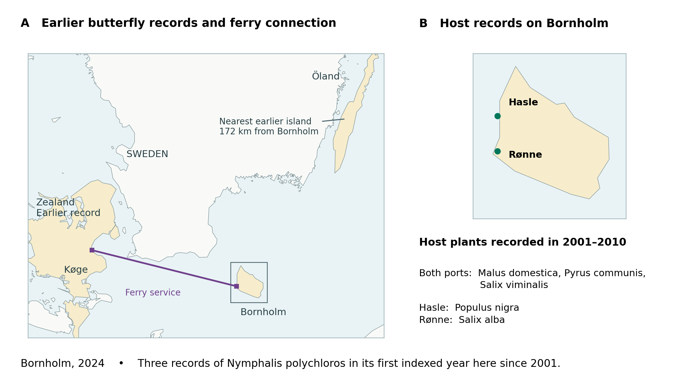

# Human-redistributed host plants amplify butterfly resources on islands: ports and marine geography

**ONE integrated Research Article | Butterfly island–port–marine synthesis v0.3 | Global Ecology and Biogeography | 9 November 2026**

**Status:** Unsubmitted and not coauthor-approved. This is the single integrated draft, retaining all source-verified v0.2 results while explicitly adding the previously archived conditional host–marine modelling and a small matched coast sensitivity. No new causal claim, independent fitting population or journal submission is asserted. v0.2 and older GEB/JBI source manuscripts remain archives. The v0.3 Figure 5 has now been rendered and its numerical input and image SHA audited; journal production and coauthor approval remain open.

**Running title:** Island butterfly host resources

**Keywords:** alien plants, butterflies, Circuitscape, island biogeography, larval host plants, marine resistance, ports, resource geography

## Structured abstract

**Aim.** When people introduce a plant to an island, a butterfly that already uses it elsewhere may gain a place where its larvae could feed. We asked how much the geography of known larval resources expands on islands and whether these opportunities correspond to recorded butterfly communities.

**Location.** Global botanical regions, 1,596 port neighbourhoods and 51 selected island groups.

**Time period.** Native and contemporary plant distributions; butterfly indices during 2001–2022, with a separate 2024 island case.

**Major taxa studied.** Butterflies and their larval host plants.

**Methods.** For 239 butterflies, we held each species’ documented hosts fixed and counted regions containing at least one host under native and contemporary plant distributions. We compared 126 insular and 237 mainland regions, examined introduced floras in 98 port-indexed island regions, and related host and marine geography to independently compiled butterfly records.

**Results.** Including introduced plants more than doubled potential butterfly–region combinations on islands (+118.9%, versus +40.9% on the mainland). The island excess was 10.7 percentage points after matching on area and biogeography. Port-rich island regions contained more introduced plants, including host species; accounting for the whole introduced flora removed the positive host association. Islands with similar host assemblages had more similar later butterfly records (ρ = 0.300). Sea geometry also improved retrospective prediction of community similarity across held-out islands, although prediction of later first records did not transfer consistently across regions.

**Main conclusions.** Plant introductions expand where butterflies could encounter a familiar larval resource, even when their diets stay fixed. On islands, that gain is especially large. The record of potential feeding sites is more extensive than the evidence for local breeding or the routes butterflies took to reach them.

## 1. Introduction

Plant introductions alter the geographic positions of ecological resources, not only botanical species lists. On islands, introduced vegetation may overlap limited native host resources, marine separation, settlement and ports. A butterfly can consequently acquire additional *potential* larval-host localities without changing its diet if plants already recorded in its host repertoire become available elsewhere. The ecological question is therefore **where this resource geography changes most, whether port-associated floral assemblages include the relevant plants, and whether those opportunities are reflected in butterfly records under contrasting marine geography**.

Opportunity and realized colonization must be separated. The presence of a catalogue-compatible host in a region does not show that a butterfly encounters it, oviposits on it or maintains breeding populations. Ports may aggregate non-native plants, but also aggregate gardening, disturbance and GBIF recording effort. Likewise, Circuitscape ocean resistance can describe accessibility contrasts beyond geodesic separation, yet is neither an observed voyage itinerary nor an individual flight trajectory. It is valuable to identify complementary source-dependent associations without treating them as a proven causal sequence.

Because human redistribution homogenizes many plant communities (van Kleunen et al., 2015; Daru et al., 2021), larval host opportunity can expand through *partner movement* rather than host switching. We hold butterfly–host identity constant to isolate this resource-geographic contrast. The island–mainland test asks whether the change is disproportionate after coarse area and biogeographic matching; a port-flora test asks whether the response concerns host plants specifically or an entire human-associated introduced flora.

To make the synthesis about butterflies rather than plants alone, we additionally compare species-specific host-catalogue matches, island-community overlap, observed GBIF indexing and the out-of-sample accuracy of recording models. In particular, a joint community comparison can ask if **host assemblages add information to marine-circuit predictors and marine-circuit predictors add information to host assemblages** under identical held-island folds. This is more discriminating than reporting separate positive rank correlations, but it still concerns observational predictive structure.

Our four linked evidence layers are (1) global host-resource amplification and the matched island contrast; (2) port-associated whole introduced floras and known butterfly hosts; (3) host/butterfly assemblage correspondence and recording prediction; and (4) conditional marine geography, historical plant-before-butterfly indexing and falsification of transport claims. We preserve the separate source denominators and unfavorable tests. The proposed generality concerns **geographic reorganization of potential resources and indexed butterfly communities**, not documented shipborne introduction or biologically successful island colonization.

## 2. Materials and methods

### 2.1. Three data grains, one butterfly-centred question

Analyses were assembled from source-versioned, non-interchangeable populations. The global resource reconstruction uses **239 resource-eligible butterflies** and botanical regions of the World Geographical Scheme for Recording Plant Distributions at Level 3 (WGSRPD3). A separate climate/land-cover-plus-host recording evaluation contains **155 butterflies** with sufficient indexed records; a small supplementary host-envelope overlap comparison includes **32 selected butterflies**. The island record and access reconstruction uses a **fixed 225-butterfly candidate list across 51 WPI-associated GSHHG landmass groups**, of which **199 butterflies** have complete frozen LepTraits wing-size and disturbance descriptors. The 51 landmass groups, 98 effort-covered insular botanical regions, and WGSRPD3 insular regions are different geographic supports; their counts and coefficients are never pooled as though they share one denominator. The joint butterfly-community host–marine comparison uses 51 islands and 1,275 non-independent pairs; the stricter double-unseen geographic marine sensitivity uses a different **990-pair historical general-plant-indexed** population.

The global ecological response is *potential butterfly × botanical-region host opportunity*. The butterfly-record responses are *indexed butterfly records, retrospective recording probabilities, or first-indexed species × landmass cells*. They are not occupancy estimates, observations of larval host use, individual movements, or successful establishment. We report these definitions throughout because an increase in one outcome does not mechanistically imply an increase in another.

The units of inference differ across comparisons. The global reconstruction counts butterfly species × botanical regions for 239 butterflies (126 insular and 237 mainland regions in the island contrast). The 1,596-port inventory describes plant observations; the association with port numbers uses 98 island botanical regions. The 155-species forecasting panel evaluates recording error. The 225-species, 51-landmass panel evaluates community similarity across 1,275 pairs sharing endpoints. For the separate 2024 case comparison we screened 200 port islands outside Britain and Ireland in the eligible frame; 33 had inbound coverage in two or more years, 31 also had butterfly records in both observation periods, and 27 had early plant records. These supported 2,994 at-risk species–island combinations (132 species). For each butterfly, a prior host required an indexed plant within 5 km of a destination port during 2001–2010, a species-specific catalogue link and regional introduced-candidate status. Earlier same-species islands were indexed by 2018, ship services were compiled for 2019–2023, and the destination outcome was its first entry in 2024 in the index beginning in 2001. Plant, service and butterfly observations therefore resolve a port neighbourhood, a pair of islands and an entire destination island, respectively.

We compared all 2,994 at-risk combinations by compatible prior port-host indexing, irrespective of shipping links. The unconfirmed group had early botanical coverage on its island but no matching regional candidate host in the sampled port buffers. Equal-weight linear probability models estimated absolute rate differences with a four-degree-of-freedom cubic B-spline of log distance to the nearest earlier conspecific island, then additive destination and species fixed effects. Approximate 95% intervals use a two-way island/species cluster sandwich with finite-sample corrections and 26 t degrees of freedom. A separate overlap comparison paired destinations within species without replacement at distance ratios ≤1.25, maximizing pair count then minimizing total absolute log-distance difference without using outcomes. All comparisons concern recording in 2024.

We extended the 2024 comparison retrospectively over 2011–2024 using the same 27 destination islands and 132 species. We rebuilt the annual risk sets from all 3,564 species–destination combinations, including those first indexed before 2024. Host status remained fixed to the 2001–2010 port plant inventory. A combination contributed while unrecorded through the preceding year, starting when another of the 200 candidate port islands already had a conspecific record. For year t, we recomputed the minimum representative-port distance using records through t−1; a first index in year t ended follow-up. Unlike the original 2024 study, the annual comparison used all prior recorded islands irrespective of shipping coverage. The selection of destination islands and species uses the later cohort and makes this a retrospective analysis. Year-specific contrasts adjusted for a four-degree-of-freedom spline of log distance. Pooled models weighted each at-risk combination-year equally and included year fixed effects, with or without destination and species fixed effects. Intervals were clustered by destination and species. One sensitivity restricted island-years to those with at least one other butterfly species recorded.

For the annual shipping comparison, we retained prior-host combinations in service years 2019–2023. For each year we required observed inbound coverage at the destination and outbound coverage of an earlier conspecific island in the same source that year. A direct link required a reported route from any such earlier island to the destination. Ferries were coded as two-way services; directional LNG and container legs retained their reported direction. Fiscal-year sources used the year ending in March. No documented direct link within this frame was coded as unconfirmed. Missing endpoint coverage was tabulated separately. We paired linked and unconfirmed rows within year at nearest-source distance ratios ≤1.25 without replacement, maximizing pair count then minimizing total absolute log-distance difference. We checked alternative equally optimal assignments and repeated matching within species or destination separately. A lagged sensitivity used service in the preceding year, required a conspecific record before that service year, and retained nearest-source distance at the beginning of the outcome year.

### 2.2. Reconstructing butterfly resource geography

The frozen HOSTS interaction dataset links butterflies to accepted larval hosts in the World Checklist of Vascular Plants (WCVP), **version 13 (21 May 2024)**, as represented in the pinned `matildabrown/rWCVPdata` commit `65bed76bae9d644ccb6ad200c05f9f5071d89e05` (Govaerts, 2024). We held accepted butterfly–host identities fixed and used each host plant's native and contemporary (native plus introduced) WGSRPD3 distributions to construct a binary potential resource envelope for each butterfly. For butterfly s and region r, the envelope was coded as a candidate opportunity if at least one accepted host of s was recorded in r. The native-only and contemporary envelopes used the same interaction list. The difference therefore measures the geography added by plant distributions and not host-switching or expanded taxonomic diet.

We calculated the added number of butterfly–region combinations, the contemporary/native resource ratio and the occurrence of gains across classes of host-family breadth. We decomposed added butterfly–region credit among contributing host species and genera using the original fractional attribution, preserving the finite number of possible regions. We retained published analyses excluding exact FAO crop-host identities and a more conservative plant-genus crop exclusion, Poaceae-feeder exclusion, native-resource breadth controls, family mixed effects, geographically stratified comparisons, and a taxon-matched butterfly phylogenetic sensitivity. A post hoc narrow-equivalence test for the host-breadth association was reported as a bound, not proof of zero association.

### 2.3. Island amplification of resource opportunity

WGSRPD3 regions were classified using the archived strict island coding rule rather than assuming that every geographically named island belongs to an island region. We contrasted native and contemporary butterfly–region resource combinations across **126 insular and 237 mainland botanical regions** in the original comparison, with area- and broad-biogeographic matching based on **15 supported Level-1 × region-area overlap strata**. Relative gains are computed within each geography class. Because alternative classifications and exclusions affect denominators, class-specific butterfly–region counts are not added to reconstruct the different overall 239-species total.

The matched comparison estimates a difference in the *share of contemporary opportunities attributable to introduced host geography* for comparable strata. It is not a controlled field experiment, an increase in butterfly abundance or an established proportion of opportunities actually used.

### 2.4. Ports and the whole introduced flora

For **98 insular botanical regions** with source-defined plant indexing effort, we examined associations between modern World Port Index (WPI; National Geospatial-Intelligence Agency, 2019) port counts and (a) total introduced vascular-plant richness, (b) distinct introduced taxa known as butterfly larval hosts, and (c) the host-taxon response conditional on the whole introduced flora. Geographic, native-baseline, area and botanical-indexing controls followed the source analysis. We retain each model's own coefficient rather than interpreting different response-model coefficients as directly comparable causal effects. We did not infer ships, botanical propagule routes or port-specific plant arrival dates from current WPI port counts.

**Port survey coverage and species-level bridges.** The broader original GBIF port inventory contains **3,630** registered port candidates; plant queries were completed at **1,596 ports across 142 country codes**, including **1,150 ports** with a recorded introduced larval-host candidate, **687 candidate introduced host plant species** and **25,742 plant × port records** (not unique plant observations and not all 3,630 ports). Contemporary WCVP regional introduced status defines *candidate* non-native plants, not independently confirmed historical introductions to each port. For an illustrative source-matched set, we compared the ten largest contributors to global added butterfly resource opportunity with **2001–2010 GBIF species-key records from 38 port buffers on 17 studied landmasses**. The resulting species-name overlap is a taxonomic/date check, not proof of ship transport or at-site larval use.

**Butterfly–plant association checks.** The separate original 225-butterfly/51-landmass host-port network contains catalogued butterfly–larval-host links and plant records pooled across **2001–2024**. We retained a species × pair outcome for butterflies newly indexed on *both* landmasses and asked whether a compatible introduced-host candidate was also indexed at both port areas. The first structural null held host-plant family and network degrees fixed, while later geographic plant-prevalence and historical-source controls provided stricter tests. For a distinct early-indexed subset, **2001–2010 plant index records** preceded **2011–2017 butterfly first indexes**, with nonindexed hosts kept as unknown, not absent. This study uses time order of records, **not verified first introduction or observed butterfly settlement**.

**Matched port/nonport coast sensitivity.** An independently archived exploratory pilot (draft [PR #158](https://github.com/zuizui0223/chocho/pull/158)) fixed 24 WPI ports in 17 selected GSHHG landmasses and constructed 24 new remote same-island coastal 5-km GBIF search neighborhoods. It indexed 2001–2010 plant species and subsequent butterfly records under the same query radius. Controls are not the earlier ESA WorldCover coast locations, and inclusion required at least 30 pre-2011 plant records at the port, so the comparison cannot identify an unbiased causal port effect.

### 2.5. Does host geography matter for butterfly records?

Two separate observation checks guard against a purely arithmetic interpretation of larger plant-defined envelopes. In a stratified 32-butterfly host-envelope comparison, we examined whether contemporary butterfly records outside native-only host envelopes fell inside the expanded envelopes, testing geometric and region-matched null expectations. In a larger **155-butterfly** panel, we compared climate-plus-land-cover recording predictions against models also including host-resource and host-composition information under a subsequent-period evaluation, held spatial blocks, and documented observation/source sensitivities. These analyses assess correspondence and prediction of GBIF records; static contemporary host geography is **not** a dated pre-colonisation exposure. Temporal holdout refers to butterfly records, not historically frozen host maps.

### 2.6. Butterfly species and island-record histories

The 225 candidate butterflies were fixed from the original island host-network source before examining subsequent recording outcomes. To make source availability auditable, we independently re-queried public GBIF species-key facets on original GSHHG 2.3.7 landmass polygons in three windows: **2001–2010**, **2011–2017**, and **2018–2022**. The source uses the documented six butterfly-family taxon keys, valid-geographic-coordinate filters and PRESENT occurrence status on GSHHG 2.3.7 boundaries (Wessel & Smith, 1996, 2017); it is **not restricted to human observations**. Six independent source shards were combined only after polygon-area, query-receipt, taxonomic-key and record-rule checks, producing **11,475 candidate species × landmass cells**. Differences from the older 17-landmass GBIF indexing snapshot were audited. This newly queried source is distinct from the previously unavailable, private, 83,573-row annual Parquet.

For each butterfly species and recording period, a target landmass was eligible for a first index only when that species had no indexed record there in an earlier window. To calculate source distance, we additionally required at least one previously indexed conspecific *elsewhere among the sampled 51 landmass groups*. That earlier indexed landmass is a **candidate recording source**, never a demonstrated exporting population. Nearest source distance is calculated among those candidates only; it may greatly overestimate the distance to the closest true population when nearer mainland or island populations are outside the panel. We report species- and island-specific observed record counts as descriptive outcomes without treating multiple island records from a species as independent migration events.

### 2.7. Marine resistance and butterfly trait sensitivity

The source-locked marine network uses original island-port representative locations and a modelled undirected ocean-resistance surface. **Joint host–marine community model.** The already completed, independently audited [joint analysis](../../results/island51_host_circuit_joint_20261106/README.md) tested 1,275 original island pairs across 51 landmasses, using Jaccard similarity of butterflies newly indexed during 2011–2022 as the outcome. Every model included source-defined great-circle distance (and its squared log), original WPI port-count sum/difference and earlier butterfly similarity. Before the joint comparisons, a source-verified **uniform-ocean Circuitscape baseline** assigned conductivity 1 to water cells, without AIS or wind. The base prediction included log great-circle distance (and its square), port-count controls and, for the later butterfly response, earlier butterfly similarity; adding uniform-ocean resistance isolated the incremental retrospective information of sea geometry under those statistical controls. The common geographic joint-model reference G included that uniform-ocean resistance. H additionally included original pooled candidate introduced-host Jaccard; C instead added observed modern native-AIS-density and wind-speed-based Circuitscape resistance; HC included hosts and both extra circuits. Leave-one-island-out cross-validation excluded all pairs incident on the test island, made separate endpoint-specific predictions and averaged their squared errors by island. **The held-island host inventory and marine coordinates were available to the predictors**; plant records pooled 2001–2024 may postdate the target. Improvements are therefore conditional *retrospective* prediction differences, not independent causal effects.

**More demanding marine transfers.** The distinct 990-pair historical all-plant-indexed [cross-community test](../../results/island51_cross_community_marine_20261107/README.md) used 15 geographic folds excluding *both island endpoints* for the held pair and evaluated native AIS, wind and their combination on earlier general-plant, earlier butterfly and later butterfly Jaccard responses, including a retrospective host-adjusted later-butterfly panel. It cannot be pooled with 51-island leave-one-island-out results. The first-indexed species×landmass test below asks yet another, harder generalization question. The 51-landmass uniform-ocean pair matrix is used to construct the minimum resistance to earlier indexed conspecific landmasses. We separately model nearest geographic distance and the residual of log marine resistance after a source-only quadratic regression on log geographic distance. In analyses of retrospective initial indexing, geographic access, island area, latitude/longitude, prior species indexing, target butterfly indexing effort, modern port count and early general botanical indexing are included as controls where supported. The ocean residual is a statistical quantity, not an observed directed ship route.

The 199 matched LepTraits butterflies provided a composite mean of recorded wing-span and forewing numerical bounds and disturbance-affinity categories. Wing-size proxy is not independently measured migratory range or aerodynamic performance. A positive-only set of **111 candidate migratory butterflies** was also matched exactly to a later researcher's GBIF request based indirectly on the migration review of Chowdhury et al. (2021); the review's original supplementary species table was not accessible. **All 114 unlisted candidate species have UNKNOWN migratory status and are not non-migrant controls.**

We evaluated L2-regularised logistic retrospective indexing models with training-only standardization, holding out individual landmasses, seven source-only geographic groups, or fixed species groups. We reported Brier score and log loss, including worse-performing comparisons. A separate 2×2 constrained null exchanged initial-index events across eligible butterfly × landmass cells while preserving the number of events for each butterfly and target landmass. A stricter null additionally restricted exchanges within the original seven geographic groups, preserving butterfly × region event counts. Trait interactions were centred by the event-weighted trait mean to avoid mistaking the main spatial-access association for a trait effect. These are exploratory conditional randomisation diagnostics, not a random experiment on biological colonisation.

## 3. Results

### 3.1. Islands gained disproportionately large introduced larval-host opportunities

On the native-only host map, 126 strictly insular WGSRPD3 regions contained **4,829** butterfly × region opportunities. Incorporating introduced ranges of *already-known* larval hosts raised this to **10,570**, a **+118.9%** expansion. The added **5,741/10,570 (54.3%)** contemporary island opportunities were attributable to introduced known-host ranges—not to an observed increase in island butterfly populations. The mainland comparison (237 regions) increased from **21,215** to **29,901** combinations (**+40.9%**). A matched analysis across **15 Level-1 biogeographic × area-overlap strata** retained an insular excess of **+10.7 percentage points** in the contemporary share attributable to introduced hosts (descriptive within-stratum permutation **p=0.0002**). These estimates indicate a disproportionate change in insular potential resources, not an increase in butterfly populations or a causal island-treatment effect.

The island contrast sits within a wider global butterfly result. Across the separately defined **239-butterfly** resource reconstruction, contemporary host maps added **14,553 butterfly × region units** (from **26,530 to 41,083**, **+54.9%**) and expanded the opportunity of **206/239 (86.2%)** butterflies. Gains appeared among dietary specialists (including **82/97 one-family** butterflies) and generalists. Proportional gain was poorly described by the number of host families (Spearman **rho=0.008**, bootstrap **95% CI −0.111 to +0.128**); a strict post hoc equivalence test for |rho|<0.10 was inconclusive (**p=0.078**). Excluding crop hosts still left **46–47%** aggregate potential expansion. Thus island amplification is not simply a result of recording dietary generalists or counting crop species.

### 3.2. Port-rich island regions accumulated broad introduced floras including butterfly hosts

The source inventory included **1,596 GBIF-query-complete ports across 142 country codes**, with **1,150** containing at least one candidate introduced larval host; it identified **687 candidate host plant species** and **25,742 plant × port combinations**. This is a geographically broad record inventory, but its sampling completeness and modern WCVP source do not make each plant an independently verified port-import event.

Among **98 botanical-effort-covered insular regions**, higher modern World Port Index port numbers were associated with more introduced vascular plant taxa (**beta=+0.2445**, permutation **p=0.0012**) and more distinct introduced taxa in the known butterfly host catalogue (**beta=+0.1639**, **p=0.011**). Importantly, after accounting for the *whole introduced flora*, there was **no additional positive host-specific port coefficient** (**beta=−0.0415**, **p=0.093**). In other words, port-rich island regions contain richer introduced floras that include larval hosts; the data do not establish selective importation of plants important to butterflies.

The independent **17-island, 24-port paired coastal pilot** found no selective introduced-host candidate surplus on the same island's port versus newly reconstructed nonport coastline after normalizing to all 2001–2010 indexed plant species (island-equal mean fraction difference **−1.31 percentage points**, bootstrap interval **−4.54 to +2.01**). This normalized botanical contrast was not associated with the subsequent 2011–2017 relative first-indexed butterfly richness (**ρ=−0.085**, island-permutation **p=0.749**). The later 2018–2022 contrast was likewise weak (ρ=+0.085, p=0.745). These smaller, effort-/habitat-unmatched results constrain the scope of a port-specific mechanism; they do not supersede the 98-region port-flora correlation.

The source names make the botanical connection concrete. The **ten most influential plants** in the global resource calculation supplied **25.1%** of added opportunity across the 239 butterflies. **Eight of those ten species** had a 2001–2010 accepted-name GBIF index in at least one of **38 surveyed port buffers on 17 landmasses** (contributor credits together accounting for **20.7%** of the global added units). *Medicago sativa* appeared at **7 ports/3 landmasses**, *Poa pratensis* at **8/4**, and *Dactylis glomerata* at **9/5**. These are records of familiar resource-contributing plant species in earlier port vicinities—not 20.7% realized resource use, proof of local alien origin in 2001 or documented cargo movement.

### 3.3. Butterfly species and introduced host candidates share measurable port/island geography

The original 225-butterfly crosswalk linked the number of additional native-to-contemporary butterfly resource units to the number of island port buffers where compatible introduced-host candidates were indexed (Spearman **rho=+0.652**). A descriptive partial rank adjusting host-taxon count, native resource opportunity and earlier butterfly index breadth was **+0.550**. Within the 225 candidates, **197** had any global added resource opportunity and **159** had an indexed candidate introduced host in at least one sampled island port. This species-level correspondence links the global and port datasets, although **both reuse HOSTS–WCVP identities**, and the 2001–2024 port records can postdate butterfly records; it is not an independent pathway test.

At the assemblage level, island pairs sharing more port-associated candidate introduced larval hosts tended also to share more butterfly species indexed during 2011–2022 (**rho=+0.300**, **51 landmass groups / 1,275 dependent pairs**). A descriptive partial rank adjusting geographical distance and earlier butterfly similarity retained **+0.215**. Host assemblage similarity related even more strongly to butterfly species indexed *earlier* (**rho=+0.418**), indicating a general geographic correspondence rather than an association specific to new arrivals.

Direct butterfly–host catalogue matching provided a taxonomic bridge. Of **1,163 butterfly × island-pair combinations** involving a butterfly newly indexed on both landmasses, **208 (17.9%)** contained a candidate introduced host recorded around ports of both islands. A 199-draw structural host-network null preserving plant family and host-link degree had **11.9%** mean matched combinations (descriptive Monte Carlo 0/199 ≥ observed). The plant records are pooled over 2001–2024, so this positive catalogue match is **not contemporary confirmed larval use** and is **not automatically temporally prior**. That structural null does not preserve the geographic indexing of host plants. In a **different**, genuinely pre-2011 host-index / 2011–2017 butterfly-first-index cohort (34/113 events), a stricter plant-geography-preserving null did not show special excess. We therefore do not upgrade either the pooled 208/1,163 source match or the smaller historical 34/113 record match to an established colonisation mechanism.

The smaller locality-scale check also retained butterfly identities: across **17 original port buffers** (Japanese, British and Canadian), **16 butterfly species** had both their own GBIF records and those of a compatible introduced-host candidate within the same 5-km search area (**59 butterfly × port combinations**). Examples include *Pieris rapae*, *Vanessa cardui*, *Pieris brassicae* and *Anthocharis cardamines*. This limited sample records spatial co-indexing rather than oviposition, feeding, contemporaneous presence or relative port-versus-nonport enrichment.

### 3.4. Butterfly record prediction improves when host geography is considered

An independent **155-species, 208,482-observation-combination** evaluation compared climate and land cover alone with models additionally including known host-resource and host-family geography. The host-informed model reduced species-equal mean squared recording-prediction error by **4.12%** for subsequent-period test records and **3.00%** for held spatial blocks. The 100-km-distant subset also improved (**2.74%**), and four recording-quality or source-sensitivity analyses retained the positive direction. The 100-km subset is nested within the held-spatial predictions, not a distinct third validation. Both models use contemporary plant distributions; the time-held comparison does *not* verify that a particular introduced host arrived before a butterfly.

Within the independently checked island-cell subset of these predictions, **95 butterfly species and 39,753 strict-coordinate-matched evaluation rows** showed **4.98%** MSE improvement from host information. However, **97.2%** of these rows came from Great Britain and Ireland; this check is not a globally representative 51-island validation. A separate **32-butterfly** source recovery analysis found that introducing host geography covered **66/115** butterfly × region index observations outside native-only host envelopes. This shows botanical and observation overlap beyond a matched structural expectation, but does not establish larval use.

### 3.5. Historically earlier port hosts can be indexed before butterfly records, but geography explains the excess

On the historically source-fixed subset, accepted host-plant GBIF indices in **2001–2010** were found around an original study port of the same island for **34/113 (30.1%)** eligible 2011–2017 newly indexed butterfly × island events (60 butterflies, 17 sampled landmasses). This exceeded the mean **25.2%** under a basic plant-family and host-degree-preserving structural null. After additionally preserving the plants' geographic indexing prevalence and regional occurrence profiles, the null mean was **30.26%**, close to the observed **30.09%**; the difference did not remain exceptional (356/499 null draws at least observed).

The weak temporal matching does not erase the observed 34 matches, but makes a biological distinction: **compatible plants can have been indexed earlier without that being an unusually frequent relationship once where plants are routinely found and recorded is taken into account**. Moreover, same-island five-year butterfly *re-indexing* was **26/34** when a compatible earlier host was indexed versus **70/79** when none was found. This did not support improved persistence; failure to index a host is not evidence it was absent. We therefore do not interpret earlier co-recording as established host-facilitated survival, breeding or new colonisation.

**Full port-island comparison.** Across 27 islands and 132 species, first records occurred in 8/390 combinations with prior compatible host records (2.05%) and 14/2,604 with host records unconfirmed (0.54%). The crude difference was +1.51 percentage points. Adjusting for continuous distance gave +1.33 points (95% interval −0.29 to +2.96); including island and species fixed effects gave +1.74 (−0.17 to +3.65). Omitting one island at a time gave adjusted estimates from +0.86 (omitting Sakhalin) to +2.04 (omitting Honshu). Within 329 distance-matched pairs of the same species (92 species, 27 destinations), first records occurred in 3/329 versus 1/329 (0.91% versus 0.30%). These pairs retain 329 of the 390 prior-host combinations. The event difference was unchanged across equally distance-optimal matches.

**Annual first records across the same 27 islands.** From 2011 to 2024 we observed 266 first indices in 42,228 at-risk species–island–years (3,238 distinct combinations). Prior-host and unconfirmed groups contributed 66/5,675 (1.16%) and 200/36,553 (0.55%) events per at-risk year. A further 1,242 combination-years, including 13 first indices, had no earlier conspecific island in the sampled source frame and thus no defined distance. The annual distance-adjusted contrast was positive in 11 of 14 years; all individual annual 95% intervals included zero. Pooling years and adjusting for distance and year gave +0.345 percentage points (approximate 95% interval −0.035 to +0.726). Adding island and species fixed effects gave +0.354 points (+0.031 to +0.676). With another butterfly recorded in the island-year the latter contrast was +0.442 (+0.083 to +0.801); omitting Sakhalin gave +0.304 (+0.004 to +0.604). Rebuilding the 2024 risk set recovered the same 2,994 combinations and 22 events as the single-year study, with updated source distances through 2023.

**Annual shipping links conditional on earlier port hosts.** Of 2,011 host-positive species–island–years in 2019–2023, 1,340 had inbound coverage and 298 had an earlier conspecific island with departure coverage in the same registry and year (15 destinations, 60 species, 50 island-years). Five of 94 linked combinations (5.32%, six islands) and seven of 204 unconfirmed combinations (3.43%, 14 islands) had a first index. Median distances to the nearest earlier conspecific island were 155 and 2,049 km, respectively. The 2019 stratum had no confirmed links. Four of the five linked events shared the Danish domestic ferry source; the fifth had a Sakhalin LNG connection. Matching by year and distance yielded 24 pairs (nine destinations in the displayed solution), with one event in each group. Across equally optimal assignments the linked-minus-unconfirmed event difference ranged from −1 to +2. Within-species matching yielded five pairs across three islands (zero versus one event); within-destination matching yielded five pairs on one island (zero versus zero). Using service in the preceding year, the crude counts were 9/89 versus 5/197; year- and distance-matching gave 23 pairs (one versus two events in the displayed assignment; tied differences −1 to +2).

**Regional extension of the annual shipping comparison.** We retained the 2019–2023 risk set and matching rules, adding positive ridership or vehicle records for selected Washington State and British Columbia ferry services, Hakodate–Aomori fiscal-year passenger counts, and completed calls of all reported vessel types at five Balearic ports. We used the reported origin of an arrival; a port outside the 200-island source frame could establish coverage at its counterpart but could not establish a direct link from an earlier sampled island. Eligible host-positive combinations increased from 298 to 323 species–island–years (15 to 16 destinations, with Mallorca added; 60 butterfly species). Linked combinations had 5/111 first indices and unconfirmed combinations had 8/212. The maximum number of year- and distance-matched pairs remained 24. One optimal solution covered eight islands and yielded 1/24 versus 2/24; equally optimal solutions ranged from two fewer to two more first indices with a link. Limiting both nearest-source distances to 250 km gave 16 pairs, or zero after Danish destinations and Danish route origins were excluded. Without the 250-km restriction, the Denmark-excluded comparison gave eight pairs on four islands, with 1/8 versus 0/8. All eight linked members had LNG service, and their only first index was *Nymphalis antiopa* on Sakhalin in 2021. No same-species pairs survived the Denmark exclusion. The wider shipping sources therefore enlarged coverage but supplied no geographically replicated short-distance contrast outside Denmark.

**Box 1. A familiar larval resource on Bornholm.** In the expanded port-island analysis, 390 butterfly–island combinations on 20 islands had an earlier port record of a compatible candidate introduced plant. Eight combinations on six islands were first indexed in 2024. On Bornholm, the large tortoiseshell (*Nymphalis polychloros*) had three records that year. Apple (*Malus domestica*), pear (*Pyrus communis*) and basket willow (*Salix viminalis*) had already been recorded around both Rønne and Hasle. These records place known larval resources on the island before the first butterfly entry in this series. Their local introduction dates and use by larvae remain unknown.

Both Öland and Zealand had records of the butterfly by 2018. Öland was the closest sampled earlier island (172 km between representative port locations). Zealand had the documented ferry connection. The line joins the terminals of the service reported in Statistics Denmark SKIB31 (382, 395, 364 and 363 journeys to and fro in 2020–2023, respectively); the butterfly's travel history is unknown. Across all eligible islands, matching routed and route-unconfirmed combinations within a 1.25 distance ratio yielded seven pairs, with one first index among the routed members and zero or one among their controls across tied matches. None of the pairs matched the same butterfly species. Coastlines are from GSHHG 2.3.7 and terminal points from the 2019 World Port Index. [Case records and methods](https://github.com/zuizui0223/chocho/tree/ff642c8/provenance/reviewer_defenses/results/expanded_port_islands); [ferry statistics](https://www.statbank.dk/SKIB31).

**Comparison across the six destinations.** Of 390 host-positive combinations, 19 had a documented link to an earlier same-species island (five newly indexed); 371 had no confirmed link (three newly indexed). Hokkaido and Sakhalin had a service from the nearest earlier island. The Ōarai–Tomakomai ferry connects Honshu and Hokkaido, whereas the host on Hokkaido was recorded at Ishikari Bay New Port. Three butterfly species shared the same Sakhalin destination-year. Their nearest earlier island was Hokkaido; the voyage ledger identifies one 2021 return from Kushiro to Sakhalin II LNG Terminal. The two Sakhalin ports with earlier host records were Uglegorsk and Kholmsk. Bornholm had a service from a different earlier island. Zealand, Whidbey and Santa Catalina had new entries with no direct service confirmed from an earlier same-species island. The other 14 host-positive islands had no new entry in 2024. [Table S1](TABLE_S1_six_island_cases.md) gives the plants, ports, first indexed years on earlier islands and vessel records for each species.

### 3.6. Host assemblages and marine geography provide complementary retrospective information about butterfly communities

**The simplest marine result does not depend on shipping or wind:** adding uniform-ocean Circuitscape resistance to the distance/port/earlier-butterfly baseline reduced later butterfly-community held-island MSE from **0.00679776 to 0.00645231 (+5.082% reduction; 33/51 island holdouts improved)** on the original 51 landmasses and 1,275 dependent pairs. This is a retrospective improvement in recorded community similarity, not direct passage or colonization. A separate source-verified **joint host–marine model on the same 51 landmasses** then tested whether host-plant assemblages or AIS/wind marine descriptors add predictive information beyond each other. For 2011–2022 newly indexed butterfly-community Jaccard similarity, adding candidate introduced-host Jaccard to the geographic/uniform-ocean reference reduced held-island MSE **2.276%**, and adding modern native-AIS and wind circuit descriptors reduced it **7.006%**. Conditioned on the AIS/wind-inclusive model, **adding hosts to the marine-circuit model** lowered MSE **0.0060002→0.0058964 (1.731%)**, improving **31/51 held islands**. **Adding AIS and wind circuits to the host model** lowered MSE **0.0063055→0.0058964 (6.488%)**, improving **39/51 held islands**. This is a retrospective model increment, not identified evidence for actual wind or vessel transport. The full joint model reduced MSE **8.616%** against the same basic geography/uniform-ocean reference (0.0064523→0.0058964). The percentages use different reference losses and must not be summed. We consistently report relative **MSE reduction = 100 × (MSE_reference − MSE_augmented) / MSE_reference**, so a positive percentage means the augmented model has *lower error*, not a negative predictive result. The absolute reductions are **0.00010387** when adding hosts to circuits and **0.00040910** when adding circuits to hosts; these are modest conditional accuracy differences and do not establish a biologically large or transport-specific effect. Independent re-aggregation of every archived endpoint-specific held-out prediction reproduced the source result. This shows complementary conditional *predictive* information, not separate causal mechanisms.

The complementary gain is not universally transferable. In the distinct **990-pair both-endpoints-geographically-unseen** comparison with source-only historical general-plant-index quality requirements, adding AIS to a retrospective host-adjusted later butterfly-community model improved MSE just **0.678%**, whereas adding AIS **and** wind together worsened it **4.699%**. Adding AIS alone worsened indexed **earlier general-plant** community predictions **1.294%** and **earlier butterfly** community predictions **8.541%**. The outcome dependence suggests a non-universal observational relation, and the modern AIS data postdate the older 2001–2010 flora. Source-only sensitivity tests explain the difference between model gain and identifiable transport: after latitude/hemisphere controls, adding the wind-only circuit **worsened held-out MSE by 4.662%** (compared with +1.359% in the earlier uncontrolled comparison); the observed AIS assignment, despite a +1.002% adjusted gain, was matched or beaten by **100/199 locally relabelled (≤750 km) marine-network placebos**. Thus wind-related gains are geographically confounded and AIS source specificity is not established, although this does not prove wind is biologically irrelevant or AIS information is zero.

Independently, the new public GBIF panel covered **225 butterflies × 51 sampled landmass groups (11,475 cells)**, containing **221** butterfly first-index events in 2011–2017 and **96** in 2018–2022. Among the 199 LepTraits-matched butterflies with earlier recorded conspecifics on other sampled islands, **187 early and 83 late** first-index events entered source-access tests. Under species-, island- and region-constrained swaps, later first indices were associated with proximity to previous conspecific indices (**p=0.00033**) and quadratic-geodesic-distance-residual uniform-ocean resistance (**p=0.00233**). However, adding this **uniform-ocean residual** to first-index prediction **worsened** late *geographic-region-held-out* Brier error by **6.48%**. This is a different response, model and holdout from the positive paired-community AIS/wind result and therefore cannot be substituted for or used to erase it. Wing-size × marine residual interactions were not supported (**p=0.645**), and the positive-only migratory-candidate subset lost its later within-region marine-residual signal after removal of two port-rich landmass groups (**p=0.229**).

The association is between modelled seascape properties, available indexed partner-plant composition and butterfly *records*. The source landmasses are not demonstrated exporting populations, a current flow is not an observed biological passage, and AIS density does not document vessel carriage of plants, eggs or butterflies. The evidence supports **conditional marine and host geography of indexed butterfly communities**, not confirmed arrival routes, reproductive success or stepping-stone colonization.

## 4. Discussion

### 4.1. Islands are amplifiers of introduced butterfly resource opportunity

The largest geographic contrast in this synthesis is the disproportionate increase in reconstructed butterfly larval-host opportunity in insular regions. The insular gain is not simply a taxonomic-generalist pattern: specialist butterflies also gain potential regions when human-translocated hosts become widespread. Nor is the comparison merely small islands possessing fewer native opportunities, because the signed island excess persists in the supported matched area and broad-biogeographic strata. These results point to a recognizable island-context consequence of plant globalization: a pronounced change in the geography of *what the known butterfly–host network could potentially support*.

This remains a potential resource signal rather than butterflies successfully colonising new islands. WGSRPD3 regional plant occurrence is a coarse proxy for resource contact, and alien plants may be absent from the microhabitats where butterflies reproduce. Yet measuring the island-specific distributional opportunity of existing known hosts is more informative than equating butterfly food breadth with the number of host families alone. It establishes an empirically bounded way to think about how human plant movement can reorganize consumer geography.

### 4.2. Ports correspond to the full non-native flora, not a butterfly-host-only invasion pipeline

The global port inventory, the 98-region effort-controlled associations and the confirmed historical plant-name matches establish a positive observational botanical connection. Introduced host candidates are found in port buffers and port-rich regions, including plant taxa that contribute disproportionately to global butterfly opportunity. The counter-intuitive result is that the association is **not host-selective once the whole introduced flora is controlled**. This is a stronger, more informative ecological story than asserting every cargo vessel selectively carries larval-host plants: ports mark concentrations of broad anthropogenic floral assembly, and known larval hosts are one subset of that flora.

At present, contemporary ports and plants may index human settlement, gardens, roadsides, agriculture, general introduced-species prevalence and GBIF sampling. The existing source lacks directly comparable historical host species lists from matched off-port coastlines for every port. Thus we cannot estimate a port-specific causal enrichment, and the collection of eight globally important host taxa in earlier port buffers cannot date their actual transport. A richer introduced flora does not imply more habitat for every butterfly, and industrial coastal habitat conversion may have competing effects on adult and larval requirements.

Across the full risk set, the association between an earlier port host and a later butterfly record remained positive after distance adjustment. The uncertainty intervals include zero, and only four events survived within-species distance matching. Port-plant documentation and island-wide butterfly detection can both vary with survey activity; an unconfirmed host may be present outside a sampled buffer or overlooked within it. These data therefore support a descriptive difference in recording rates on the sampled islands. Establishment probability and a globally transferable host effect remain unresolved.

The repeated annual records give a more precise estimate of a small positive average association within this cohort. Its direction varied across years, and interval exclusion of zero depended on the adjustment set. A fixed early host index does not track subsequent changes in plant availability or identify feeding. Differences in documentation can persist even among island-years in which other butterflies were observed.

The service-year data connect some earlier conspecific islands to subsequently indexed destinations, but the additional association with shipping is unresolved where source distances overlap. Controls share endpoint coverage with a shipping registry; unobserved routes remain possible. Annual and fiscal-year service reports do not order individual voyages relative to a butterfly record within the same year. The preceding-year comparison also depends on a small set of distance-matched observations. These tests condition on prior hosts and do not identify a host-by-shipping interaction.

The six destination histories illustrate one possible role for an island: it may already contain a familiar larval resource when a butterfly is subsequently recorded there. Prior host indexing was an inclusion criterion, so its recurrence across all six supplies no independent test of a host effect. Return legs at an LNG terminal and passenger service at a different port from the host record give distinct biological hypotheses about access and post-arrival resources. Neither identifies the origin of an individual butterfly. Testing an island as a stepping stone would require evidence of persistence or breeding there and subsequent movement to another destination; those outcomes were outside the observation frame.

### 4.3. Plants and butterflies are linked at species and assemblage scales, with a temporal boundary

This integrated paper gains its butterfly relevance from explicit species-level resource–record connections, not from island similarities alone. The correlations of globally gained butterfly resource units with candidate alien-host port indexing, the port co-indexing of known butterfly–host pairs and the 51-landmass host–butterfly assemblage relationship each document a tangible *where-are-the-resources-and-butterflies-recorded* correspondence. Independent butterfly recording prediction further indicates that host geography contributes information beyond broad environmental covariates. Those positive observations are worth reporting, with their different data supports and shared source identities made visible.

What the positive patterns do not demonstrate is just as revealing. Earlier butterflies are more strongly correlated with the pooled port host assemblages than newly indexed butterflies, and the 2001–2024 pooled host records are not historically prior to the newer butterflies by construction. A separate genuine pre-2011 plant record subset shows 34 butterfly-specific earlier host coincidences, yet a prevalence- and region-matched plant null removes the apparent special excess and the subsequent butterfly re-indexing rate is not higher. Thus the observation cannot distinguish attraction to newly introduced larval hosts from long-term geographical co-structuring of host and butterfly distributions. In a biological interpretation of island assembly, that unresolved transition from resource opportunity to established local populations is a substantive testable gap, not a reason to discard the preceding observations.

### 4.4. The sea and the host flora: complementary predictors, not an identified transport chain

The most interpretable marine result is **uniform-conductivity ocean resistance reducing later butterfly-community prediction MSE by 5.082% beyond distance, port-count and earlier-community controls**. It is based on the water geometry rather than vessel or wind activity. A distinct **same-population conditional comparison** finds that host similarity further improves a model including uniform, AIS and wind marine descriptors by 1.731%; the converse AIS/wind increment is descriptive but not a ship- or wind-specific mechanism. Therefore indexed butterfly community geography is not exhausted by a single host overlap or a single geodesic separation variable. This result directly tests the requested ecological contrast between **resources** and **access-related spatial structure**.

Its limitations are unusually important. The original host assemblage was pooled through 2024, the marine AIS source describes modern 2015–2021 activity, and a held island's resource inventory was visible to the model. More stringent double-unseen-pair tests show a much smaller AIS-only increment and adverse full AIS+wind results; wind-only improvement reverses under explicit latitude controls, and the actual AIS node assignment is not exceptional under geographically local circuit reassignment; first-index event modelling shows a conditional residual-sea correlation but no robust unseen-region improvement. These are different forecast targets and holdout regimes, not interchangeable effects or contradictions. Without verified plant introduction years, larval-use observations and biologically validated travel pathways, **'marine access' remains a geographic interpretation of the predictors**, not a realized migration or shipborne vector.

The broad ecological picture therefore has three measured layers: introduced hosts disproportionately alter insular *opportunity*, ports are associated with the aggregate introduced flora rather than host-selective imports, and host/marine geography each carry source-dependent information about where butterflies are indexed. Their overlap makes islands informative biogeographic settings, without implying that any particular vessel or oceanic path delivered a breeding population.

Two transport checks qualify this interpretation. Adding historical liner connectivity increased held-out MSE by 2.92% across 17 islands, yet reduced it by 8.15% after one composite landmass was excluded from training and testing. In a separate 25-island holdout, the gain from adding ports beyond natural geography changed sign when islands and species were weighted equally in turn. Both results make the geographic composition of a sample consequential for interpreting a port coefficient. [Historical liner comparison](https://github.com/zuizui0223/chocho/pull/149); [whole-island holdout](https://github.com/zuizui0223/chocho/pull/125).

### 4.5. Generality and implications for butterfly conservation

The conceptual advance is the combination of **island amplification, broad port-flora assembly, butterfly-specific resource geography and marine-conditioned community prediction**. Reconstructed host opportunity grows broadly even for butterflies with narrow diets, but it is concentrated in the geography of a relatively small set of redistributed plants. That combination makes island host geography sensitive to changes in the human-associated flora. It has potential relevance for other specialized herbivorous insects, although their reproduction and dispersal have not been studied here.

These findings do not justify planting exotic host species as conservation resources. Exotic plants can impose demographic costs, serve as ecological traps, displace native vegetation or be biologically inaccessible to larvae (Yoon & Read, 2016; Braga, 2023). Conservation and biosecurity assessments should distinguish whether a plant is regionally introduced, locally present, a recorded host of the target butterfly, actually used for oviposition and larval development, and capable of supporting persistent butterfly populations. Each step requires finer spatial and historical observations than a global database record.

A decisive causal test would establish the actual local alien status and date of compatible host plants at matched island port/non-port coastal sites, then compare later butterfly record and breeding histories under species- and survey-effort-matched models. Historical maritime cargo links and direct mainland arrival alternatives would be needed to isolate shipping and stopover processes. The present integrated results define the observational expectations against which that work can be evaluated.

## 5. Limitations

The plant and butterfly layers have different units, species filters, geography and temporal resolution. HOSTS is incomplete; WCVP introduction status is a region-level contemporary record without a date or vector of actual establishment. WGSRPD3 opportunity does not ensure that a host and larva coexist at a field site. The host-family equivalence margin was post hoc and was not passed in a strict test. Butterfly occurrence prediction uses static contemporary host layers and opportunistic recording; time holdout on butterfly records is not a historical prospective test of host movement.

The 51-landmass GBIF panel comprises selected port-linked groups and uses a new 2026 public index rather than the unavailable 83,573-row author original. Non-indexing is not absence, first indexing is not first arrival, and the independently dated source distances are among sampled landmasses only. Pairwise Jaccard rows reuse the same island identities and do not constitute 1,275 independent biological replicates. Modelled electrical marine resistance, current concentration, present-day port abundance and maritime activity proxies must not be interpreted as realized immigration, ship routes or historically dated propagule delivery. The conditional randomisations are retrospective and multiple comparisons are exploratory. The jointly fitted host–marine regressions permit predictors from a held island's contemporary host inventory, so they are retrospective held-island rather than full prospective establishment forecasts. The separate 990-pair test with both endpoints geographically unseen shows both smaller positive AIS-only gains and adverse AIS-plus-wind results. The 17-island port/nonport coastal pilot has selection on previous botanical recording and incompletely matched habitat and survey effort. Although results about the geography of *recording* are reproducible, no integrated historical island host × access × butterfly establishment likelihood is estimated.

## 6. Conclusions

Human-redistributed plants have greatly increased the potential resource geography of butterflies without requiring shifts in known larval host identity, with especially large gains in insular botanical regions. Ports are observational concentrations of introduced plant assemblages containing those hosts, not demonstrated selective vectors of butterfly resources. The geography of known hosts corresponds to recorded butterflies across taxa and island communities. On original 51-island community holdouts, uniform-ocean circuit resistance built solely from sea geometry improves retrospective prediction by **5.08%** over a geographic baseline, and a separate joint model finds that host assemblage similarity adds conditional information beyond marine descriptors. Yet this correspondence weakens or fails in stronger transfer designs, and neither plant delivery nor butterfly establishment is directly observed. **Ports index broad introduced floral assembly; islands amplify available known-host opportunities; host and marine geography together characterize the geography of recorded butterflies—not a proven chain of biological transport.**

## Proposed main display pieces

**Figure 1 — Island ports as the butterfly-resource question.** Visual conceptual framework and source denominators. Panel A shows the same butterfly host list with native-only versus introduced plant geography; Panel B distinguishes port-associated plant assembly, island resource amplification and retrospective butterfly-index correspondence; Panel C labels the 239 resource species, 98 botanical regions, 155 forecast species and 225×51 recording panel. Solid arrows for *defined resource construction*; dashed for *associations*; no transport/arrival arrows as empirical.

**Figure 2 — Islands disproportionately gain butterfly larval-host opportunities.** Native→contemporary island **4,829→10,570** vs mainland **21,215→29,901**, with area–biogeography matched **+10.7pp** across all 15 supported strata. Inset contextualizes the global **+54.9%** across 239 butterflies, 206 gaining, and disproportionate concentration of contribution in 38 plant taxa. Host breadth versus proportional gain can move to Supplementary to keep island/port primary.

**Figure 3 — Port-associated introduced flora and actual botanical identities.** Source coverage **1,596 completed ports/142 countries** (687 introduced candidate host plants, 25,742 plant×port combinations) as a coverage map or geographically non-invented ports summary, then the three 98-region association coefficients **+0.2445, +0.1639, −0.0415** for total flora, hosts and hosts adjusting flora. Display named **2001–2010 plant index matches in 17 landmasses/38 ports**: eight of ten leading butterfly-resource contributors, explicitly an index record and not measured cargo transport.

**Figure 4 — Butterfly species and introduced hosts coincide geographically.** Species × port contribution contrast **rho +0.652** (shared HOSTS/WCVP), 51-landmass candidate-host/later butterfly Jaccard **rho +0.300**, adjusted **+0.215**, earlier butterfly **+0.418**, and actual catalogue-matched **208/1,163=17.9%** against plant family/network-degree-only reference **11.9%**. Show butterfly names (*Pieris rapae*, *Vanessa cardui*, etc.) from the separate small 17-port matched-coindex sample; no implied observed larval feeding. A conspicuous source-age annotation flags 2001–2024 pooled botanical records.

**Figure 5 — Ocean geometry, host-resource geography and marine-specificity limits.** The source-locked figure foregrounds **uniform-ocean Circuitscape +5.08%** improvement beyond the baseline containing geographic distance, port count and earlier butterfly similarity; the previously positive **host +1.73% beyond AIS/wind-inclusive marine descriptors** is labelled as a distinct conditional comparison. The AIS/wind +6.49% remains an exploratory model statistic, not identified transport. Contrast the 990-pair both-endpoints-unseen AIS-only **+0.68%** and AIS+wind **−4.70%** and the distinct first-index marine geographic holdout **−6.48%**. Include historical 34/113 earlier compatible plant indexes versus geographic-prevalence null 30.26% as an additional boundary; the original v0.2 Figure 5 remains an archived alternative with a different panel emphasis.

**Supplementary:** full per-family and plant contribution results; all 15 area-matched strata; port inventory QA and 17-port butterfly co-index tables; 32-species 66/115 recovered-index source; local-to-island 95-species +4.98% with 97.2% Great Britain/Ireland concentration; exact structural and geographic host null; source-year recurrence; all 51-landmass trait transfer tests; indirect author migration proxy; current-density Circuitscape map and AIS/liner negative specificity controls. The older JBI and integrated v0.2 figure sets remain source-verified artifacts. The newly rendered v0.3 Figure 5 has its own source-hash receipt, but is not yet publisher-approved artwork. The 17-island port/nonport sensitivity is archived in [PR #158](https://github.com/zuizui0223/chocho/pull/158) and belongs to Supplementary, without reweighting global estimates.

## Data and code availability (draft; final rights and archive check required)

The integrated analyses reuse several distinct datasets rather than a single interchangeable global butterfly–host–island observation file. Accepted butterfly larval-host identities are based on the Natural History Museum HOSTS source (DOI: 10.5519/havt50xw) and **WCVP v13 (21 May 2024; DOI: 10.34885/0yex-xv26)**, frozen through the reproducibility-sidecar rWCVPdata commit `65bed76bae9d644ccb6ad200c05f9f5071d89e05` (Kew archived dataset licence: CC BY 3.0; the R-package GPL licence describes the package, not the underlying Kew archive); butterfly traits are from the source-locked LepTraits dataset (DOI: 10.1038/s41597-022-01473-5). Original population definitions, archived source commit identities, reconstruction scripts, result receipts and figure data are maintained in the project's GitHub repository. The old 32-species GBIF occurrence validation source has the archived GBIF DOI **10.15468/dl.pp5nc9**; **this DOI does not describe the new 225-by-51 public GBIF reindex or all other butterfly occurrence analyses**.

For the new island record analysis, a derived **11,475-row, 225-butterfly × 51-landmass GBIF period-index table**, six original GBIF query receipt/geometry audits, the fixed source panels, every main-figure renderer and source-checker script have been committed on the single working Draft branch, under data/exploratory/public51_butterfly_index_20261109/, results/, scripts/ and figures/integrated_island_port_butterfly_v02/. GBIF indexing is not verified establishment. Global 1,596-completed-port plant inventory metrics, original butterfly–host concordance, pre-2011 38-port botanical audit and the original 239-species resource envelopes remain source-referenced with their own cohort and permission boundaries.

**Independent GBIF provenance and citation gate:** According to GBIF's data-citation guidance, research based on occurrence search API queries should identify contributing publisher datasets and obtain suitable occurrence-download or derived-dataset DOI citations. The older exact-record download **10.15468/dl.pp5nc9** applies only to its prior butterfly occurrence-validation subset. It must **not** be reused as a citation for the new 225-butterfly×51-landmass reindex or the 1,596-port plant facet queries. Those independent acquisitions currently retain API receipts, query date and source-hash metadata but require datasetKey-level attribution or an appropriate GBIF derived-data DOI before the submission package can be declared complete. See the source-by-source audit for remaining permissions and citation tasks.

**Important reproducibility limitation:** The historical 83,573-row author-side butterfly×island×year Parquet and some original author-side butterfly–host linking / occurrence-level coordinate inputs have not been released as raw files in this Draft. Certain historic named-host comparisons can therefore currently be checked against source-locked published aggregate receipts and preserved scripts, but not fully rebuilt by an unauthenticated reviewer from publicly committed raw rows alone. We will not imply complete reproduction of those analyses until licence and permission checks, restricted-input access or an approved public derivative are resolved.

The current PNG/SVG main Figures 1–5, vector PDF exports for Figures 1 and 5, five figure legends, numerical ledgers and audit scripts were generated for scientific review; they are **not yet a journal-approved final artwork bundle**. Final data licences, source metadata/GBIF citations for all independent acquisitions, coauthor rights, long-term repository DOI, unblinded/anonymous submission-package segregation and figure accessibility remain to be audited before submission.

## Figure legends

The complete panel-by-panel legends for this manuscript and its five scientific figures are in [FIGURE_CAPTIONS_V03.md](FIGURE_CAPTIONS_V03.md). Figures 1–4 retain the v0.2 source-locked plots; Figure 5 uses the new [v0.3 source-verified render](../../figures/integrated_island_port_butterfly_v03/FIGURE5_V03_SOURCE_RECEIPT.json). Earlier captions are preserved as research provenance, not the current figure legends.

## References (DOI identities verified; dataset-specific attribution gates remain)

- Braga, M. P. (2023). Are exotic host plants a life raft or a trap for butterflies? *Current Opinion in Insect Science*, **58**, 101074. https://doi.org/10.1016/j.cois.2023.101074
- Braschler, B. & Hill, J. K. (2007). Role of larval host plants in the climate-driven range expansion of the butterfly *Polygonia c-album*. *Journal of Animal Ecology*, **76**, 415–423. https://doi.org/10.1111/j.1365-2656.2007.01217.x
- Chowdhury, S., Fuller, R. A., Dingle, H., Chapman, J. W. & Zalucki, M. P. (2021). Migration in butterflies: a global overview. *Biological Reviews*, **96**, 1462–1483. https://doi.org/10.1111/brv.12714
- Daru, B. H. et al. (2021). Widespread homogenization of plant communities in the Anthropocene. *Nature Communications*, **12**, 6983. https://doi.org/10.1038/s41467-021-27186-8
- Govaerts, R. (ed.) (2024). *World Checklist of Vascular Plants (WCVP), version 13* (21 May 2024) [data set]. Royal Botanic Gardens, Kew. https://doi.org/10.34885/0yex-xv26
- Govaerts, R. et al. (2021). The World Checklist of Vascular Plants, a continuously updated resource for exploring global plant diversity. *Scientific Data*, **8**, 215. https://doi.org/10.1038/s41597-021-00997-6
- Kawahara, A. Y. et al. (2023). A global phylogeny of butterflies reveals their evolutionary history, ancestral hosts and biogeographic origins. *Nature Ecology & Evolution*, **7**, 903–913. https://doi.org/10.1038/s41559-023-02041-9
- Lancaster, L. T. (2020). Host use diversification during range shifts shapes global variation in Lepidopteran dietary breadth. *Nature Ecology & Evolution*, **4**, 963–969. https://doi.org/10.1038/s41559-020-1199-1
- National Geospatial-Intelligence Agency (2019). *World Port Index (Publication 150)*, 27th edition. https://msi.nga.mil/Publications/WPI. **Note:** the exact archived source snapshot of the study’s port file must still be matched to the original version and date.
- Neu, A. et al. (2021). Reduced host-plant specialization is associated with the rapid range expansion of a Mediterranean butterfly. *Journal of Biogeography*, **48**, 3016–3031. https://doi.org/10.1111/jbi.14258
- Robinson, G. S., Ackery, P. R., Kitching, I., Beccaloni, G. W. & Hernández, L. M. (2023). *HOSTS - a Database of the World's Lepidopteran Hostplants* [data set]. Natural History Museum. https://doi.org/10.5519/havt50xw
- Shirey, V. et al. (2022). LepTraits 1.0: A globally comprehensive dataset of butterfly traits. *Scientific Data*, **9**, 382. https://doi.org/10.1038/s41597-022-01473-5
- Slove, J. & Janz, N. (2011). The relationship between diet breadth and geographic range size in the butterfly subfamily Nymphalinae—a study of global scale. *PLOS ONE*, **6**, e16057. https://doi.org/10.1371/journal.pone.0016057
- van Kleunen, M., Dawson, W., Essl, F. et al. (2015). Global exchange and accumulation of non-native plants. *Nature*, **525**, 100–103. https://doi.org/10.1038/nature14910
- Wessel, P. & Smith, W. H. F. (1996). A global, self-consistent, hierarchical, high-resolution shoreline database. *Journal of Geophysical Research: Solid Earth*, **101**, 8741–8743. https://doi.org/10.1029/96JB00104
- Wessel, P. & Smith, W. H. F. (2017). *GSHHG: Global Self-consistent Hierarchical High-resolution Geography*, version 2.3.7 [data set]. Zenodo. https://doi.org/10.5281/zenodo.7007502
- Yoon, S. & Read, Q. D. (2016). Consequences of exotic host use: impacts on Lepidoptera and a test of the ecological trap hypothesis. *Oecologia*, **181**, 985–996. https://doi.org/10.1007/s00442-016-3560-2

**Reference scope:** The article and dataset names/DOIs above were checked against the publisher, PubMed, museum or dataset landing records. This does not replace a final GEB-style author-list, punctuation and citation-in-text audit. The **WCVP v13 version and DOI are now traced to the pinned 2024 source and Kew archival dataset**; the 2019 WPI identity crosswalk beyond a source fingerprint, raw-data sharing permissions and **independent GBIF acquisition DOIs** still require documentation in [REFERENCE_DATA_ATTRIBUTION_AUDIT_V03.md](REFERENCE_DATA_ATTRIBUTION_AUDIT_V03.md). The `rWCVPdata` v13 embedded citation points to DOI `10.34885/nswv-8994`, which Kew currently identifies as **WCVP v10**; this manuscript deliberately cites the correct **v13 DOI `10.34885/0yex-xv26`**.

### Source archive and reproducibility pointers (NOT independent extra studies)

1. Frozen original butterfly global manuscript: ../butterfly_specialization_ecology_v0.2.md (239-species source, claims and supplementary methods).
2. Frozen island-port manuscript from the separate source branch: https://github.com/zuizui0223/chocho/blob/manuscript/island-resources-marine-access-jbi-v02-20261108/manuscript/island_resources_marine_access_20261108/ISLAND_RESOURCES_MARINE_ACCESS_MANUSCRIPT_V02.md .
3. Full public butterfly 225 × 51 independent source, and its reindex receipts: ../../data/exploratory/public51_butterfly_index_20261109/full51_source_validation.json .
4. Original species-first 270 index records: ../../results/public51_butterfly_species_index_profiles_20261109/butterfly_candidate_source_event_audit.json .
5. Migrant-proxy-only source positive-list and 49-landmass sensitivity: ../../results/public51_author_selected_migrant_access_20261109/ .
6. Original GEB/JBI figure renders remain versioned source evidence. No duplicated independent publication, submission, or merge is part of this draft.

**Reporting rule:** Wherever an observed association, a predictive improvement and a proposed causal mechanism appear near each other, state their different underlying measurements explicitly. No input-source record was reclassified as an actual biological colonisation or shipping event.

---

## v0.3 provenance and scientific claims

- **No new models fitted for this revision.** The [archived 51-island joint result](../../results/island51_host_circuit_joint_20261106/README.md), its [complete 10 contrasts](../../results/island51_host_circuit_joint_20261106/comparison_summary.csv), and the stricter [990-pair cross-community result](../../results/island51_cross_community_marine_20261107/README.md) already exist in the repository and are now explicitly integrated into the scientific argument.
- Existing v0.2 main Figure 1–5 rendering, 27-claim ledger, 239-species global increase, 126/237 area-matched resource analysis, 98-region port coefficient, 155-species record prediction, 225×51 community similarity and original historical host nulls are preserved rather than replaced.
- The new v0.3 Figure 5 is rendered and its numerical inputs and image SHA verified. Complete references/rights, version-specific review DOCX visual QA, coauthor approval and journal submission remain separate open gates.
