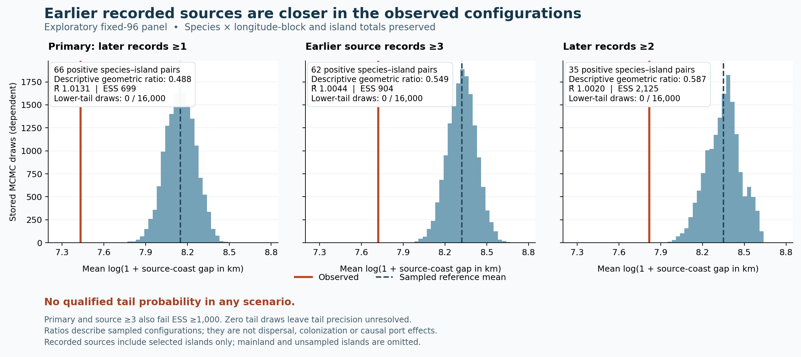

# Island barriers: baseline census, recorded sources and actual host co-recording

**Result:** the added baseline census cannot fill the near-continent / far-port recording gap. In the already observed island panel, later focal-species records have shorter distances to earlier recorded source candidates than the sampled conditional reference configurations, but none of the three analyses qualifies for a tail-probability claim. Fresh point-to-island host acquisition succeeds technically and shows that the old positive-country subset does not overlap the fixed96 butterfly panel.

This continues draft [PR #102](https://github.com/zuizui0223/chocho/pull/102) from repository commit `757d7568b4f57ac074c240f78441cfb20eb3b09f`. The [continuation plan](ISLAND_BASELINE_HOST_PLAN_20261029.md) was saved before these acquisitions and sampling runs, SHA256 `67c25d1f28ff9f98def1122fc0fa0b4782062e08cf3dae5497cd3806795a82e6`. All times below are UTC. The previous96 outcomes were already known; the source-distance analysis is explicitly post-pilot exploration. The previous richness/port models remain unfitted under their original gates.

| Work completed | New evidence | Decision |
| --- | --- | --- |
| Baseline-only census of120 unseen candidate islands | All120 complete;114 have zero indexed records;6 have44 records;0 pass the recording screen | Stop this specified port-cohort expansion without acquiring late outcomes |
| Species-specific earlier-source distance | Primary93 species,28 target islands,2,385 candidate pairs,66 later-record positives; descriptive distance ratio0.488 | Retain the distance hypothesis for stronger validation; no qualified tail probability |
| Fresh original26 country-case host join | All70 source queries complete; frozen96 has0 butterfly and13 candidate-plant records; separate8260-island inventory has287 co-recorded butterfly indices | The old country subset cannot support the96-island host comparison; broader edge/source coverage is needed |

## 1. The deficient baseline cell was exhaustively checked within its fixed geography

The new roster contains every previously unqueried source island with **100 <= area <20,000 km²**, representative latitude within±55°, no Antarctic ambiguity, continental-coast-gap upper bound<100 km, and nearest-WPI-distance lower bound>100 km. The half-open area interval is stated explicitly in the selection lock; it continues the earlier area strata and resolves the plan's abbreviated “100–20,000” wording. No island was chosen using its new butterfly count.

There are117 medium and3 large islands, grouped into21 fixed500-km connected components;75 are in one Chilean component. They have no overlap with the previously observed96. Identities, original source hashes and120 exact polygon hashes were locked at **13:51:47.449149**, before acquisition at **13:52:41.608287–13:58:43.990708**. Selection SHA256 is `d96226d1ad1ee153f8ccd4a935026aad3f54d0929c86abcce8cedde50c46d08e`.

Only2010–2017 was queried, with the same COL XR Papilionoidea concept and exact source polygons. The240 actual HTTP calls cover one complete facet response and one independent first-page check for each island. Species, year, dataset and basis-of-record totals reconcile. All queries completed; there are no failures encoded as zero.

| Baseline result | Islands |
| --- | ---: |
| Complete, zero indexed records |114|
| Complete, positive indexed records |6|
| At least3 recorded species |3|
| At least20 species-assigned records, at least90% assignment and at least3 recorded years |**0**|

The six positive counts are **1,1,2,10,13 and17**, summing to44; all44 are species-assigned. Even the largest count falls below the unchanged20-record requirement. Thus the prespecified fewer-than3-eligible stopping rule is met. **Zero late-period queries were made for this roster.** The result limits this particular expansion route under this source snapshot and geography; it does not establish butterfly absence or a biological port effect.

Evidence: [baseline manifest](../../../data/exploratory/island_baseline_20261029/unseen_island_baseline_manifest.json), [all120 counts](../../../data/exploratory/island_baseline_20261029/unseen_island_baseline_counts.csv), [selection lock](../../../data/exploratory/island_baseline_20261029/unseen_island_baseline_selection.json).

## 2. Later records are descriptively nearer earlier recorded source candidates

The question is species-specific: among sampled islands without an early record of a focal species, do later records occur nearer other sampled islands with an early focal record? Starting taxa are **all230 conservatively bridged original names**, not the105 species selected by occurrence somewhere in the already observed early/late panel. Ninety-three have a qualifying early source record.

Targets require at least3 early and4 late recorded species across all Papilionoidea. The latter condition guarantees at least3 other late species whether the focal label is zero or one, so the allowed comparison mask does not change when labels are rearranged. These thresholds yield28 targets and2,385 eligible species–island cells. The66 later-record positives represent38 species and21 targets. The28 targets are not newly acquired islands and do not replace the earlier14-island original-taxon support result or the failed richness/port recording gates.

Every one of the4,560 unordered pairs among the fixed96 islands was measured using the original unsimplified source coastlines sampled at <=1-km arc spacing. Artificial dateline-cut edges are excluded. Distances are spherical coastline approximations with at most1-km sampling intervals; these intervals do not cover shoreline-position error, coastline age or spherical-model error. The target island is excluded from its own possible sources. “Source” means an earlier indexed record on a sampled island, not a demonstrated breeding population or origin of dispersal. Mainland and unsampled-island sources are absent from this source universe.

The statistic is the mean of `log(1 + nearest recorded-source coast gap in km)` among later-positive cells. The comparison fixes each species' later-positive count **within each fixed90° longitude block**, and fixes each target island's later-positive count. Thus it preserves these broad recording margins. It does not remove all climate, habitat, observer or geographic range structure; it also cannot estimate a standalone port coefficient because island margins are held fixed.

| Scenario | Candidate pairs | Positive pairs | Observed T | Sampled reference mean T | Descriptive geometric ratio | Split R̂ | Statistic ESS |
| --- | ---: | ---: | ---: | ---: | ---: | ---: | ---: |
| Primary: early source>=1, later outcome>=1 |2,385|66|7.43258|8.14948|**0.48827**|1.01311|698.96|
| Early source>=3 records |2,197|62|7.72152|8.32173|0.54870|1.00443|903.99|
| Later outcome>=2 records |2,385|35|7.81798|8.35105|0.58680|1.00196|2,124.61|

The ratio is `exp(observed T - mean sampled-reference T)`. For the primary result, the observed geometric mean of `(1 + gap)` is1,690.17, compared with3,461.57 from exponentiating the sampled reference mean, using kilometre-valued gap inputs. These are descriptive transformed-distance summaries, not odds ratios, causal effects or confidence intervals. The observed primary coastline-sampling interval for T is[7.42771350,7.43258450].

Each scenario used four fixed-seed chains, each with100,000 attempted burn-in steps and4,000 stored samples every50 attempted steps:1.2million attempted steps and16,000 samples per scenario. The uniform fixed-margin kernel permits every alternating-cycle length. It samples ordered existing edges without retrying invalid selections; rejections and the state-independent probability0.5 hold count as attempted steps. The explicit hold, rank/folded diagnostics and tail-precision checks were documented before sampling as implementation/precision refinements, leaving the scientific plan unchanged. Tests exhaustively check transition symmetry, uniform stationarity and connectivity on small structural-zero fibers that require longer cycles.

**None of the three scenarios has a qualified tail probability.** Primary and source>=3 fail the prespecified statistic ESS>=1,000 gate. The later>=2 scenario passes statistic mixing checks, but all three have **0 of16,000 samples in the closer-source tail**, leaving tail-indicator ESS and Monte Carlo precision unresolved. The stored mechanical plus-one fraction must not be quoted as a p-value. No chains were extended or specifications selected after looking at these results. The observed contrast is worth investigating, while its sampling uncertainty and observational explanations remain unresolved.



Evidence: [full diagnostic and source hashes](../../../data/exploratory/island_recorded_sources_20261029/recorded_source_diagnostic.json), [explicit risk cells](../../../data/exploratory/island_recorded_sources_20261029/recorded_source_risk_cells.csv), [all48,000 stored samples](../../../data/exploratory/island_recorded_sources_20261029/recorded_source_chain_samples.csv), [first run lock](../../../data/exploratory/island_recorded_sources_20261029/recorded_source_run_lock.json).

## 3. Fresh point acquisition establishes the scope of host co-recording

This pipeline retained the original26 butterfly–country cases, representing16 butterfly taxa, plus44 plant–country queries,24 plant taxa and46 country-linked candidate edges. These derive from the existing **HOSTS/WCVP/BCE-augmented source subset**; the exported edges do not distinguish HOSTS from BCE provenance. Original numeric taxon keys were queried under the explicit old GBIF Backbone checklist, rather than being reinterpreted as COL XR keys.

All70 source queries completed at **13:48:34.628675–13:51:56.987118**, through132 HTTP calls with0 retries and minimum recorded start spacing1.500092 seconds. The new snapshot retrieved **467 butterfly and3,597 plant records**. Relative to the earlier snapshot, *Robinia pseudoacacia*–GB increased from3,203 to3,204 and *Asclepias syriaca*–DE from86 to87. These are fresh counts, not an exact replay of the older source snapshot.

Raw biological coordinates, occurrence identities and response bodies were processed only in transient memory. Saved artifacts contain source-body hashes and derived island/year/uncertainty aggregates. Exact original polygon membership was measured first; a separate conservative check requires the full reported uncertainty envelope to lie strictly inside the same source polygon. Unknown uncertainty stays unknown. The uncertainty screen remains conditional on the reported radius and supplied shoreline and does not cover omitted water bodies or map error.

| Scope | Butterfly indices on source islands | Unique plant–country indices on source islands | Butterfly indices with a candidate plant on the same island within±3 years |
| --- | ---: | ---: | ---: |
| Primary frozen96 |**0**|13|**0**|
| Separate8260-island diagnostic inventory |341|3,324|287|

The primary zero concerns **these original26 butterfly–country queries**. It does not imply that the16 butterfly taxa are absent from the96 islands when other country queries are considered. The13 primary plant records are all *Robinia pseudoacacia* on the Isle of Wight, with2 early and11 late;12 meet full reported-uncertainty containment and the<=1-km sensitivity screen. No primary island was replaced with one that had positive results.

The diagnostic287 co-recorded butterfly indices occur across12 original country cases and6 taxa, on only3 physical islands:

| Physical source island | Same-island,±3-year co-recorded indices | Both uncertainty envelopes fully contained | Both reported radii also<=1 km |
| --- | ---: | ---: | ---: |
| Cuba |71|24|20|
| Hispaniola |215|160|144|
| Great Britain |1|0|0|
| **Total** |**287**|**184**|**164**|

The butterfly-window split is25 early and262 late co-recorded indices;275 have a candidate plant within the same early/late window, while12 rely only on a±3-year match across the2017/2018 boundary. There are160 same-year matches. *Papilio demoleus* supplies219/287 indices(76.3%), so the diagnostic is concentrated in one taxon and two Caribbean islands, within an already positive-country-selected cohort.

Whole-island co-recording is a much coarser spatial condition than the earlier5-km point-proximity analysis. The new287 cannot be interpreted as an improvement over the old75 in a common biological endpoint. It supplies no evidence of feeding, wild host availability, recruitment, establishment or first arrival. It also does not estimate whether co-recording is more frequent than an observation-aware spatial null.

Evidence: [host acquisition manifest](../../../data/exploratory/island_host_corecords_20261029/host_corecord_manifest.json), [fixed96 output](../../../data/exploratory/island_host_corecords_20261029/frozen96_case_island_window_corecords.csv), [diagnostic inventory](../../../data/exploratory/island_host_corecords_20261029/original8260_positive_source_case_inventory.csv), [derived-data verification](../../../data/exploratory/island_host_corecords_20261029/verification_receipt.json).

## 4. Scientific decision and the next useful work

The new census rules out solving the observed near-continent/far-WPI support problem merely by adding the remaining islands within the stated geography and baseline source. Broader geography, better recording data or a different study design would be needed before a port-effect comparison becomes defensible. WPI proximity itself remains a port-location proxy, not historical shipping exposure.

The recorded-source result is the most direct new lead for the barrier hypothesis: later recorded occurrences are geographically closer to earlier focal records than the sampled margin-preserving references. Its next useful validation is an independently specified numerical method on the same frozen estimand, retaining the failed first run, followed by better source coverage and a climate/observation-aware design. A numerical refinement cannot by itself identify dispersal or establish causality.

For the host mechanism, the immediate missing input is a broader verified host-edge/source roster aligned to the island-recorded taxa. The local old-country subset covers only7 of the105 island-recorded original taxa, through16 distinct butterfly–plant edges and16 plant IDs. The pinned author artifact contains a recoverable catalogued-edge source through the established runner-only derivation route; it was not downloaded or substituted with guessed plant associations in this continuation. A broader roster should be fixed before new plant outcomes are selected.

## 5. Verification, separation and replay

Independent review verified the baseline selector and query contract, source-distance eligibility and every fixed margin, all4,560 coastline-pair rows, all48,000 chain samples, mask/state hashes and every source-distance minimum. The root independently recomputed every co-recording value from the exported year bins across4,992 primary rows,52 diagnostic rows and94 edge rows. Missing sources remain distinct from complete zero results.

The full local suite passed **492 tests and5 subtests**, with20 pre-existing Shapely deprecation warnings. The original anonymous reviewer bundle still contains **222 files** and is byte-identical to its earlier verified version, SHA256 `c650bc87fc2281b851270d886503e7bf9ac8513934e1fb1e4be81cc42cff96f4`. New exploratory scripts/tests are excluded from that bundle. The original manuscript was not edited. See the [continuation verification receipt](../../../data/exploratory/island_baseline_20261029/continuation_verification.json) for checksums and review details.

Preserve the first-run outputs. An analytical replay should use a fresh directory; a point-acquisition replay is a new live source snapshot and may change counts. For example:

```bash
python scripts/analyze_island_recorded_sources_20261029.py \
  --source-cache /tmp/chocho-island-sources \
  --output-dir /tmp/chocho-recorded-source-replay
python scripts/acquire_island_host_corecords_20261029.py \
  --source-cache /tmp/chocho-island-sources \
  --plan provenance/archive/host_hindcast/ISLAND_BASELINE_HOST_PLAN_20261029.md \
  --output /tmp/chocho-host-corecord-replay
python -m pytest -q
```
