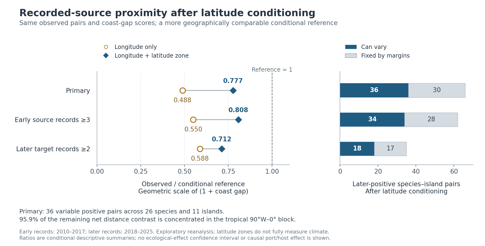

# Island, port and host hypotheses: dated-host and latitude continuation

**Result:** the recorded-source distance association persists after conditioning on fixed latitude zones, but its magnitude is smaller and its remaining contrast is geographically concentrated. Actual pre-2018 plant evidence has now been acquired on all 28 frozen target islands. The host join is a descriptive test of catalogue-compatible recording; an independent host effect and the port effect remain unestimated.

This continues draft PR #102 from `77d9e7295d10396254bcbf0994ae7a55a12b19d7`. The [continuation plan](ISLAND_DATED_HOST_LATITUDE_PLAN_20261030.md) was saved before the new focal plant queries and latitude calculation. Earlier butterfly outcomes, the longitude-only result and its spatial concentration were already known. This is exploratory reanalysis, not a preregistration or independent ecological replication. All original risk masks, outcomes, source coast scores and failed model gates are preserved.

## 1. Current scientific status

| Hypothesis | Current evidence | What is not established |
| --- | --- | --- |
| Access from a previously recorded butterfly source matters | Later-positive species–island pairs have smaller recorded-source distances than the specified uniform fixed-margin reference, including the new latitude-zone constraints | Actual dispersal, first arrival, breeding or establishment; a global distance effect independent of recording and range structure |
| Port access weakens an island barrier | Geography and WPI proximity are measured; the intended comparison still fails its frozen recording/support gates | A historical traffic exposure or independent port coefficient |
| Previously available hosts facilitate later butterfly recording | The original host catalogue is connected to actual early island plant records with explicit conservative taxonomy and missingness states | Local larval use, wild resource availability, introduced-host dependence, or a host effect separated from geography and recording |

The island result currently concerns access to another **sampled island with earlier indexed records of the focal butterfly**. It is not equivalent to distance from a documented reproducing source population. Mainland sources and most islands are outside the 96-island source panel. The 28-target screen already depends on known later all-butterfly richness, so all results condition on that selected recording-supported roster.

## 2. Latitude conditioning weakens, but does not remove, the distance contrast

The original statistic is the mean `log(1 + upper coast gap km)` across later-positive cells. The new comparison refines each species-by-longitude margin into three geography-defined latitude zones: south of −23.5°, −23.5° to +23.5°, and north of +23.5°. Target-island positive margins, eligibility masks, observed labels, coast scores and positive denominators are unchanged. The reported ratio is `exp(observed statistic − exact conditional mean statistic)`: a ratio on the geometric scale of **1 + coast gap**, not the ratio of arithmetic mean kilometres.

| Fixed scenario | Candidate cells | Later-positive cells | Longitude-only ratio | Longitude + latitude-zone ratio | Closer-tail draws / 100,000 | Simultaneous three-scenario 95% upper bound |
| --- | ---: | ---: | ---: | ---: | ---: | ---: |
| Primary | 2,385 | 66 | 0.488059 | **0.777125** | 33 | 0.000475536 |
| At least 3 early source records | 2,197 | 62 | 0.549816 | **0.807778** | 416 | 0.004615193 |
| At least 2 later target records | 2,385 | 35 | 0.587710 | **0.712248** | 24 | 0.000367814 |

The tail bounds describe the conditional probability that a uniformly sampled allowed table has a statistic at least as close as the observed one, including ties. They bound Monte Carlo uncertainty in that table probability; they are not confidence limits for an ecological effect. Each scenario used exactly the fixed 100,000 independent uniform integer-rank draws with replacement and its original locked seed. There was no resampling or increased budget after results were seen.

The conditional means, exact cell occupancies and finite support were independently reproduced by complete enumeration of all 36 scenario blocks, without importing the production numerical helpers. All 6,967 occupancy numerators match. The whole-table counts are 147,117,600, 66,202,920 and 13,770. The independent audit additionally enumerated the entire smallest scenario: its inclusive closer tail contains 3 of 13,770 tables, probability 0.000217864924, compatible with its saved Monte Carlo result. This supplementary audit does not overwrite the first-run output.

| Scenario | Positive cells that can vary | Positive cells fixed by margins | Species contributing variable cells | Islands contributing variable cells |
| --- | ---: | ---: | ---: | ---: |
| Primary | **36** | 30 | **26** | **11** |
| At least 3 early source records | 34 | 28 | 24 | 11 |
| At least 2 later target records | 18 | 17 | 15 | 8 |

The smaller ratio contrast after latitude conditioning shows that the earlier comparison depended partly on which geographic regions could be exchanged within broad longitude groups. It does not provide a causal fraction explained by latitude. The new latitude zones also leave much smaller randomization support; this is not added ecological replication.

**95.8902% of the primary remaining signed observed-minus-reference distance contrast is in the tropical 90°W–0° block.** The corresponding shares are 106.7219% and 99.0569% for the two recording-threshold scenarios; the share above 100% occurs because another block offsets part of the signed contrast. These are arithmetic contributions to a net statistic, not causal percentages. They argue for a geographically bounded interpretation and against treating the three scenarios as independent confirmations of a global mechanism. Latitude zones do not measure climate or habitat fully, and spatially structured range and observer processes remain plausible explanations.

Evidence: [complete diagnostic](../../../data/exploratory/island_latitude_null_20261030/latitude_null_diagnostic.json), [frozen input assertions](../../../data/exploratory/island_latitude_null_20261030/independent_input_assertions.json), [independent numerical review](../../../data/exploratory/island_latitude_null_20261030/independent_latitude_review.md), [data and first-run records](../../../data/exploratory/island_latitude_null_20261030/).

## 3. Early plant evidence and the original host catalogue

<!-- HOST_RESULTS_START -->
The fixed original early-recorded cohort retains **93 butterflies, 1,440 host links and 1,062 source plant IDs**. All 1,040 eligible source-binomial queries succeeded, as did 29 additional accepted-name checks needed where the provider omitted accepted status. Twenty-two source names remain explicitly unqueried under the frozen species-binomial rule. These are successful retrieval counts, not counts of scientifically resolved concepts.

The final conservative gate permits **695 source plant IDs / 695 distinct accepted concepts**, covering **865 catalogue links**. Another 345 queried IDs remain taxonomically unresolved under this gate, alongside the 22 unqueried names; 575 catalogue links are unresolved in total. There are no accepted-concept collisions. **84 of 93 butterflies** retain at least one resolved host concept, but **only 4 of 93** have every source host ID resolved. The other nine have no conservatively usable concept in this continuation; their catalogues remain present.

The gate checks exact canonical identity, species rank, accepted/synonym status, accepted status, Plantae, source family and competing exact concepts. During independent review, distinct exact species usages resolving to subspecies or variety concepts were found to escape an overly narrow alternative-rank check. Two regression tests first reproduced the issue; the corrected gate rejects those competing concepts too. The same raw evidence was reprocessed with network disabled, reducing eligible concepts from 705 to 695 and eligible links from 878 to 865. No rejected concept was promoted, no new primary request was made, and every cached request/response byte and the raw archive remained unchanged. The original acquisition script and corrected processing-code hashes are preserved separately.

| Descriptive dated-host result | Count | Interpretation |
| --- | ---: | --- |
| Original candidate species–target pairs | **2,385** | Same frozen risk set; all have complete plant queries |
| Pairs with at least one recorded known-host concept in 2010–2017 | **336 / 2,385 (14.09%)** | Catalogue-compatible early plant recording |
| Later-positive butterfly pairs | **66** | Existing 2018–2025 outcome, not an arrival endpoint |
| Later-positive pairs with a recorded early known-host concept | **20 / 66 (30.30%)** | Actual dated evidence; no independent host-effect estimate |
| No plant match and at least one unresolved catalogue ID | **1,961** | Incomplete taxonomic coverage and no matched indexed record |
| No plant match with a fully resolved source catalogue | **88** | No matched indexed record under this query; still not biological absence |
| Missing plant-query pairs | **0** | All 28 target queries are complete |

The remaining 46 later-positive pairs cannot be labelled host-free. The 30.30% and 14.09% fractions are descriptive, share observations and have different compositions; their comparison is not an adjusted effect or an independent test.

The full source audit verifies 1,069 request receipts and all 3,207 archive members. One acquisition timing limitation is retained explicitly: six adjacent saved UTC start timestamps are up to 162 microseconds below the intended 1.05-second interval (minimum 1.049837828 seconds). The implementation uses a monotonic limiter, but those monotonic markers were not archived, so strict compliance cannot be independently established from UTC receipts. This does not change the requests, responses or scientific matching result. The final manifest timestamps describe cached processing; the audit preserves the actual HTTP interval, 02:06:03.698567–02:24:45.298627 UTC on 2026-10-30.

Evidence: [taxonomy bridge](../../../data/exploratory/island_dated_host_20261030/plant_taxonomy_bridge.csv), [taxonomy audit and correction](../../../data/exploratory/island_dated_host_20261030/plant_taxonomy_audit.json), [independent final taxonomy review](../../../data/exploratory/island_dated_host_20261030/independent_taxonomy_final_review.md), [host recording summary](../../../data/exploratory/island_dated_host_20261030/dated_host_recording_summary.json), [all original risk cells](../../../data/exploratory/island_dated_host_20261030/dated_host_primary_risk_cells.csv), [catalogue coverage](../../../data/exploratory/island_dated_host_20261030/dated_host_butterfly_catalogue_coverage.csv).
<!-- HOST_RESULTS_END -->

### Plant acquisition and the preserved source repair

All plant requests use the current COL XR namespace (`7ddf754f-d193-4cc9-b351-99906754a03b`, Plantae key `P`), the exact archived island polygons, 2010–2017, PRESENT, coordinates and no indexed geospatial issue. Individual-record limit is zero and every returned `results` array is empty. The records are indexed occurrence counts, not plants, abundance estimates or independent observations. No biological coordinates or individual occurrence identifiers were acquired.

The original 100-bin pagination completed 25 targets and explicitly stopped three when tied facet counts produced duplicate identifiers across pages. Those failures remain in the original manifest and archive. After identifying the transport issue, a [separate repair specification](ISLAND_PLANT_FACET_REPAIR_20261030.md) was fixed before inspecting host joins. It requests one bounded 10,000-bin page for each failed target, checks all four facet types, probes each returned facet's actual terminal offset with limit 1, and repeats the full page. Completion requires empty terminal probes, stable totals, unique identifiers, equal count maps and reconciled dataset/year margins. No undocumented server maximum is assumed to imply completeness.

The three repaired target counts are 300,967, 175,920 and 12,994; all twelve terminal probes are empty. Together with the untouched original 25 complete results, the resolved input has **28 complete targets, no missing target and 728,040 indexed early plant records**. Sixteen islands meet the inherited botanical recording-support descriptor (at least 20 records, at least 90% species assignment and at least three positive years). That descriptor does not reselect targets or license absence inference.

An independent review checked all 18 repair request/response/receipt triples, all 54 archive members, all 28 geometry hashes, every resolved facet and the exact equality of the original 25 complete results. The original acquisition archive and manifest remain unchanged. **The authoritative completed join input is `early_plants_resolved_manifest.json`; `early_plants_manifest.json` intentionally retains the first-run partial state.**

Evidence: [resolved source manifest](../../../data/exploratory/island_dated_host_20261030/early_plants_resolved_manifest.json), [first-run source manifest](../../../data/exploratory/island_dated_host_20261030/early_plants_manifest.json), [repair manifest](../../../data/exploratory/island_dated_host_20261030/early_plants_repair_manifest.json), [original acquisition review](../../../data/exploratory/island_dated_host_20261030/independent_initial_plant_review.md), [repair and join review](../../../data/exploratory/island_dated_host_20261030/independent_repair_join_review.md).

### Limits of the dated-host join

The recorded-host endpoint combines a literature-derived catalogue link, conservative current concept matching and an early plant record inside the target polygon. It is evidence of a catalogue-compatible plant recorded before the later butterfly window. It does not document feeding, larval development, resource abundance, native/introduced status or wild rather than cultivated plants. Current taxonomic concordance also does not prove unchanged biological meaning of every historical host assertion.

Plant species and year facets are separate margins. The joint query establishes membership in the early 2010–2017 window; it does not recover species-specific observation dates, same-event co-observation or the older point study's ±3-year criterion. Indexed point membership in an exact polygon does not establish full coordinate-uncertainty containment. Neither an unresolved catalogue nor a complete no-match is treated as biological host absence.

Descriptive co-recording fractions retain the fixed candidate roster. Differences between later-positive and other candidates can reflect plant and butterfly range structure, geography, record intensity and catalogue completeness. No odds ratio, causal resource explanation or independent host-effect coefficient is inferred from these fractions in this continuation.

### Post-join audit of the remaining host comparison support

A descriptive support audit connects the host classifications to the already-computed primary latitude-conditioned cell occupancies. It performs no new host null test, effect estimate or significance calculation.

| Existing conditional-support subset | Recorded known host | No match with unresolved catalogue | No match with fully resolved catalogue | Total |
| --- | ---: | ---: | ---: | ---: |
| Allowed cells that can vary | **17** | **72** | **0** | **89** |
| Observed positive cells that can vary | 11 | 25 | 0 | 36 |
| Observed positive cells fixed by margins | 9 | 21 | 0 | 30 |

All 88 fully resolved catalogue no-match cells have zero occupancy under the existing latitude-conditioned margins. This describes the constrained table space; it is not evidence that butterflies cannot occur without hosts. Even a fully resolved no-match would still be recording nondetection, not biological absence. Among the variable cells, the actual alternative to a recorded host is entirely a no-match with unresolved catalogue coverage.

The recorded-host indicator varies within 12 of 32 species-by-longitude-by-zone rows containing variable cells, across 10 of 26 species and 7 of 11 target islands with variable cells. Those counts demonstrate some exposure variation but do not by themselves prove a nonconstant score under every joint margin constraint or identify a biological effect. A future recorded-host association could still be mathematically investigated; it must not be described as a host-present versus verified-host-absent test. The immediate evidentiary priority is resolving uncertain concepts and improving independent local plant recording on this existing comparison support.

Evidence: [descriptive conditional-support review](../../../data/exploratory/island_dated_host_20261030/host_conditional_support_review.md).

## 4. The port hypothesis remains unestimated

The [existing expansion](ISLAND_EXPANSION_RESULTS_20261029.md) still has only 23 late-period islands meeting its primary m=20 recording screen, versus a minimum of 30; only nine are near-continental, versus the required ten in each continental-distance class. The gap-by-WPI proximity cells have 8, 1, 10 and 4 supported islands, and the near-continent/far-WPI cell fails the required minimum of three.

The subsequent 120-island baseline-only attempt produced zero newly eligible targets under the original stopping rule. No later outcomes for that stopped roster were queried. More opportunistic geographic expansion without independent recording support is therefore not a demonstrated remedy for this comparison imbalance.

The current distance randomization fixes each target island's positive count, so it cannot identify an additive island-constant port, area or mainland-distance effect. WPI2025 proximity is a geographic proxy, may point across water to a port on another landmass and is not historical traffic during 2010–2025. None of the new plant data or conditional distance calculations resolves that exposure or design gap. No port model was fitted and no original threshold was relaxed.

## 5. What has advanced and what the next test must distinguish

The work has moved beyond an undated host roster: the fixed island comparison now has current plant-concept evidence, actual early plant recording and explicit catalogue coverage on the original risk cells. It has also narrowed the distance claim by checking a concrete geographic alternative and quantifying how much comparison support remains.

A subsequent host-effect specification must first identify overlap in recorded-host exposure among cells that can actually vary under the geographic and species constraints, with explicit treatment of botanical recording intensity and unresolved catalogues. It must distinguish a resource association from the shared plant/butterfly range and observation process, retain the same source provenance and state a stopping rule for insufficient contrast. This later specification would be exploratory because the outcomes and the present descriptive joins are already known. A confirmatory ecological test needs independent outcomes or an independently supported target panel.

The best-supported current statement is narrower: **within the selected recording-supported islands, later butterfly recording is associated with shorter distance to another sampled island with earlier focal records, after coarse longitude and latitude-zone conditioning; the remaining contrast is strongly concentrated in the western tropics.** The new host evidence supplies an actual early covariate for a next constrained test. It does not yet demonstrate that hosts explain that association or that ports overcome the barrier.

## 6. Reproduction and integration

<!-- VERIFICATION_START -->
The final local project suite passed **631 tests and 5 subtests**, with only the 20 preexisting Shapely deprecation warnings. New scientific gates and acquisition failures were tested before implementation; the homonym correction has two additional regression cases. Separate reviewers checked the actual source archives, final taxonomy decisions, plant repair, host join and latitude calculations. The figure was rendered and visually inspected; its numerical values come directly from the stored diagnostics, without resampling.

The deterministic anonymous manuscript reviewer bundle remains **222 files**, byte-identical at SHA256 `c650bc87fc2281b851270d886503e7bf9ac8513934e1fb1e4be81cc42cff96f4`. New exploratory scripts and tests are explicitly excluded. Original scientific inputs and prior results are unchanged; the prior result report receives only a dated continuation link. This work used an isolated checkout and left the earlier workspace's preexisting uncommitted changes untouched.
<!-- VERIFICATION_END -->

The [local verification receipt](../../../data/exploratory/island_dated_host_20261030/continuation_local_verification.json) records the final project checks and source preservation. The [integration manifest](../../../data/exploratory/island_dated_host_20261030/continuation_integration_manifest.json) identifies delivered code, data, reports, source receipts and the figure by SHA256. The original manuscript's scientific claims are unchanged.

Reproduction entry points are `scripts/bridge_island_plant_taxonomy_20261030.py`, `scripts/acquire_island_early_plants_20261030.py`, `scripts/repair_island_plant_facets_20261030.py`, `scripts/analyze_island_dated_hosts_20261030.py`, `scripts/analyze_island_latitude_null_20261030.py` and `scripts/render_island_latitude_comparison_20261030.py`. Use the retained raw evidence for exact-source replay; a new live API retrieval is a new indexed snapshot. Pass the resolved plant manifest for the host join. Read the first-run locks and use new directories for numerical reproductions; no favorable rerun replaces these fixed outputs.
