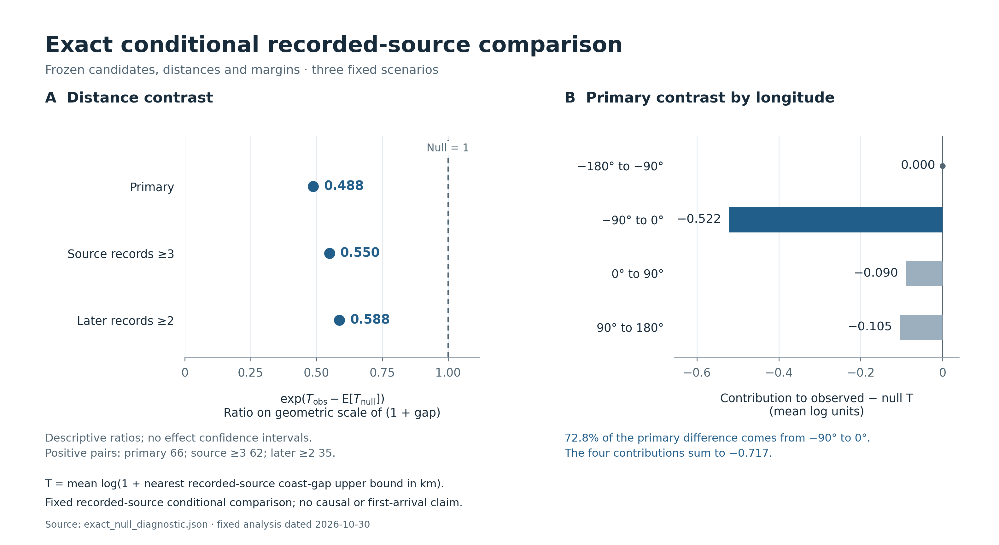

# Island recorded source distance and original host roster follow up

**Distance result:** under the previously frozen recorded-source comparison, later-positive species–island pairs are nearer early recorded source candidates than uniformly drawn configurations with the same species-by-longitude and island margins. The transformed-distance ratios are **0.488, 0.550 and 0.588** in the three fixed scenarios. Exact integer table counting and 100,000 independent draws per scenario now provide qualified upper bounds on the conditional lower-tail probabilities. The main distance contrast is geographically concentrated: **72.8% comes from the 90°W–0° longitude block**. This supports a conditional recording association, while climate, range structure and observation remain competing explanations.

**Host result:** the original 230-taxon catalogue is now recovered as 2,524 source links; the early 93 taxa have all 1,440 expected links. This is the input roster for a future local-resource comparison, not a test of island plant presence.

This follows [the previous baseline and host results](ISLAND_BASELINE_HOST_RESULTS_20261029.md) and the immutable [implementation plan](ISLAND_EXACT_NULL_HOST_ROSTER_PLAN_20261030.md), within draft [PR #102](https://github.com/zuizui0223/chocho/pull/102). The plan was frozen before the new scored exact calculation and draws, after the earlier outcomes and MCMC results were known. It is a numerical follow-up to an explored ecological comparison. Dates in filenames use the established 2026-10-30 JST continuation label; execution receipts explicitly record UTC.

## 1. What the distance comparison now establishes

The source pool remains the same 96 sampled islands, with 2010–2017 as the early period and 2018–2025 as the later period. Starting butterfly concepts remain the original 230 conservative taxonomic bridges. Ninety-three have an eligible early source record. Targets retain the original at least 3 early and at least 4 later all-Papilionoidea recorded-species screen, yielding 28 target islands. Early missing focal records are structural candidate conditions; later focal records provide the binary labels. Mainland and unsampled-island sources are outside this observed source pool.

For each candidate cell, the geographic score is the stored log(1 + nearest early recorded-source coastline-gap upper bound in km). The target island is excluded as its own source. The statistic T is the mean of that score over the positive cells, including positives forced by the margins. The original shoreline approximation, its at most 1-km coast-sampling bound, candidate mask, observed table, margins and score remain unchanged.

| Fixed scenario | Candidate pairs | Positive pairs | Observed T | Conditional null mean T | exp(observed T − null mean T) | Tail hits / independent draws |
| --- | ---: | ---: | ---: | ---: | ---: | ---: |
| Primary, early source ≥1 and later target ≥1 record |2,385|66|7.432584497|8.149904124|**0.488058684**|**0 / 100,000**|
| Early source ≥3 records |2,197|62|7.721522420|8.319693155|**0.549816477**|**0 / 100,000**|
| Later target ≥2 records |2,385|35|7.817978383|8.349500000|**0.587710020**|**1 / 100,000**|

The ratio compares the geometric scale of 1 + distance. A value 0.488 means that this transformed summary is about 49% of its conditional reference, not that the arithmetic mean distance, an odds ratio or a colonization probability is halved. Requiring more early records or more later records changes the planned scenario but retains the direction. These are three related sensitivity analyses of the same already observed panel, not three ecological replications.

The lower-tail event is T_null ≤ T_observed + 10⁻¹². It asks how often a uniformly drawn allowed configuration is at least as close as the observed configuration, conditional on the frozen constraints.

| Fixed scenario | Individual one-sided 95% upper bound on conditional tail probability | Simultaneous three-scenario 95% upper bound |
| --- | ---: | ---: |
| Primary |0.0000299569|**0.0000409426**|
| Early source ≥3 |0.0000299569|**0.0000409426**|
| Later target ≥2 |0.0000474378|**0.0000604679**|

The simultaneous upper bounds correspond to approximately 0.00409%, 0.00409% and 0.00605%. They quantify **Monte Carlo uncertainty in the fixed conditional-tail probabilities**. They are not confidence intervals for ecological effects, population uncertainty, or exact probabilities obtained by exhaustive tail enumeration. Zero observed tail hits never implies probability zero. The later-record ≥2 run has one real tail hit, saved as sample 8,704, rank 2,072,598,585, T=7.817510900516905.

Evidence: [complete numerical results](../../../data/exploratory/island_source_exact_null_20261030/exact_null_diagnostic.json), [method and replay instructions](../../../data/exploratory/island_source_exact_null_20261030/README.md), [independent review](../../../data/exploratory/island_source_exact_null_20261030/exact_null_independent_review.json).

## 2. Why this resolves the earlier numerical limitation

The earlier MCMC result remains `MCMC_DIAGNOSTIC_OR_TAIL_PRECISION_GATE_FAILED`; none of its old samples, diagnostics or decisions was rewritten. The new computation addresses the same conditional table space through a separate method.

The allowed configurations preserve every labeled species-by-longitude-block row margin and every target-island column margin. Different longitude blocks have disjoint allowed edges, so the full configuration space factors into four block spaces. A dynamic program counts each possible labeled completion using arbitrary-size integers. Zero-margin rows and columns are removed bijectively. Unranking maps each integer from 0 to the total count minus 1 to exactly one feasible full table; a uniform integer draw therefore produces a uniform table. Sampling is independent with replacement and does not use a Markov chain.

| Fixed scenario | Number of feasible labeled full tables |
| --- | ---: |
| Primary |3,496,100,624,678,845,194,886,224|
| Early source ≥3 |70,389,053,018,969,220,551,610|
| Later target ≥2 |4,470,500,064|

The fixed budgets were 100,000 draws each, with seeds 2026103001, 2026103002 and 2026103003. Seeded pseudorandom integer draws implement independent sampling with replacement; the binomial confidence guarantees refer to the independent uniform-rank sampling model. Every reconstructed table was checked against the original mask and both margins. All 300,000 checks passed. All saved ranks were independently replayed from their seeds. The later-record ≥2 file contains 99,999 distinct ranks in 100,000 draws; its repeated rank was retained, as sampling with replacement requires.

Exact completion counts weight a centered-moment recurrence that computes the conditional mean and variance without Monte Carlo estimation. Separately computed cell occupancy counts independently reconcile the conditional mean. The table counts and occupancy numerators are exact integers; moments of the stored log-distance scores are evaluated in floating-point arithmetic. Thus “exact” refers to the discrete table law, not exact real-number arithmetic or an exactly enumerated tail.

With a fixed number of independent draws, the tail-hit count has a binomial distribution. One-sided Clopper–Pearson limits provide the reported upper bounds; for zero hits the individual bound is 1 − 0.05^(1/100000). The simultaneous family uses alpha 0.05/3 per scenario. This numerical uncertainty calculation does not require the old MCMC effective-sample-size or 20-tail-hit qualification gates. Those gates remain applicable to the historical MCMC result. The [SciPy exact proportion interval documentation](https://docs.scipy.org/doc/scipy/reference/generated/scipy.stats._result_classes.BinomTestResult.proportion_ci.html) identifies the corresponding Clopper–Pearson construction.

The independent audit used a different row order and independently implemented prefix/suffix occupancy calculations. It reconciled 6,967 allowed-cell occupancy numerators, 12 block summaries, conditional means and variances, 16 saved-table reconstructions, and the one-hit upper limits against a separate binomial-CDF calculation. Both resource-cap failures were exercised and correctly produced incomplete receipts without qualified bounds. No extra stochastic run was used to improve the result after inspection.

## 3. The association is concentrated and remains conditional

The primary observed-minus-null difference in T is −0.717319627. The following decomposition accounts for the same statistic; it introduces no block-level significance tests or model selection.

| Target-island longitude block | Positive pairs | Contribution to full observed-minus-null T | Share of total deficit |
| --- | ---: | ---: | ---: |
| 180°W to 90°W |1|0|0%|
| 90°W to 0° |21|−0.522070679|**72.78%**|
| 0° to 90°E |19|−0.090170923|12.57%|
| 90°E to 180°E |25|−0.105078024|14.65%|

Only 259 of the 2,385 allowed primary cells can vary under the exact constraints; 65 observed positives are variable and one is forced. The later-record ≥2 comparison has 110 variable allowed cells, 26 variable positives and 9 forced positives. All 9 positives in its 0°–90°E block are forced. They remain in T and its denominator, but provide no randomization contrast in that block.

The five most frequent positive taxa account for 26/66 pairs (39.4%); the largest target island contributes 10/66 (15.2%). Thirty-one of 66 primary positives have only one later record, and 12 have only one sampled early source island. The specified higher-record scenarios address these recording thresholds but do not establish complete detection, causal spread, or independence of species and islands.

The target screen uses previously observed later all-species richness. The review confirmed its eligibility remains invariant under the fixed margins, including the ≥2-record sensitivity, but inference remains conditional on that selected roster and support. The coarse longitude margins do not fully control climate, latitude, habitat, geographic range or observer effort. The result is consistent with a distance-related barrier, and is also compatible with spatially structured recording or range limits.

Because target-island positive counts are fixed, this comparison cannot estimate an independent port, area or mainland-distance effect. The earlier port/richness models remain unfitted under their original data gates. The 120-island baseline expansion still yielded zero eligible new targets and therefore no later acquisitions. Neither result is overridden by the new conditional-distance calculation.

## 4. Original host roster source recovery

**The pinned original HOSTS-derived source was successfully recovered and reconciled for every original butterfly.** The [successful source run](https://github.com/zuizui0223/chocho/actions/runs/40979986160) used commit `ef86ac353cce571c2765fb5f8ebe49e18e06ca6e`. All 239 species-specific distinct accepted-plant-ID counts matched the frozen metrics before the 230-species filter was applied. This is actual recovered source content, not reconstruction of edges from aggregate counts.

| Recovered catalogue scope | Butterfly taxa | Butterfly–accepted-plant-ID edges | Meaning |
| --- | ---: | ---: | --- |
| Entire original cohort used for count reconciliation |239|2,596|Every per-species count agrees with the pinned original metrics|
| Conservative butterfly taxonomy bridge |230|**2,524**|All eligible taxa retained, regardless of later recording|
| Eligible taxa with early records in the fixed 96 panel |93|**1,440**|Early 2010–2017 coverage only; all 93 catalogues recovered|

The 230 butterflies comprise 212 currently accepted usages and 18 exact synonyms, mapped to unique conservative accepted concepts. Nine original concepts remain excluded under the existing bridge: five have competing exact species concepts, two fail the exact species-level match, and two collide at an accepted concept. The later 102 and ever-recorded 105 taxa were not substituted for the fixed 230 or early 93 denominators. The source is the original accepted HOSTS table; no BCE-augmented old-country edges enter this roster.

There are **1,677 distinct source plant IDs** across the 230 taxa. Of these, **1,642 pass the exact source-binomial name screen**, while 35 remain explicitly unresolved for that query gate. All 35 contain infraspecific rank markers, such as subspecies, variety or form; this does not imply that the source names are taxonomically invalid. They are retained in the recovered catalogue and withheld from the species-binomial query inventory rather than promoted to species names by string truncation. The 49 associated edges remain visible, leaving 2,475 edges connected to eligible source query names.

Within the early 93 taxa, the 1,440 recovered edges connect to 1,062 distinct plant IDs. There are **1,411 edges and 1,040 plant IDs** with eligible source query names. Every one of the 93 butterflies has at least one such host candidate; 71 have all of their recovered source names eligible. The remaining 22 butterflies have 29 edges that require infraspecific taxonomic resolution. No missing link or unresolved name was recoded as ecological absence.

This removes the earlier 26-country-case roster as the necessary taxonomic bottleneck for an island host comparison. It does **not** show that these plants occur on the target islands, identify currently accepted GBIF plant concepts, demonstrate larval use, or establish that hosts explain the distance association. No new plant/butterfly occurrence queries or current plant-taxonomy queries were made in this source recovery.

### Source identity and the resolved import failure

The runner first verified original run 39006554609, its successful head, artifact 12090584135, metadata digest/size and expiry. The downloaded outer artifact digest matched in the download action. The derivation script separately verified the inner archive bytes and SHA256, all 28 manifest-member hashes, the accepted host table and metrics hashes, upstream pins, the local butterfly bridge and the early/late facet source. The script read the needed CSVs directly from the verified ZIP without extracting those source members or running archived code. The raw source remained in the runner and was removed; only the five allowed derived files were uploaded.

The initial strict-digits importer stopped before export. A separate diagnostic retry found 53,445 digit-form and 4 scientific-notation IDs in the full 53,449-row accepted table; one of the 2,633 rows associated with the original 239 taxa used scientific notation. The original source builder preserves IDs as strings. The corrected importer therefore validates only exact positive-integer scientific notation and **retains its original string**, without floating conversion, numeric normalization or numeric-equivalent merging. Complete 239-species count reconciliation still gates success. The two failed attempts remain as explicit incomplete receipts, not zero-record results.

The successful derived artifact has exactly five files, 124,608 ZIP bytes and SHA256 `414f5806034d1934ded8245efbe3a30edb81adaa1ac05c5f03956831a39c3200`. Its downloaded bytes and every output hash were verified again locally. The raw author source archive was not downloaded into this workspace.

Evidence: [source and cohort manifest](../../../data/exploratory/island_host_roster_20261030/original230_host_roster_manifest.json), [all 239 count alignment](../../../data/exploratory/island_host_roster_20261030/original239_host_count_alignment.csv), [230-species edges](../../../data/exploratory/island_host_roster_20261030/original230_host_edges.csv), [early 93 coverage](../../../data/exploratory/island_host_roster_20261030/baseline93_host_coverage.csv), [plant name candidates](../../../data/exploratory/island_host_roster_20261030/plant_taxon_query_candidates.csv), [additional coverage totals](../../../data/exploratory/island_host_roster_20261030/derived_host_coverage_summary.json), [verified retrieval](../../../data/exploratory/island_host_roster_20261030/derived_artifact_retrieval.json).

## 5. What the next ecological test needs

The immediate scientific priority is to distinguish distance from the environmental and recording structure concentrated in the western longitude block. Before any new outcomes, a subsequent specification should fix an environmental and observation basis, demonstrate that enough conditional support remains, and state its stopping rule. Favorable blocks or taxa must not be selected retrospectively from this decomposition. An environmental reanalysis of this already observed panel would remain exploratory; a confirmatory ecological test would require outcomes or a target panel not used to choose that specification.

Host testing requires exact current plant-concept resolution followed by plant evidence on the fixed target islands using a frozen time rule and completeness checks. The recovered source roster, by itself, supplies taxonomic candidate links rather than island-level plant availability. Any later co-recording result must retain the distinction between catalogue host potential, local occurrence, and demonstrated larval use. Port proximity likewise remains a geographic proxy until actual transport and adequate comparison support are available.

## 6. Reproducibility and integration

The final local project suite passed **570 tests and 5 subtests**, with only the 20 existing Shapely deprecation warnings. This includes 19 exact-table tests and 59 host-source tests. Separate reviewers checked both the numerical method and the actual recovered host files. The latter [independent host review](../../../data/exploratory/island_host_roster_20261030/independent_host_review.json) found no source, count, taxonomy-gate or export-boundary blocker. All relative report links were checked and the summary figure was visually inspected.

The deterministic anonymous reviewer bundle remains **222 files**, byte-identical at SHA256 `c650bc87fc2281b851270d886503e7bf9ac8513934e1fb1e4be81cc42cff96f4`. The new scripts and tests are explicitly excluded from that existing manuscript snapshot. The original ecological inputs and failed analyses are preserved; the earlier report receives only a dated continuation link. The original workspace's pre-existing uncommitted facet-file change was left untouched, and this work used an isolated checkout of the pinned complete source bytes.

The [local verification receipt](../../../data/exploratory/island_source_exact_null_20261030/followup_local_verification.json) records source/output identity checks, test-log identity and the unchanged reviewer bundle. The [integration manifest](../../../data/exploratory/island_source_exact_null_20261030/followup_integration_manifest.json) identifies the delivered code, data, figure, source receipts and report by SHA256. GitHub checks are associated with the published draft PR head; this continuation does not merge the PR or change the manuscript's scientific claims.

Reproduction entry points are `scripts/analyze_island_source_exact_null_20261030.py`, `scripts/render_island_source_exact_null_20261030.py`, and `.github/workflows/island-original230-host-roster.yml`. The exact sampler refuses an existing output directory; its fixed plan and successful first-run lock remain immutable. Source recovery must fail explicitly if the pinned author artifact expires or no longer reconciles. No replacement source or favorable resampling is permitted by this result.
