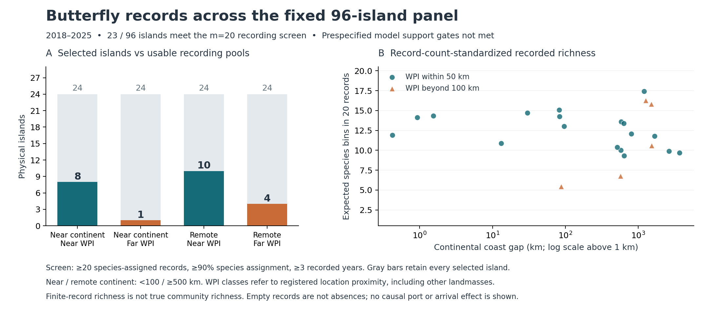

# Island-barrier continuation: 96 islands, taxonomy bridge and support limits

**Result:** the fixed panel now contains **96 physical islands and 192 complete island-period queries**, totaling **194,860 indexed butterfly records**. There are **28 islands with at least three recorded species in both periods**, up from ten in the 24-island pilot. The stricter prespecified recording screen retains only **23 late-period islands**; the near-continent/far-WPI comparison contains just **one**. Every prespecified model fails its support gate, so no isolation, port or host effect coefficient is reported.

The geographic diagnostic advances the hypothesis itself: among 48 continental-remote selected islands, **29 lie within 100 km of another landmass >=1,000 km²**. Direct continental distance and local sea-crossing distance should remain distinct. Neither distance establishes an occupied butterfly source population.

This is the continuation of draft PR #102 from `c3fb7bc3e437d1c5aca7fd95d9facaf3b37f216e`. The original GEB manuscript and original anonymous reviewer contents remain separate. The [frozen plan](ISLAND_EXPANSION_PLAN_20261029.md) is pilot-informed exploration, not a wholly outcome-blind preregistration.

## 1. Acquisition expanded without replacing empty islands

Each of the original 12 area × continental-gap × WPI-proximity strata now has eight islands. The original two selections were retained. Six more were chosen by repeatedly maximizing minimum representative-point distance to already selected islands in the same stratum, with stable island-key tie breaks. No new outcome entered selection. The largest-remote/far-WPI stratum has only eight eligible candidates, all retained; this is purposive geographic coverage, not a probability sample.

The scientific plan was saved at 12:58:17 UTC. The new roster was locked at **12:58:22.125285 UTC**, before the first additional request; the first new response arrived at **12:58:23.511503 UTC**. Selection content SHA256 is `db0f49c244309716b22e05ea5eeddd7d48749e46f46d2757114d98cf0df4df72`. Plan SHA256 is `6374bdf4f93b83173ec8c9c94a447fb96bd376963d14ddf8de7827643255319a`.

All 96 exact GSHHG high-resolution polygons were retained without simplification or rectangular substitution. They contain 20,545 vertices, with a maximum of 2,447 for one geometry. The 48 original pilot queries retain their original bytes, receipts and timestamps and are labeled as previously observed. The 144 new island-period queries required 288 read-only API requests, including separate first-page rechecks. All succeeded, without HTTP errors or retries.

| Acquired recording coverage | 2010–2017 | 2018–2025 |
|---|---:|---:|
| Selected physical islands / completed queries | 96 / 96 | 96 / 96 |
| Qualifying indexed records | **103,723** | **91,137** |
| Species-assigned records | 103,528 | 90,191 |
| Records without species assignment | 195 | 946 |
| Islands with no qualifying records | 59 | 52 |
| Islands with >=3 recorded species bins | 29 | 37 |
| Islands meeting the m=20 recording screen | **14** | **23** |

Across both periods, 49 islands have no records in either period; 28 have >=3 species bins in both; **14 meet the stricter recording screen in both**. The latter two counts are different definitions, and neither certifies that all islands are ecologically independent. One positive late-period window contains eight higher-rank-only records and no species bins; it is kept explicit rather than misrepresented as zero records.

The record totals are highly concentrated. The three most recorded islands supply **95.47%** of early and **85.72%** of late records. A single island supplies **80.76%** and **56.83%**, respectively. More indexed records in those islands do not provide missing geographic comparison units. The early-to-late change is not an abundance or population trend.

## 2. The frozen biological comparison is still not supported

The primary endpoint is the exact expected number of COL species bins in a uniform without-replacement subsample of **20 species-assigned records**. It is a finite-record summary, not actual community richness or survey completeness. An island qualifies only with >=20 assigned records, >=90% species assignment and records from >=3 calendar years.

Sequential late-period attrition is **96 complete → 28 with enough assigned records → 24 with adequate species assignment → 23 with enough recorded years**. Early-period attrition is **96 → 18 → 14 → 14**. These sequential counts avoid double-counting overlapping exclusion reasons.

| Late-period comparison cell | Selected | Any records | >=20 assigned records | Meets all primary criteria |
|---|---:|---:|---:|---:|
| Continental gap <100 km; WPI <=50 km | 24 | 14 | 10 | **8** |
| Continental gap <100 km; WPI >100 km | 24 | 3 | 1 | **1** |
| Continental gap >=500 km; WPI <=50 km | 24 | 16 | 10 | **10** |
| Continental gap >=500 km; WPI >100 km | 24 | 11 | 7 | **4** |

The primary model was fixed as log expected recorded richness versus log island area, absolute latitude, log(1 + continental coast gap), and four fixed longitude-block effects. Its thresholds require >=30 eligible islands and >=10 in each gap class, together with within-block overlap, rank/conditioning and geographic-cluster support. The actual panel has **23 eligible islands: nine near-continental and 14 remote**. It spans 17 fixed 500-km connected components, so clustering is not the limiting criterion.

The secondary WPI term additionally requires >=3 eligible islands in each gap × proximity cell. The near-continent/far-WPI cell contains one. Neither model is fitted. The thresholds were not relaxed after outcomes arrived.

| Prespecified alternative | Eligible islands | Model outcome |
|---|---:|---|
| Late period, 20 records | 23 | Insufficient total and near-continent support |
| Late period, 10 records | 26 | Insufficient total support |
| Late period, 50 records | 20 | Insufficient total and near-continent support |
| Early period, 20 records | 14 | Insufficient total and near-continent support |
| Late period, >=5 recorded years | 23 | Insufficient total and near-continent support |
| Late period, >=90% human-observation records | 20 | Insufficient total and near-continent support |
| Late period, largest dataset <=90% of records | 15 | Insufficient islands, near-continent support and clusters |

The 1,000-km cluster sensitivity also fails the same sample-size/gap gates. No effects or influence regressions are produced. This is a documented lack of support under the chosen design, **not evidence of a zero ecological effect**, and not a claim that it is mathematically impossible to regress 23 observations. Fitting an alternative after inspecting these data would be a separate exploratory analysis with a different evidential status.



The figure is descriptive. Record-count standardization does not remove observer selectivity, recording-source differences, duplicates, habitat coverage or regional species pools. The geographic blocks are longitude quadrants, not biogeographic realms. Marginal dataset/basis facets cannot reconstruct a species-by-dataset or species-by-basis matrix.

## 3. Continental isolation often differs from the next substantial sea crossing

All 96 islands now have two additional coast-to-coast measurements: the nearest **other** source landmass >=5 km² and the nearest **other** landmass >=1,000 km². Candidate universes contain 8,265 and 292 landmasses respectively, including the five mapped continents; the focal landmass is always excluded.

| Among the fixed 48 islands >=500 km from a continental coast | Islands | Fraction |
|---|---:|---:|
| Other landmass >=5 km² within 50 km | 43 | 89.6% |
| Other landmass >=1,000 km² within 50 km | 24 | 50.0% |
| Other landmass >=1,000 km² within 100 km | **29** | **60.4%** |

The same spherical source-coast algorithm supplies conservative sampling intervals <=1 km wide. Vectorized spherical-cap pruning and shared KD trees preserve the exhaustive sampled-distance result. Artificial dateline cut edges remain excluded. Bounds concern sampling, not source positional accuracy or spherical-versus-ellipsoidal error.

This supports retaining a more specific mechanism hypothesis: available host resources may be realized differently depending on access from occupied, resource-bearing source areas, and that access cannot be represented by continental distance alone. The >=1,000 km² cutoff reduces reliance on tiny neighbors, but does not verify occupancy, habitat suitability, host availability or transport links. A large neighboring landmass is still only a geographic candidate source.

## 4. The original host-panel taxonomy is now explicitly bridged

All **239 original names** were queried against the exact current COL XR checklist used for the island records. The official matching metadata identifies deployed COL26.6 XR / ChecklistBank315557. Original numeric GBIF-backbone IDs are not reused as current string IDs.

The responses contain 237 exact matches and two higher-rank matches. Conservative checks permit **230 original names** for current taxonomic record joins: five competing exact-concept cases and the two higher-rank cases are excluded, and the two Oeneis names sharing both an old key and current accepted key are quarantined. **224** also retain an eligible original numeric-key join. Eligibility is not proof that every historical host assertion transfers unchanged across a taxonomic concept.

In the 96-island panel:

- **105 conservatively matched original-panel taxa** occur among 650 recorded current species keys.
- They account for **128,620 / 193,719 species-assigned records (66.40%)**.
- Forty islands have at least one eligible original-panel record; **14 have >=3 eligible panel species in each period**.
- Of the 105 recorded original names, 101 retain old numeric-occurrence join eligibility. Biblis hyperia, Graphium sarpedon, Lasiommata megera and Lopinga achine were unresolved in the old audit; their newly matched current records are not silently backfilled into that old numeric panel.

This solves an identifier bridge, not the local host-exposure problem. Earlier work does contain finer-scale evidence: the 26-case plant audit reported 3,595 indexed plant records; a previous point-proximity summary evaluated 467 butterfly records, with 75 within the 5-km/three-year proximity rule and 34 under the stricter coordinate-uncertainty rule. Those summaries do not establish feeding or recruitment.

The previous point-analysis workflow explicitly retained coordinates only in Actions memory and emitted `no_raw_coordinates_preserved=true`. Coordinate-level source inputs are not present in the repository or checked task caches; the new island APIs intentionally return empty occurrence-result arrays and aggregate facets. Therefore the old summaries cannot simply be spatially joined to these 96 polygons. Their source IDs, hashes, grain and availability are recorded in `existing_host_evidence_grain_audit.json`. No national or regional host status was copied onto physical islands.

## 5. Decision and verification

Keep the natural-barrier/source-access hypothesis open. The geographic distinction is measured; the intended biological and port moderation effects remain untested with adequate support. Further expansion should prioritize a design with independently documented baseline recording or survey histories in the deficient comparison groups, plus dated island-level host and source-population evidence. Repeating geographic spread alone is unlikely to resolve the demonstrated recording imbalance efficiently. Any baseline-conditioned roster must be fixed before examining later outcomes and must state its narrower target population.

Completed work against the frozen plan: fixed 96-island acquisition; exact finite-record metrics and unrelaxed gates; two nearest-landmass access diagnostics; all-239 taxonomy bridge plus both pilot/expanded overlaps; source/numerical review, figure inspection and reviewer-bundle separation. No effect model has been selected to replace a failed prespecified gate.

Validation evidence:

- **384 occurrence response receipts** independently match cached request/response bytes; all 288 new responses postdate the new roster lock.
- **239 taxonomy response receipts** independently match archived original response bytes and output hashes.
- Independent numerical checks matched finite-record richness to SciPy hypergeometric expectations and clustered OLS mathematics to statsmodels on synthetic data.
- Independent geography review matched randomized cap-pruned results to exhaustive distances, all 96 nested distance bounds, and overlapping earlier Hawaii/Isabela results.
- All published recording metrics, facets, support tables and no-fit outcomes were independently reconciled.
- The support figure was rendered and visually inspected.
- Full local suite: **467 passed, 5 subtests passed**; 20 pre-existing Shapely deprecation warnings.
- The original anonymous GEB bundle still contains 222 files and is byte-identical to the previous verified bundle: SHA256 `c650bc87fc2281b851270d886503e7bf9ac8513934e1fb1e4be81cc42cff96f4`.

### Outputs and replay

See [expanded observations, metrics, geography and figure](../../../data/exploratory/island_expansion_20261029/) and [taxonomy bridge, raw official-response archive and host-grain audit](../../../data/exploratory/island_taxonomy_20261029/).

```bash
python scripts/acquire_expanded_island_panel_20261029.py --source-cache /tmp/chocho-island-sources --cache-dir /tmp/chocho-island-expansion-gbif-cache --original-cache /tmp/chocho-island-gbif-cache
python scripts/analyze_expanded_island_recordings_20261029.py
python scripts/measure_expanded_island_access_20261029.py --source-cache /tmp/chocho-island-sources
python scripts/bridge_island_host_taxonomy_20261029.py --cache-dir /tmp/chocho-island-taxonomy-cache
python scripts/bridge_island_host_taxonomy_20261029.py --expanded-overlap-only
python scripts/render_expanded_island_recordings_20261029.py
python -m pytest -q
```

The published facet tables/manifests preserve this retrieval. An uncached future GBIF acquisition is a new snapshot, not an exact replay. Taxonomy raw responses and receipts are supplied in the deterministic archive. The immutable plan remains unchanged; this results file records completion and interpretation.
