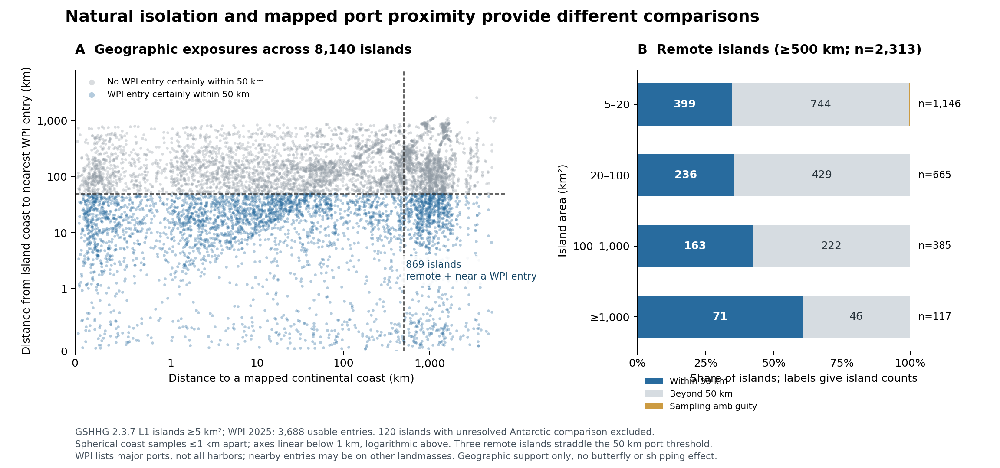

# Island, port and barrier continuation — measured results, 29 October 2026

**Later continuation:** the [96-island expansion and taxonomy bridge](ISLAND_EXPANSION_RESULTS_20261029.md) supersede the pilot's observation-coverage status below. This file retains the original 24-island results and full 8,260-island geographic census.

**Current result:** geographic exposures are now measured for all 8,260 source islands ≥5 km², and an independent 24-island × two-period butterfly recording pilot has been acquired completely. The existing country panel cannot supply the intended within-island host comparison. The new pilot is too sparse for the full isolation × port × host test: only 10 of its 24 islands have at least three recorded species in both periods. No butterfly port, host or colonisation effect is estimated here.

This continues exploratory PR #102 from `a8416af4151e16ae7050240348765f9528d20748`. The prior head already passed paper CI and reviewer-bundle checks; its old source failures were repaired. The original GEB manuscript is unchanged.

## 1. Geographic measurement is complete

The source is the exact GSHHG 2.3.7 high-resolution L1 archive used by the previous census, SHA256 `8dbbe7e071e77e9e75f2d639239099ebca8d5c16d6a07df8169729d49f15cf41`. Original sibling-ID dissolution reproduces 144,744 landmasses, 8,260 islands ≥5 km² and 3,696 ≥20 km². Five continental seeds independently agree with the previous >7 million km² mainland inventory, including Australia. Greenland remains an island.

All 3,689 original WPI entries were audited. The complete page digest independently matches the prior successful [source Actions run 40857801018](https://github.com/zuizui0223/chocho/actions/runs/40857801018), artifact 12890257067. One numeric `(0,0)` placeholder is excluded, leaving **3,688 usable location entries**. Excluding it changed no island's nearest-port result or 50/100 km category in this census. WPI is a major-port registry, not a complete harbor inventory; no nearby entry does not establish the absence of a real port.

Distances are minimum spherical great-circle separations between source coastlines, sampled at ≤1 km intervals. Every island receives an upper estimate and a conservative sampling-only lower bound: at most 1 km width for coast-to-coast distance and 0.5 km for a port point to a coast. The bounds do not include shoreline positional uncertainty or the difference between spherical and ellipsoidal Earth models. Artificial dateline cut edges are excluded; island centers are not used as distance substitutes. The calculation uses 988,798 continental and 1,553,553 island coast samples.

Antarctica is absent from this source's L1 mainland layer. A conservative southern-cap check flags 120 islands for which Antarctica could be nearer. The primary geographic support summary therefore uses **8,140 islands**, while the complete derived table retains all 8,260 and their flags.

| Measured geographic support | Islands |
|---|---:|
| Eligible mainland comparison | 8,140 |
| WPI entry certainly within 50 km of some island coast | 3,669 |
| WPI entry certainly within 100 km | 5,113 |
| Continental coast certainly at least 500 km away | 2,313 |
| Among those remote islands: WPI entry certainly within 50 km | **869** |
| Among those remote islands: all WPI entries certainly beyond 50 km | **1,441** |
| Among those remote islands: sampling interval crosses 50 km | **3** |

The remote-island near-port fraction is 869/2,313 = **37.57%**. This establishes geographic comparison support; it does not establish shipping connectivity, port ownership, a historical arrival pathway, or a butterfly response. A nearby WPI entry can lie on another island or the mainland.

| Area among islands ≥500 km from a continental coast | Within 50 km of WPI | Beyond 50 km of WPI | Ambiguous | Total |
|---|---:|---:|---:|---:|
| 5–20 km² | 399 | 744 | 3 | 1,146 |
| 20–100 km² | 236 | 429 | 0 | 665 |
| 100–1,000 km² | 163 | 222 | 0 | 385 |
| ≥1,000 km² | 71 | 46 | 0 | 117 |

The near/far contrast exists in every prespecified area class. The islands are not automatically independent ecological replicates: archipelago structure still requires explicit handling.



## 2. Continental distance and the immediate sea gap are different exposures

For eight named source islands, a second calculation evaluated the nearest **other** source landmass ≥5 km² among all 8,265 eligible landmasses, including the five continents. Final distances still use shorelines; spherical caps only prune candidates whose lower bound cannot improve the current nearest distance.

| Island | Direct continental coast gap | Nearest-other-landmass coast gap |
|---|---:|---:|
| Izu Oshima | 894.439–895.439 km | **21.627–22.627 km**, to Honshu |
| Hawaii Big Island | 3,672.583–3,673.583 km | **45.670–46.670 km** |
| Galápagos Isabela | 1,096.519–1,097.519 km | **3.063–4.063 km** |

These intervals cover discretisation only. They show why direct continental distance cannot represent every local sea crossing. The nearest-other metric also has a limit: Greenland, Borneo, Madagascar, Okinawa and Honshu have nearby small islands under this ≥5 km² definition. A tiny gap to such an island does not demonstrate access to a viable butterfly source population. Several nearest-neighbor identities are ambiguous at the 1 km sampling resolution and are flagged explicitly.

**Working biological hypothesis:** the realisation of available host resources depends on access from occupied, resource-bearing source areas; direct continental distance, local island spacing and potential human entry locations may describe different parts of that access. This is a hypothesis motivated by the measured geography, not a dispersal result. The next ecological barrier variable must identify actual source populations and hosts rather than declaring every neighboring island a stepping stone.

## 3. The frozen country panel has no positive outcomes in the needed contrasts

The original 255 species × Level1 strata and 3,188 candidate species-country cells were retained exactly. Source hashes are recorded in `island_host_support_summary.json`. The conservative island-country screen contributes 13 eligible codes: BN, CU, DO, GB, HT, ID, IE, IS, JP, LK, MG, PG and TW. The complement is called **continental_or_mixed_country**, not pure mainland. Countries are not independent physical islands.

| Preserved country-panel diagnostic | Result |
|---|---:|
| Screened island-country candidate cells | 335 |
| Island-country cells with indexed butterfly records | 18 |
| Within-island-country strata containing both host classes | 31 |
| Cells in those host-contrast strata | 86 |
| Positive record outcomes in those contrast strata | **0** |
| Strata containing all four geography × host-class groups | 20 |
| Cells in those four-group strata | 320 |
| Positive outcomes in those four-group strata | **0** |

The 18 island-country positives are concentrated in strata with constant host exposure within the island screen. A pooled island-country detection enrichment would mix species and geography. It cannot be interpreted as the intended within-species host interaction. Model-based extrapolation across strata could still produce a coefficient, but does not create the absent comparison support.

The temporal continuation retains the original threshold of **at least three OTHER source taxa in each window**, not three visits. Its within-island host-contrast strata again have zero positive support. Zero indexed records are not biological absences or failed establishment events.

## 4. New butterfly observations are now available at the actual island grain

Before observing responses, 24 physical islands were selected from 12 geography strata: three area classes (20–100, 100–1,000, 1,000–20,000 km²), two direct-continental gap classes (<100 versus ≥500 km), and two WPI proximity classes (within 50 versus beyond 100 km). Each stratum supplied two islands: largest first, then the candidate geographically farthest from the first. Representative latitude was restricted to ±55°, and Antarctic-ambiguous comparisons were excluded. These are geographically selected cases, not a probability sample of global islands.

The selection was locked at **2026-10-29T12:01:05.062680Z**, before the first query, SHA256 `552410a030feb6e9058e6becf1fb6efa3c3d36c539b9060d5a565f1db6aa6656`. All 24 islands remain in the outputs, including record-empty islands. None was replaced after examining outcomes.

Queries used exact, oriented, dissolved GSHHG polygons without simplification or rectangular substitutes. Their largest geometry has 2,008 vertices. The accepted broad Papilionoidea concept was queried in the COL XR namespace (`checklistKey=7ddf754f-d193-4cc9-b351-99906754a03b`, `taxonKey=5G9`), separately from the original 239-species numeric GBIF backbone keys.

| Acquired source recordings | 2010–2017 | 2018–2025 |
|---|---:|---:|
| Completed island queries | 24 | 24 |
| Qualifying indexed records | **1,310** | **5,112** |
| Islands with records | 12 | 13 |
| Islands with no qualifying records | 12 | 11 |
| Islands with ≥3 recorded species bins | 11 | 10 |
| Species-assigned records | 1,271 | 4,908 |
| Records not assigned to species bins | 39 | 204 |

All **48/48** queries completed; no failed query is coded as zero. Transient API rate-limit responses were retained in the local source cache and resolved by cooldown and sequential resumption. Each query has original-response SHA receipts, complete species/basis/dataset/year facets, margin checks and an independently reacquired first page. All real pilot facets exhausted within the first 100-bin page.

Across the pilot, **10/24 islands** have at least three recorded species in each period; 10 islands have no qualifying records in either period. After the descriptive three-species coverage screen, only **two of the six area × continental-gap blocks** retain islands in both WPI proximity classes. These are both remote-gap blocks; the full isolation × port contrast is therefore still unsupported by this pilot's adequately recorded subset.

The three-species screen is a descriptive coverage indicator, not measured survey effort and not the original focal-species three-OTHER-taxa threshold. The increase from 1,310 to 5,112 records is not evidence of butterfly abundance or range growth. Source composition, digitisation and observer activity can change. The 243 records without a species-bin assignment are retained explicitly.

## 5. What can be concluded, and the remaining test

The current positive advances are concrete: the global geographic exposure table is measured, natural isolation can be contrasted with mapped port proximity at several island sizes, local sea-gap measurements differ substantially from direct continental distances, and exact-polygon butterfly time windows are now acquired successfully.

The biological hypotheses remain open:

1. Does resource availability matter more where occupied source populations are accessible through short sea crossings?
2. Does proximity to historically established transport entry points modify that relationship beyond coast, habitat and recording effort?
3. Does independently verified introduced-host availability explain a remaining difference once arrival opportunity and observation are accounted for?

The next main task is a fixed, expanded island observation panel with adequate recording in both periods, joined to independently dated local host evidence and source-population information. Expansion must retain all selected islands and record the sampling rule before acquisition; it must not silently replace empty outcomes with favorable ones. The current 10-island coverage subset is below the earlier 20-independent-island design target. Within-island port analyses additionally need observation locations and coast/placebo controls. The 2025 WPI snapshot does not verify pre-2018 port exposure, and retrospective GBIF indexing does not reconstruct the information available in 2017.

### Replay

From repository root, in an analysis environment with numpy, pandas, scipy, geopandas, shapely, pyproj, pytest and matplotlib:

```bash
python scripts/analyze_island_host_identifiability_20261029.py
python scripts/measure_island_port_geography_20261029.py --cache-dir /tmp/chocho-island-sources
python scripts/measure_named_island_neighbor_gaps_20261029.py --cache-dir /tmp/chocho-island-sources
python scripts/acquire_island_butterfly_panel_20261029.py --source-cache /tmp/chocho-island-sources --cache-dir /tmp/chocho-island-gbif-cache --workers 1
python scripts/summarize_island_pilot_support_20261029.py
python scripts/render_island_port_measurements_20261029.py
python -m pytest -q
```

Use the frozen published facet tables for the exact recorded GBIF result; a future uncached API replay is a new retrieval, not guaranteed identical. Raw source geometries and original API bytes remain outside the Git repository; all reported source and result identities are in the derived manifests. Exploratory scripts/tests are excluded from the original double-anonymous GEB reviewer bundle.
