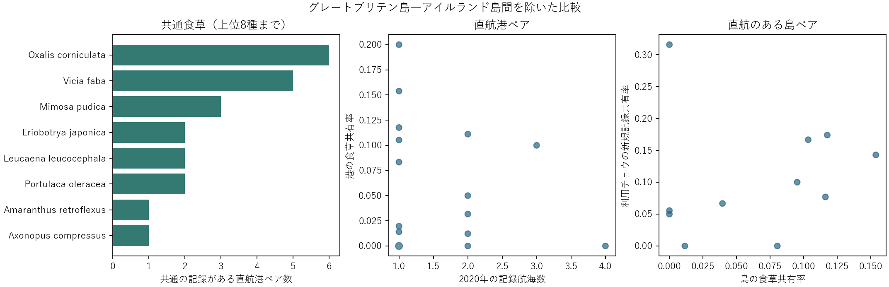

# 直航港で共通する外来食草候補687種とチョウの新規記録

グレートブリテン島―アイルランド島間を除くと、2020年AISで直航のある16港ペア（11島ペア、26航海記録）のうち12港ペアで計14種の食草が共通した。両島を端点とする全航路まで除くと10港ペア中7ペア。カタバミは6港ペア・3島ペア、ソラマメは5港ペア・4島ペア、オジギソウは3港ペア・2島ペアで共通した。マニラ―淡水ではオジギソウなど4種、カリアリ―パルマではソラマメ、ビワ、Amaranthus retroflexus の3種が共通した。

元の49港・21島・1,009港ペアおよび5 kmの港植物検索とAIS照合を固定。687種は港で地域目録上の外来候補として記録された食草の集合。チョウは候補225種のうち、687種のいずれかとの食草関係が登録された192種。植物は両港で地域的な外来候補の記録があるものを共有とした。チョウは2001年以降の記録を参照し、島での初記録が2011–2022年の種を新規とした。島ペアでは各島の照合港の植物記録をまとめ、各島ペアを1回だけ数えた。

英国・アイルランド間を除き、直航の記録有無と共通食草数のSpearman相関は＋0.015（955港ペア）。直航16港ペアの記録航海数と食草のJaccard共有率は−0.253。直航のある11島ペアで、食草共有率と利用チョウの新規記録共有率は＋0.395、英国・アイルランド両島を全て除くと＋0.108（7島ペア）。片側以上にAISの記録がない港は比較から外し、両端にAIS記録があっても直航が未確認のペアは実交通の有無が未知。共有率は共通種数を和集合種数で割り、両側とも空なら欠測とした。共有端点、植物記録量、地理的近接の影響を含む記述相関である。

16直航港ペアで共有された食草に限定し、その食草の既知の利用種が両島で新規記録されたかを種名で照合した。該当はマニラ―トアマシナのオジギソウと Zizula hylax の1組。初記録はそれぞれの島で2018年・2013年で、両方とも今回のAIS観測年に先立つ。2021–2022年だけに限ると、比較可能な直航10島ペアのチョウ共有率はすべて0で相関を推定できない。植物記録は2001–2024年の集約であり、現地での摂食や移入の経路・順序は未識別。

[全14食草](shared_hosts_other_routes.csv)・[直航港別の食草と対応するチョウ・初記録年](shared_hosts_and_users.csv)・[相関と除外条件](correlations.csv)・[前回のAIS出典と対象ペア](../top6_actual_ports_20261109/README.md)。再計算は元のchoch作業ディレクトリから analyze.py を実行する。
