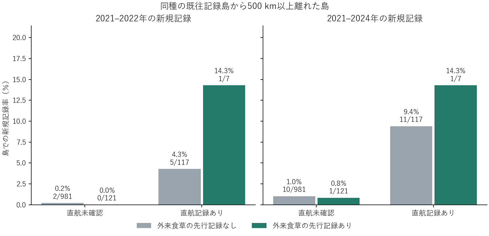

# 遠方の島での外来食草先行記録と同種既往記録島への直航

2021–2022年の新規記録率は直航確認群で、食草先行記録あり1/7、なし5/117。直航未確認群ではそれぞれ0/121、2/981。割合差の差は＋10.2ポイントだが、対象島を一つずつ除くと−4.2〜＋15.7ポイントまで変わった。2024年まで延長すると＋5.1ポイントで、食草・直航あり群の新規記録は同じ1件だった。

既存51島・225候補から、687外来食草候補に食草関係を持つ192種を出発点にした。食草記録は2001–2010年の194港の調査で地域目録上の外来候補に一致したもの。地域分類は現代の資料に基づく。対象島の港のどこかで当該種の食草が記録されていれば先行記録あり。年順を確保するため、前回の複数年窓別の公開再照会から、元座標の2001–2024年種別島別年次集計に切り替えた。2001–2019年に別の島で同種が記録され、対象島では2020年末まで同種の記録がない組を選んだ。距離は51島内の最近接既往記録島との代表港間距離。最小距離500 km以上が対象。

2020年の直接航海の照合は前回の49港・21島に固定。チョウの対象島と少なくとも一つの同種既往記録島の両方がAISで被覆されていることを要件とし、既往記録島のいずれかとの直接航海があれば直航確認とした。航路は双方向をまとめたもの。対象島には基準期の港植物記録と予測前後のチョウ群の記録を要求した。比較可能な18島・91種・1,226種×島を分母とする。未確認航路と未記録の植物には未検出が含まれる。船の運航量、船への乗載、島での繁殖、採集努力を同定する設計ではない。

両条件を満たす7組は3島に分布。新規記録は2022年のグレートブリテン島の Leptotes pirithous 1件。港を実航路の端点まで限定しても該当し、Harwich周辺に Medicago sativa と Spartium junceum の先行記録があり、同種の既往記録があるキプロス島のLimassolと2020年に直接航海2件が照合された。チョウの新規記録地点は島単位で評価した。英国・アイルランドを対象から除くと割合差の差は前期末2022年で−4.5ポイント、2024年で−10.1ポイントとなる。2つの評価窓は重なる。疎な記述比較であり一般的な相乗効果の支持は限定的。

[群別の分母・記録数](rates.csv)・[割合差の差と一島除外の範囲](contrasts.csv)・[種×島と対応する記録島・食草](eligible_species_islands.csv)・[AISの来歴と元の港間照合](../top6_actual_ports_20261109/README.md)
