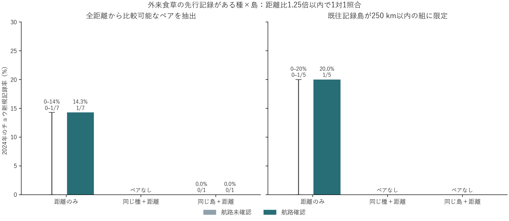

# 港のある島に広げた距離照合とチョウの新規記録率

**近距離での結果。** 港周辺で既知の外来食草候補が先行記録され、最寄りの同種記録島が双方250 km以内、かつ距離比1.25倍以内の航路確認・未確認例は、重複使用のない5ペア。2024年の初記録は確認側1/5、未確認側0～1/5。対照種を同じ最適距離を与える別の種に替えると差はゼロにもなる。5ペアの確認側は2島、未確認側は3島。同じチョウ種どうし、または同じ到着島内という条件まで付けると250 km以内では0ペア。

点線の境界や距離ビンを使わず、距離の大きい方÷小さい方が1.25以下の組を対象に1対1で照合した。全距離では7ペア（確認側1/7、未確認側0～1/7）。同じ種に限ると0ペア。同じ島内に限ると本州の1ペア（双方2,049 km、0/1と0/1）。図の縦線は距離が同点の最適な照合から生じうる率の範囲。標本誤差の信頼区間ではない。左右の図は入れ子であり同じ新規記録を含む。

**地理・観測被覆。** WPI 2019の3,630港全体で、半径5 kmの植物照会範囲が単一の島（既存定義の面積700万 km²未満）にのみ重なる653港・204島を抽出。英国・アイルランドの港のある島を除くと532港・200島。調査範囲に複数の島が入る港では、植物記録を一島に帰属できない。2019–2023年に入港側として2年分以上の資料があるのは33島、さらに予測前と追跡期間に候補チョウの記録があるのは31島。31島180港の2001–2010年の植物記録を調査した（以前の完了分77港、今回GBIFの期間指定で照会した103港）。4島はこの期間に調査港で植物記録がなく、最終評価は27島・132種・2,994種×島。元51島の外から9島・999組を追加できた。先行食草ありは20島390組で、元51島の外からは4島147組。航路未確認とは、使用資料で対応する運航を検出できなかったことを表す。

**時間と生物の単位。** 元225候補のうち既存687食草候補と利用関係を持つ192種から開始。港内の記録に対応する植物名をGBIFの種キーで照合し、港周辺が重なる植物区すべてで現在の地域目録が外来候補分類を支持する場合に採用。島内の調査港のいずれかで当該種の食草を2001–2010年に記録した島が「先行記録あり」。2018年までに別の港島で同種の記録があり、そのうち少なくとも一島で出港実績が資料にあること、対象島で2023年まで未記録だったことをリスク集合の条件とした。距離は200候補島内の最寄りの既往記録島へのWGS84測地線距離で、島の位置は厳密に地理を割り当てた港の球面平均。航路は既往記録島のいずれかと到着島の接続。航路の出発島と最寄りの既往記録島は異なりうる。

**航路資料。** 前回の船種別資料を広げた港島リストに再照合し、デンマークの国内・国際フェリー、米国BTS全国フェリー調査を追加。米国の2020年調査は2019年の実績、2022年調査は2022年の実績。正の年間運航回数を報告した区間に限り、端点座標はGSHHG高解像度陸塊と照合（海上なら1 km以内で一意の陸塊）、表中で多区間と読める名称は除外。往復フェリー統計は島間の双方向接続として符号化し、方向別回数を推定していない。LNGとコンテナ船は出発→到着を使用。台湾の2023年10–12月の表は欠測。地域ごとに資料・対象船種・記録密度は異なり、全世界の港の悉皆運航履歴ではない。[BTSの調査資料](https://www.bts.gov/surveys/national-census-ferry-operators-ncfo/ncfo-previous-datasets)・[デンマーク国内フェリー](https://www.statbank.dk/SKIB31)・[国際フェリー](https://www.statbank.dk/SKIB32)・[その他の出典](../mixed_vessel_distance/README.md)

**照合と解釈。** 航路確認・未確認を二部グラフの両側に置き、転帰を使わず、ペア数を最大化し、次に対数距離差の総和を最小化。確認側・対照側とも各種×島は一度まで使用した。等価な最適解の転帰の最小・最大を別途計算し、最適ペア数と距離差総和が同じことを検算。原集団では確認側5/19・未確認側3/371だが、距離の支持域・島・種の構成が異なる。主比較の確認側の初記録は新規追加したボーンホルム島の Nymphalis polychloros。対象港には Malus domestica や Salix alba 等の先行記録があり、シェラン島とのフェリー接続が確認された。最寄りの既往記録島はエーランド島（172 km）。未確認の対照として同じ距離の別の種が選べる例にはウィッビー島の Colias eurytheme の新規記録（202 km）もある。島をまたぐ照合では地域・種・観測努力が異なるため、1件の差を輸送の効果と解釈できない。

[島別の採否](island_coverage.csv)・[1対1のペア一覧](pairs.csv)・[許容距離比・同一資料制限などの感度](matched_rates.csv)・[同点の影響](tie_sensitivity.csv)・[種別表](species_islands.csv)。元のchoch作業領域から lng.py 2023、routes.py、us_ferry.py、plants.py、analysis.py の順に実行する。
