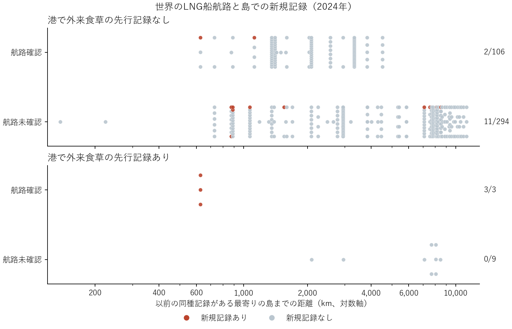

# 島間距離を連続量としたLNG船航路・先行食草・チョウ初記録の比較

2020–2023年の4年間について、一つの世界資料・同じ座標照合方法で島に入ったLNG船の方向を調べた。2024年の追跡は9島、66種、412種×島。港で外来食草が先に記録された群のうち、同種既往記録島との航路確認は3/3が新規記録、航路未確認は0/9。前者はすべてサハリン島の同じ627 km、後者は2,089–8,470 kmだった。島内で共通する距離域を持つ確認・未確認群が得られず、先行食草が航路との関係を強めるという交互作用は識別できない。

|航路の期間|追跡|評価島|種×島|食草あり・確認航路|食草あり・未確認|
|---|---|---:|---:|---:|---:|
|2020–21|2022–24|6|187|3/3|0/2|
|2020–22|2023–24|6|186|3/3|0/2|
|2020–23|2024|9|412|3/3|0/9|

分子は期間内初記録、分母は期間開始まで対象島で未記録だった種×島。各窓の3件はすべて同じ3種。後から観測年を延ばした2比較は被覆感度で、独立した反復ではない。4年窓の追加3島では資料中の入港確認が1年だけで、2年以上を要求すると6島に戻る。航路確認には同種の2019年以前の記録島のいずれかからの有向航海を要求した。2年以上に同じ出発島からの接続を要求しても、先行食草ありの3件は同じ。

*Celastrina argiolus* と *Polygonia c-album* には *Humulus lupulus*、*Vanessa cardui* には *Tussilago farfara* がサハリンの調査港周辺で対応した。3種とも元座標資料で2024年に各1記録。サハリンの候補チョウ全体は2022年6記録・3種、2023年10記録・4種、2024年20記録・9種で、記録状況の変化もありうる。

**方法**　英国・アイルランド・オークニーを除いた元51島で照会。2001–2010年に地域目録上の外来候補食草を当該島の港で記録、2019年までの同種の記録分布、航路期間、その後のチョウの記録という時間順序を固定した。687食草候補と利用関係のある192種から、以前の記録島のうち少なくとも1島にLNG出港実績があり、対象島に入港実績・早期の植物記録・予測前後のチョウ群の観測がある種×島を評価した。食草は島内の調査港のどこかの記録。ターミナルそのものの植生や地域目録の当時の在来性は測っていない。

ターミナル座標をGSHHG高解像度陸塊と照合し、陸上は交差、海上は5 km以内に一意の陸塊がある場合を採用した。5 kmは座標照合の許容幅。種別の距離は英国等除外後の研究範囲で同種が以前に記録された最近接島と対象島の代表港間の大円距離で、全距離を使用した。近い島と船が出た島は別の場合がある。「航路未確認」にはLNG資料にない航海も含まれる。全船種やチョウの船上移動、局所的な幼虫利用、定着は確認できない。

**距離の調整**　島ごと、先行食草の有無ごとに、確認航路と未確認航路で距離分布の範囲が重なる行を抽出した。両群が残る場合だけ、距離の対数（底2）、出港実績のある既往記録島数の対数、島の固定効果を加えた線形確率モデルを計算した。先行食草ありではどの期間もこの比較が成立しない。先行食草なしの4年窓で条件を満たす97組にも新規記録は1件だけだった。群間の見かけの比率から一般的な輸送効果は推定しなかった。

**出典と再計算**　LNG-T3（CC BY 4.0）の2ファイルを版固定・MD5照合した。往路・復路を含むAISから再構成された航海を使用した。前回の地域別の資料を混ぜた解析とは対象も異なる。元のchoch作業領域で prepare.py と analyze.py に航路の最終年（2021、2022、2023のいずれか）を渡して順番に実行する。[配布データ](https://doi.org/10.5281/zenodo.19571058)・[原著](https://doi.org/10.1038/s41597-026-07454-2)・[4年窓の種別表](through_2023/species_islands.csv)・[島と距離の重なり](through_2023/overlap.csv)・[期間別の入港被覆](through_2023/endpoint_coverage.csv)
