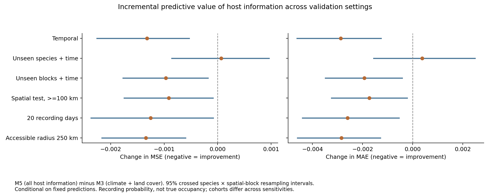

# 広域・多種のチョウ記録分布変化：予測検証の統合結果

**進行中。** 未完了の検証を成功と扱わない。未完了：最大提供者を除外、位置誤差100 m以内。

候補225種。主解析は観測支持を満たす155種。学習は2011–2014年→2015–2018年、評価は2015–2018年→2019–2022年。目的変数は観測努力を標準化した記録確率で、真の占有・新規定着ではない。食草資料は静的な地域資源であり、食草の移動や現地個体数を測定していない。

## 食草を追加したときの予測誤差

M3は背景＋気候＋土地被覆、M4はM3＋食草資源指標、M5はM4＋食草の科組成。以下は種を等しく重み付けしたMSE。小さいほどよい。異なる感度条件の絶対誤差は、対象と目的変数が異なる場合があるため直接ランキングしない。

| 検証 | 種数 | 評価組数 | M3 | M4 | M5 | M5−M3の95%区間 |
|---|---:|---:|---:|---:|---:|---|
| 時間外 | 155 | 208,482 | 0.032064 | 0.031126 | 0.030743 | -0.002260 ～ -0.000533 |
| 未学習種＋時間外 | 155 | 208,482 | 0.032633 | 0.032675 | 0.032701 | -0.000859 ～ 0.000962 |
| 未学習空間＋時間外 | 155 | 208,482 | 0.032327 | 0.031815 | 0.031359 | -0.001770 ～ -0.000180 |
| 空間外・学習地点から100 km以上 | 155 | 102,728 | 0.033468 | 0.033003 | 0.032552 | -0.001749 ～ -0.000088 |
| 20記録日への標準化 | 155 | 159,084 | 0.042091 | 0.041029 | 0.040839 | -0.002369 ～ -0.000083 |
| 候補範囲250 km | 155 | 180,654 | 0.035637 | 0.034697 | 0.034296 | -0.002164 ～ -0.000600 |

未学習種では食草追加後のMSE差は +0.000068。時間外検証での改善が、そのまま種を越えて再現したとは言えない。種を越えた共通予測則という主張は支持されていない。

100 km以上という評価は、空間外モデルの同じ予測を距離で絞った事後的な感度確認であり、独立した再学習や事前固定のバッファ付き検証ではない。

**肯定的な結果：食草の追加による改善は、未学習の空間ブロックでも残った。** MSEの減少は空間外で3.00%、学習地点から100 km以上離れた部分集合でも2.74%。両方でMAEも減少し、固定予測の再抽出区間はゼロをまたがなかった。既知種の別の場所・後年を予測する際の追加価値として支持される。未学習種への転用や寄主拡大の因果効果とは区別する。

区間は学習済み予測を固定し、種×5度空間ブロックを2,000回再抽出した記述的な区間。モデル再学習・記録誤差・年次反復・将来シナリオの不確実性は含まない。

## 持続予測を超えたか

MSEとMAEを両方示す。MSEだけが小さい場合を、全般的に予測力が優れるとは扱わない。

| 検証 | 持続MSE | M5 MSE | 持続MAE | M5 MAE |
|---|---:|---:|---:|---:|
| 時間外 | 0.045205 | 0.030743 | 0.103860 | 0.107856 |
| 未学習種＋時間外 | 0.045205 | 0.032701 | 0.103860 | 0.112747 |
| 未学習空間＋時間外 | 0.045205 | 0.031359 | 0.103860 | 0.110909 |
| 空間外・学習地点から100 km以上 | 0.046153 | 0.032552 | 0.104667 | 0.112817 |
| 20記録日への標準化 | 0.059667 | 0.040839 | 0.115513 | 0.124969 |
| 候補範囲250 km | 0.050379 | 0.034296 | 0.115775 | 0.121353 |

## 前期に対象種の記録がなかった地点

モデル設定時に指定した部分集合。2015–2018年の対象種の記録確率が0の地点を2019–2022年に評価したもので、過去全期間の不在・新規定着・繁殖を意味しない。時間外・種外とも154種、133,557組。

| 検証 | 指標 | M3 | M5 | 相対的な誤差減少 | 差の95%区間 |
|---|---|---:|---:|---:|---|
| 時間外 | MSE | 0.023825 | 0.022578 | 5.23% | -0.002630 ～ -0.000123 |
| 時間外 | MAE | 0.083841 | 0.081582 | 2.69% | -0.004341 ～ -0.000126 |
| 未学習種＋時間外 | MSE | 0.024314 | 0.024499 | -0.76% | -0.001023 ～ 0.001422 |
| 未学習種＋時間外 | MAE | 0.085890 | 0.086589 | -0.81% | -0.001683 ～ 0.003645 |
| 未学習空間＋時間外 | MSE | 0.024532 | 0.023235 | 5.28% | -0.002942 ～ -0.000251 |
| 未学習空間＋時間外 | MAE | 0.087182 | 0.085345 | 2.11% | -0.004332 ～ 0.000096 |

既知種の時間外評価での改善は、前期にも記録があった地点だけに限定されない。一方、未学習種への転用は別の問いであり、この改善をそのまま一般化しない。区間は固定予測の交差クラスターブートストラップによる記述的なもの。

## 応答差と観測過程

食草×環境変化の補助混合モデルでは、9交互作用はいずれもHolm調整後p≥0.177で、交互作用を加えた後期再現精度も改善しなかった。食草の予測上の追加価値と、環境応答を変える機構の証拠は区別する。主解析155種とは異なり、この集約補助解析は139種・19地域である。

提供者構成変化の小さい群でも時間外MSEの改善は残ったが、全モデルの誤差には135種中111種で正の空間相関が残った。空間外検証と距離を設けた評価の結果を重視する。

## 根拠ファイル

- 全モデルの数値：`forecast_validation_all_metrics.csv`
- ペア比較・固定予測の区間：`forecast_paired_comparisons.csv`
- 独立再集計：`forecast_metric_validation.json`
- 候補225種の脱落理由：`forecast_all_225_disposition.csv`
- 主解析・食草交互作用・感度分析の条件：`forecast_evaluation_protocol_ja.md`、`forecast_interaction_protocol_ja.md`、`forecast_sensitivity_protocol_ja.md`
- 観測・空間診断：`forecast_observation_spatial_diagnostics_ja.md`

出現データ：[GBIF](https://doi.org/10.15468/dl.umqmsf)。土地被覆：[ESA LCCS年次集約データ](https://doi.org/10.5281/zenodo.11407287)。気候：NASA POWER。過去の記録アーカイブと現代の食草資料を使う後ろ向き検証であり、2018年当時に実際に発行された予報ではない。
