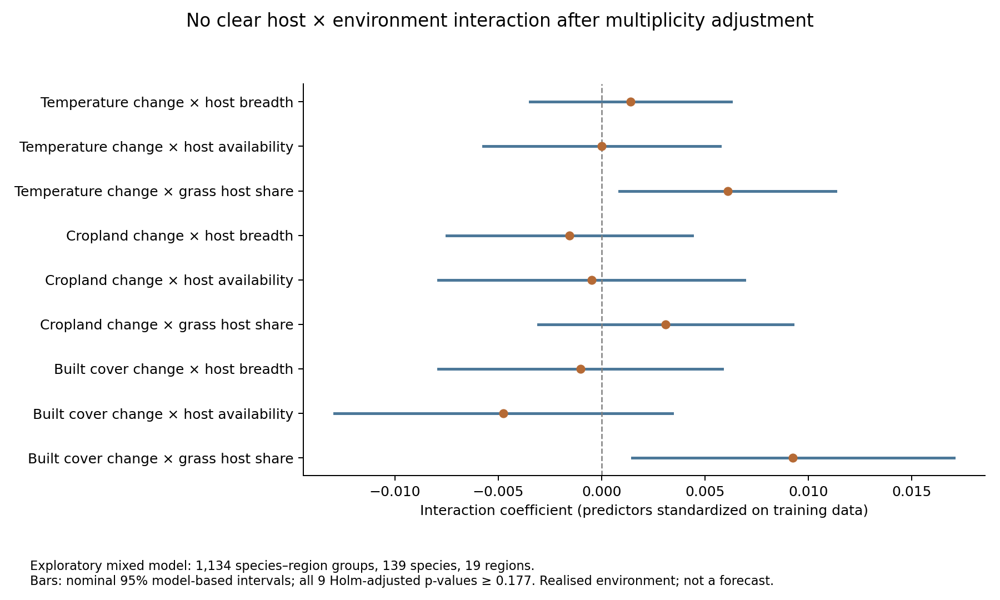

# 食草による環境変化への応答差：探索的補助解析

2026-10-29。**今回のモデルでは、食草が環境変化への応答を変えるという明確な支持は得られなかった。** RFへの食草追加による予測改善と、この交互作用の検証を区別する。

事前に固定した広域155種のパネルから、同じメッシュの変化を種×地域に集約した。各組10メッシュ以上を要求すると、学習は139種・19地域・1,134組となった。これは主解析を置き換えるものではなく、観測支持を要求した補助解析である。対象は2011–2014年から2015–2018年への標準化記録確率の変化。種のランダム切片・地域の固定切片を持つモデルを用いた。

検討したのは、気温・農地率・建造地率の変化と、食草利用幅・地域的利用可能割合・イネ科食草割合の9交互作用。後の期間の実測環境変化を入力するため、予測時点の情報だけによる将来予測とは異なる。詳細条件は `forecast_interaction_protocol_ja.md` に、計算前に記録した。

## 結果

9交互作用のHolm調整済みp値は全て0.177以上だった。気温変化×イネ科割合、建造地変化×イネ科割合は未調整では正の係数が出たが、多重比較を考慮すると支持は明瞭ではない。この2項だけを選んで仮説を確証したとは扱わない。

後の2015–2018年から2019–2022年への変化を、学習済みの種・地域に限定した1,081組で再現した結果も、交互作用追加による改善を示さなかった。

| モデル | 後期MSE | 後期MAE | 学習AIC |
|---|---:|---:|---:|
| 主効果のみ | 0.006611 | 0.057209 | −2791.59 |
| 9交互作用を追加 | 0.008464 | 0.063649 | −2783.75 |

誤差は種×地域の集約行に等重みを与えた値で、RFの種均等・メッシュ単位の誤差とは直接比較できない。後期候補1,201組のうち、学習済み種・地域に限定して1,081組を評価した。

## 検証と限界

両モデルは収束したが、分散成分の境界に関する警告が出た。種ランダム切片の分散は約0.000552、残差分散は約0.0043であった。別の最適化法による確認では対数尤度の差は0.000001未満、固定効果の最大差は0.000006未満だった。保存した予測からMSE・MAEを独立に再計算し、一致を確認した。

図の区間は未調整のモデルベース95%区間で、空間依存・データ提供者の違い・食草資料の誤差を完全には扱わない。イネ科は組成の一例であり、18科全体を検定したことにはならない。地域集約によって細かな局所応答が消える可能性もある。

したがって結果は「食草による応答差が存在しない」という証明でもない。**現状は、食草情報に予測上の追加価値がある可能性はあるが、気候・土地利用への応答を変える共通の仕組みは確認できていない**、という整理が適切である。真の定着・分布拡大や因果機構を観測したとは主張しない。
