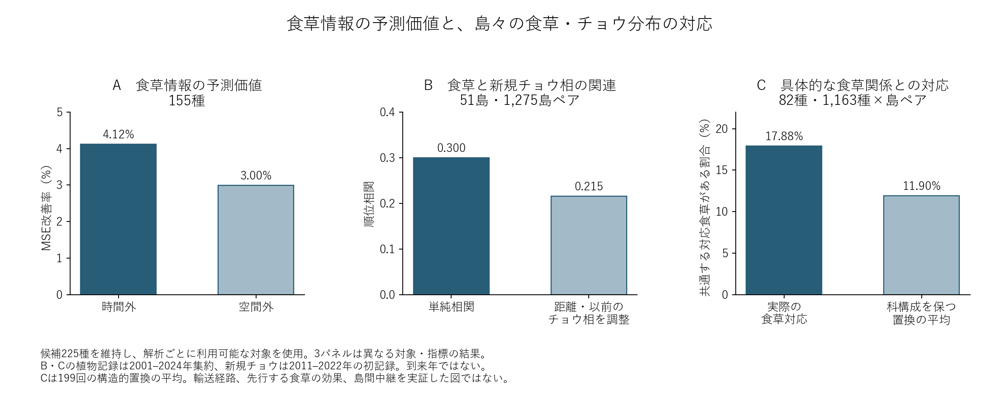

# 食草予測改善と港の外来食草候補をつなぐ

## 主結論：食草情報の予測価値と、島々の分布の対応

2026-10-30更新。確認できた肯定的な結果を中心に整理する。候補母集団は225種を維持し、各解析の利用可能な種・島を明示する。

**食草情報は既知種のチョウ記録分布の予測を改善し、港で外来食草候補を共有する島々ではチョウの記録組成も似ていた。その対応は、具体的な食草カタログ上の関係にも表れていた。**

これを本研究の現段階の中心結論とする。異なる対象・解析で得た3つの結果が、食草資源の配置をチョウ分布の理解に組み込む意義を示す。ただし同一の因果経路を独立に3回検証したわけではない。

| 根拠 | 確認できた結果 | 対象・意味 |
|---|---|---|
| 食草情報の予測価値 | 時間外MSE約4.1%改善、119/155種で改善。空間外でも約3.0%改善 | 既存の背景・気候・土地利用モデルM3に食草を加えたM5との比較。港食草そのものの効果ではない |
| 島間の組成の対応 | 外来食草候補と新規チョウ組成の類似性ρ=0.300、距離と以前のチョウ相を調整した偏順位相関0.215 | 51島・1,275島ペア。気候・土地利用を直接調整した結果ではない |
| 食草関係の具体性 | 対応食草の共有率17.9%、食草数・植物側の対応種数・科構成を保った置換平均11.9% | 82種・1,163種×島ペア、199回の置換。現地の摂食確認ではない |

## 島の役割として考察できること

港で記録される外来食草候補の配置が、島々で利用可能な潜在的食草資源の共通性と結びつく、という作業仮説を提示できる。研究の焦点は、島の距離や面積だけでなく「どのチョウにとって、どの島が食草資源を持つ場所になり得るか」という種ごとの対応にある。

**人為的に広がる植物が島々に共通する資源を形成し、チョウの分布に関わる可能性**は、この結果から発展させる説明である。人為輸送が植物の配置を作ったこと、チョウが食草を追って移動したこと、島が実際の中継地になったことは、現在のマクロ解析では識別していない。外来候補は地域分布カタログによる分類であり、船舶付着による導入を確認した種の集合ではない。

## 主結論の範囲を決める補足結果

新規記録と以前からの記録を共通59種で比較すると、食草対応の超過が新規記録で特に強まったとは確認できなかった。したがって「分布拡大に特有の関係」より「島の記録分布と食草関係の対応」と表現する。

植物記録をチョウより前の2001–2010年に限ると、対応は1,163組中5組に減り、置換に対する明確な超過は確認できなかった。早期植物記録の少なさもあるため、食草が不在だった証拠ではないが、時間的な先行効果は未確認である。

港接続性を追加した予測改善も空間外では再現しなかった。これは食草情報自体の予測価値とは別の比較である。未知種への食草モデルの転用、観測偏り、共通の生物地理、港以外との比較不足も残るため、港特有の集中や全球の全島への一般化を主張しない。

以下の重なりの集計は、具体的な食草・チョウを追跡する基盤として保持する。

既存225種のうち192種が、港で記録された外来食草候補687種と食草資料上で対応する。以前の時間外予測155種では144種、食草情報でMSEが改善した119種では109種が対応した。

この重なりの意味は、予測改善のあった種の大部分について、港周辺に記録される具体的な食草を追跡できること。港の食草によって予測が改善したことの証明ではない。

## 比較対象を含めた確認

改善119種中の対応率は109/119=91.6%。予測対象全155種の対応率144/155=92.9%より高くない。港食草と対応する144種では109種が改善し、対応がない11種でも10種が改善した。未対応は食草不在ではなく、取得・分類・食草資料の範囲で未対応という意味。

各種の全食草に占める港の外来食草候補の割合と、相対MSE改善率の種間順位相関は-0.043。したがって対応の有無や割合だけで改善を説明する結果にはなっていない。この探索は同じ食草・地域を共有する種の依存性を調整した推論ではない。

## 地域まで対応を絞る

単一地域に対応する港の植物リストと、既存予測の5メッシュ以上を持つ種×地域を照合すると、実際に同じ地域で利用食草候補が港に記録されるのは114種。そのうち予測改善があるのは86種。全球のどこかで対応する109種と区別する。

114種／86種は空間条件を付けた追跡候補であり、局所共存、実際の食草利用、導入順序の確認ではない。取得済み港・地域の制約も含む。

## 発展させる主張

「食草情報の予測価値」と「人為活動に関係し得る港での食草の配置」を結ぶ、具体的な種×地域の対応表ができた。この対応表を、気候が適するのにチョウの記録が乏しい地域、記録が増える地域、過去記録から離れた地域の違いを検討する基盤にする。

分析対象を改善86種だけに選び直すと結果で対象を選ぶことになるため、比較の主解析は既存155種と元の225種の採否を維持する。86種は具体例・原典確認の候補群として用いる。

現在の港植物は2001–2024年集約なので、未来予測の追加説明変数としての有効性や因果効果を評価した結果ではない。
