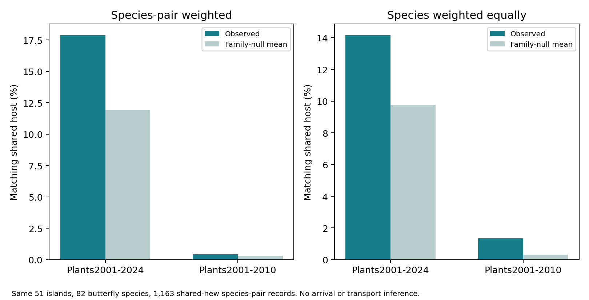

# 先行する食草記録と、その後のチョウ記録の対応

2026-10-30。候補225種を維持し、同じ51島・82種・1,163件の共通新規チョウ種×島ペアを固定して、食草の記録年代を変えて比較した。

## 取得完了

194港すべての2001–2010年の植物記録を整理した。141港はGBIFの種別集計を新たに取得、53港は既存の年別集計で早期記録ゼロを確認した。新たに取得した141港の総記録数は以前のキャッシュの同期間集計と一致した。ページ間の総数変化・種キー重複を検査した。

食草として対応できる記録は7,967港×植物、681植物種。現行カタログで外来候補となるのは288種で、35島・98港に記録があった。食草全体は41島に記録があり、植物全体の早期記録は44島にあった。未記録を植物不在とはみなさない。

## 比較結果

| 食草データの期間 | 共通する対応食草がある種×島ペア | 対応率 | 科構成を保つ置換の平均 |
|---|---:|---:|---:|
| 2001–2024年 | 208 / 1,163 | 17.88% | 11.90% |
| 2001–2010年 | 5 / 1,163 | 0.43% | 0.30% |

チョウの対象は両方とも2011–2022年の島での初記録。チョウ種を等重みにすると、早期食草との対応は1.34%、置換平均は0.32%。199回の置換のうち実測以上となったのは、種×島ペア等重みで44回、種等重みで15回だった。明確な超過は今回確認できなかった。通常の独立標本の検定ではない。

先行記録が確認できた対応は、Colias croceus と C. hyale–Medicago sativa、Vanessa cardui–Zea mays、Pieris rapae–Lepidium didymum、Nymphalis antiopa–Alnus incana の各1件だった。食草カタログ上の対応であり、これらの島での摂食・繁殖確認ではない。

## 解釈

全年代で見えた対応を、同じ強さのまま先行する食草配置の効果へ結びつけることはできなかった。チョウの後年の記録を含む植物データと、チョウより前の植物記録は分ける必要がある。

一方、早期データは地域・植物種によって記録が疎であり、今回の減少は食草が当時なかった証拠ではない。記録年代を限定すると情報量も減るため、対応率の低下だけで「後から食草が侵入した」「食草は拡大に関係しない」とは言えない。

2019年の港位置は検索領域を定めるために使っており、2010年以前の港稼働を示さない。外来候補という分類も現行の分布カタログに基づき、2001–2010年に外来だったことの独立証拠ではない。食草リスト自体も現代の知識である。チョウの初記録は到来・定着年ではなく、記録の時間的先行は輸送経路・導入年・因果効果を確定しない。今回の比較は外部予測検証でもない。

## 検証

全194港の取得状態、51島の取得完了、年指定、集計キー重複、ページ末尾を照合した。全1,163件の食草対応を別の集合積で再構築し、225種の採否を保存した。早期対応5件はすべて全年代の対応にも含まれた。置換の各標本でチョウ次数・植物次数・チョウの科別食草数を確認。図の描画を確認済み。

再現コード：`acquire_island_port_early_inventory.py`、`summarize_early_port_inventory.py`、`run_island_host_degree_null.py --family --dated`、`summarize_dated_host_match.py`。元の食草ネットワークと取得キャッシュはローカルに保持し、出典ハッシュ・集計・採否・図・コードをPRへ同期する。
