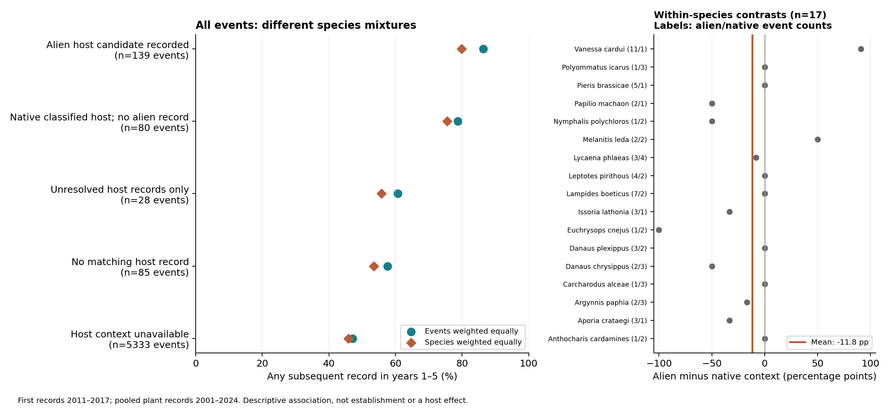

# 全球の島における港食草とチョウ記録の継続性

2026-10-30。文献事例を主解析にせず、既存225種のマクロ解析を維持する。全候補の採否を保存した。

2011–2017年の島での初回記録を対象に、その翌年から5年間の記録を原座標に基づく島別・年別集計から追跡した。189種・5,665件の種×島を対象とする。初回記録は実際の到来ではなく、この観測データ内での初回記録である。

港の植物検索が完了し、検索域が単一の陸塊かつ単一の島に対応する場合だけ食草情報を結合した。食草情報を結べたのは332件（5.9%）、107種。82種は対象期間の島記録があるが食草情報を結べず、36種は対象期間の初回記録がない。未取得を食草不在に置換していない。

| 港の食草記録区分 | 種×島の件数 | チョウ種数 | 島数 | 翌年から5年間に再記録された割合 | 種を等重みとした割合 |
|---|---:|---:|---:|---:|---:|
| 外来食草候補あり | 139 | 53 | 44 | 86.3% | 79.8% |
| 在来食草の分類記録あり・外来候補の記録なし | 80 | 48 | 25 | 78.8% | 75.5% |
| 分類未解決の食草記録のみ | 28 | 20 | 17 | 60.7% | 55.8% |
| 対応する食草記録なし | 85 | 47 | 38 | 57.6% | 53.5% |
| 食草情報を評価できない | 5,333 | 178 | 1,433 | 47.2% | 45.9% |

各行の種・島には重複がある。記録なしは植物不在ではない。

全体の再記録率は外来候補群で高い。しかし両群に記録のある17種を種内で比較し、その差を等重みで平均すると、外来候補群−在来群は−11.8ポイントだった。記録された年数の差は+0.047年、5年後の記録率の差は+8.6ポイントで、指標間でも一貫しない。さらに、両群とも3件以上あるのは1種のみで、種内比較も疎である。全体集計の差を共通の食草効果と解釈できず、逆方向の因果効果も主張できない。

## ここで判明したこと

全球の記録変遷を追う母集団は十分広い一方、年代を揃えて港食草まで結べる被覆が制約になる。植物記録は2001–2024年の集約であり、チョウの初回記録より前に食草があったという証拠ではない。2019年港カタログも過去の港稼働を保証しない。本結果は遡及的な記録の関連で、予測改善・定着・繁殖・人為輸送・島間中継の証拠ではない。植物・チョウ双方の観測量の違いも残る。

## マクロ解析の主軸

全225種の分布履歴から島での記録の出現・継続・その後の他島記録を追い、同じ食草を共有する島群との対応を調べる。食草と港が観測された範囲の採否を明示する。時間順の記録ネットワークを実際の移動経路とは呼ばない。現行の集約植物記録を過去年代の予測変数として流用しない。文献事例の収集は主解析の代替にしない。

## 検証

全5,665件の追跡年数・5年後記録フラグを別の年表結合で再計算し、17種の差と225種の採否を照合した。検証はPASS。元の観測の完全性や因果機構を保証する検証ではない。再現コード、入力ハッシュ、行単位の結果、採否、検証結果を併記した。
