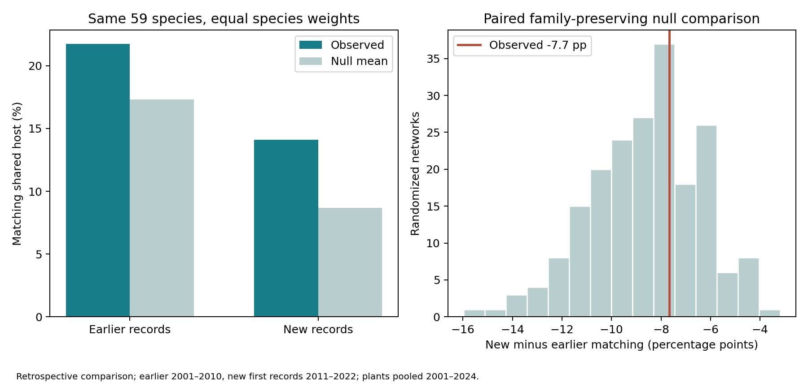

# 食草対応の超過は、新しいチョウ記録に特有か

2026-10-30。225種を候補母集団とし、前段の51島・1,275島ペアを固定した追加比較。結論は、食草対応の超過が新規記録に特有とは今回確認できなかった、である。

2001–2010年までに既に記録されたチョウと、2011–2022年にその島で初めて記録されたチョウを比較した。植物は同じ2001–2024年集約の港記録である。食草カタログのチョウ次数・植物次数・各チョウの植物科別食草数を保った199回の同一置換列を両期間に適用した。

## 共通59種の比較

両期間で少なくとも1つの両島共通記録ペアがある59種に揃え、チョウ種を等重みで評価した。以前の記録は2,125件、新規記録は1,041件の種×島ペア。種は一致するが、島ペア構成は同じではない。

| 記録群 | 実際の食草対応率 | 置換平均 | 置換平均からの超過 |
|---|---:|---:|---:|
| 以前からの記録 | 21.75% | 17.31% | +4.44ポイント |
| 新規記録 | 14.10% | 8.68% | +5.42ポイント |

超過の新規−以前の差は+0.98ポイント。実際の対応率の新規−以前は−7.66ポイントで、同じ差の置換分布の中央95%範囲（−13.30〜−4.65ポイント）内にあった。実際の差以上の置換は67/199回。したがって、この比較から新規記録で食草対応が特に強まったとは言えない。これは同等性の証明でも、食草効果の否定でもない。

## 全種の結果も保持

共通種に絞らない場合、以前の75種では実測19.02%・置換平均17.94%、新規の82種では実測14.15%・置換平均9.75%だった。種構成が異なるこの比較だけでは、超過の差を分布拡大の特徴と解釈できない。全225種の共通比較への採否を保存した。

## 研究上の位置付け

前段で確認した「食草数・科構成を保つ置換より実際の食草対応が高い」という結果自体は残る。ただし以前の記録にも対応があり、今回のマクロ結果が直接支えるのは島のチョウ分布と港の外来食草候補の組合せの関連までである。人為輸送、島間中継、新規分布拡大に特有の食草効果という主張には追加の証拠が必要。

期間の観測量・長さ・島ペア構成が異なり、全年代の植物情報を使っている。以前の記録を自然分散、新規記録を人為移入と分類しない。初回記録を到来年とみなさず、将来予測の改善とは別に扱う。

## 検証

共通種集合59種の一致、全3,166件の種×島ペアの期間条件、225種の採否、199標本の集計を照合した。置換は同一入力順・seed・アルゴリズムを用い、標本番号と元の辺の残存率の系列も一致した。各標本で次数・科別辺数の保存を検証。図を描画して確認済み。置換の生態学的な妥当性や混合の証明ではない。

再現：`run_island_host_degree_null.py --family --earlier`、同`--earlier --common`、同`--common`を実行後、`summarize_island_host_early_new.py`。既存の科制約新規群の出力も使う。原データと詳細対応はローカルに保持し、集計・規則・コード・図をPRへ同期する。
