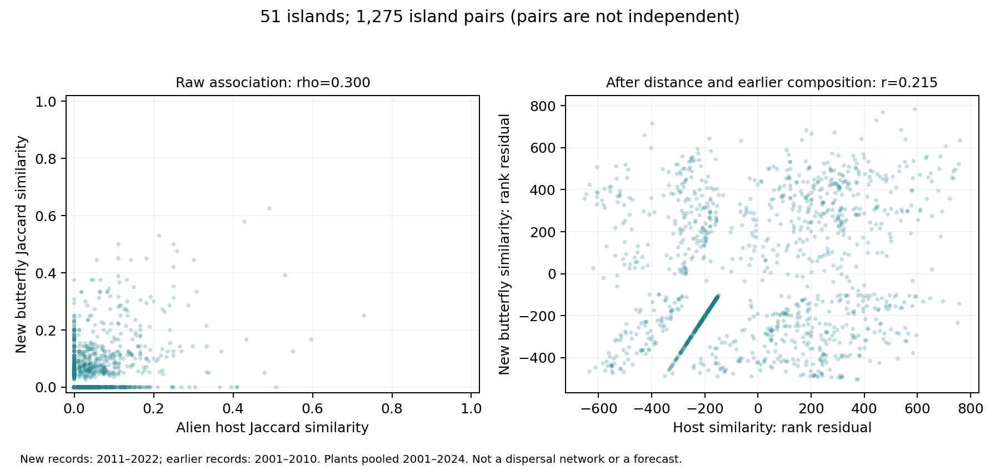

# 港の外来食草を共有する島では、新しいチョウ記録も似るか

2026-10-30。225種を候補母集団にした探索的マクロ解析。文献事例の収集ではなく、原座標から割り当てた島別の出現履歴と既存港植物データを比較した。

## 結果

完成済み港検索が単一の島に対応した103島のうち、外来食草候補の記録と2001–2010年のチョウ記録がともにある51島が対象となった。全1,275組の島ペアを比較した。対象島で2011–2022年に新たに記録されたのは116種・430件の種×島で、以前の記録は99種。全225種について採否を残した。

| 比較 | 相関 |
|---|---:|
| 外来食草の類似性と、新しく記録されたチョウ相の類似性 | Spearman ρ = 0.300 |
| 外来食草の類似性と、以前から記録されたチョウ相の類似性 | Spearman ρ = 0.418 |
| 港位置間の距離・以前のチョウ相を調整した、新しいチョウ相との記述的関連 | 偏順位相関 = 0.215 |

食草の共通性と新しいチョウ記録の共通性には正の関連がある。以前のチョウ相との関連はさらに強い。新しい記録に特異的な効果や拡大機構が特定されたわけではない。

島を1つずつ除いた51通りの影響診断では、単純相関は0.270–0.327、偏順位相関は0.191–0.238だった。単一の島を除くだけでは正の方向は変わらない。この範囲は信頼区間や外部検証ではない。

## 方法

- 食草：同じ島の完成済み港検索に記録された外来食草候補を重複なく集約。複数港で地域分類が食い違う植物を外来候補として確定しない。
- 類似性：Jaccard係数（共通種数÷どちらかに記録された種数）。チョウの新規記録は2001–2024年のデータ中の初回記録が2011–2022年にある種。実際の移入・定着年ではない。
- 地理：各島の対象港の座標を球面上で平均し、その代表位置間の大円距離を使用。海上の航路距離や輸送量ではない。
- 調整：食草・新規チョウの類似性を順位化し、距離順位と以前のチョウ相の類似性順位をそれぞれ回帰で差し引いた残差間の相関。気候・土地利用を直接調整したモデルではない。
- 全ペアに双方の新規チョウ種のいずれかがあり、Jaccard分母ゼロのペアはなかった。各島のペア数が同じなので、島の寄与を等しくする重み付け結果は単純相関と同じで、独立の頑健性証拠ではない。

## 解釈と次の解析の位置付け

ここまでで「島ごとの食草数」から、「食草を共有する島群とチョウの新規記録を共有する島群の対応」までマクロ解析を進められた。ただし植物記録は2001–2024年の集約であり、チョウ記録に先行した植物配置ではない。共通する気候、生物地理、観測活動などでも関連は生じる。港・食草のある島への対象限定もあり、全世界の島への無条件な一般化はしない。

1,275組は51島を繰り返し使うため独立サンプルではない。通常の相関検定のp値や独立ペアを仮定した信頼区間は示さない。今回の正の相関を、船舶移入、食草による拡大促進、島間の実移動、未来予測の改善として扱わない。

次の比較では既存食草ネットワークを用い、共通して新規記録されたチョウが実際に利用候補とする食草の共有なのかを確認する。単に同じ地域の植物相とチョウ相が似る効果と、食草対応を持つ組の関連を区別する。全225種の採否を保持し、改善種だけに絞らない。

## 検証と資料

全ペアの新旧チョウJaccardを種×島の二値行列積から再計算し、偏順位相関を別の順位計算・疑似逆行列で照合した。225種の集計も一致、検証PASS。植物分類自体は既存の港食草データ監査に依存する。図を描画して確認済み。

再現コード：`analyze_island_host_network.py`、`verify_island_host_network.py`。結果：`island_host_network_pairs.csv`、`island_host_network_islands.csv`、`island_host_network_all225.csv`、`island_host_network_leave_one_island.csv`。入力ハッシュと規則は同名audit・lock JSONに保存した。
