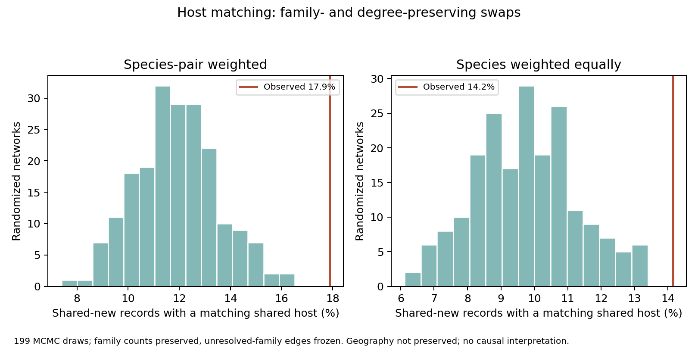

# 共通する食草とチョウの対応は、ネットワークの次数だけで説明できるか

2026-10-30。51島の記録と植物分布を固定し、候補225種・2,167植物・3,502本の既存食草ネットワークで探索的な置換比較を実行した。前段の82種・1,163件の共通新規チョウ種×島ペアが評価対象。植物分布は2001–2024年集約、新規チョウ記録は2011–2022年であり、時間順の予測ではない。

## 結果

| 食草対応 | 種×島ペアを等重み | チョウ種を等重み |
|---|---:|---:|
| 実際のカタログ対応 | **17.9%** | **14.2%** |
| 食草数・対応チョウ数を保つ置換の平均 | 9.1% | 8.6% |
| さらに各チョウの食草の科構成を保つ置換の平均 | **11.9%** | **9.8%** |

科構成を保つ199回の置換における中央95%の範囲は、種×島ペア等重みで8.9–15.1%、種等重みで6.8–12.9%。いずれも実際の値以上となる置換は0/199回だった。これはシミュレーション分布の範囲で、実データの信頼区間ではない。0回は確率ゼロを意味しない。

科を保たない置換では、実データ以上の回数はそれぞれ0/199回、2/199回だった。科構成を保つ比較は最初の置換結果を見た後に追加し、その結果を計算する前に別のlockを保存した感度分析である。

## 方法と検証

二部ネットワークの辺を2本ずつ交換した。蝶A−植物x、蝶B−植物yを蝶A−植物y、蝶B−植物xへ交換し、重複辺が生じる交換を拒否する。これにより各チョウの食草数と各植物に対応するチョウ数を保つ。

科を保つ分析では、同じ科の植物間だけを交換する。科名は元のinsect_host_accepted.csvでaccepted_nameが完全一致し、一意な非欠測科名を持つ植物に限った。科が未解決の352植物・455辺は固定した。科を保つことは属や種ごとの実際の受容性を保つことではない。

乱数seed=20261030。初期化後に辺数の10倍の交換を試行し、以後は辺数の5倍の試行ごとに199標本を保存した。全標本でチョウ次数・植物次数・辺数・重複なしを照合し、科制約ありではチョウ×科の辺数も照合した。観測値は前回の1,163件の対応フラグから再確認。保存された標本の平均・超過数を別計算で検証した。割合のlag-1自己相関は約0.05だったが、これだけで混合・独立性を証明したものではない。

## 解釈

実際の食草カタログの対応は、食草数・植物の対応チョウ数・科への専門性だけを保って組み替えたネットワークより、島間の共通新規チョウ記録とよく対応していた。先の17.9%を、単に利用植物が多いチョウや多くのチョウに共有される植物の存在だけで説明するのは、この置換条件では難しい。

ただし置換は地理的な生物相・属レベルの専門性・食草の観察されやすさを保たない。実際の組合せの方が地理的に同所的であるだけでも差が出る。人為輸送、食草による分布拡大促進、島間中継、現地での摂食・繁殖、未来予測の改善は未検証のまま。実際の生態系の帰無仮説全体を棄却したという表現はしない。

次に必要なのは、新旧のチョウ記録で同じ対応の強さが出るかという比較、および年代整合した植物分布で既存の気候・土地利用予測の乖離と結べる範囲の確認である。現在の全年代植物記録を過去年代の予測入力として扱わない。

再現：`run_island_host_degree_null.py`（基本比較）、同スクリプトに`--family`（科制約）。規則・標本・入力ハッシュ・集計検証を保存し、制限付きの元の食草辺一覧は再配布しない。
