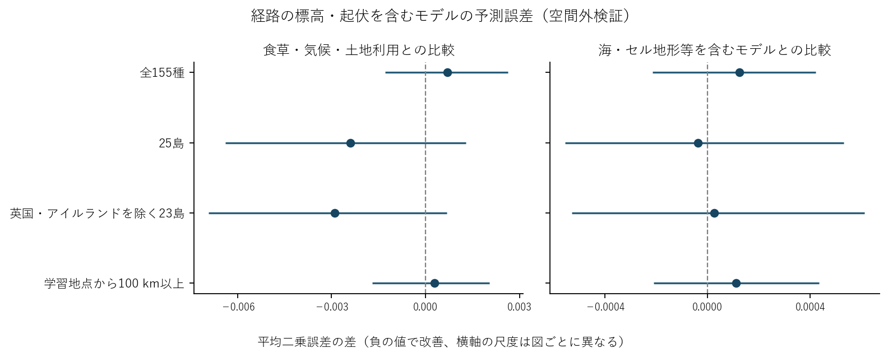

# 島・港・食草とチョウの記録分布変化

チョウの既知の食草とその地域分布は、後年にどこでチョウが記録されるかを予測するのに役立った。島では海を隔てた位置関係などの自然地理にも予測上の情報がある。一方、港への接続、経路上の山地、中間島がそれぞれどこまで寄与するかには幅がある。

## 食草を加えると後年の記録を予測しやすいか

候補225種のうち、基準期の観測被覆を満たす155種を主解析とした。2011–2014年から2015–2018年への変化で学習し、2019–2022年の記録確率を予測した。目的変数は提供者と日付の組を10単位抽出したときに当該種が記録される確率。気候・土地利用などを含むモデルに食草資源と食草の科組成を加えると、種を等しく重み付けした平均二乗誤差は時間外で4.12%、空間外で約3.0%減った。未学習種への適用では改善が明確でなかった。食草情報は現代の静的な資料なので、この比較で直接測ったのは記録分布との対応である。[元の予測比較](forecast_validation_results_ja.md)・[全225種の採否と14評価の被覆](../route_terrain_20261105/transport_all225_evaluation_coverage.csv)

## 島の隔たりと地形

学習から地域を外した評価では、自然地理と経路地形を含むモデルの誤差は食草・気候・土地利用モデル比で25島・95種では10.26%減り、全155種では2.24%増えた。海上距離・地点の地形などを含むモデルに経路地形だけを加えた改善は25島で0.18%、全155種で−0.39%。この8比較の誤差差の95%区間はすべてゼロを含んだ。[時間外の結果](../route_terrain_20261105/route_terrain_temporal_ja.md)・[空間外の結果](../route_terrain_20261105/route_terrain_spatial_ja.md)

原座標で2011–2022年の島での初記録を追うと、205種・2,656島の12,028件のうち57.0%で、前年までの最寄り記録も島にあった。種を等しく重み付けすると62.8%は過去記録から100 km未満、12.1%は500 km以上だった。短距離で記録が連なる例と、既知の記録群から離れた例の両方がある。最寄りの過去記録を実際の供給源と特定するには独立した移動履歴が必要になる。[記録の連続性と観測被覆](global_original_island_continuity_results_ja.md)

## 港は島の予測に何を加えるか

25島をグループに分け、対象島に重なる学習セルをすべて除いた検証では、食草・気候・土地利用モデルに対し、自然地理で6.65%、自然地理と港の接続性で9.10%誤差が減った（種等重み）。島を等しく重み付けするとそれぞれ7.67%、7.19%で、港を追加した差の向きが変わった。過去の観測情報は予測時点まで利用した。港の上乗せは観測努力の扱いにも依存し、155種の時間外評価で自然地理モデルに港を加えた改善は通常条件で0.02%、20記録日基準で0.42%、最大提供者を除くと−0.63%だった。[島全体を外した検証](../whole_island_holdout_20261105/whole_island_holdout_results_ja.md)・[観測努力への感度](../joint_provider_sensitivity_20261105/joint_observation_sensitivity_results_ja.md)

港の外来食草の共有から船舶輸送を調べるには、二つの港を実際に結ぶ航海と時期の対応が要る。照合できた2020年のAISと歴史航海記録は、現代の予測起点における港間輸送量を推定できる被覆を欠いた。港の四半期接続指数で評価した範囲と、実航路を使った検証の被覆はここで異なる。[航海資料の年代・地理の照合](voyage_forecast_overlap_results_ja.md)

## 食草が先に記録されたか

独立の初記録資料で地域を照合した265組（チョウ9種・9地域）のうち、植物が先に記録されたのは178組、チョウ先行は68組、年代未確定16組、区間重複3組だった。複数の食草が同じチョウ記録を共有する。17のチョウ種×地域のうち7群に両方の順序があった。共通上位6食草に絞ると、照合できた19組のうち16組で植物が先行した。これが示すのは記録の前後関係であり、各島での導入年、繁殖開始、船での共輸送は未識別である。[年代幅を含む検証](../first_record_report_reconciliation_20261105/terrain_and_record_lag_results_ja.md)・[上位食草の種別内訳](../first_record_report_reconciliation_20261105/top_shared_host_first_record_results_ja.md)

## データの適用範囲

既存の出典監査に加え、NHMの食草データセットHOSTSについて配布元のAPIでCC0を確認した。地域の植物分布表にはそれぞれの配布条件が適用される。現代の食草目録、海岸線、地形、2019年版の港位置を使うため、将来予測への適用には当時取得可能だった資料だけでの検証が残る。[HOSTSの取得記録](hosts_terms.json)・[出典別の年代・解像度・利用条件](../source_scope_audit_20261105/island_forecast_source_alignment.csv)
## 検証範囲の最終照合

- **母集団・時間順序**　225候補の内訳は主解析155種、基準期の共有セル10未満62種、基準期の記録30未満7種、期間中の記録なし1種。予測可能範囲は2014年までの記録で固定し、各時点の記録距離・密度はその時点までの記録で算出した。評価対象は後年の記録確率である。
- **自然地理**　過去の分布、同一陸塊での記録、海上区間、地形を段階的に比較した。海上区間等を含むモデルに直線上の中間島数を加えたとき、全155種のMSE改善率は時間外＋0.54%、空間外−0.05%。島による実際の中継は未識別。[中間島の比較](../intermediate_island_geometry_20261105/intermediate_island_forecast_results_ja.md)
- **検証を固定した時期**　基本予測の設定は学習前に、海・DEM、港、自然地理と港の併用、島全体の除外は各モデルの結果が出る前に固定した。経路地形と中間島は基本解析を見た後に追加した検証で、個別の比較は該当指標の抽出前に固定した。島外評価の区間推定は点推定後の追加診断である。
- **日付の被覆**　独立資料の265組に対応するのは主解析155種中9種。島外評価95種との種名の重複は7種で、各記録の地域は国・島など異なる範囲を含む。初記録年は考えられる年代幅で照合し、9種の結果を155種へ外挿していない。
- **出典別の利用条件**　解析入力には原典の種名照合や地域集計などの加工がある。食草の対応関係にはNHM HOSTS、欧州の追加情報にはClarkeの資料を用いた。NHMの配布レコードはCC0、Clarke (2024) の同名DryadデータはCC0 1.0、地域分布のWCVP v13はKewの版別カタログにCC BY 3.0とある。これらは各配布物に関する表示であり、加工入力一式の配布条件は別途確認が必要。GBIF DOIの表示はCC BY-NC 4.0。NASA POWERのカタログ上のライセンスは未指定。WPI 2019の公式刊行物、UNCTAD現行FAQについて確認できた範囲と、利用したミラー・旧版で未確認の条件は出典監査に記録した。初記録資料のメタデータとワークブックで条件表示が異なる点も保持した。[Kew WCVP v13](https://kew.iro.bl.uk/entities/product/5d36f109-7e49-461e-9541-6a85aac339fa)・[Dryad登録メタデータ](https://api.datacite.org/dois/10.5061/dryad.1vhhmgr12)・[港と輸送の条件監査](../source_scope_audit_20261105/port_transport_indexed_terms_audit.json)
