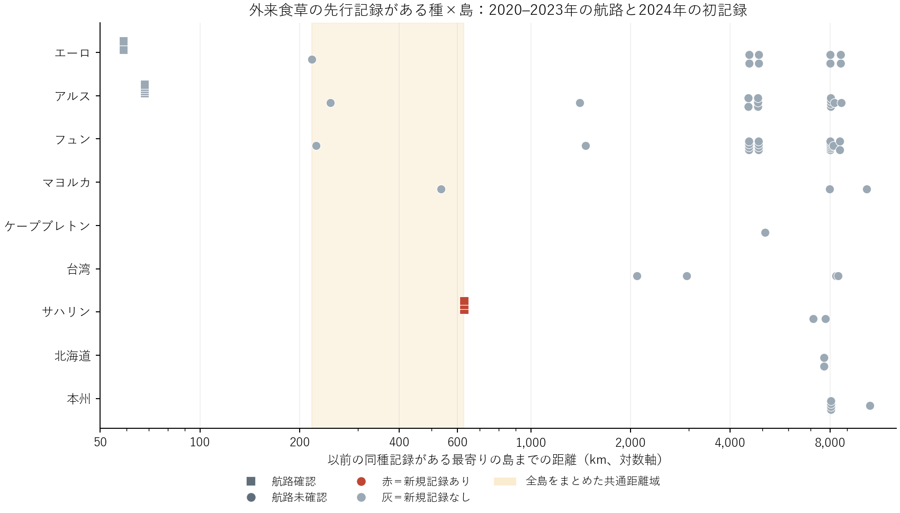

# コンテナ船・フェリー・LNG船の接続と、外来食草の先行記録がある島でのチョウ初記録

2020–2023年に2年以上の入港・運航実績を確認できる11島で92種・769種×島を評価。うち2001–2010年にそのチョウの外来食草候補が港周辺で記録されたのは9島68組。2024年初記録は、2019年までの同種記録島との接続がある10組で3件、未確認58組で0件だった。新規記録はすべてサハリンのLNG接続3種で、追加船種だけで扱った場合は接続確認0/7、未確認0/53だった。船種限定で航路端点が変わるため母集団も変わる。

図は外来食草の先行記録がある全68組。1点が1種×島。同距離の点は縦にずらした。既往同種記録島への最小距離は全対象島間の代表港を用い、航路は既往記録島のいずれかとの接続を用いた。全島を合わせた最小–最大距離範囲の共通部分（218–627 km）では、航路確認側はすべて627 kmのサハリン3種（3/3）、未確認側は218–535 kmの4島4組（0/4）。共通部分に残る実測点は互いに異なる島にあり、同じ対象島ごとに距離範囲を交差させると両群を比較可能な組は0。同じ島の最も近い対照でも距離比は3.64倍だった。島と距離をそろえた航路効果は推定不能。コンテナ船・フェリーだけの2020–2021年の航路と2022–2024年の初記録を比較した感度では、エーロ島の Anthocharis cardamines（30 km、Reseda lutea）と Cupido minimus（59 km、Melilotus officinalis）が2022年に初記録。同じ島・同程度の距離の対照は得られなかった。

**資料**　世界LNG-T3に、台湾の船種欄が全貨櫃船または貨櫃船の実入港記録、バレアレス港湾局の完了寄港（船種にコンテナまたはフェリーの明示）、デンマークの2港間フェリーの実運航統計、カナダのMarine Atlanticの実渡航回数、北海道運輸局の苫小牧―大洗の実輸送人員を加えた。台湾・マヨルカでは資料に記載された出発港からの入港方向を使用した。フェリーの往復路線は正の年間実績がある場合に両方向の接続として符号化し、方向別の輸送回数を推定していない。カナダ・日本は2020–22年度（終了年2021–23、追跡前のみ）。限定された路線と船種についての観測であり、未確認は全船種の欠航を意味しない。台湾の2023年10–12月のリンクは表の代わりにHTMLを返したため当該月の照合は欠測。マヨルカは港の調査被覆あり、今回の対象島間で船種と両端を照合できた追加リンクなし。複数地域資料に共通の種×島・距離の規則を適用したが、報告制度と船種のカバー範囲は地域別に異なる。

**方法**　元51島のうち英国・アイルランド・オークニーを除外。687種の候補食草に対応するチョウ192種を出発点とした。対象島には基準期の港植物記録、予測前と追跡中の候補チョウ観測、2年以上の航路資料での入港被覆を要求。予測起点まで対象島で未記録、かつ別の島の出発端点で同種の既往記録がある種を選定した。先行食草ありは対象島の調査港のいずれかで地域目録上外来の既知食草が記録されたことを表す。異なる船種、同じ資料で出発側も観測できた範囲、島内・島間の距離の重なりを個別に集計した。比較の分母は種×島。共通距離域と近距離対照がない条件では調整回帰や有意差を報告しない。

[台湾の月別資料](https://data.gov.tw/dataset/99641)・[バレアレス原簿](https://posidoniaweb.portsdebalears.com/docs/en/)・[デンマーク統計局 SKIB31](https://www.statbank.dk/SKIB31)・[Marine Atlantic 年報 p.6](https://www.marineatlantic.ca/sites/default/files/2023-11/Annual-Report-2022-2023.pdf)・[北海道運輸局の路線別輸送実績](https://wwwtb.mlit.go.jp/hokkaido/content/000322485.pdf)・[LNG-T3](https://doi.org/10.5281/zenodo.19571058)

[比較表](comparisons.csv)・[種別表](species_islands.csv)・[同じ島での最寄り対照](within_island_nearest.csv)・[年・船種別のリンク](links.csv)。元のchoch作業ディレクトリで prepare.py、analyze.py の順に実行する。
