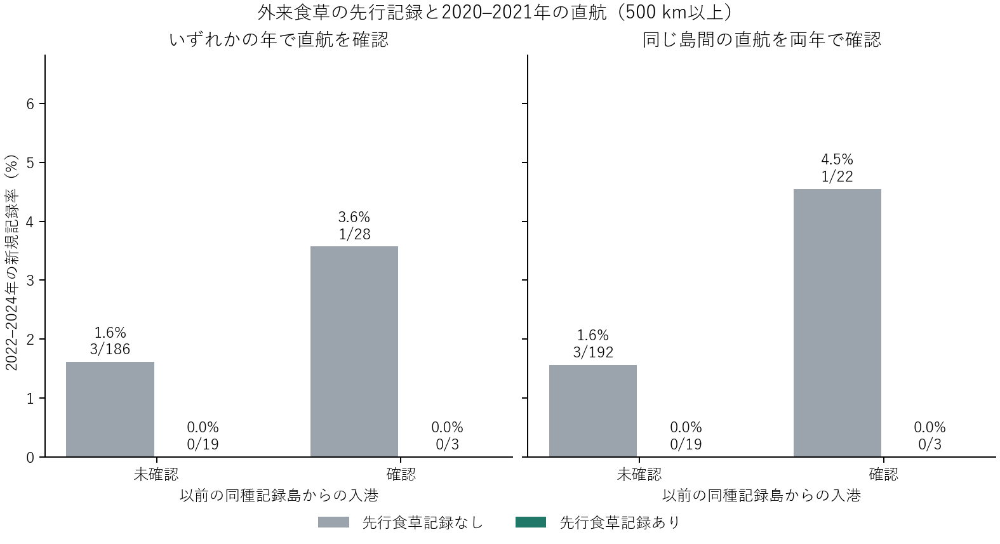

# 複数年の実航路と外来食草を使うチョウの新規記録

2020–2021年に台湾・マヨルカ島・ハワイ諸島へ入港した向き付きの運航記録を照合した。既存51島のうち、グレートブリテン島、アイルランド島、英国のオークニー諸島を発着地と同種分布の参照範囲から除外。比較は2001–2010年の港周辺の植物記録、2019年までの同種記録、2020–2021年の実航路、2022–2024年の初記録の順に構成した。

**いずれかの年で航路確認**　最近接の既往記録島が500 km以上離れた75種・4島（台湾、マヨルカ、マウイ、カウアイ）、236種×島で新規記録4件。食草記録あり・直航確認は0/3、食草記録なし・直航確認は1/28。直航未確認ではそれぞれ0/19、3/186。両年に同じ方向の島間接続があった場合でも食草ありは0/3、なしは1/22。2パネルは同じ追跡対象の再分類である。

**種の内訳**　3組はマヨルカの Nymphalis antiopa、N. polychloros（港の先行記録は Populus alba）、台湾の Anthocharis cardamines（Brassica rapa、Capsella bursa-pastoris）。いずれも2024年末まで対象島の初記録なし。直航あり・食草記録なしの初記録はマヨルカの Argynnis paphia（2023年）。500 km条件を外すと2組が追加され、そのうちカウアイ島の Vanessa cardui は既往記録島が最短152 km、Lactuca sativa の先行記録あり、マウイ・オアフから入港確認、2024年に初記録。現地で観察された繁殖、実際の初到来、船上輸送の証拠は別途必要になる。

**どの範囲を観測したか**　既存の地域目録で外来候補と分類された687食草と、その利用関係を持つ候補チョウ192種から開始。植物データは対象島の調査港周辺のいずれかに当該食草が記録されたか。経路は同一の既往記録島から対象島への入港方向を要求した。試料全体では18島にまたがる19の有向島ペア、うち14ペアを両年で確認。照合できた入港先は5島。対象島では基準期に植物・チョウの記録があり、追跡期間にもチョウ群の観測があり、当該種が2021年まで未記録で、既往記録島の少なくとも一つが航路資料の照合端点であることを要求した。最近接距離は残る対象島群内の全既往記録島を用いる。このため遠方の比較対象は4島。食草の先行記録と入港舶が同じ島に対応することまでを評価した。

**対照の制約**　資料内で直航を確認できなかった組には、航路未被覆が含まれる。特に台湾とマヨルカの資料はそれぞれ一つの到着島の港を観測する。出発島も同じ配布資料で実績照合済みという条件に厳しく限定すると、遠方の31組すべてにいずれかの年の直航があり、未確認群との比較は成立しない。食草・直航の交互作用の一般化や有意差判定には十分な分母がない。前回の2020年単年・無向の世界AIS標本とは、観測地域・航路方向・追跡期間が異なる。

**出典・照合方法**

- バレアレス港湾局の完了済み寄港の月別表。到着日、寄港ID、実際の到着港、記載された出発港UN/LOCODEを使用。2022年1月公開分も到着日が2021年のものだけを採用。滞在中の重複は寄港ID・港で除去。[港湾局アーカイブ](https://posidoniaweb.portsdebalears.com/docs/en/)
- 台湾交通部航港局の24月分。実入港日付きのレコードに掲載された出発港を使用。到着側は国際商港の所在地から台湾本島単位で集計した。出発港の英名が世界の海港名と一意に一致する場合に限る。出発港欄から外洋での行程すべてを再構成することはできない。[原データ](https://data.gov.tw/dataset/99641)・[国際商港の範囲](https://www.twport.com.tw/en/business/Guide?a=6)
- 米国の2018–2022年貨物船AIS航路表から共通の2020–2021年を使用。著者が推定した出発・到着州がともにハワイで、両端の港名を島に特定できた行を集計した。表の行数は統一的な航海頻度の指標に使用していない。[原データ](https://doi.org/10.6084/m9.figshare.25846111.v1)・[手法](https://www.nature.com/articles/s41597-024-03391-0)
- 欧州・台湾資料の出発港は固定版UN/LOCODEの座標を既存のGSHHG島に照合し、同国の既存検証港から5 km以内の照合も利用した。結果が複数島にまたがる港は除外した。該当港・年・資料別の実績は [verified_links.csv](verified_links.csv)、ファイルの照合値は [source_receipts.json](source_receipts.json) に記録。現代の座標・港名照合なので改名や座標欠落は未被覆になる。

[全比較・地域別感度](rates.csv)・[種×島の分母と食草名](species_islands.csv)。元のchoch作業ディレクトリから prepare.py、analyze.py の順で実行する。
