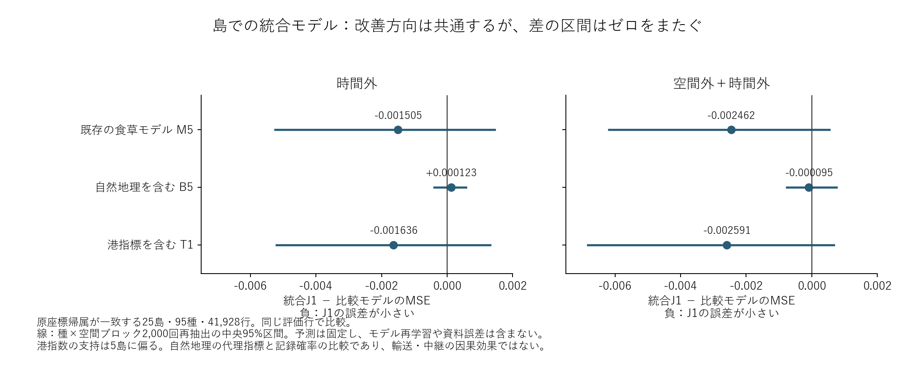

# 自然地理と港指標を合わせた追加比較

2026-10-30。肯定的な主結論である食草情報の予測価値と島間の食草・チョウ分布の対応を補足する、探索的な予測比較。候補225種、既存の評価対象155種・208,482行、RF設定、学習・評価期間を維持した。

## 時間外の結果

J1は、既存の食草・気候・土地利用等を含むM5に、過去記録からの距離・陸塊・海上区間・セル内地形と港の3指標を加えたモデル。

| 評価範囲 | J1対M5 | J1対自然地理を含むB5 | J1対港指標を含むT1 |
|---|---:|---:|---:|
| 全155種・208,482行 | −1.134% | +0.018% | −1.362% |
| 原座標帰属が一致する25島・41,928行 | +6.800% | −0.600% | +7.352% |
| 英国・アイルランドを除く23島・3,305行 | +6.641% | −0.072% | +7.111% |

値は種等重みMSEの改善率。正が改善、負が悪化。島ではM5より低い誤差となったが、自然地理だけを追加したB5より良くなったわけではない。従って、島部分での差を港・人為輸送の効果とはしない。全体でもB5に対する追加差は約0.018%と小さい。

## 不確実性

既存の計画に沿って種と空間ブロックを交差して2,000回再抽出した。保存済み予測を固定した差の区間であり、モデル再学習・原資料・地理誤分類の不確実性は含まない。

島群のJ1−M5のMSE差は−0.001505、再抽出分布の中央95%区間は−0.005242〜+0.001449で、ゼロをまたいだ。英国・アイルランドを除いた島でも−0.001904（−0.005710〜+0.001343）だった。従って6.8%という点推定を、新たに確認された頑健な改善として主結果へ格上げしない。

全体のJ1−B5は−0.000006（−0.000277〜+0.000301）。今回集計した全9比較の区間はゼロをまたいだ。これは同等性の証明ではない。

## 検証と限界

同一行のM5・B5・T1予測と目標値を既存出力と完全一致で照合した。J1の特徴量集合は保存済みB5とT1の特徴量集合の和と完全一致し、重複なし。別集計の種等重みMSEは実行記録と一致した。種×ブロック集計の和から計算した差は、元の行単位からの種平均差と一致した。

海上区間は250 m以下の間隔で評価した直線的な候補経路であり、実際の移動経路や最小海峡幅ではない。地形はセル内DSMの標高・起伏で、越えた山脈ではない。港指数の支持は一部の島に偏り、2019年の港位置と現代の食草資料を使う遡及比較という限界も残る。

空間外の統合モデルと統合モデル自体の20記録日感度は下記のとおり完了した。これまでの港単独追加の感度分析と区別する。全体目標は継続中。

## 空間外の統合比較

同じ空間ブロックを学習から除き、時間も外した比較が完了した。全155種・208,482行ではJ1のM5に対する改善率は−1.873%、B5に対して−0.032%、T1に対して−1.528%だった。学習地点から100 km以上の102,728行でも、M5に対して−0.593%で、全体の追加的予測価値は確認できなかった。

一方、島25島・95種ではM5に対して+10.504%、B5に対して+0.453%、T1に対して+10.997%。英国・アイルランドを除く23島でもM5に対して+9.650%だった。島部分でのM5に対する改善方向は時間外と共通するが、自然地理を含むB5との差は小さい。

島のJ1−M5のMSE差は−0.002462、固定予測の再抽出中央95%区間は−0.006183〜+0.000535。英国・アイルランドを除いても−0.002866（−0.006653〜+0.000316）で、いずれもゼロをまたぐ。全12比較で区間はゼロをまたいだ。「複数の条件で改善方向が共通した」という記述にとどめ、独立な反復実験で確証を得たとはしない。

空間外でも参照モデルの全キー・目標・予測の一致、特徴量集合の和、独立誤差集計を確認した。3つの統合実行条件の支持を候補225種の表に反映した。主結果の食草・島の対応図と、この不確実性を含む補足図を分ける。

## 20記録日への標準化による感度

実行前に joint_effort20_lock.json を固定し、自然地理を含むB5と統合J1を20日条件で再学習した。M5とT1も同じ20日条件の保存済み予測を使用。全155種・159,084行で、J1のM5に対する改善率は+0.989%、B5に対して+0.421%、T1に対して+1.241%だった。

島19島・93種・35,167行ではM5に対して+10.684%、B5に対して−0.248%。英国・アイルランドを除く17島・92種・2,716行では、M5に対して+7.775%、B5に対して+0.289%。島では既存の食草モデルより誤差が小さいという点推定の方向が20日条件でも残るが、自然地理を含むB5への港追加の差は小さい。

種×空間ブロック2,000回の固定予測再抽出では、全体のJ1−M5は−0.000404（−0.003578〜+0.002290）、島は−0.002772（−0.011357〜+0.004499）だった。全9比較の区間がゼロをまたいだ。主解析と応答指標・対象行が違うため、10日と20日の改善率の大小を頑健性の強さとして順位付けしない。

20日応答は全支持行で超幾何確率を再計算し、既存M5/T1の全行のキー・目標・予測と一致。B5/J1の特徴量集合も既存モデルと照合し、種平均誤差を独立に再集計して一致した。統合モデルの最大提供者除外や位置精度感度まで検証したという意味ではない。
