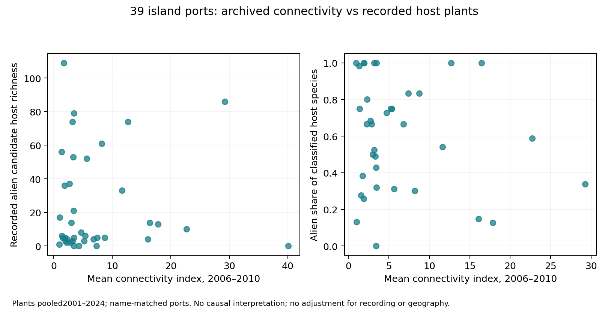

# 港の接続性と外来食草記録：マクロ相関の初回比較

2026-10-30。UNCTAD PLSCIの2006–2010年平均と、既存港域の2001–2024年植物記録を比較した。候補225種の食草ネットワークを維持し、距離帯取得・対照地点マッチングは追加していない。

## 結果

| 対象 | 外来候補食草種数とのSpearman相関 | 外来候補の割合との相関 |
|---|---:|---:|
| 植物検索完了の215港 | 0.047（215港） | 0.086（177港） |
| そのうち島に対応する39港 | **0.023（39港）** | −0.095（36港） |
| 27島への集約 | **0.027（27島）** | −0.158（25島） |

割合は外来候補種数÷（在来種数＋外来候補種数）。分類未解決の植物は分母に入れず、分母ゼロは欠測にした。種数ゼロは記録された対応がないという意味で、不在ではない。

今回の範囲では、接続性が高いほど外来食草が多いという単純な単調関係は確認できなかった。負の割合相関も小さく、接続性が外来食草を減らすという意味ではない。

## 対象と方法

既存WPIとアーカイブで国コード・正規化港名が両方一意に一致する候補から、2006–2010年の20四半期中16以上の指数があり、植物検索が完了した215港を使用。単一陸塊かつ単一島に検索域が交差する39港・27島を別集計した。39港の名称と国の一覧を点検し、明示的な異名の自動統合はしなかった。ただしアーカイブに座標がなく、港湾複合体を含む地理的同一性の独立確認は未完了である。

島の集約では、対象港の接続性指数の最大値を用い、食草は植物種の和集合とした。同じ植物の地域分類が港間で食い違う場合は外来候補・在来のどちらにも確定しない。指数を合計して輸送量とは呼ばない。

島の対象港に記録された外来食草候補は、225種中159種のチョウとカタログ上で対応した。これは解析対象との接続被覆であり、それら159種の分布拡大が説明されたという意味ではない。

## 解釈の範囲

指数はコンテナ定期船の接続性で、貨物量・植物持ち込み数・客船やフェリーの往来・港間の実際の航路ではない。食草の園芸・農業導入はこの指数と直接対応しない可能性もある。今回は植物種数・割合との単純相関を先に確認した結果であり、観測量、植物分類の地域差、気候、生物地理を調整していない。

植物記録は2001–2024年集約で、2006–2010年の接続性を用いた植物導入の将来予測ではない。港名の一致候補を使用した探索的な比較であり、港の因果効果や輸送の否定を主張しない。通常の独立港を仮定したp値も示さない。

前段の「港の食草が似る島ではチョウ相も似る」「実際の食草対応が置換より高い」という結果とは別の段階である。今回の結果から、その関連を接続性の強さによる外来食草の増加へ直接結びつけることはできない。

## 検証と出典

215港の外来候補種数・在来種数を既存集計と全件照合し、6相関を順位のPearson相関で再計算した。225種の採否を保存し、図を確認した。検証PASS。出典の版・取得経路は`port_connectivity_archive_audit.json`に記録したUNCTAD/DBnomicsの2021年版。原観測値・詳細港行は利用条件の直接確認までローカルに保持し、PRには集計・図・監査・コードを同期する。
