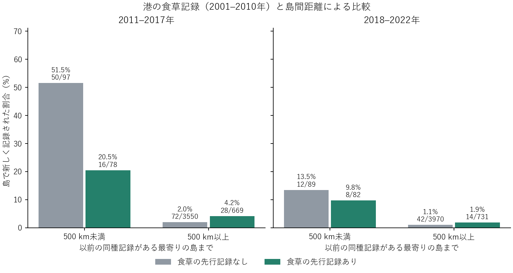

# 港での食草の先行記録、既知の同種分布からの距離、その後の島での初記録

過去の同種記録がある島から近いほど、その後に当該種が初めて記録された割合が高かった。遠方群では、港にその種の幼虫食草の記録がある場合の初記録割合が両期間とも高かった。近傍群では逆方向であり、近接性と食草記録の正の相乗効果は支持されなかった。

原母集団は225種×51島。公開GBIF再照会の種別・島別の3期間表を[固定コミット](https://github.com/zuizui0223/chocho/blob/3221899dcefa539d72a3751632577d29e4a6a2b7/data/exploratory/public51_butterfly_index_20261109/full51_225butterfly_period_index.csv)から取得。各評価期間の開始前に当該島で記録されず、51島内の別の島で同種が記録され、食草対応が既知で、対象島に過去の植物・チョウの記録がある種×島を比較した。194港すべての照会は完了し、基準期の港植物記録がゼロだった7島を除いた。比較対象は前期115種・44島・4,394組（初記録166）、後期130種・44島・4,872組（同76）。図の分母は種×島数。期間の長さと対象種が異なるため各期間内で比較する。

港の食草は両期共通の2001–2010年5 km港周辺の記録を島単位で集約し、当該種の既知食草を少なくとも1種記録した場合に「あり」とした。後期では、2011–2017年に初めて記録された食草は反映されない。同種分布は前期には2001–2010年、後期には2001–2017年の記録を使用。距離は各島の対象港を代表する座標間の大円距離の最小値。500 kmは可視化の作業上の区切りである。距離を連続量としても、期間×食草記録の4群で初記録との順位相関は−0.27〜−0.15だった。

各期間の線形確率モデルで種・島の固定効果を加えた。遠方群で食草記録ありとなしの調整割合差は前期＋3.8ポイント、後期＋1.9ポイント、近傍群では順に−25.9、−2.9ポイント。交互作用の種・島二方向クラスタ近似95%区間は前期−45.0〜−14.3ポイント、後期−15.4〜＋5.9ポイント。港の植物観測範囲、種ごとの記録されやすさ、期間内の観測努力、島内での食草とチョウの局所的一致には制約が残る。推論対象はこの港・観測条件を満たす島群における記録分布の変化であり、島全体の食草量、定着率、船による輸送は未識別。

英国・アイルランドを対象島から除く感度でも遠近と食草の差の向きは同じ。地域目録上の外来候補食草だけに絞った場合、近傍・食草ありの初記録は前期3/19、後期2/23で、標本が小さい。各条件の件数・調整結果は[割合表](recording_rates.csv)、[距離の順位相関](continuous_distance.csv)、[調整差](adjusted.csv)、[被覆表](coverage.csv)を参照。
