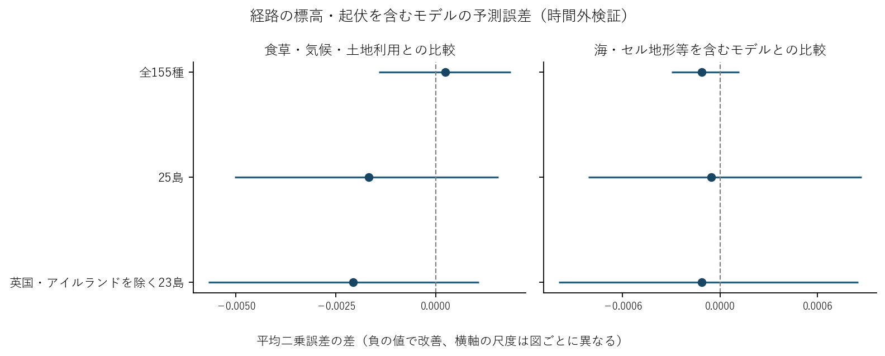

# 経路の標高・起伏とチョウの記録予測（時間外検証）

候補225種のうち適格155種を評価した。地形指標は予測時点以前の最近接記録と対象地点を結ぶ測地線上の地表高から算出した。指標の欠測は専用のフラグで保持した。

|対象|種数|評価行|比較対象|MSE改善率|MSE差の95%区間|
|---|---:|---:|---|---:|---|
|全155種|155|208,482|食草・気候・土地利用|-0.79%|[-0.001427, +0.001872]|
|25島|95|41,812|食草・気候・土地利用|+7.60%|[-0.005031, +0.001569]|
|英国・アイルランドを除く23島|95|3,248|食草・気候・土地利用|+7.23%|[-0.005693, +0.001072]|
|全155種|155|208,482|海・セル地形等を含むモデル|+0.36%|[-0.000296, +0.000120]|
|25島|95|41,812|海・セル地形等を含むモデル|+0.26%|[-0.000810, +0.000868]|
|英国・アイルランドを除く23島|95|3,248|海・セル地形等を含むモデル|+0.43%|[-0.000990, +0.000848]|

MSE差は経路地形を含むモデルの値から各比較対象の値を引いたもの。区間は固定した予測を種と空間ブロックの両方で2,000回再標本化して算出。島の行は各検証の予測のうち、対象島に属する行を集計した。

