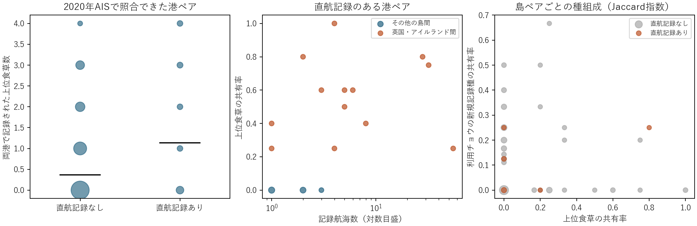

# 実航路・上位外来食草・チョウの新規記録

2020年AISの直接航海が記録された29港ペアのうち、上位外来食草が少なくとも1種共通したのは13ペア（44.8%）。13ペアはすべてグレートブリテン島とアイルランド島の間にあった。他の島間16港ペアでは共通種数は0だった。港ペア単位の正の相関には、この島間の違いが大きく影響する。

左の線は平均、丸の大きさは同じ値に重なったペア数を表す。中央は共有率を定義できた26直航港ペア。右は島内の照合港で植物記録をまとめ、島ペアを1回ずつ集計した。

|比較|ペア数|Spearman ρ|
|---|---:|---:|
|直航の記録有無と共通食草数（港ペア）|1,009|+0.096|
|直航の記録有無と食草共有率（港ペア）|894|+0.098|
|直航ペア内の記録航海数と食草共有率|26|+0.655|
|同じ比較をグレートブリテン島・アイルランド島間だけで実施|13|+0.091|
|食草共有率と利用チョウの新規記録種の共有率（島ペア）|155|−0.009|

比較範囲は既存51島のうち、植物検索が完了しAIS端点と照合できた21島49港。異なる島の1,009港ペアのうち、実航海を確認したのは9島間の12島ペア、29港ペア、180航海記録。直航記録ありでは共通食草数が平均1.14種、両端でAIS記録があり当該直航が資料内で未確認の980ペアでは0.37種。未確認ペアの実際の船舶交通は未知。英国・アイルランド間は154航海記録を占め、残りの直航ペアはすべて共通食草0種で、残りだけの航海数との相関は定義できない。

固定済み上位6種は Medicago sativa、Robinia pseudoacacia、Plantago lanceolata、Capsella bursa-pastoris、Hesperis matronalis、Malus domestica。外来候補は地域目録上で現代分布に含まれ在来リストに含まれない港周辺の植物記録。直航ペアでの共有は Capsella 12、Medicago 9、Malus 9、Hesperis 3ペア。港周辺の取得範囲・照合距離は既存5 km設定。異なる港ペアが同じ島や航路系統を共有するため、独立標本の有意確率は算出しなかった。観測努力や港の規模の差は残る。

チョウは上位6種のいずれかに既知の食草関係を持つ候補38種に固定し、2001年以降の元座標記録から島で初めて記録された年が2011–2022年に入る種を集計。Jaccard指数は共通種数／どちらかで記録された種数とし、両側とも空なら欠測。2021–2022年だけでは比較可能な47島ペアすべてで新規チョウの共有率が0。食草・チョウの双方を種名まで照合すると、直航港ペアでの一致は Medicago sativa と Issoria lathonia の9ペアで、すべて同じ2島の同じチョウ記録（2011年と2019年）を共有する。局所的な食草利用・船舶移入・定着年は未識別。

航海原典は[2020年AIS資料](https://doi.org/10.5281/zenodo.10783698)。既存の[港間照合](https://github.com/zuizui0223/chocho/pull/117)を固定コミットから読み、取得済みの植物・チョウの原解析表を結合した。[港ペア表](port_pairs.csv)・[島ペア表](island_pairs.csv)・[相関と1島ずつ除外した感度](correlations.csv)・[再計算コード](analyze.py)
