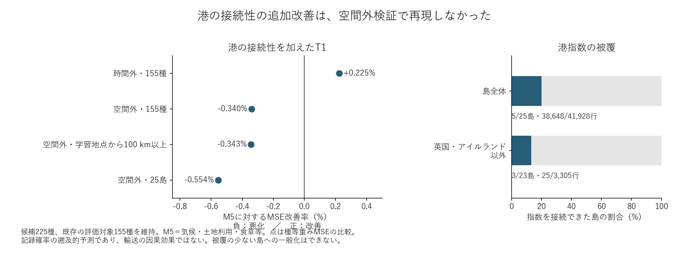

# 港接続性の追加価値：空間外検証

2026-10-30。候補225種、元の評価対象155種・208,482行を維持し、既存の5空間ブロック分割で検証した。各評価ブロックを学習から除き、2011–2014年から2015–2018年への変化で学習し、2015–2018年から2019–2022年を予測する。したがって空間と時間の両方を外した比較である。

| 評価範囲 | T0：港距離・不明フラグ追加 | T1：さらに港接続性を追加 |
|---|---:|---:|
| 全155種 | −0.217% | −0.340% |
| 学習地点から100 km以上・102,728行 | −0.185% | −0.343% |
| 原座標帰属が一致する25島・41,928行 | −0.098% | −0.554% |
| 島かつ100 km以上・21,153行 | +0.084% | −0.514% |

数値は既存の気候・土地利用・食草モデルM5に対する種等重みMSE改善率。正が改善、負が悪化。全体のMSEはM5=0.031358648、T0=0.031426752、T1=0.031465217。T1はT0に対しても0.122%悪化した。

時間外比較の全体+0.225%という小さな改善は、空間外では再現しなかった。全体では155種中82種が改善したが、誤差増減の大きさを含む平均は悪化した。1種ずつ除いても−0.403〜−0.180%と悪化方向が残った。この範囲は影響診断で、信頼区間ではない。

## 島への一般化の限界

港指数が既知の島だけならT1はM5より0.719%改善する一方、T0は1.489%改善しており、接続性指数を加えることで改善が大きくなったわけではない。この部分集計は被覆を確認した後の探索的診断である。

指数を接続できた島は25島中5島で、38,648行中38,623行を英国・アイルランドが占める。両島を除いた指数既知群は3島・3セル・25行にすぎない。その部分のT1改善率+8.408%を全球の島へ一般化しない。指数不明は港や輸送の不在を意味しない。

今回の結果は、この港指標・対応範囲・モデルで追加的な空間外予測価値が確認できなかったことを示す。船による移入や島の中継機能を否定する検証ではない。現代の港位置・食草リストを使う遡及比較であり、真の到来・定着・因果効果を予測したものではない。港食草51島の組成比較とは対象も問いも異なる。

## 検証

全行の種キー・セル・目標値・M5予測値が元の空間外出力と一致。別計算の種等重みMSEがモデル実行記録と一致した。分割ごとに学習と評価の空間ブロックの非重複を確認し、学習セルまでの距離を計算した。100 km以上は元の目的で指定された追加評価であり、島・指数既知などの部分集計は別モデルを再学習した結果ではない。

種外検証は実行中。輸送指標を追加した観測努力感度、自然地理と輸送を組み合わせた比較などは未完了で、全体目標は継続する。
