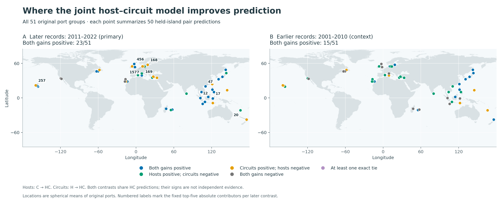
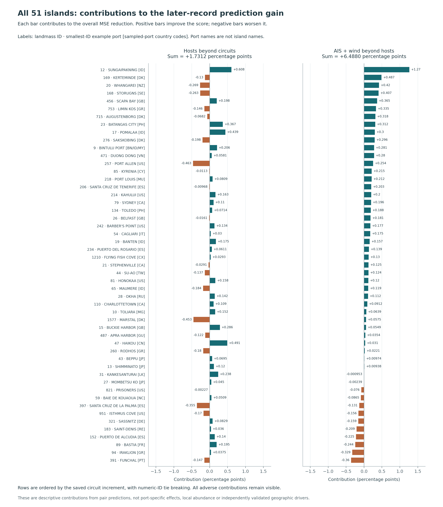

# Where the fixed host–circuit prediction gains occur

## Result and status

**For the later butterfly response, the joint model has lower mean squared error than both conditional alternatives on 23 of the original 51 islands.** Hosts improve prediction beyond the circuit model on 31 islands, while native AIS and wind circuits improve prediction beyond the host model on 39. The two comparisons improve on different subsets: 8 islands have only a positive host increment, 16 only a positive circuit increment, and 4 worsen in both comparisons. Every island, including every adverse contribution, remains in this atlas.

The positive contributions are distributed across multiple islands. The five largest positive contributors account for **43.09% of the gross host gain** and **34.78% of the gross circuit gain**; reaching half of those positive masses requires **7 and 10 islands**, respectively. Adverse contributions cancel part of each positive mass, leaving the previously reported net MSE reductions of **1.7312%** and **6.4880%**. These are accounts of the saved prediction errors, not new geographic-driver tests.

This completed descriptive extension uses [PR128](https://github.com/zuizui0223/chocho/pull/128), parent commit `17a4768cbb6cddf249449bd67e3ea1124e0db2f5`. The [protocol](PROTOCOL.md), [implementation plan](IMPLEMENTATION_PLAN.md), and [input lock](input_lock.json) were fixed at **2026-11-06 12:59:35 UTC**, before calculating the atlas. The parent outcomes were already known. No models, circuits, responses, species membership, or geographic population were refitted or changed.



## 1. What an island's gain means

The [parent analysis](../island51_host_circuit_joint_20261106/README.md) predicts butterfly Jaccard similarity for **1,275 unordered pairs among 51 islands**. For each held-out island, it trains on 1,225 pairs among the other 50 islands and evaluates its 50 incident pairs. Thus a point on this map summarizes 50 pair predictions. Each pair has two endpoint-specific predictions, and prediction loss is calculated before averaging. Neither a point nor its example port represents a measured local butterfly abundance or a port-specific ecological effect.

The common geographic reference G includes log1p of original distance and its square, original port-count controls, a uniform-ocean circuit term, and—for the later response only—earlier butterfly similarity. H adds candidate-host Jaccard to G; C adds native AIS and wind circuit fields to G; HC includes both additions. I adds the two previously specified host × signed-connectivity terms. All five comparisons, both responses, and all **510 comparison-fold records** are preserved in [island_gain_decomposition.csv](island_gain_decomposition.csv).

The primary contrasts are:

| Contrast | Question | Later reference MSE | Joint MSE | Later MSE reduction |
|---|---|---:|---:|---:|
| C → HC | Do hosts add prediction information beyond circuits? | 0.0060002266 | 0.0058963529 | +1.7312% |
| H → HC | Do AIS + wind add information beyond hosts? | 0.0063054522 | 0.0058963529 | +6.4880% |

These contrasts share exactly the same HC predictions. “Both positive” means HC beats both alternatives for that fold; it is not two independent confirmations. The 51 folds also share training data and pair endpoints. Counts and ranks are descriptive, with no independent-fold confidence intervals or p-values.

### Complete conditional sign counts

| Island's MSE signs | Later: first indexed 2011–2022 | Earlier: 2001–2010 context |
|---|---:|---:|
| Both conditional gains positive | **23** | **15** |
| Host positive; circuit negative | 8 | 18 |
| Host negative; circuit positive | 16 | 7 |
| Both negative | 4 | 11 |
| At least one exact tie | 0 | 0 |
| Total retained | 51 | 51 |

The four later islands with both negative gains are IDs **391, 397, 821, and 951**. All underlying reference errors, gains, percentages, and metric-specific signs appear in [island_conditional_status.csv](island_conditional_status.csv).

MAE provides a separate check on error behavior. For later records, mean MAE decreases by **1.4752%** when adding hosts and **4.5286%** when adding circuits. Both MAE increments are positive on **29 islands**, compared with 23 for MSE. Host MSE/MAE signs disagree on 6 later islands, and circuit signs disagree on 5. The map retains its frozen MSE classification; MAE disagreements are not suppressed or used to relabel islands.

## 2. How improvement and worsening combine

For island i, define gain as reference MSE minus augmented MSE. Positive values reduce error. Its contribution to the global percentage reduction is `100 × gain_i / sum(all 51 reference MSEs)`, in **percentage points (pp)**. The 51 contributions add to the parent's global percentage reduction. The ordinary average of island-relative percentages would be a different quantity and is not used.

| Response and contrast | Gross positive contribution | Gross adverse contribution | Net global reduction | Improved / worse |
|---|---:|---:|---:|---:|
| Later, hosts beyond circuits | +5.0829 pp | −3.3517 pp | **+1.7312%** | 31 / 20 |
| Later, circuits beyond hosts | +8.4658 pp | −1.9778 pp | **+6.4880%** | 39 / 12 |
| Earlier, hosts beyond circuits | +9.5442 pp | −4.2492 pp | +5.2950% | 33 / 18 |
| Earlier, circuits beyond hosts | +0.4172 pp | −1.7511 pp | −1.3339% | 22 / 29 |

Each row uses its own reference-loss denominator. Contributions within a row are additive; percentages from different contrasts must not be added. In the later response, the circuit increment is positive on more islands and loses less of its gross positive contribution to adverse folds. This describes the represented model comparison, not a larger causal role for shipping or wind.

### Fixed concentration summaries

Positive shares divide by the sum of positive gains; adverse shares divide by the sum of worsening magnitudes. Neither uses the signed net gain as a denominator. Rankings use ascending numeric island ID to break exact ties. The fixed top-1, top-3, and top-5 summaries are:

| Later contrast and mass | Top 1 share | Top 3 share | Top 5 share | Contributors reaching 50% |
|---|---:|---:|---:|---:|
| Hosts: positive gain | 11.97% | 30.25% | **43.09%** | **7** |
| Hosts: adverse loss | 13.81% | 37.92% | 53.80% | 5 |
| Circuits: positive gain | 14.96% | 25.66% | **34.78%** | **10** |
| Circuits: adverse loss | 18.21% | 47.20% | 69.11% | 4 |

No single island supplies most of either positive mass, and the top five together supply less than half. This does not establish that a refitted model would retain its score after removing those islands: no island-deletion experiment was performed. All ten response/contrast combinations, both MSE and MAE mass decompositions, ranked positive/adverse IDs, and exact fractions are in [gain_concentration_summary.csv](gain_concentration_summary.csv).

The earlier response gives different temporal context. Circuit information conditional on hosts worsens both MSE (**−1.3339% gain**) and MAE (**−0.6946% gain**). Its largest adverse island accounts for **43.37%** of gross worsening, and two islands reach half of that adverse mass. Earlier communities are not a null expected to be unrelated to modern geography. This contrast does not verify a temporal transport mechanism or arrival history. The parent's small and mixed interaction result also remains secondary; it is preserved in the ten-row summary and not promoted by this atlas.

## 3. Source-backed locations and example ports

The geographic joins retain **51 islands, all 194 original biological ports, and 182 marine-qualified ports**. Representative coordinates are the spherical means of **all original ports in each group**, including marine-excluded ports. They are neither island polygon centroids nor means of snapped marine terminals. All 12 marine exclusions remain in [original_port_geography.csv](original_port_geography.csv), with absent marine fields left blank.

Source identity is joined by WPI `OBJECTID`, never by feature order or port name. [island_geography.csv](island_geography.csv) records every original port ID/name, the sampled-port country-code set, original/marine counts, unique terminal-node counts, and the canonical landmass ID. Example ports are chosen by the smallest numeric OBJECTID, before gains are joined. Port names below label the original source group; they are **not substituted island names**. Country codes refer to sampled port records and do not assert complete political coverage of an island.

The following nine groups are exactly the frozen map-label selection: the union of the five largest **absolute** later contributions from each primary contrast. The selection includes adverse contributions.

| Landmass ID | Example source port | Sampled country codes | Original / marine ports | Host contribution | Circuit contribution |
|---|---|---|---:|---:|---:|
| 12 | SUNGAIPAKNING | ID | 5 / 4 | +0.6082 pp | +1.2664 pp |
| 17 | POMALAA | ID | 5 / 5 | +0.4389 pp | +0.2999 pp |
| 20 | WHANGAREI | NZ | 2 / 2 | −0.2688 pp | +0.4195 pp |
| 47 | HAIKOU | CN | 1 / 1 | +0.4906 pp | +0.0310 pp |
| 168 | STORUGNS | SE | 2 / 2 | −0.2633 pp | +0.4069 pp |
| 169 | KERTEMINDE | DK | 2 / 2 | −0.1298 pp | +0.4868 pp |
| 257 | PORT ALLEN | US | 3 / 3 | −0.4630 pp | +0.2539 pp |
| 456 | SCAPA BAY | GB | 1 / 1 | +0.1977 pp | +0.3648 pp |
| 1577 | MARSTAL | DK | 1 / 1 | −0.4535 pp | +0.0575 pp |

ID 12 is the largest positive contributor to both contrasts. In contrast, IDs 20, 168, and 169 have substantial positive circuit increments but negative host increments. IDs 257 and 1577 are the largest adverse host contributors while retaining positive circuit increments. These patterns make the aggregate cancellation concrete without assigning a mechanism to the example ports.

The complete figure below retains all 51 groups in the same order in both panels, ordered by the saved circuit contribution. Its common horizontal scale shows additive global contributions, not island-relative percentages. Baseline losses and per-island relative gains remain available in the CSV tables, since a larger absolute gain can reflect a larger initial error.



The source reconstruction predates this atlas. The archived [coordinate recovery](../../data/exploratory/island51_observed_ocean_20261106/coordinates/island51_original_WPI_ports_coords_unique_source.json), [WPI2019 features](../../data/exploratory/island51_observed_ocean_20261106/wpi/ports_2019_source.geojson), [194-port attachment audit](../island51_observed_ocean_circuit_20261106/original194_port_attachment_audit.csv), and [source-preparation receipt](../island51_observed_ocean_circuit_20261106/source_preparation.json) remain the geographic authority. The original raw port-to-landmass crosswalk was not archived: 49 groups were geographically recovered, and IDs 12 and 26 were uniquely reconciled using the exact archived distances. The atlas preserves this recovered provenance; it does not turn it into an independently archived raw crosswalk.

The basemap is the 0.5° averaged land fraction derived from the frozen 0.0625° coastline-grid mask. It is a location aid and introduces no new island grouping, marine route, or circuit calculation. Nearby locations may overlap at global map scale; the complete labelled ranking and geographic table retain their distinct identities.

## 4. Interpretation boundary

The concrete extension is that later conditional predictive gains can now be located, checked against original ports, and separated into positive and adverse mass. The two information sources have overlapping but different geographic patterns. These results preserve the earlier positive host associations, global resource-opportunity findings, and circuit results under their original populations and estimands; see the [parent's evidence discussion](../island51_host_circuit_joint_20261106/README.md#relation-to-the-existing-positive-host-evidence).

Host inventories pool **2001–2024** and may postdate the later butterfly response. Candidate hosts do not establish local feeding, and first indexed butterfly records do not establish arrival, breeding, or colonization. The source population remains the original 225-species panel. Original port counts partly represent observation opportunity; host richness, climate, land use, and detailed provider/survey effort remain unresolved. Modern AIS and undirected wind-speed circuits do not identify bilateral shipping or directional flight paths. Spatial holdout does not remove these date, observation, and causal limitations.

No regressions against these geographic ranks, basin/region tests, outcome-selected thresholds, model selection, or refitting were added. The atlas is a descriptive post-hoc interpretation of already known predictions, with accounting rules frozen before its computation.

## 5. Verification and reproduction

The [summary runner](../../scripts/summarize_island51_host_circuit_atlas.py) verifies all **20 pinned inputs**, invokes the pinned parent's independent prediction auditor in memory without writing to the parent, and constructs the five tables. The fresh [parent audit](parent_prediction_audit.json) checks the original 25,500 predictions. [atlas_receipt.json](atlas_receipt.json) binds the source checks, implementation, output hashes, and complete summary identities.

The separately written [atlas verifier](verify_atlas.py) imports no summary-runner code and fits no models. Its [independent audit](independent_atlas_audit.json) reconstructs every field of all five tables: **51 geography rows, 194 ports, 510 gains, 102 statuses, and 10 concentration summaries**. Geographic/port tables agree exactly; reconstructed spherical means differ from archived representative coordinates by at most **2.84 × 10⁻¹⁴ degrees**. Parent global reductions reproduce within **3.31 × 10⁻¹⁴ pp**, below the fixed `1e-12` absolute/relative tolerance. Signs, ID ranks, half-mass counts, and source labels agree exactly. All **19 recorded parent scientific artifacts** remain byte-identical.

The runner's 26 synthetic tests cover accounting, undefined denominators, gross-mass concentration, exact signs, strict joins, dateline means, protected source paths, and importing the module without a `results/` directory. The independent verifier has 16 additional synthetic tests, including corrupted support and frozen-file tampering. Its tests are stored beside the results and invoked explicitly; the anonymous manuscript package retains its established boundary.

The fresh full-repository run plus the independent verifier tests passed **258 tests**, with one existing optional `netCDF4` wind-builder skip. A separate complete atlas run reproduced all **five CSVs, four PNG/SVG figures, and the figure receipt byte for byte**, and its independent audit passed. The actual anonymous snapshot passed **148 tests**, including all 26 new runner tests, with 31 inherited scope/dependency skips; its four manuscript figures regenerated as four PNGs and four PDFs. The existing source files remained unchanged throughout these checks.

Run from the repository root into a new output directory:

```bash
python -m pip install -e ".[test,figure]"
python -m pytest -q tests results/island51_host_circuit_atlas_20261106/test_verify_atlas.py
python scripts/summarize_island51_host_circuit_atlas.py --out-dir /tmp/chocho-island51-atlas
python results/island51_host_circuit_atlas_20261106/verify_atlas.py --results-dir /tmp/chocho-island51-atlas
python results/island51_host_circuit_atlas_20261106/render_atlas.py --results-dir /tmp/chocho-island51-atlas
```

The dedicated [workflow](../../.github/workflows/chocho-island51-host-circuit-atlas.yml) repeats the tests, parent audit, five-table calculation, independent reconstruction, and figure rendering, and archives the outputs with the actual Python environment. [figure_receipt.json](figure_receipt.json) binds both PNG/SVG figures to their exact inputs and lists every mapped and labelled ID. Completion evidence, including the fresh full-suite result, anonymous-package check, separate reproduction, and figure inspection, is recorded separately in [execution_verification.json](execution_verification.json), so the frozen design bytes remain unchanged.

Machine-readable results: [island geography](island_geography.csv), [original port geography](original_port_geography.csv), [all fold gains](island_gain_decomposition.csv), [conditional signs](island_conditional_status.csv), and [gross-mass concentration](gain_concentration_summary.csv). The SVG figures are [the two-target map](island_conditional_gain_maps.svg) and [all later-island contributions](all_island_later_gain_contributions.svg).
