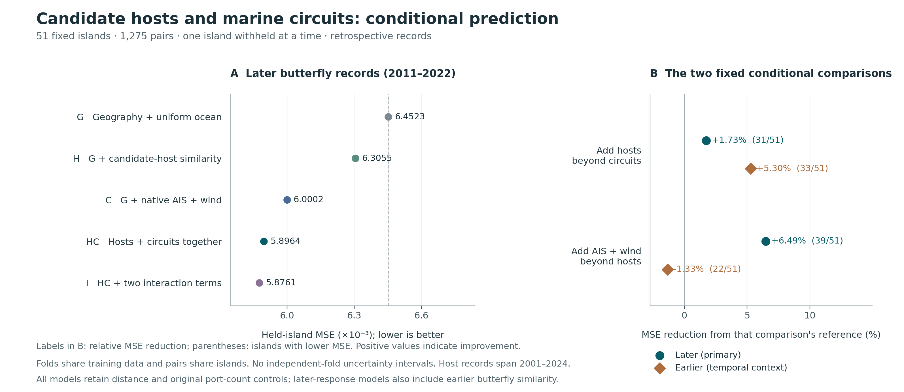

# Joint candidate-host and marine-circuit prediction

## Result and current status

**Both candidate-host similarity and the represented marine circuit fields retain additional predictive information for later butterfly-record similarity on the fixed 51 islands.** Adding hosts to the circuit model reduces held-island mean squared error (MSE) by **1.7312%**, with lower MSE on **31/51 islands**. Adding native AIS and wind circuits to the host model reduces MSE by **6.4880%**, with lower MSE on **39/51 islands**. Both comparisons also improve mean absolute error (MAE).

This is a completed **exploratory, retrospective extension** of [PR127](https://github.com/zuizui0223/chocho/pull/127), using the same population and previously inspected outcomes. The [protocol](PROTOCOL.md) and [input lock](input_lock.json) were fixed at **2026-11-06 12:10:44 UTC**, before these new joint fits. Earlier host and circuit results were already known. No independent new validation population or prospective forecast is claimed.

The fixed analysis retains **51 islands, 1,275 unique pairs, all 194 original ports for host inventories and port-count controls, and the previously qualified 182 marine circuit terminals**. It exports every one of the **25,500 endpoint-specific predictions**, all **510 model-fold losses**, all **510 comparison-fold records** and all **10 fixed comparison summaries**. The saved predictions independently reproduce the complete numerical result.



## The two primary comparisons

The primary response is the Jaccard similarity of butterflies first indexed on each island in **2011–2022** within the archived record history. The values below use the exact same 51 held-island folds.

| Fixed comparison | Reference MSE | Joint MSE | MSE reduction | Islands improved / worse / tied | Reference → joint MAE |
|---|---:|---:|---:|---:|---:|
| Hosts beyond circuits: C → HC | 0.0060002266 | 0.0058963529 | **+1.7312%** | **31 / 20 / 0** | 0.05413185 → 0.05333332 |
| AIS + wind beyond hosts: H → HC | 0.0063054522 | 0.0058963529 | **+6.4880%** | **39 / 12 / 0** | 0.05586313 → 0.05333332 |

These are conditional predictive increments within the fixed model specification. They do not identify independent causes or prove that plants or butterflies were transported along the represented marine routes. Port counts partly represent inventory opportunity, but host-list richness, climate, land use and provider or survey effort are not separately controlled.

The joint additive model HC has **8.6164% lower MSE than G**, the common geographic/uniform-ocean reference. This follows directly from their saved MSEs. Percentages from comparisons with different reference errors must not be added together.

## All five models and all fixed comparisons

Let B contain the original log1p great-circle distance, its square, the sum and absolute difference of log1p original port counts, and—for the later response only—earlier butterfly similarity. All models include an intercept. Each circuit feature is the previously used `log1p(R / median_positive_pair_R)`.

| Model | Predictors beyond B | Later MSE | Later MAE | Earlier MSE | Earlier MAE |
|---|---|---:|---:|---:|---:|
| G | Uniform-ocean circuit | 0.0064523063 | 0.05716343 | 0.0110049094 | 0.07072287 |
| H | G + original host Jaccard | 0.0063054522 | 0.05586313 | 0.0104139429 | 0.06789732 |
| C | G + native AIS + wind circuits | 0.0060002266 | 0.05413185 | 0.0111428717 | 0.07094181 |
| HC | G + hosts + native AIS + wind | 0.0058963529 | 0.05333332 | 0.0105528550 | 0.06836894 |
| I | HC + both host × signed-connectivity terms | 0.0058761453 | 0.05340324 | 0.0105659492 | 0.06711677 |

The earlier response covers **2001–2010** and is secondary temporal context. Its own Jaccard value is never included as its predictor. Host Jaccard is never a response in this joint analysis.

| Comparison | Role | Later MSE reduction | Later improved / worse | Earlier MSE reduction | Earlier improved / worse |
|---|---|---:|---:|---:|---:|
| G → H | Context: hosts beyond geographic reference | +2.2760% | 33 / 18 | +5.3700% | 34 / 17 |
| G → C | Context and prior-result reproduction | +7.0065% | 40 / 11 | −1.2536% | 26 / 25 |
| C → HC | **Primary: hosts beyond circuits** | **+1.7312%** | **31 / 20** | +5.2950% | 33 / 18 |
| H → HC | **Primary: circuits beyond hosts** | **+6.4880%** | **39 / 12** | −1.3339% | 22 / 29 |
| HC → I | Secondary: two interactions together | +0.3427% | 28 / 23 | −0.1241% | 27 / 24 |

There are no tied island MSEs in these comparisons. Positive percentages indicate lower augmented-model MSE; all adverse comparisons and folds are retained in [comparison_summary.csv](comparison_summary.csv) and [comparison_fold_losses.csv](comparison_fold_losses.csv).

**The interaction result is small and mixed across loss functions.** For later records its MSE improves by 0.3427%, while MAE worsens from 0.05333332 to 0.05340324. For earlier records its MSE worsens by 0.1241%, while MAE improves. This does not provide a clear interaction-specific result across metrics and does not establish a transport × resource mechanism. I remains the prespecified secondary model; no model is selected by these new scores.

The earlier-response pattern also differs from the later one: host similarity adds information conditional on circuits, but adding AIS and wind conditional on hosts increases earlier-response MSE by 1.3339%. Earlier communities are not a null that should be unrelated to modern geography, and the later/earlier difference is not evidence of verified arrivals or a causal temporal effect.

## What was held fixed and how prediction was evaluated

1. **Biological source and population.** Use the [original pair table](../../provenance/reviewer_defenses/results/island_host_network_20261030/island_host_network_pairs.csv) and [island roster](../../provenance/reviewer_defenses/results/island_host_network_20261030/island_host_network_islands.csv), including zero host similarities. The archived population comes from the original 225-species candidate panel; it is not silently replaced by the later manuscript's 239-species panel. Host inventories are unions of candidate introduced larval-host taxa across the original completed port queries. The 12 ports excluded from marine terminal attachment remain in the biological inventory and original port-count controls.
2. **Marine sources.** Reuse the exact uniform, wind and **direct-native AIS** resistance matrices from [the completed circuit analysis](../island51_observed_ocean_circuit_20261106/README.md). Native AIS was selected for its source-quality aggregation, with both prior AIS variants' results already known. The graph, terminal attachment, equal within-island distributed-port weights and official Circuitscape validation receipts remain unchanged. Port attachment is a geographic proximity criterion, not verification of a navigable harbor path; AIS density and undirected wind-speed circuits do not encode observed bilateral transport or directional trajectories. No circuit or external source is rebuilt in this extension.
3. **Features and fitting.** Use the existing ordinary-least-squares routine with training-only standardization, intercept and clipping to [0,1]. Host similarity is the original untransformed Jaccard. Signed connectivity for interaction construction is the negative circuit feature, so higher values mean relatively greater connectivity. Both host × AIS and host × wind terms enter together with all main effects. No response-derived species counts, matched-later-species host indicators, thresholds or outcome-selected transformations are added.
4. **Geographic holdout.** Exclude one island and all 50 incident pairs, train on the 1,225 pairs among the other 50 islands, and repeat for all 51 islands. Each unique pair has two separately retained predictions, one for each held-out endpoint. Calculate each prediction's loss first, then average within each island and across the 51 folds. Averaging the two endpoint predictions before calculating loss would evaluate a different ensemble and is not done here.
5. **Scope of transfer.** The held-out island's host inventory and geography are available predictors. The test concerns one unrepresented island paired with otherwise represented islands. It does not test two unseen islands, new butterfly species, independent new regions or islands without known resources. Folds share training data and pairs share endpoints; improved-island counts are descriptive. No independent-fold confidence intervals, error bars or pair-independent p-values are reported.

## Relation to the existing positive host evidence

The [original host-network audit](../../provenance/reviewer_defenses/results/island_host_network_20261030/island_host_network_audit.json) reports host versus later butterfly similarity **Spearman 0.299806**, host versus earlier similarity **0.417826**, and later partial rank association controlling distance and earlier similarity **0.215354**. Those are association results with a different estimand. The present conditional prediction comparison preserves them and adds a geographically held-out assessment under represented circuit controls.

The separate global resource-opportunity, host forecasting and shared-host correspondence analyses also retain their original populations and interpretations. They are summarized in the [existing host synthesis](../../provenance/reviewer_defenses/results/host_island_synthesis_20261030/port_host_forecast_connection_development_ja.md). This extension neither replaces the original Fig. 4 association specification nor upgrades it to causal evidence.

Host records pool **2001–2024**, potentially postdating the **2011–2022** butterfly target, while modern AIS and wind information also overlaps the biological record period. Candidate hosts are not verified local feeding observations, and first indexed records do not establish arrival, colonization or breeding. These date and observation limits persist despite island holdout. The predictive increments can reflect resource composition together with residual biogeography, climate, recording effort or observed list size; they do not isolate host identity from richness or establish resource mediation.

## Verification and reproducibility

[source_validation.json](source_validation.json) records successful verification of all **12 pinned inputs**, the frozen protocol and implementation plan, and the prior **16-file source bundle** before fitting. Original port counts and strict circuit matrix ID order, finiteness, symmetry, zero diagonal and positive off-diagonal values are also checked. Source hashes are rechecked after fitting.

[prior_circuit_reproduction.json](prior_circuit_reproduction.json) verifies the previous G/C result for **102 comparison-fold rows / 204 model-fold records** and both butterfly summaries. The maximum absolute numeric difference is **8.8818 × 10⁻¹⁶**, within the fixed absolute and relative tolerance of 10⁻¹². The earlier **+7.0065%** native-AIS/wind later-response improvement is therefore reproduced, not overwritten.

The separate [saved-prediction verifier](verify_saved_predictions.py) imports no joint-runner code and fits no models. It uses independent CSV parsing and aggregation to reconstruct all individual errors, 510 model-fold records, 510 comparison-fold records, 10 model summaries and 10 comparison summaries, while checking original observations, pair support and both endpoint holdouts. Its [audit receipt](independent_prediction_audit.json) contains the numerical and specification verdicts. Regression tests exercise target poisoning, matrix misalignment, changed source/protocol bytes, loss-before-endpoint-averaging, wrong comparison denominators, omitted adverse folds and strict tie definitions.

Run from the repository root into a separate output directory:

```bash
python -m pip install -e ".[test,analysis,figure]"
python -m pytest -q
python scripts/run_island51_host_circuit_joint.py --out-dir /tmp/chocho-island51-joint
python results/island51_host_circuit_joint_20261106/verify_saved_predictions.py --results-dir /tmp/chocho-island51-joint
python results/island51_host_circuit_joint_20261106/render_summary.py --results-dir /tmp/chocho-island51-joint
```

The scoped [GitHub workflow](../../.github/workflows/chocho-island51-host-circuit-joint.yml) runs the scientific regression tests, repeats the complete fixed analysis, independently reconstructs its losses, and archives predictions, receipts and the actual Python environment. The [run receipt](joint_run_receipt.json) records versions, implementation hashes, input hashes, output hashes, model feature membership and all interpretation limits. A [figure receipt](figure_receipt.json) binds the PNG/SVG to the exact saved numerical inputs.

The final local repository suite passed **216 tests**, with one inherited wind-builder test skipped for an unavailable optional dependency. A fresh complete run into a separate directory reproduced all five numerical output files, including the compressed individual predictions, **byte for byte**; its independent audit also passed. [execution_verification.json](execution_verification.json) records these checks and the independent specification/code reviews. The reused wind matrix is already frozen and validated, so this extension does not depend on running the skipped upstream data builder.

## Output index and continuation boundary

- [heldout_predictions.csv.gz](heldout_predictions.csv.gz): every endpoint-specific observed value, prediction and individual loss; deterministic gzip metadata.
- [model_fold_losses.csv](model_fold_losses.csv) and [model_summary.csv](model_summary.csv): all five models for both targets.
- [comparison_fold_losses.csv](comparison_fold_losses.csv) and [comparison_summary.csv](comparison_summary.csv): all fixed contrasts, including adverse values.
- [joint_host_circuit_summary.png](joint_host_circuit_summary.png) and [joint_host_circuit_summary.svg](joint_host_circuit_summary.svg): exact-data figure, with [renderer](render_summary.py).
- [PROTOCOL.md](PROTOCOL.md), [IMPLEMENTATION_PLAN.md](IMPLEMENTATION_PLAN.md) and [input_lock.json](input_lock.json): immutable pre-fit specification and original source identities. Completion is recorded separately so their frozen bytes remain unchanged.

This continuation completes the fixed conditional host/circuit comparison. Its concrete conclusion is additional retrospective predictive information from both represented resource composition and marine circuit fields for later records, with no identified transport mechanism. The original circuit/source outputs and manuscript analyses remain byte-identical to the parent revision.

### Anonymous manuscript export integration

The existing anonymous GEB review export deliberately omits root `results/` and exploratory island inputs. Its first remote run copied the two new joint-analysis test modules without that required context. The followup adds those two modules to the exporter's existing exclusion list; it changes neither test discovery in the complete repository nor the dedicated joint CI. The full repository still passes 216 tests, and all scientific code, source locks and numerical outputs remain unchanged. The failure, four-line packaging fix and verification evidence are recorded in [execution_verification.json](execution_verification.json).
